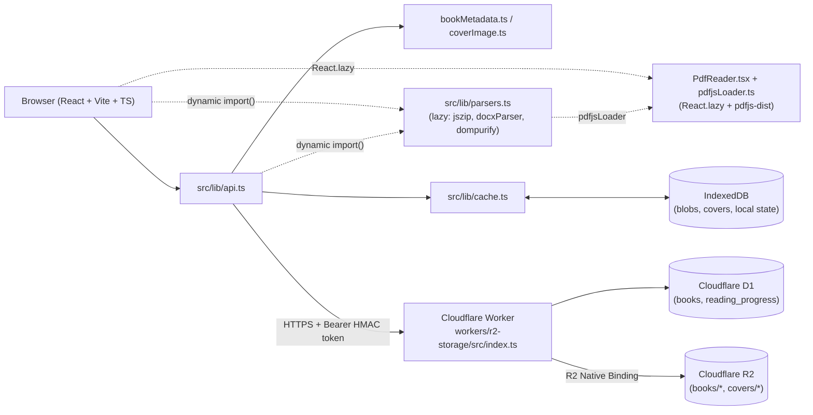

# Kiến trúc hệ thống — Arcane Library (`ofu.lol`)

## 1. Sơ đồ tổng thể

## 2. Bảng module

| File | Trách nhiệm | Export chính | Phụ thuộc vào |
|---|---|---|---|
| `src/types.ts` | Định nghĩa kiểu dữ liệu dùng chung (Book, Chapter, ParsedBook, Progress, Storage, ReaderSettings) | `Book`, `BookFileType`, `Chapter`, `ParsedBook`, `ReadingProgress`, `StorageStats`, `ShelfGroup`, `ReaderSettings`, `ViewMode` | — |
| `src/lib/cache.ts` | Lớp truy cập IndexedDB (`arcane-library-cache-v1`) lưu cache file sách/bìa và dữ liệu chế độ local | `getCachedBookBlob`, `setCachedBookBlob`, `deleteCachedBookBlob`, `getCachedCoverBlob`, `setCachedCoverBlob`, `deleteCachedCoverBlob`, `getLocalBooks`, `putLocalBook`, `deleteLocalBook`, `getAllLocalProgress`, `putLocalProgress`, `deleteLocalProgress` | `src/types.ts`, IndexedDB API |
| `src/lib/shelfPlacement.ts` | Quy tắc phân bổ kệ thông minh: nhận diện tên bộ truyện (kể cả `SAO1`, `SAOP1`, `SAO (01)`, `SAO v01`), phát hiện kệ gốc chung cho cả lô tải lên (`inferBatchCommonShelf`), tác phẩm lẻ đứng kệ riêng và tự động gom chung về kệ tác giả khi có từ 2 tác phẩm lẻ cùng tác giả | `extractSeriesName`, `isKnownAuthor`, `inferBatchCommonShelf`, `inferSingleBookShelf`, `resolveUploadShelfPlan`, `resolvePreviewShelfName` | `src/types.ts` |
| `src/lib/epubChapters.ts` | Chuẩn hoá danh sách chương EPUB: gom toàn bộ ảnh minh hoạ đầu sách (trước Khúc dạo đầu / Mục lục / Mở đầu / Chương X...) thành 1 mục duy nhất `Minh họa`; tích hợp liền mạch ảnh minh hoạ giữa chương và các tệp nối tiếp vào ngay trong chương hiện tại (không tách nhỏ chương trước khi tới chương tiếp theo) | `buildEpubChapters`, `RawEpubSection` | `src/types.ts` |
| `src/lib/bookMetadata.ts` | Hàm thuần trích xuất & chuẩn hoá metadata sách từ tên file (không phụ thuộc Canvas hay thư viện parse) | `pickCoverColor`, `inferShelfName`, `parseFileMetadata`, `bookDuplicateKey` | `src/types.ts`, `src/lib/shelfPlacement.ts` |
| `src/lib/coverImage.ts` | Crop tâm & nén ảnh bìa bằng Canvas về JPEG nhẹ `480×720` (~40 KB), tự giải phóng `ImageBitmap`, hỗ trợ tuỳ chọn `rejectBlankOrTiny` lọc bỏ ảnh quá nhỏ hoặc ảnh đơn sắc/trắng trơn | `compressCoverBlob`, `CompressCoverOptions` | Canvas / `createImageBitmap` |
| `src/lib/chunkReload.ts` | Phát hiện lỗi tải chunk động sau deploy (`404`) và tự tải lại trang tối đa 1 lần qua `sessionStorage` để chặn lặp vô hạn (không reload khi `navigator.onLine === false`) | `isChunkLoadError`, `reloadOnceForStaleChunk`, `recoverFromChunkError` | `sessionStorage`, `navigator.onLine` |
| `src/lib/pdfjsLoader.ts` | Nạp lười `pdfjs-dist` (cache promise, tự reset & xử lý chunk cũ khi lỗi), cấu hình `GlobalWorkerOptions.workerSrc` và `pdfWasmUrl` | `loadPdfJs`, `pdfWasmUrl` | `pdfjs-dist` (dynamic), `src/lib/chunkReload.ts` |
| `src/lib/sanitizeHtml.ts` | Làm sạch HTML sách EPUB/DOCX bằng `DOMPurify` v3 trước khi render (`dangerouslySetInnerHTML`), chạy trước bước đổi ảnh sang `blob:` URL | `sanitizeBookDocument` | `dompurify` |
| `src/lib/docxXml.ts` | Hàm thuần đọc siêu dữ liệu OOXML của tệp `.docx` (relationships, styles/heading, numbering `ul`/`ol`, trích `rId` ảnh bỏ qua nhánh trùng `mc:AlternateContent`, thu thập ứng viên bìa ưu tiên thứ tự xuất hiện trong `word/document.xml` → `word/media/*` → `docProps/thumbnail.*`) | `DocxRel`, `StyleMeta`, `RASTER_IMAGE_EXT_RE`, `RENDERABLE_IMAGE_EXT_RE`, `escapeHtml`, `getAttr`, `findDirectChild`, `resolveDocxPath`, `guessImageMimeType`, `parseRelationships`, `parseStyles`, `parseNumberingKinds`, `resolveHeadingFromStyle`, `isToggleFlagEnabled`, `findImageRelIds`, `collectDocxCoverCandidates` | `jszip` (type-only) |
| `src/lib/docxParser.ts` | Trích ảnh bìa DOCX (duyệt ứng viên theo thứ tự `word/document.xml` → `word/media/*` → `docProps/thumbnail.*`, tự bỏ qua ảnh trắng trơn/icon quá nhỏ) và parse `word/document.xml` thành `ParsedBook` reflowable (giữ định dạng chữ, danh sách, bảng, ảnh `blob:` URL có `dispose()`, tự tách chương theo Heading 1/2 hoặc tiêu đề `Chương X`) | `extractDocxCover`, `parseDocxZip` | `jszip` (type-only), `src/types.ts`, `src/lib/coverImage.ts`, `src/lib/docxXml.ts`, `src/lib/sanitizeHtml.ts` |
| `src/lib/parsers.ts` | Nạp lười `jszip` và `pdfjs-dist` (qua `pdfjsLoader`); tải trước `jszip` khi trình duyệt rảnh (`preloadCoreReaders`); trích ảnh bìa lúc upload và parse EPUB/PDF/DOCX thành `ParsedBook` kèm `dispose()` | `preloadCoreReaders`, `extractCoverAtUpload`, `parseBookBlob` | `jszip` (dynamic), `src/types.ts`, `src/lib/chunkReload.ts`, `src/lib/coverImage.ts`, `src/lib/docxParser.ts`, `src/lib/epubChapters.ts`, `src/lib/pdfjsLoader.ts`, `src/lib/sanitizeHtml.ts` |
| `src/lib/readerConfig.ts` | Cấu hình trình đọc: 4 bảng màu đọc (`paper`/`sepia`/`dark`/`midnight`), font/width map, lưu & nạp `ReaderSettings` trong `localStorage` | `DEFAULT_READER_SETTINGS`, `READER_THEME_STYLES`, `READER_FONT_CLASS`, `READER_WIDTH_MAX`, `loadReaderSettings`, `saveReaderSettings`, `ReaderThemePalette` | `src/types.ts`, `localStorage` |
| `src/lib/api.ts` | Giao tiếp HTTP với Worker, quản lý token, bảo vệ D-005 (chặn Local-First trên production), giới hạn 9.0 GiB, cache-first blob/cover, đồng bộ tiến độ đọc & chuyển kệ hàng loạt | `HARD_LIMIT_BYTES`, `MAX_SHELF_NAME_LENGTH`, `isMissingProductionApi`, `isLocalDevMode`, `isCloudMode`, `getAuthToken`, `setAuthToken`, `formatBytes`, `sortBooksByTitle`, `groupBooksIntoShelves`, `isAuthError`, `checkHealth`, `loginWithPasscode`, `fetchLibraryState`, `uploadBook`, `updateBookMetadata`, `updateBookCover`, `renameShelfAll`, `bulkUpdateBooksShelf`, `deleteBooks`, `fetchBookBlobCached`, `fetchCoverBlobCached`, `saveReadingProgress`, `clearReadingProgress` | `src/types.ts`, `src/lib/bookMetadata.ts`, `src/lib/cache.ts`, `src/lib/chunkReload.ts`, `src/lib/coverImage.ts`, `src/lib/parsers.ts` (dynamic) |
| `src/hooks/useTheme.ts` | Quản lý 3 chế độ màu (`light` Ban ngày `#f6f1e7` → `dim` Chiều tối `#0d1117` + gradient sương nhẹ → `midnight` Đêm khuya `#060608`) lưu `localStorage`, hỗ trợ View Transitions API & `meta[name="theme-color"]` | `useTheme`, `AppTheme`, `THEME_ORDER`, `THEME_LABELS`, `getNextTheme` | React, `localStorage` |
| `src/hooks/useCanUse3D.ts` | Ranh giới thiết bị D-008: kiểm tra tuần tự `min-width: 1024px`, `(hover: hover) and (pointer: fine)`, lazy probe WebGL `{ failIfMajorPerformanceCaveat: true }` (cache cấp module, giải phóng ngay context test), `prefers-reduced-motion: reduce`, lưu/đồng bộ đa tab `localStorage` (`ofu-library-view-mode`), debounce resize `200ms`, cờ chịu lỗi phiên (`session3DFailed`, `retryKey`) | `VIEW_MODE_STORAGE_KEY`, `CanUse3DState`, `useCanUse3D` | React, `src/types.ts`, `localStorage`, `matchMedia`, WebGL API |
| `src/hooks/useLibraryViewState.ts` | Quản lý state giao diện thư viện dùng chung cho cả 2D và 3D (`searchQuery`, `activeShelfKey`, `selectionMode`, `selectedIds`, `allShelves`, `continueReadingBooks`, `filteredBooks`, `visibleShelves`, `selectedBooks`) | `normalizeSearchText`, `LibraryViewState`, `useLibraryViewState` | React, `src/types.ts`, `src/lib/api.ts` |
| `src/hooks/useBookReader.ts` | Quản lý luồng mở/đóng sách (`fetchBookBlobCached` + dynamic `parseBookBlob`), chống rò rỉ `ObjectURL` (request ID + `dispose()` khi đóng/đổi/unmount), lưu `ReaderSettings` & `saveReadingProgress` | `useBookReader` | React, `src/types.ts`, `src/lib/api.ts`, `src/lib/chunkReload.ts`, `src/lib/parsers.ts` (dynamic), `src/lib/readerConfig.ts` |
| `src/hooks/useCoverUrl.ts` | Tải ảnh bìa từ IndexedDB/R2 qua `fetchCoverBlobCached`, tạo & thu hồi `URL.revokeObjectURL` đúng vòng đời | `useCoverUrl` | React, `src/lib/api.ts` |
| `src/hooks/useToast.ts` | Hook quản lý hàng đợi thông báo Toast tự tắt kèm dọn sạch timer khi unmount | `useToast`, `ToastItem`, `ToastType` | React |
| `src/components/ThemeToggle.tsx` | Nút xoay vòng 3 chế độ (`Sun` → `Moon` → `MoonStar`) kiểu Cyanodex dùng chung cho `AuthGate` và `LibraryHeader` | `ThemeToggle` | `lucide-react`, `src/hooks/useTheme.ts` |
| `src/components/ViewModeToggle.tsx` | Công tắc chuyển đổi `2D` / `3D` trên `LibraryHeader`, chỉ render khi `canUse3D === true` (D-008) | `ViewModeToggle` | `lucide-react`, `src/types.ts` |
| `src/components/ErrorBoundary.tsx` | React Error Boundary chống trắng trang, nhận prop tuỳ chọn `fallback?: ReactNode \| ((errorMessage: string) => ReactNode)` (boundary gốc ở `main.tsx` giữ fallback mặc định), tự gọi `recoverFromChunkError(error)` trong `componentDidCatch` | `ErrorBoundary` | `lucide-react`, `src/lib/chunkReload.ts` |
| `src/components/ToastContainer.tsx` | Hiển thị stack thông báo không chặn UI góc dưới-phải, đồng bộ màu Sáng/Tối | `ToastContainer` | `lucide-react`, `src/hooks/useToast.ts` |
| `src/components/AuthGate.tsx` | Màn hình kiểm tra kết nối Worker, đăng nhập 1 passcode (D-003), báo lỗi thiếu `VITE_API_URL` (D-005), hỗ trợ đổi Sáng/Tối | `AuthGate` | `lucide-react`, `src/lib/api.ts` |
| `src/components/BookCard.tsx` | Thẻ sách 2D (dọc/ngang): bìa tỉ lệ `3/4` (ảnh lazy qua `IntersectionObserver` + `useCoverUrl` hoặc bìa vải cổ điển fallback), thanh tiến độ %, badge định dạng, chế độ chọn nhiều | `BookCard` | `lucide-react`, `src/types.ts`, `src/hooks/useCoverUrl.ts` |
| `src/components/LibraryHeader.tsx` | Header thương hiệu **Ofu's Library**: thanh dung lượng `usedBytes / limitBytes` (`formatBytes`), công tắc `ViewModeToggle` (khi `canUse3D`), chuyển Sáng/Tối, upload, chọn nhiều, làm mới, đăng xuất | `LibraryHeader` | `lucide-react`, `src/types.ts`, `src/lib/api.ts`, `src/components/ThemeToggle.tsx`, `src/components/ViewModeToggle.tsx` |
| `src/components/Library2DView.tsx` | Giao diện thư viện 2D dùng state chung `LibraryViewState` từ `App.tsx`: khối "Tiếp tục đọc", tìm kiếm không dấu, lọc kệ, thanh chọn hàng loạt (`Chọn tất cả`, `Chuyển kệ (N)`, `Xoá đã chọn (N)`), danh sách kệ, nút đổi tên kệ/sửa sách/xoá | `Library2DView` | `lucide-react`, `src/types.ts`, `src/hooks/useLibraryViewState.ts`, `src/components/BookCard.tsx`, `src/components/LibraryHeader.tsx` |
| `src/components/Library3DHost.tsx` | Vỏ nạp lười `React.lazy` cho `FantasyLibrary3D` (chỉ mount sau khi đăng nhập & `effectiveMode === '3d'`), bọc `<ErrorBoundary key={retryKey}>` + `<Suspense>` tự động fallback mượt về `Library2DView` + toast khi lỗi chunk/runtime | `Library3DHost` | `lucide-react`, `src/components/ErrorBoundary.tsx`, `src/components/Library2DView.tsx`, `src/components/LibraryHeader.tsx`, `src/components/library3d/FantasyLibrary3D.tsx` (lazy) |
| `src/components/library3d/layout3d.ts` | Bộ tính toán bố cục 3D thuần cho Đại sảnh cổ điển: dựng toạ độ tủ kệ gỗ cao (`ShelfLayout3D`, tự mở rộng nhiều khoang cho kệ rất lớn, chia tầng cân bằng cho kệ 41+ cuốn như bộ SAO) & từng cuốn sách (`BookSlot3D`, xen kẽ gáy đứng & sách tiêu điểm quay mặt bìa hơi ngả sau), windowing tầm nhìn `getVisibleShelfWindow(cameraX, layouts, radius = 2)` và chọn tối đa `<= 20–24` slot gắn `CoverPlane` (`selectFeaturedCoverSlots`) theo `D-013`/`D-014` | `LIBRARY_3D_CONSTANTS`, `DEFAULT_FEATURED_COVER_SLOTS`, `MAX_FEATURED_COVER_SLOTS`, `BookFacing`, `CoverPlaneTransform`, `BookSlot3D`, `ShelfLayout3D`, `LibraryLayout3D`, `VisibleShelfWindow`, `FeaturedCoverSelectionOptions`, `buildLibraryLayout3D`, `getNearestShelfIndex`, `getVisibleShelfWindow`, `selectFeaturedCoverSlots` | `src/types.ts`, `src/lib/bookMetadata.ts` |
| `src/components/library3d/coverTextureCache.ts` | Quản lý VRAM texture bìa 3D theo `D-013`: tái sử dụng `fetchCoverBlobCached`, LRU tối đa `36` texture (`MAX_COVER_TEXTURES`), tối đa `4` lượt tải song song (`MAX_CONCURRENT_COVER_LOADS`), ưu tiên & huỷ request khi kệ rời tầm nhìn (`pruneOutsideShelves`), decode `createImageBitmap(blob, { imageOrientation: 'flipY', resizeWidth: 256, resizeHeight: 384, resizeQuality: 'medium' })` với `flipY = false` + `SRGBColorSpace` (fallback `ObjectURL` luôn `URL.revokeObjectURL` ngay trong `onload`/`onerror`), giải phóng bắt buộc `texture.dispose()` + `bitmap.close()` khi evict và `disposeAll()` | `MAX_COVER_TEXTURES`, `MAX_CONCURRENT_COVER_LOADS`, `COVER_DECODE_WIDTH`, `COVER_DECODE_HEIGHT`, `CoverTextureListener`, `CoverTextureRequestOptions`, `CoverTextureCacheStats`, `CoverTextureCache`, `createCoverTextureCache` | `three`, `src/lib/api.ts` |
| `src/components/library3d/proceduralMaterials.ts` | Tạo 100% vật liệu & texture Canvas2D procedural (0 CDN, `<= 4` texture VRAM: vân gỗ ấm tileable, wood bump, mặt giấy, atlas biển tên kệ dùng font hệ thống) và bảng màu/ánh sáng đồng bộ 3 chế độ `light` (Ban ngày nắng ấm), `dim` (Chiều tối đèn thư phòng), `midnight` (Đêm khuya ánh trăng), đổi theme tại chỗ (`applyTheme`) kèm `dispose()` thu hồi sạch texture/material | `LIBRARY_3D_THEME_PALETTES`, `Library3DLightingRig`, `Library3DThemePalette`, `LibraryMaterialBundle`, `ShelfNameplateItem`, `NameplateUVRect`, `ShelfNameplateAtlas`, `getLibrary3DThemePalette`, `createShelfNameplateTexture`, `createShelfNameplateAtlas`, `createLibraryMaterialBundle` | `three`, `src/hooks/useTheme.ts` |
| `src/components/library3d/FantasyLibrary3D.tsx` | Không gian Thư viện 3D (hiện giữ vỏ nạp lười nhẹ chưa kéo `three`, dùng chung `LibraryHeader` & `LibraryViewState`; sẽ nối 3 module lõi vào cảnh WebGL ở Sub-phase 4A.3–4A.4) | `FantasyLibrary3D`, `FantasyLibrary3DProps` | `lucide-react`, `src/types.ts`, `src/components/LibraryHeader.tsx`, `src/hooks/useLibraryViewState.ts` |
| `src/components/UploadDropzone.tsx` | Modal kéo-thả/chọn nhiều file EPUB/PDF/DOCX, phát hiện trùng lặp qua `bookDuplicateKey()`, tự gợi ý gom kệ chung cho cả lô (`inferBatchCommonShelf` + `UploadBatchShelfBar`) hoặc phân bổ kệ thông minh theo cuốn (`resolveUploadShelfPlan`), hiển thị tiến độ & cảnh báo hạn mức 9.0 GB | `UploadDropzone` | `lucide-react`, `src/types.ts`, `src/lib/api.ts`, `src/lib/bookMetadata.ts`, `src/lib/shelfPlacement.ts`, `src/components/UploadBatchShelfBar.tsx`, `src/components/UploadQueueList.tsx`, `src/hooks/useToast.ts` |
| `src/components/UploadBatchShelfBar.tsx` | Pill checkbox `Thêm vào kệ <Tên>` ở góc trái footer `UploadDropzone`: tự tick khi phát hiện kệ chung, hỗ trợ sửa nhanh tên kệ ngay trên pill kèm `<datalist>` gợi ý kệ | `UploadBatchShelfBar` | `lucide-react`, React |
| `src/components/UploadQueueList.tsx` | Danh sách hàng đợi tệp trong `UploadDropzone`: trạng thái từng tệp, cảnh báo trùng, preview kệ thông minh (`batchShelfOverride` hoặc `resolvePreviewShelfName`), nút bỏ qua/xoá | `UploadQueueList`, `UploadQueueItem`, `QueueItemStatus` | `lucide-react`, `src/types.ts`, `src/lib/api.ts`, `src/lib/shelfPlacement.ts` |
| `src/components/BookEditModal.tsx` | Modal sửa metadata sách (`title`, `author`, `shelf` gợi ý kệ có sẵn, `description`) qua `updateBookMetadata()`, đổi ảnh bìa qua `updateBookCover()` kèm thu hồi `URL.revokeObjectURL`, nút xoá 1 sách | `BookEditModal` | `lucide-react`, `src/types.ts`, `src/lib/api.ts`, `src/hooks/useCoverUrl.ts`, `src/hooks/useToast.ts` |
| `src/components/ShelfRenameModal.tsx` | Modal đổi tên (hoặc gộp) kệ hàng loạt qua `renameShelfAll()` | `ShelfRenameModal` | `lucide-react`, `src/lib/api.ts`, `src/hooks/useToast.ts` |
| `src/components/BulkShelfModal.tsx` | Modal chuyển kệ hàng loạt cho các sách đã chọn qua `bulkUpdateBooksShelf()`: tự gợi ý kệ chung (`inferBatchCommonShelf` đối chiếu `existingShelves`), danh sách chips kệ hiện có chọn 1 chạm, khoá `saving` | `BulkShelfModal` | `lucide-react`, `src/types.ts`, `src/lib/api.ts`, `src/lib/shelfPlacement.ts`, `src/hooks/useToast.ts` |
| `src/components/DeleteConfirmModal.tsx` | Modal xác nhận xoá 1 sách hoặc xoá hàng loạt qua `deleteBooks()`, hiển thị danh sách tên sách & tổng dung lượng giải phóng (`formatBytes`) | `DeleteConfirmModal` | `lucide-react`, `src/types.ts`, `src/lib/api.ts`, `src/hooks/useToast.ts` |
| `src/components/PdfReader.tsx` | Trình xem PDF canvas HiDPI tải lười (nạp `pdfjs-dist` qua `loadPdfJs()`), thanh thumbnail (tối đa 40 trang đầu), huỷ `RenderTask` & `loadingTask` cũ, zoom & tải xuống | `PdfReader` | `pdfjs-dist` (type-only), `lucide-react`, `src/lib/pdfjsLoader.ts` |
| `src/components/PdfReaderFallback.tsx` | Thẻ báo lỗi cục bộ trong khung đọc khi trình đọc PDF không tải được, có nút "Tải lại trang" và "Đóng sách" | `PdfReaderFallback` | `lucide-react` |
| `src/components/ReaderSettingsPopover.tsx` | Bảng tùy chỉnh trình đọc: 4 chế độ màu, kiểu chữ, cỡ chữ, giãn dòng, độ rộng cột, bật/tắt chạm lề & phím mũi tên | `ReaderSettingsPopover` | `lucide-react`, `src/types.ts`, `src/lib/readerConfig.ts` |
| `src/components/ReaderTocDrawer.tsx` | Ngăn kéo mục lục chương/trang kèm ô lọc nhanh | `ReaderTocDrawer` | `lucide-react`, `src/types.ts`, `src/lib/readerConfig.ts` |
| `src/components/ReaderView.tsx` | Trình đọc EPUB/DOCX/PDF gọn ≤ 500 dòng: điều hướng chương/trang, lưu & khôi phục vị trí cuộn theo tỉ lệ, phím `←`/`→` an toàn, nạp lười `PdfReader` bằng `React.lazy` + `Suspense` bọc trong `<ErrorBoundary fallback={...}>` (`PdfReaderFallback`) | `ReaderView` | `lucide-react`, `src/types.ts`, `src/lib/readerConfig.ts`, `src/components/ErrorBoundary.tsx`, `src/components/PdfReader.tsx` (lazy), `src/components/PdfReaderFallback.tsx`, `src/components/ReaderSettingsPopover.tsx`, `src/components/ReaderTocDrawer.tsx` |
| `src/App.tsx` | Vỏ điều phối mỏng (~270 dòng): quản lý theme 3 chế độ, ranh giới 3D `useCanUse3D()`, state thư viện dùng chung `useLibraryViewState()`, auth state, xử lý `401` tập trung, tải thư viện, tải trước nền `preloadCoreReaders()`, điều phối `AuthGate` ↔ `Library2DView` / `Library3DHost` (+ 5 modal `z-40`) ↔ `ReaderView` / `ToastContainer` (`z-50`) | `default App` | `src/types.ts`, `src/lib/api.ts`, `src/lib/parsers.ts` (dynamic idle preload), `src/components/*`, `src/hooks/{useBookReader,useCanUse3D,useLibraryViewState,useTheme,useToast}.ts` |
| `src/main.tsx` | Điểm khởi chạy React, bọc `<ErrorBoundary>` quanh `<App />` và lắng nghe `vite:preloadError` xử lý chunk cũ sau deploy | — | `src/components/ErrorBoundary.tsx`, `src/lib/chunkReload.ts`, `src/App.tsx` |
| `workers/r2-storage/src/auth.ts` | Xác thực fail-closed cho Worker: so sánh timing-safe, ký & kiểm tra token HMAC-SHA256 30 ngày, `HttpError` | `HttpError`, `AuthEnv`, `isInsecureDevAuthDisabled`, `isAuthRequired`, `timingSafeEqual`, `signPayload`, `createAuthToken`, `authenticatePasscode`, `verifyAuth` | Web Crypto API (`crypto.subtle`) |
| `workers/r2-storage/src/booksDb.ts` | Các hàm truy vấn D1/R2 & kiểm soát hạn mức 9.0 GiB cho Worker (chia lô `<= 50` ID mỗi câu SQL trong `env.DB.batch` cho xoá/chuyển kệ/đổi tên kệ hàng loạt) | `Env`, `BookRow`, `ProgressRow`, `getLimitBytes`, `getStorageStats`, `assertQuota`, `isValidId`, `safeDecodeHeader`, `listBooksAndProgress`, `deleteSingleBook`, `bulkDeleteBooks`, `bulkUpdateBooksShelf`, `renameShelfCaseInsensitive`, `upsertReadingProgress` | Cloudflare Workers Runtime (`D1Database`, `R2Bucket`), `workers/r2-storage/src/auth.ts` |
| `workers/r2-storage/src/index.ts` | Cloudflare Worker HTTP Router: CORS, định tuyến REST API sách/kệ/tiến độ, stream upload/download R2 (hỗ trợ HTTP Range) | `default { fetch }` | Cloudflare Workers Runtime (`D1Database`, `R2Bucket`), `workers/r2-storage/src/auth.ts`, `workers/r2-storage/src/booksDb.ts` |

## 3. API của Cloudflare Worker

> Auth `Có*`: bắt buộc `Authorization: Bearer <token>` (hoặc query `?token=`). Mặc định **fail-closed**: thiếu `ACCESS_PASSCODE` sẽ trả `503` (chỉ tắt auth khi chạy dev và đặt tường minh `ALLOW_INSECURE_DEV_NO_AUTH="true"` cùng với việc bỏ trống `ACCESS_PASSCODE`).

| Method | Path | Auth? | Mô tả |
|---|---|---|---|
| `OPTIONS` | `*` | Không | CORS preflight theo `APP_ORIGINS` (trả `204`) |
| `GET` | `/api/health` | Không | Kiểm tra sống, trả `{ ok, authRequired, limitBytes }` |
| `POST` | `/api/auth/login` | Không | Kiểm tra `passcode` (so sánh timing-safe), cấp token HMAC-SHA256 hạn 30 ngày |
| `GET` | `/api/storage` | Có* | Trả thống kê dung lượng `{ usedBytes, limitBytes, remainingBytes, bookCount }` |
| `GET` | `/api/books` | Có* | Trả toàn bộ `books`, bản đồ `progress` và `storage` |
| `PUT` | `/api/books/:id/file` | Có* | Stream file sách (tối đa 350 MB) lên R2, kiểm tra hạn mức 9.0 GiB trước & sau khi ghi, tạo bản ghi D1 |
| `PUT` | `/api/books/:id/cover` | Có* | Stream ảnh bìa JPEG (< 5 MB) lên R2, xoá ảnh bìa cũ trên R2, cập nhật D1 |
| `PATCH` | `/api/books/:id` | Có* | Cập nhật metadata sách (`title`, `author`, `shelf`, `description`, `cover_color`) |
| `DELETE` | `/api/books/:id` | Có* | Xoá 1 sách: xoá object file + cover trên R2 và xoá dòng ở `reading_progress`, `books` |
| `POST` | `/api/books/bulk-delete` | Có* | Xoá hàng loạt sách theo `ids` trên cả R2 và D1 (chia lô `<= 50` ID trong `DB.batch`) |
| `POST` | `/api/books/bulk-shelf` | Có* | Chuyển kệ hàng loạt theo `{ ids, shelf }` (`shelf <= 120` ký tự, chia lô `<= 50` ID mỗi câu `UPDATE` trong `DB.batch`, trả `{ updatedIds, shelf }`) |
| `POST` | `/api/shelves/rename` | Có* | Đổi tên kệ hàng loạt không phân biệt hoa/thường tiếng Việt (`oldName` → `newName`) |
| `PUT` | `/api/progress/:bookId` | Có* | Upsert tiến độ đọc (`chapterId`, `chapterIndex`, `scrollRatio`, `scrollTop`, `completed`, `updatedAt`) |
| `DELETE` | `/api/progress/:bookId` | Có* | Xoá tiến độ đọc của 1 sách |
| `GET` / `HEAD` | `/api/files/:key` | Có* | Stream object `books/*` hoặc `covers/*` từ R2; hỗ trợ `Range` (`206`), `ETag`, `Cache-Control: private, max-age=31536000, immutable` |

## 4. Data Model (`workers/r2-storage/schema.sql`)

- **`books`**:
  - `id TEXT PRIMARY KEY`
  - `title TEXT NOT NULL`, `author TEXT NOT NULL DEFAULT 'Không rõ tác giả'`, `shelf TEXT NOT NULL DEFAULT 'Kho chưa phân loại'`, `description TEXT`
  - `cover_color TEXT NOT NULL DEFAULT '#4f46e5'`, `cover_key TEXT`, `file_key TEXT NOT NULL`
  - `file_type TEXT NOT NULL CHECK (file_type IN ('epub', 'pdf', 'docx'))`
  - `file_size INTEGER NOT NULL DEFAULT 0`, `cover_size INTEGER NOT NULL DEFAULT 0`, `created_at TEXT NOT NULL`
- **`reading_progress`**:
  - `book_id TEXT PRIMARY KEY REFERENCES books(id) ON DELETE CASCADE`
  - `chapter_id TEXT NOT NULL`, `chapter_index INTEGER NOT NULL DEFAULT 0`, `chapter_title TEXT`, `total_chapters INTEGER`
  - `scroll_ratio REAL NOT NULL DEFAULT 0`, `scroll_top REAL NOT NULL DEFAULT 0`
  - `completed INTEGER NOT NULL DEFAULT 0`, `updated_at INTEGER NOT NULL`
- **Indexes**: `idx_books_shelf`, `idx_books_created_at`, `idx_progress_updated_at`.

## 5. Biến môi trường & cấu hình

| Biến / Binding | Phía | Loại | Đặt ở đâu | Vai trò |
|---|---|---|---|---|
| `VITE_API_URL` | Frontend | Env var (public) | `.env.local` (dev), GitHub Actions Secret (deploy) | URL Cloudflare Worker. Khi trống: chỉ cho phép Local-First ở `DEV`; bản production báo lỗi cấu hình rõ ràng (D-005). |
| `VITE_BASE_PATH` | Frontend | Env var (public) | `.github/workflows/deploy.yml` (`/`) | Base path của Vite build cho domain `ofu.lol`. |
| `APP_ORIGINS` | Worker | Var | `workers/r2-storage/wrangler.toml` `[vars]` | Danh sách origin được phép CORS (`https://ofu.lol`, `http://localhost:5173`, `http://127.0.0.1:5173`). |
| `STORAGE_LIMIT_BYTES` | Worker | Var | `workers/r2-storage/wrangler.toml` `[vars]` | Chốt chặn cứng `9663676416` (9.0 GiB). |
| `BOOKS_BUCKET` | Worker | R2 Binding | `workers/r2-storage/wrangler.toml` | Bucket R2 `arcane-library-books`. |
| `DB` | Worker | D1 Binding | `workers/r2-storage/wrangler.toml` | D1 database `library-db` (`1718c115-0bad-4fd2-b1eb-43a2b63b4ce9`, region APAC). |
| `ACCESS_PASSCODE` | Worker | Secret | `wrangler secret put` (prod) / `.dev.vars` (local) | Mật mã đăng nhập thư viện (thiếu sẽ trả `503` fail-closed). |
| `AUTH_SECRET` | Worker | Secret | `wrangler secret put` (prod) / `.dev.vars` (local) | Khoá ký HMAC-SHA256 cho session token 30 ngày (nếu thiếu chỉ fallback về `ACCESS_PASSCODE`, không dùng chuỗi cố định). |
| `ALLOW_INSECURE_DEV_NO_AUTH` | Worker | Var (tuỳ chọn dev) | `.dev.vars` (chỉ local dev) | Đặt `"true"` (và không đặt `ACCESS_PASSCODE`) để tắt auth khi dev local; tuyệt đối không đặt trên production. |

## 6. Công cụ đã có — cấm viết lại

| Hàm / Hằng | File | Mô tả |
|---|---|---|
| `formatBytes(bytes)` | `src/lib/api.ts` | Định dạng dung lượng byte sang `B / KB / MB / GB / TB`. |
| `sortBooksByTitle(books)` | `src/lib/api.ts` | Sắp xếp danh sách sách theo tiêu đề tiếng Việt (`numeric: true`). |
| `groupBooksIntoShelves(books)` | `src/lib/api.ts` | Gom sách thành các `ShelfGroup` theo tên kệ (không phân biệt hoa thường tiếng Việt). |
| `getAuthToken()` / `setAuthToken()` / `isAuthError()` | `src/lib/api.ts` | Quản lý token đăng nhập và nhận diện lỗi `401`. |
| `checkHealth()` / `loginWithPasscode()` | `src/lib/api.ts` | Kiểm tra Worker & đăng nhập passcode. |
| `fetchLibraryState()` / `uploadBook()` / `updateBookMetadata()` / `updateBookCover()` / `renameShelfAll()` / `bulkUpdateBooksShelf()` / `deleteBooks()` | `src/lib/api.ts` | Toàn bộ thao tác thư viện (tự động xử lý cache IndexedDB, chuyển kệ hàng loạt & hạn mức 9.0 GiB). |
| `fetchBookBlobCached()` / `fetchCoverBlobCached()` | `src/lib/api.ts` | Tải sách/ảnh bìa ưu tiên IndexedDB (0ms), cache tự động khi tải từ R2. |
| `saveReadingProgress()` / `clearReadingProgress()` | `src/lib/api.ts` | Lưu/xoá tiến độ đọc đồng thời local và D1. |
| `pickCoverColor(seed)` | `src/lib/bookMetadata.ts` | Chọn màu bìa mặc định ổn định từ bảng màu Arcane theo chuỗi seed. |
| `extractSeriesName` / `inferBatchCommonShelf` / `resolveUploadShelfPlan` / `resolvePreviewShelfName` | `src/lib/shelfPlacement.ts` | Nhận diện bộ truyện nhiều tập (kể cả số dính liền chữ `SAO1`, `SAOP1`, ngoặc `(01)`, `v01`), suy luận kệ chung cho lô `>= 2` tệp (`inferBatchCommonShelf`), và tự động gom các tác phẩm lẻ cùng tác giả về chung kệ tác giả. |
| `inferShelfName(title, author)` | `src/lib/bookMetadata.ts` | Suy luận tên kệ đơn lẻ (uỷ quyền `inferSingleBookShelf`): ưu tiên tên bộ/tác phẩm, chỉ fallback về tác giả khi thiếu tiêu đề. |
| `parseFileMetadata(fileName)` | `src/lib/bookMetadata.ts` | Tách `title`, `author`, `shelf`, `extension` từ tên file. |
| `bookDuplicateKey(title, author)` | `src/lib/bookMetadata.ts` | Tạo khoá chuẩn hoá để phát hiện sách trùng lặp. |
| `compressCoverBlob(source, options?)` | `src/lib/coverImage.ts` | Crop tâm & nén ảnh bìa về JPEG `480×720` (~40 KB), có tuỳ chọn `rejectBlankOrTiny` lọc bỏ ảnh quá nhỏ hoặc ảnh trắng trơn/đơn sắc. |
| `isChunkLoadError(err)` / `reloadOnceForStaleChunk()` / `recoverFromChunkError(err)` | `src/lib/chunkReload.ts` | Nhận diện lỗi tải chunk động sau deploy và tự tải lại trang đúng 1 lần qua `sessionStorage` (bỏ qua khi `navigator.onLine === false`). |
| `loadPdfJs()` / `pdfWasmUrl` | `src/lib/pdfjsLoader.ts` | Nạp lười `pdfjs-dist` có cache promise, cấu hình `GlobalWorkerOptions.workerSrc` và đường dẫn WASM. |
| `sanitizeBookDocument(doc)` | `src/lib/sanitizeHtml.ts` | Làm sạch HTML EPUB/DOCX bằng `DOMPurify` v3 (gọi trước bước đổi ảnh sang `blob:` URL). |
| `preloadCoreReaders()` | `src/lib/parsers.ts` | Tải trước ngầm `jszip` khi trình duyệt rảnh sau khi vào thư viện 2D để sẵn sàng đọc EPUB/DOCX offline. |
| `extractCoverAtUpload(file, fileType)` | `src/lib/parsers.ts` | Trích xuất ảnh bìa nhẹ 1 lần duy nhất lúc upload cho EPUB/DOCX/PDF. |
| `parseBookBlob(blob, book)` | `src/lib/parsers.ts` | Parse EPUB/PDF/DOCX thành `ParsedBook` kèm `dispose()` thu hồi Object URL. |
| `getCachedBookBlob` / `setCachedBookBlob` / `deleteCachedBookBlob` | `src/lib/cache.ts` | Đọc/ghi/xoá blob sách trong IndexedDB. |
| `getCachedCoverBlob` / `setCachedCoverBlob` / `deleteCachedCoverBlob` | `src/lib/cache.ts` | Đọc/ghi/xoá blob ảnh bìa trong IndexedDB. |
| `useTheme()` | `src/hooks/useTheme.ts` | Quản lý & xoay vòng 3 chế độ màu (**Ban ngày / Chiều tối / Đêm khuya**) lưu `localStorage`. |
| `useCanUse3D()` | `src/hooks/useCanUse3D.ts` | Kiểm tra ranh giới thiết bị D-008 (`>= 1024px`, `hover: hover` + `pointer: fine`, lazy probe WebGL `failIfMajorPerformanceCaveat`), `prefers-reduced-motion`, công tắc `2D`/`3D` lưu `localStorage` (`ofu-library-view-mode`), debounce resize 200ms và cơ chế fallback lỗi phiên. |
| `useLibraryViewState()` / `normalizeSearchText()` | `src/hooks/useLibraryViewState.ts` | State tìm kiếm không dấu, lọc kệ, chọn nhiều sách dùng chung cho cả `Library2DView` và `FantasyLibrary3D`. |
| `useCoverUrl(coverKey, enabled?)` | `src/hooks/useCoverUrl.ts` | Tải blob ảnh bìa từ cache/R2 và tự động `URL.revokeObjectURL` khi đổi khoá hoặc unmount. |
| `useBookReader(options)` | `src/hooks/useBookReader.ts` | Mở/đóng sách (`fetchBookBlobCached` + `parseBookBlob`), thu hồi `ParsedBook.dispose()` an toàn theo request ID, lưu `ReaderSettings` và `saveReadingProgress`. |
| `loadReaderSettings()` / `saveReaderSettings()` | `src/lib/readerConfig.ts` | Đọc/ghi cài đặt trình đọc (`theme`, `font`, `fontSizePx`, `lineHeight`, `width`, `sideTapNavigation`) trong `localStorage`. |
| `buildLibraryLayout3D()` / `getVisibleShelfWindow()` / `selectFeaturedCoverSlots()` | `src/components/library3d/layout3d.ts` | Tính toạ độ 3D tủ kệ & từng cuốn sách (gáy + quay mặt bìa tiêu điểm), windowing kệ `± radius` và chọn tối đa `<= 20–24` slot gắn `CoverPlane` (D-013/D-014). |
| `createCoverTextureCache()` / `CoverTextureCache` | `src/components/library3d/coverTextureCache.ts` | Nạp & cache texture bìa 3D qua `fetchCoverBlobCached` + `createImageBitmap` `256×384`, LRU 36, concurrency 4, huỷ khi kệ rời tầm nhìn, giải phóng `texture.dispose()` + `bitmap.close()`. |
| `createLibraryMaterialBundle()` / `createShelfNameplateAtlas()` / `getLibrary3DThemePalette()` | `src/components/library3d/proceduralMaterials.ts` | Tạo bộ texture/vật liệu Canvas2D procedural 0 CDN (`<= 4` VRAM textures gồm atlas biển tên kệ) và ánh sáng/bảng màu đồng bộ 3 theme `light`/`dim`/`midnight` kèm `dispose()`. |

## 7. Trạng thái hiện tại

- **Phase 3 (2D + Cloudflare Worker/D1/R2)**, **Code-Splitting (`refactor/code-splitting`)**, **Gom kệ hàng loạt (`feat/bulk-shelf-grouping`)** và **Đổi định dạng EPUB/PDF/DOCX (`feat/docx-drop-mobi-cbz`, D-009)** đều đã merge vào `main` và chạy ổn định trên `https://ofu.lol`.
- **Nhánh `feat/library-3d` (PR 4A — đã chốt `D-010` → `D-014`):**
  - **Sub-phase 4A.1 hoàn tất:** triển khai ranh giới thiết bị D-008 (`useCanUse3D.ts`), tách state thư viện dùng chung (`useLibraryViewState.ts`), thêm công tắc `ViewModeToggle.tsx` vào `LibraryHeader.tsx`, nối `Library3DHost.tsx` (`React.lazy` + `ErrorBoundary` fallback tức thì về `Library2DView` + retry theo `retryKey`) và vỏ tạm nhẹ `FantasyLibrary3D.tsx` (`4.19 kB / 1.62 kB gzip`, chưa kéo `three`).
  - **Sub-phase 4A.2 hoàn tất:** xây dựng 3 module lõi 3D thuần (`layout3d.ts`, `coverTextureCache.ts`, `proceduralMaterials.ts`, mỗi file `<= 500` dòng hiệu dụng, 0 CDN, 0 asset ngoài, giữ nguyên `three ^0.169.0`), sẵn sàng dựng cảnh WebGL ở Sub-phase 4A.3.
- **Kiểm định tự động XANH 100%**: `npm run typecheck`, `npm run lint` và `npm run build` đều **0 lỗi, 0 cảnh báo** (`index-*.js` = `283.89 kB / 83.54 kB gzip` — giữ nguyên 0 byte tăng thêm ở 4A.2, nằm dưới trần D-013 `86.04 kB gzip`; chunk `three` = `0 kB`).
