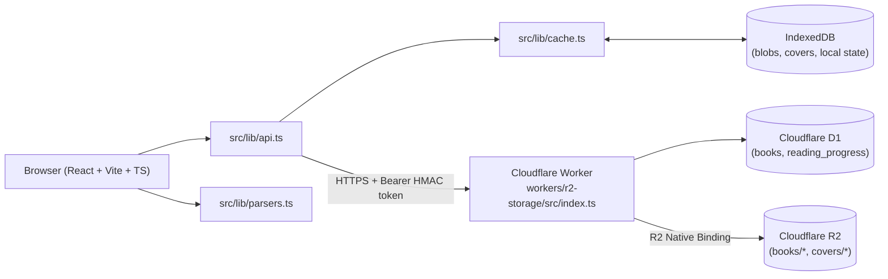

# Kiến trúc hệ thống — Arcane Library (`ofu.lol`)

## 1. Sơ đồ tổng thể

## 2. Bảng module

| File | Trách nhiệm | Export chính | Phụ thuộc vào |
|---|---|---|---|
| `src/types.ts` | Định nghĩa kiểu dữ liệu dùng chung (Book, Chapter, ParsedBook, Progress, Storage, ReaderSettings) | `Book`, `BookFileType`, `Chapter`, `ParsedBook`, `ReadingProgress`, `StorageStats`, `ShelfGroup`, `ReaderSettings`, `ViewMode` | — |
| `src/lib/cache.ts` | Lớp truy cập IndexedDB (`arcane-library-cache-v1`) lưu cache file sách/bìa và dữ liệu chế độ local | `getCachedBookBlob`, `setCachedBookBlob`, `deleteCachedBookBlob`, `getCachedCoverBlob`, `setCachedCoverBlob`, `deleteCachedCoverBlob`, `getLocalBooks`, `putLocalBook`, `deleteLocalBook`, `getAllLocalProgress`, `putLocalProgress`, `deleteLocalProgress` | `src/types.ts`, IndexedDB API |
| `src/lib/shelfPlacement.ts` | Quy tắc phân bổ kệ thông minh: ưu tiên tên bộ truyện (VD `Mushoku`), tác phẩm lẻ đứng kệ riêng và tự động gom chung về kệ tác giả khi có từ 2 tác phẩm lẻ cùng tác giả | `extractSeriesName`, `isKnownAuthor`, `inferSingleBookShelf`, `resolveUploadShelfPlan`, `resolvePreviewShelfName` | `src/types.ts` |
| `src/lib/epubChapters.ts` | Chuẩn hoá danh sách chương EPUB: gộp toàn bộ trang ảnh minh hoạ đầu sách (trước Khúc dạo đầu / Mục lục / Mở đầu / Chương X...) thành 1 mục duy nhất `Minh họa` | `buildEpubChapters`, `RawEpubSection` | `src/types.ts` |
| `src/lib/parsers.ts` | Trích xuất metadata tên file, trích/nén ảnh bìa JPEG khi upload, parse EPUB/PDF/CBZ/MOBI thành `ParsedBook` kèm `dispose()` | `pdfWasmUrl`, `pickCoverColor`, `inferShelfName`, `parseFileMetadata`, `bookDuplicateKey`, `compressCoverBlob`, `extractCoverAtUpload`, `parseBookBlob` | `jszip`, `pdfjs-dist`, `@lingo-reader/mobi-parser`, `src/types.ts`, `src/lib/epubChapters.ts`, `src/lib/shelfPlacement.ts` |
| `src/lib/readerConfig.ts` | Cấu hình trình đọc: 4 bảng màu đọc (`paper`/`sepia`/`dark`/`midnight`), font/width map, lưu & nạp `ReaderSettings` trong `localStorage` | `DEFAULT_READER_SETTINGS`, `READER_THEME_STYLES`, `READER_FONT_CLASS`, `READER_WIDTH_MAX`, `loadReaderSettings`, `saveReaderSettings`, `ReaderThemePalette` | `src/types.ts`, `localStorage` |
| `src/lib/api.ts` | Giao tiếp HTTP với Worker, quản lý token, bảo vệ D-005 (chặn Local-First trên production), giới hạn 9.0 GiB, cache-first blob/cover, đồng bộ tiến độ đọc | `HARD_LIMIT_BYTES`, `isMissingProductionApi`, `isLocalDevMode`, `isCloudMode`, `getAuthToken`, `setAuthToken`, `formatBytes`, `sortBooksByTitle`, `groupBooksIntoShelves`, `isAuthError`, `checkHealth`, `loginWithPasscode`, `fetchLibraryState`, `uploadBook`, `updateBookMetadata`, `updateBookCover`, `renameShelfAll`, `deleteBooks`, `fetchBookBlobCached`, `fetchCoverBlobCached`, `saveReadingProgress`, `clearReadingProgress` | `src/types.ts`, `src/lib/cache.ts`, `src/lib/parsers.ts` |
| `src/hooks/useTheme.ts` | Quản lý 3 chế độ màu (`light` Ban ngày `#f6f1e7` → `dim` Chiều tối `#0d1117` + gradient sương nhẹ → `midnight` Đêm khuya `#060608`) lưu `localStorage`, hỗ trợ View Transitions API & `meta[name="theme-color"]` | `useTheme`, `AppTheme`, `THEME_ORDER`, `THEME_LABELS`, `getNextTheme` | React, `localStorage` |
| `src/hooks/useBookReader.ts` | Quản lý luồng mở/đóng sách (`fetchBookBlobCached` + `parseBookBlob`), chống rò rỉ `ObjectURL` (request ID + `dispose()` khi đóng/đổi/unmount), lưu `ReaderSettings` & `saveReadingProgress` | `useBookReader` | React, `src/types.ts`, `src/lib/api.ts`, `src/lib/parsers.ts`, `src/lib/readerConfig.ts` |
| `src/hooks/useCoverUrl.ts` | Tải ảnh bìa từ IndexedDB/R2 qua `fetchCoverBlobCached`, tạo & thu hồi `URL.revokeObjectURL` đúng vòng đời | `useCoverUrl` | React, `src/lib/api.ts` |
| `src/hooks/useToast.ts` | Hook quản lý hàng đợi thông báo Toast tự tắt kèm dọn sạch timer khi unmount | `useToast`, `ToastItem`, `ToastType` | React |
| `src/components/ThemeToggle.tsx` | Nút xoay vòng 3 chế độ (`Sun` → `Moon` → `MoonStar`) kiểu Cyanodex dùng chung cho `AuthGate` và `LibraryHeader` | `ThemeToggle` | `lucide-react`, `src/hooks/useTheme.ts` |
| `src/components/ErrorBoundary.tsx` | React Error Boundary chống trắng trang, có nút tải lại & khôi phục, đồng bộ màu Sáng/Tối | `ErrorBoundary` | `lucide-react` |
| `src/components/ToastContainer.tsx` | Hiển thị stack thông báo không chặn UI góc dưới-phải, đồng bộ màu Sáng/Tối | `ToastContainer` | `lucide-react`, `src/hooks/useToast.ts` |
| `src/components/AuthGate.tsx` | Màn hình kiểm tra kết nối Worker, đăng nhập 1 passcode (D-003), báo lỗi thiếu `VITE_API_URL` (D-005), hỗ trợ đổi Sáng/Tối | `AuthGate` | `lucide-react`, `src/lib/api.ts` |
| `src/components/BookCard.tsx` | Thẻ sách 2D (dọc/ngang): bìa tỉ lệ `3/4` (ảnh lazy qua `IntersectionObserver` + `useCoverUrl` hoặc bìa vải cổ điển fallback), thanh tiến độ %, badge định dạng, chế độ chọn nhiều | `BookCard` | `lucide-react`, `src/types.ts`, `src/hooks/useCoverUrl.ts` |
| `src/components/LibraryHeader.tsx` | Header thương hiệu **Ofu's Library**: thanh dung lượng `usedBytes / limitBytes` (`formatBytes`), chuyển Sáng/Tối, upload, chọn nhiều, làm mới, đăng xuất | `LibraryHeader` | `lucide-react`, `src/types.ts`, `src/lib/api.ts` |
| `src/components/Library2DView.tsx` | Giao diện thư viện 2D: khối "Tiếp tục đọc" theo `progress.updatedAt`, tìm kiếm tên/tác giả/kệ (hỗ trợ không dấu), lọc kệ, thanh chọn hàng loạt, danh sách kệ từ `groupBooksIntoShelves()`, nút đổi tên kệ/sửa sách/xoá | `Library2DView` | `lucide-react`, `src/types.ts`, `src/lib/api.ts`, `src/components/BookCard.tsx`, `src/components/LibraryHeader.tsx` |
| `src/components/UploadDropzone.tsx` | Modal kéo-thả/chọn nhiều file EPUB/MOBI/PDF/CBZ, phát hiện trùng lặp qua `bookDuplicateKey()`, upload tuần tự từng tệp qua `uploadBook()` kèm tự động phân bổ/gom kệ thông minh (`resolveUploadShelfPlan`), hiển thị tiến độ & cảnh báo hạn mức 9.0 GB | `UploadDropzone` | `lucide-react`, `src/types.ts`, `src/lib/api.ts`, `src/lib/parsers.ts`, `src/lib/shelfPlacement.ts`, `src/components/UploadQueueList.tsx`, `src/hooks/useToast.ts` |
| `src/components/UploadQueueList.tsx` | Danh sách hàng đợi tệp trong `UploadDropzone`: trạng thái từng tệp, cảnh báo trùng, preview kệ thông minh (`resolvePreviewShelfName`), nút bỏ qua/xoá | `UploadQueueList`, `UploadQueueItem`, `QueueItemStatus` | `lucide-react`, `src/types.ts`, `src/lib/api.ts`, `src/lib/shelfPlacement.ts` |
| `src/components/BookEditModal.tsx` | Modal sửa metadata sách (`title`, `author`, `shelf` gợi ý kệ có sẵn, `description`) qua `updateBookMetadata()`, đổi ảnh bìa qua `updateBookCover()` kèm thu hồi `URL.revokeObjectURL`, nút xoá 1 sách | `BookEditModal` | `lucide-react`, `src/types.ts`, `src/lib/api.ts`, `src/hooks/useCoverUrl.ts`, `src/hooks/useToast.ts` |
| `src/components/ShelfRenameModal.tsx` | Modal đổi tên (hoặc gộp) kệ hàng loạt qua `renameShelfAll()` | `ShelfRenameModal` | `lucide-react`, `src/lib/api.ts`, `src/hooks/useToast.ts` |
| `src/components/DeleteConfirmModal.tsx` | Modal xác nhận xoá 1 sách hoặc xoá hàng loạt qua `deleteBooks()`, hiển thị danh sách tên sách & tổng dung lượng giải phóng (`formatBytes`) | `DeleteConfirmModal` | `lucide-react`, `src/types.ts`, `src/lib/api.ts`, `src/hooks/useToast.ts` |
| `src/components/PdfReader.tsx` | Trình xem PDF canvas HiDPI, thanh thumbnail (tối đa 40 trang đầu), huỷ `RenderTask` cũ, zoom & tải xuống | `PdfReader` | `pdfjs-dist`, `lucide-react`, `src/lib/parsers.ts` |
| `src/components/ReaderSettingsPopover.tsx` | Bảng tùy chỉnh trình đọc: 4 chế độ màu, kiểu chữ, cỡ chữ, giãn dòng, độ rộng cột, bật/tắt chạm lề & phím mũi tên | `ReaderSettingsPopover` | `lucide-react`, `src/types.ts`, `src/lib/readerConfig.ts` |
| `src/components/ReaderTocDrawer.tsx` | Ngăn kéo mục lục chương/trang kèm ô lọc nhanh | `ReaderTocDrawer` | `lucide-react`, `src/types.ts`, `src/lib/readerConfig.ts` |
| `src/components/ReaderView.tsx` | Trình đọc EPUB/MOBI/CBZ/PDF gọn ≤ 500 dòng: điều hướng chương/trang, lưu & khôi phục vị trí cuộn theo tỉ lệ, phím `←`/`→` an toàn | `ReaderView` | `lucide-react`, `src/types.ts`, `src/lib/readerConfig.ts`, `src/components/PdfReader.tsx`, `src/components/ReaderSettingsPopover.tsx`, `src/components/ReaderTocDrawer.tsx` |
| `src/App.tsx` | Vỏ điều phối mỏng (< 200 dòng): quản lý theme 3 chế độ, auth state, xử lý `401` tập trung, tải thư viện, điều phối `AuthGate` ↔ `Library2DView` (+ 4 modal) ↔ `ReaderView` / `ToastContainer` | `default App` | `src/types.ts`, `src/lib/api.ts`, `src/components/*`, `src/hooks/{useBookReader,useTheme,useToast}.ts` |
| `src/main.tsx` | Điểm khởi chạy React, bọc `<ErrorBoundary>` quanh `<App />` | — | `src/components/ErrorBoundary.tsx`, `src/App.tsx` |
| `workers/r2-storage/src/auth.ts` | Xác thực fail-closed cho Worker: so sánh timing-safe, ký & kiểm tra token HMAC-SHA256 30 ngày, `HttpError` | `HttpError`, `AuthEnv`, `isInsecureDevAuthDisabled`, `isAuthRequired`, `timingSafeEqual`, `signPayload`, `createAuthToken`, `authenticatePasscode`, `verifyAuth` | Web Crypto API (`crypto.subtle`) |
| `workers/r2-storage/src/index.ts` | Cloudflare Worker API: CORS, kiểm soát hạn mức 9.0 GiB, CRUD D1, stream upload/download R2 (hỗ trợ HTTP Range) | `default { fetch }` | Cloudflare Workers Runtime (`D1Database`, `R2Bucket`), `workers/r2-storage/src/auth.ts` |

## 3. API của Cloudflare Worker

> Auth `Có*`: bắt buộc `Authorization: Bearer <token>` (hoặc query `?token=`). Mặc định **fail-closed**: thiếu `ACCESS_PASSCODE` sẽ trả `503` (chỉ tắt auth khi chạy dev và đặt tường minh `ALLOW_INSECURE_DEV_NO_AUTH="true"` cùng với việc bỏ trống `ACCESS_PASSCODE`).

| Method | Path | Auth? | Mô tả |
|---|---|---|---|
| `OPTIONS` | `*` | Không | CORS preflight theo `APP_ORIGINS` (trả `204`) |
| `GET` | `/api/health` | Không | Kiểm tra sống, trả `{ ok, authRequired, limitBytes }` |
| `POST` | `/api/auth/login` | Không | Kiểm tra `passcode` (so sánh timing-safe), cấp token HMAC-SHA256 hạn 30 ngày |
| `GET` | `/api/storage` | Có* | Trả thống kê dung lượng `{ usedBytes, limitBytes, remainingBytes, bookCount }` |
| `GET` | `/api/books` | Có* | Trả toàn bộ `books`, bản đồ `progress` và `storage` |
| `PUT` | `/api/books/:id/file` | Có* | Stream file sách (tối đa 350 MB) lên R2, kiểm tra hạn mức 9.0 GiB trước & sau khi ghi, tạo bản ghi D1 |
| `PUT` | `/api/books/:id/cover` | Có* | Stream ảnh bìa JPEG (< 5 MB) lên R2, xoá ảnh bìa cũ trên R2, cập nhật D1 |
| `PATCH` | `/api/books/:id` | Có* | Cập nhật metadata sách (`title`, `author`, `shelf`, `description`, `cover_color`) |
| `DELETE` | `/api/books/:id` | Có* | Xoá 1 sách: xoá object file + cover trên R2 và xoá dòng ở `reading_progress`, `books` |
| `POST` | `/api/books/bulk-delete` | Có* | Xoá hàng loạt sách theo `ids` trên cả R2 và D1 |
| `POST` | `/api/shelves/rename` | Có* | Đổi tên kệ hàng loạt (`oldName` → `newName`) |
| `PUT` | `/api/progress/:bookId` | Có* | Upsert tiến độ đọc (`chapterId`, `chapterIndex`, `scrollRatio`, `scrollTop`, `completed`, `updatedAt`) |
| `DELETE` | `/api/progress/:bookId` | Có* | Xoá tiến độ đọc của 1 sách |
| `GET` / `HEAD` | `/api/files/:key` | Có* | Stream object `books/*` hoặc `covers/*` từ R2; hỗ trợ `Range` (`206`), `ETag`, `Cache-Control: private, max-age=31536000, immutable` |

## 4. Data Model (`workers/r2-storage/schema.sql`)

- **`books`**:
  - `id TEXT PRIMARY KEY`
  - `title TEXT NOT NULL`, `author TEXT NOT NULL DEFAULT 'Không rõ tác giả'`, `shelf TEXT NOT NULL DEFAULT 'Kho chưa phân loại'`, `description TEXT`
  - `cover_color TEXT NOT NULL DEFAULT '#4f46e5'`, `cover_key TEXT`, `file_key TEXT NOT NULL`
  - `file_type TEXT NOT NULL CHECK (file_type IN ('epub', 'mobi', 'pdf', 'cbz'))`
  - `file_size INTEGER NOT NULL DEFAULT 0`, `cover_size INTEGER NOT NULL DEFAULT 0`, `created_at TEXT NOT NULL`
- **`reading_progress`**:
  - `book_id TEXT PRIMARY KEY REFERENCES books(id) ON DELETE CASCADE`
  - `chapter_id TEXT NOT NULL`, `chapter_index INTEGER NOT NULL DEFAULT 0`
  - `scroll_ratio REAL NOT NULL DEFAULT 0`, `scroll_top REAL NOT NULL DEFAULT 0`
  - `completed INTEGER NOT NULL DEFAULT 0`, `updated_at INTEGER NOT NULL`
- **Indexes**: `idx_books_shelf`, `idx_books_created_at`, `idx_progress_updated_at`.

## 5. Biến môi trường & cấu hình

| Biến / Binding | Phía | Loại | Đặt ở đâu | Vai trò |
|---|---|---|---|---|
| `VITE_API_URL` | Frontend | Env var (public) | `.env.local` (dev), GitHub Actions Secret (deploy) | URL Cloudflare Worker. Khi trống: chỉ cho phép Local-First ở `DEV`; bản production báo lỗi cấu hình rõ ràng (D-005). |
| `VITE_BASE_PATH` | Frontend | Env var (public) | `.github/workflows/deploy.yml` (`/`) | Base path của Vite build cho domain `ofu.lol`. |
| `APP_ORIGINS` | Worker | Var | `workers/r2-storage/wrangler.toml` `[vars]` | Danh sách origin được phép CORS (`https://ofu.lol`, `http://localhost:5173`, `http://127.0.0.1:5173`). |
| `STORAGE_LIMIT_BYTES` | Worker | Var | `workers/r2-storage/wrangler.toml` `[vars]` | Chốt chặn cứng `9663676416` (9.0 GiB). |
| `BOOKS_BUCKET` | Worker | R2 Binding | `workers/r2-storage/wrangler.toml` | Bucket R2 `arcane-library-books`. |
| `DB` | Worker | D1 Binding | `workers/r2-storage/wrangler.toml` | D1 database `library-db` (`1718c115-0bad-4fd2-b1eb-43a2b63b4ce9`, region APAC). |
| `ACCESS_PASSCODE` | Worker | Secret | `wrangler secret put` (prod) / `.dev.vars` (local) | Mật mã đăng nhập thư viện (thiếu sẽ trả `503` fail-closed). |
| `AUTH_SECRET` | Worker | Secret | `wrangler secret put` (prod) / `.dev.vars` (local) | Khoá ký HMAC-SHA256 cho session token 30 ngày (nếu thiếu chỉ fallback về `ACCESS_PASSCODE`, không dùng chuỗi cố định). |
| `ALLOW_INSECURE_DEV_NO_AUTH` | Worker | Var (tuỳ chọn dev) | `.dev.vars` (chỉ local dev) | Đặt `"true"` (và không đặt `ACCESS_PASSCODE`) để tắt auth khi dev local; tuyệt đối không đặt trên production. |

## 6. Công cụ đã có — cấm viết lại

| Hàm / Hằng | File | Mô tả |
|---|---|---|
| `formatBytes(bytes)` | `src/lib/api.ts` | Định dạng dung lượng byte sang `B / KB / MB / GB / TB`. |
| `sortBooksByTitle(books)` | `src/lib/api.ts` | Sắp xếp danh sách sách theo tiêu đề tiếng Việt (`numeric: true`). |
| `groupBooksIntoShelves(books)` | `src/lib/api.ts` | Gom sách thành các `ShelfGroup` theo tên kệ (không phân biệt hoa thường tiếng Việt). |
| `getAuthToken()` / `setAuthToken()` / `isAuthError()` | `src/lib/api.ts` | Quản lý token đăng nhập và nhận diện lỗi `401`. |
| `checkHealth()` / `loginWithPasscode()` | `src/lib/api.ts` | Kiểm tra Worker & đăng nhập passcode. |
| `fetchLibraryState()` / `uploadBook()` / `updateBookMetadata()` / `updateBookCover()` / `renameShelfAll()` / `deleteBooks()` | `src/lib/api.ts` | Toàn bộ thao tác thư viện (tự động xử lý cache IndexedDB & hạn mức 9.0 GiB). |
| `fetchBookBlobCached()` / `fetchCoverBlobCached()` | `src/lib/api.ts` | Tải sách/ảnh bìa ưu tiên IndexedDB (0ms), cache tự động khi tải từ R2. |
| `saveReadingProgress()` / `clearReadingProgress()` | `src/lib/api.ts` | Lưu/xoá tiến độ đọc đồng thời local và D1. |
| `pickCoverColor(seed)` | `src/lib/parsers.ts` | Chọn màu bìa mặc định ổn định từ bảng màu Arcane theo chuỗi seed. |
| `extractSeriesName` / `resolveUploadShelfPlan` / `resolvePreviewShelfName` | `src/lib/shelfPlacement.ts` | Nhận diện bộ truyện nhiều tập (ưu tiên kệ theo tên bộ) và tự động gom các tác phẩm lẻ cùng tác giả về chung kệ tác giả khi có ≥ 2 tác phẩm lẻ. |
| `inferShelfName(title, author)` | `src/lib/parsers.ts` | Suy luận tên kệ đơn lẻ (uỷ quyền `inferSingleBookShelf`): ưu tiên tên bộ/tác phẩm, chỉ fallback về tác giả khi thiếu tiêu đề. |
| `parseFileMetadata(fileName)` | `src/lib/parsers.ts` | Tách `title`, `author`, `shelf`, `extension` từ tên file. |
| `bookDuplicateKey(title, author)` | `src/lib/parsers.ts` | Tạo khoá chuẩn hoá để phát hiện sách trùng lặp. |
| `compressCoverBlob(source)` | `src/lib/parsers.ts` | Crop tâm & nén ảnh bìa về JPEG `480×720` (~40 KB). |
| `extractCoverAtUpload(file, fileType)` | `src/lib/parsers.ts` | Trích xuất ảnh bìa nhẹ 1 lần duy nhất lúc upload cho EPUB/CBZ/MOBI/PDF. |
| `parseBookBlob(blob, book)` | `src/lib/parsers.ts` | Parse EPUB/PDF/CBZ/MOBI thành `ParsedBook` kèm `dispose()` thu hồi Object URL. |
| `getCachedBookBlob` / `setCachedBookBlob` / `deleteCachedBookBlob` | `src/lib/cache.ts` | Đọc/ghi/xoá blob sách trong IndexedDB. |
| `getCachedCoverBlob` / `setCachedCoverBlob` / `deleteCachedCoverBlob` | `src/lib/cache.ts` | Đọc/ghi/xoá blob ảnh bìa trong IndexedDB. |
| `useTheme()` | `src/hooks/useTheme.ts` | Quản lý & xoay vòng 3 chế độ màu (**Ban ngày / Chiều tối / Đêm khuya**) lưu `localStorage`. |
| `useCoverUrl(coverKey, enabled?)` | `src/hooks/useCoverUrl.ts` | Tải blob ảnh bìa từ cache/R2 và tự động `URL.revokeObjectURL` khi đổi khoá hoặc unmount. |
| `useBookReader(options)` | `src/hooks/useBookReader.ts` | Mở/đóng sách (`fetchBookBlobCached` + `parseBookBlob`), thu hồi `ParsedBook.dispose()` an toàn theo request ID, lưu `ReaderSettings` và `saveReadingProgress`. |
| `loadReaderSettings()` / `saveReaderSettings()` | `src/lib/readerConfig.ts` | Đọc/ghi cài đặt trình đọc (`theme`, `font`, `fontSizePx`, `lineHeight`, `width`, `sideTapNavigation`) trong `localStorage`. |

## 7. Trạng thái hiện tại

- **Sub-phase 3.4 đã hoàn tất**: tách gọn `ReaderView.tsx` (`ReaderSettingsPopover`, `ReaderTocDrawer`, `readerConfig.ts`), dọn sạch CSS `.pdf-*` lỗi thời và thêm `.font-reader-*` trong `src/index.css`, nối hoàn chỉnh trình đọc vào `App.tsx` (< 200 dòng) qua `useBookReader` kèm `dispose()` an toàn.
- **Kiểm định toàn repo XANH 100%**: `npm run typecheck`, `npm run lint` (`eslint .` — mọi file frontend & Worker đều ≤ 500 dòng hiệu dụng), `npm run build`, và `workers/r2-storage` `npm run typecheck` đều **0 lỗi, 0 cảnh báo**. Sẵn sàng sang Sub-phase 3.5 (kiểm thử checklist thực tế & cấu hình GitHub Secret `VITE_API_URL`) → 3.6 (mở PR merge vào `main`).
