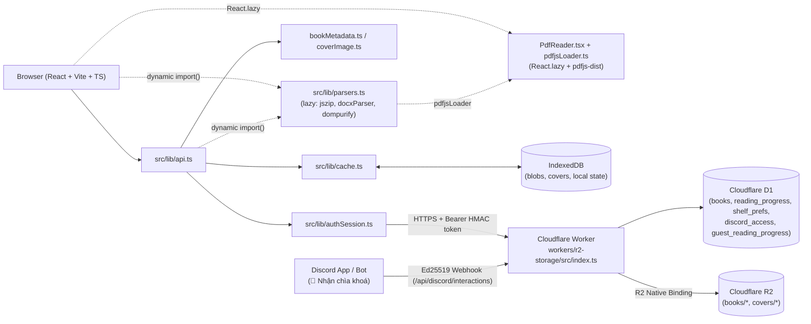

# Kiến trúc hệ thống — Arcane Library (`ofu.lol`)

## 1. Sơ đồ tổng thể

## 2. Bảng module

| File | Trách nhiệm | Export chính | Phụ thuộc vào |
|---|---|---|---|
| `src/types.ts` | Định nghĩa kiểu dữ liệu dùng chung (Book, Chapter, ParsedBook, Progress, Storage, ReaderSettings, ViewMode, LibraryTab, AuthRole, AuthSessionInfo) | `Book`, `BookFileType`, `Chapter`, `ParsedBook`, `ReadingProgress`, `StorageStats`, `ShelfGroup`, `ReaderSettings`, `ViewMode`, `LibraryTab`, `AuthRole`, `AuthSessionInfo` | — |
| `src/lib/authSession.ts` | Quản lý token & vòng đời phiên 2 tầng (`owner` 30 ngày / `guest` 24 giờ từ Discord key, `D-026`), bảo vệ D-005, HTTP client gắn Bearer token (`apiFetch`), kiểm tra Worker (`checkHealth`), đăng nhập (`loginWithPasscode`) và định dạng thời gian phiên còn lại (`formatRemainingSessionTime`) | `DEFAULT_OWNER_SESSION`, `isMissingProductionApi`, `isLocalDevMode`, `isCloudMode`, `assertApiConfigured`, `parseTokenSession`, `getAuthToken`, `setAuthToken`, `inspectStoredSession`, `getActiveAuthSession`, `formatRemainingSessionTime`, `isAuthError`, `apiFetch`, `checkHealth`, `loginWithPasscode` | `src/types.ts`, `localStorage`, Fetch API |
| `src/lib/cache.ts` | Lớp truy cập IndexedDB (`arcane-library-cache-v1`) lưu cache file sách/bìa và dữ liệu chế độ local | `getCachedBookBlob`, `setCachedBookBlob`, `deleteCachedBookBlob`, `getCachedCoverBlob`, `setCachedCoverBlob`, `deleteCachedCoverBlob`, `getLocalBooks`, `putLocalBook`, `deleteLocalBook`, `getAllLocalProgress`, `putLocalProgress`, `deleteLocalProgress` | `src/types.ts`, IndexedDB API |
| `src/lib/shelfPlacement.ts` | Quy tắc phân bổ kệ thông minh: chuẩn hoá dấu gạch/hai chấm Unicode (`cleanShelfLabel`), nhận diện nhãn tập có tiêu đề phụ (`isVolumeOrSubtitleSegment`), trích tên bộ truyện (`extractSeriesName`), phát hiện kệ gốc chung cho cả lô tải lên (`inferBatchCommonShelf`), tác phẩm lẻ đứng kệ riêng và tự động gom chung về kệ tác giả khi có từ 2 tác phẩm lẻ cùng tác giả | `VOLUME_SEGMENT_RE`, `VOLUME_WITH_SUBTITLE_RE`, `isVolumeOrSubtitleSegment`, `cleanShelfLabel`, `extractSeriesName`, `isKnownAuthor`, `inferBatchCommonShelf`, `inferSingleBookShelf`, `resolveUploadShelfPlan`, `resolvePreviewShelfName` | `src/types.ts` |
| `src/lib/shelfPrefs.ts` | Quản lý tuỳ chọn kệ sách đồng bộ đa thiết bị (`D-025`): lưu/nạp cache `localStorage`, cập nhật ảnh bìa kệ đại diện (`setShelfCoverBook` → `PUT /api/shelves/cover`), ghim kệ yêu thích (`setShelfFavorite` → `PUT /api/shelves/favorite`), hợp nhất khi đổi tên kệ (`renameShelfPrefs`), dọn `cover_book_id` khi xoá sách (`pruneDeletedBooksFromPrefs`) và sắp xếp kệ yêu thích lên đầu (`sortShelvesFavoriteFirst`) | `ShelfPrefsState`, `toShelfPrefKey`, `readLocalShelfPrefs`, `writeLocalShelfPrefs`, `patchShelfCover`, `patchShelfFavorite`, `renameShelfPrefs`, `pruneDeletedBooksFromPrefs`, `sortShelvesFavoriteFirst`, `setShelfCoverBook`, `setShelfFavorite` | `src/types.ts`, `src/lib/api.ts`, `localStorage` |
| `src/lib/epubChapters.ts` | Chuẩn hoá danh sách chương EPUB: gom toàn bộ ảnh minh hoạ đầu sách (trước Khúc dạo đầu / Mục lục / Mở đầu / Chương X...) thành 1 mục duy nhất `Minh họa`; tích hợp liền mạch ảnh minh hoạ giữa chương và các tệp nối tiếp vào ngay trong chương hiện tại (không tách nhỏ chương trước khi tới chương tiếp theo) | `buildEpubChapters`, `RawEpubSection` | `src/types.ts` |
| `src/lib/bookMetadata.ts` | Hàm thuần trích xuất & chuẩn hoá metadata sách từ tên file (hỗ trợ tập thập phân `Tập 6.5` và tập kèm tiêu đề phụ `Tập 1：...` không ghi tác giả), lọc tên tác giả hiển thị sạch (`getDisplayAuthor`), ghép tiêu đề sắp xếp (`getBookSortTitle`), màu bìa vải cổ điển và tính `%` tiến độ đọc | `VOLUME_SEGMENT_RE`, `VOLUME_WITH_SUBTITLE_RE`, `isVolumeOrSubtitleSegment`, `extractMisplacedVolumeFromAuthor`, `getDisplayAuthor`, `getBookSortTitle`, `pickCoverColor`, `pickClothCoverColor`, `inferShelfName`, `parseFileMetadata`, `bookDuplicateKey`, `computeBookProgressPercent` | `src/types.ts`, `src/lib/shelfPlacement.ts` |
| `src/lib/shelfSummary.ts` | Hàm thuần cho Tab Thư viện (chỉ nạp lười trong chunk `LibraryCatalogView`): trích số tập (`Tập 1`, `Vol.1`, `v01`, `SAO1`...), chọn sách đại diện làm bìa kệ (`pickShelfCoverBook` ưu tiên tập do người dùng chọn ở `D-025`, fallback Tập 1 theo `D-018`) và tổng hợp thống kê kệ (`summarizeShelf`: `customCoverBookId`, `isFavorite`, tác giả, trạng thái đọc, `%`, dung lượng, tập đọc tiếp) | `extractVolumeNumber`, `pickShelfCoverBook`, `summarizeShelf`, `computeBookProgressPercent`, `ShelfReadingStatus`, `ShelfSummary` | `src/types.ts`, `src/lib/bookMetadata.ts`, `src/lib/shelfPlacement.ts` |
| `src/lib/coverImage.ts` | Crop tâm & nén ảnh bìa bằng Canvas về JPEG nhẹ `480×720` (~40 KB), tự giải phóng `ImageBitmap`, hỗ trợ tuỳ chọn `rejectBlankOrTiny` lọc bỏ ảnh quá nhỏ hoặc ảnh đơn sắc/trắng trơn | `compressCoverBlob`, `CompressCoverOptions` | Canvas / `createImageBitmap` |
| `src/lib/chunkReload.ts` | Phát hiện lỗi tải chunk động sau deploy (`404`) và tự tải lại trang tối đa 1 lần qua `sessionStorage` để chặn lặp vô hạn (không reload khi `navigator.onLine === false`) | `isChunkLoadError`, `reloadOnceForStaleChunk`, `recoverFromChunkError` | `sessionStorage`, `navigator.onLine` |
| `src/lib/pdfjsLoader.ts` | Nạp lười `pdfjs-dist` (cache promise, tự reset & xử lý chunk cũ khi lỗi), cấu hình `GlobalWorkerOptions.workerSrc` và `pdfWasmUrl` | `loadPdfJs`, `pdfWasmUrl` | `pdfjs-dist` (dynamic), `src/lib/chunkReload.ts` |
| `src/lib/sanitizeHtml.ts` | Làm sạch HTML sách EPUB/DOCX bằng `DOMPurify` v3 trước khi render (`dangerouslySetInnerHTML`), chạy trước bước đổi ảnh sang `blob:` URL | `sanitizeBookDocument` | `dompurify` |
| `src/lib/docxXml.ts` | Hàm thuần đọc siêu dữ liệu OOXML của tệp `.docx` (relationships, styles/heading, numbering `ul`/`ol`, trích `rId` ảnh bỏ qua nhánh trùng `mc:AlternateContent`, thu thập ứng viên bìa ưu tiên thứ tự xuất hiện trong `word/document.xml` → `word/media/*` → `docProps/thumbnail.*`) | `DocxRel`, `StyleMeta`, `RASTER_IMAGE_EXT_RE`, `RENDERABLE_IMAGE_EXT_RE`, `escapeHtml`, `getAttr`, `findDirectChild`, `resolveDocxPath`, `guessImageMimeType`, `parseRelationships`, `parseStyles`, `parseNumberingKinds`, `resolveHeadingFromStyle`, `isToggleFlagEnabled`, `findImageRelIds`, `collectDocxCoverCandidates` | `jszip` (type-only) |
| `src/lib/docxParser.ts` | Trích ảnh bìa DOCX (duyệt ứng viên theo thứ tự `word/document.xml` → `word/media/*` → `docProps/thumbnail.*`, tự bỏ qua ảnh trắng trơn/icon quá nhỏ) và parse `word/document.xml` thành `ParsedBook` reflowable (giữ định dạng chữ, danh sách, bảng, ảnh `blob:` URL có `dispose()`, tự tách chương theo Heading 1/2 hoặc tiêu đề `Chương X`) | `extractDocxCover`, `parseDocxZip` | `jszip` (type-only), `src/types.ts`, `src/lib/coverImage.ts`, `src/lib/docxXml.ts`, `src/lib/sanitizeHtml.ts` |
| `src/lib/parsers.ts` | Nạp lười `jszip` và `pdfjs-dist` (qua `pdfjsLoader`); tải trước `jszip` khi trình duyệt rảnh (`preloadCoreReaders`); trích ảnh bìa lúc upload và parse EPUB/PDF/DOCX thành `ParsedBook` kèm `dispose()` | `preloadCoreReaders`, `extractCoverAtUpload`, `parseBookBlob` | `jszip` (dynamic), `src/types.ts`, `src/lib/chunkReload.ts`, `src/lib/coverImage.ts`, `src/lib/docxParser.ts`, `src/lib/epubChapters.ts`, `src/lib/pdfjsLoader.ts`, `src/lib/sanitizeHtml.ts` |
| `src/lib/readerConfig.ts` | Cấu hình trình đọc: 4 bảng màu đọc (`paper`/`sepia`/`dark`/`midnight`), font/width map, lưu & nạp `ReaderSettings` trong `localStorage` | `DEFAULT_READER_SETTINGS`, `READER_THEME_STYLES`, `READER_FONT_CLASS`, `READER_WIDTH_MAX`, `loadReaderSettings`, `saveReaderSettings`, `ReaderThemePalette` | `src/types.ts`, `localStorage` |
| `src/lib/api.ts` | Tầng nghiệp vụ thư viện: tái xuất helper auth từ `authSession.ts`, giới hạn 9.0 GiB, gom/sắp xếp kệ sách, cache-first blob/cover qua IndexedDB, đồng bộ `fetchLibraryState` (kèm `session` xác thực từ Worker) & tiến độ đọc cách ly `owner`/`guest` (`D-026`) | `HARD_LIMIT_BYTES`, `MAX_SHELF_NAME_LENGTH`, `isMissingProductionApi`, `isLocalDevMode`, `isCloudMode`, `getAuthToken`, `setAuthToken`, `formatBytes`, `sortBooksByTitle`, `groupBooksIntoShelves`, `isAuthError`, `checkHealth`, `loginWithPasscode`, `fetchLibraryState`, `uploadBook`, `updateBookMetadata`, `updateBookCover`, `renameShelfAll`, `bulkUpdateBooksShelf`, `deleteBooks`, `fetchBookBlobCached`, `fetchCoverBlobCached`, `saveReadingProgress`, `clearReadingProgress` | `src/types.ts`, `src/lib/authSession.ts`, `src/lib/bookMetadata.ts`, `src/lib/cache.ts`, `src/lib/chunkReload.ts`, `src/lib/coverImage.ts`, `src/lib/shelfPrefs.ts`, `src/lib/parsers.ts` (dynamic) |
| `src/hooks/useTheme.ts` | Quản lý 3 chế độ màu (`light` Ban ngày `#f6f1e7` → `dim` Chiều tối `#0d1117` + gradient sương nhẹ → `midnight` Đêm khuya `#060608`) lưu `localStorage`, hỗ trợ View Transitions API & `meta[name="theme-color"]` | `useTheme`, `AppTheme`, `THEME_ORDER`, `THEME_LABELS`, `getNextTheme` | React, `localStorage` |
| `src/hooks/useCanUse3D.ts` | Ranh giới thiết bị D-008: kiểm tra tuần tự `min-width: 1024px`, `(hover: hover) and (pointer: fine)`, lazy probe WebGL `{ failIfMajorPerformanceCaveat: true }` (cache cấp module, giải phóng ngay context test), `prefers-reduced-motion: reduce`, lưu/đồng bộ đa tab `localStorage` (`ofu-library-view-mode`), debounce resize `200ms`, cờ chịu lỗi phiên (`session3DFailed`, `retryKey`) | `VIEW_MODE_STORAGE_KEY`, `CanUse3DState`, `useCanUse3D` | React, `src/types.ts`, `localStorage`, `matchMedia`, WebGL API |
| `src/hooks/useLibraryViewState.ts` | Quản lý state giao diện thư viện dùng chung cho cả 2D và 3D (`searchQuery`, `activeShelfKey`, `selectionMode`, `selectedIds`, `allShelves`, `continueReadingBooks` tự loại sách đã `completed`, `filteredBooks`, `visibleShelves`, `selectedBooks`), đồng thời quản lý tab 2D `Trang chủ` / `Thư viện` (lưu `localStorage`), drill-down kệ đang mở (`openedLibraryShelf`), lọc kệ giữ nguyên số tập (`libraryShelves`) và đồng bộ đổi tên kệ (`syncRenamedShelf`) | `LIBRARY_TAB_STORAGE_KEY`, `normalizeSearchText`, `selectContinueReadingBooks`, `computeBookProgressPercent`, `LibraryViewState`, `useLibraryViewState` | React, `src/types.ts`, `src/lib/api.ts`, `src/lib/bookMetadata.ts` |
| `src/hooks/useBookReader.ts` | Quản lý luồng mở/đóng sách (`fetchBookBlobCached` + dynamic `parseBookBlob`), chống rò rỉ `ObjectURL` (request ID + `dispose()` khi đóng/đổi/unmount), lưu `ReaderSettings` & `saveReadingProgress` | `useBookReader` | React, `src/types.ts`, `src/lib/api.ts`, `src/lib/chunkReload.ts`, `src/lib/parsers.ts` (dynamic), `src/lib/readerConfig.ts` |
| `src/hooks/useCoverUrl.ts` | Tải ảnh bìa từ IndexedDB/R2 qua `fetchCoverBlobCached`, tạo & thu hồi `URL.revokeObjectURL` đúng vòng đời | `useCoverUrl` | React, `src/lib/api.ts` |
| `src/hooks/useToast.ts` | Hook quản lý hàng đợi thông báo Toast tự tắt kèm dọn sạch timer khi unmount | `useToast`, `ToastItem`, `ToastType` | React |
| `src/components/ThemeToggle.tsx` | Nút xoay vòng 3 chế độ (`Sun` → `Moon` → `MoonStar`) kiểu Cyanodex dùng chung cho `AuthGate` và `LibraryHeader` | `ThemeToggle` | `lucide-react`, `src/hooks/useTheme.ts` |
| `src/components/ViewModeToggle.tsx` | Công tắc chuyển đổi `2D` / `3D` trên `LibraryHeader`, chỉ render khi `canUse3D === true` (D-008) | `ViewModeToggle` | `lucide-react`, `src/types.ts` |
| `src/components/ErrorBoundary.tsx` | React Error Boundary chống trắng trang, nhận prop tuỳ chọn `fallback?: ReactNode \| ((errorMessage: string) => ReactNode)` (boundary gốc ở `main.tsx` giữ fallback mặc định), tự gọi `recoverFromChunkError(error)` trong `componentDidCatch` | `ErrorBoundary` | `lucide-react`, `src/lib/chunkReload.ts` |
| `src/components/ToastContainer.tsx` | Hiển thị stack thông báo không chặn UI góc dưới-phải, đồng bộ màu Sáng/Tối | `ToastContainer` | `lucide-react`, `src/hooks/useToast.ts` |
| `src/components/AuthGate.tsx` | Màn hình cổng thư viện giữ nguyên thiết kế hiện có: kiểm tra Worker, nhận chung cả **Chìa khoá Discord 12 ký tự** (`guest` 24 giờ) lẫn **Mật mã quản trị** (`owner` 30 ngày) tại cùng 1 ô nhập (`D-026`), báo hết hạn phiên 24 giờ, báo thiếu `VITE_API_URL` (`D-005`), đổi Sáng/Tối | `AuthGate` | `lucide-react`, `src/types.ts`, `src/lib/{api,authSession}.ts` |
| `src/components/BookCard.tsx` | Thẻ sách 2D (dọc/ngang): bìa tỉ lệ `3/4` (ảnh lazy qua `IntersectionObserver` + `useCoverUrl` hoặc bìa vải cổ điển fallback), thanh tiến độ %, badge định dạng, chế độ chọn nhiều | `BookCard` | `lucide-react`, `src/types.ts`, `src/hooks/useCoverUrl.ts` |
| `src/components/LibraryHeader.tsx` | Header thương hiệu **Ofu's Library**: thanh tab 2D (`Trang chủ` \| `Thư viện`), phân nhánh theo vai trò (`owner`: thanh dung lượng `usedBytes / limitBytes`, `Tải sách`, `Chọn`, `ViewModeToggle`; `guest`: ẩn toàn bộ nút quản trị/3D và hiện huy hiệu đếm ngược thời gian phiên 24 giờ `D-026`), chuyển Sáng/Tối, làm mới, đăng xuất | `LibraryHeader` | `lucide-react`, `src/types.ts`, `src/lib/{api,authSession}.ts`, `src/components/ThemeToggle.tsx`, `src/components/ViewModeToggle.tsx` |
| `src/components/ShelfCoverCard.tsx` | Thẻ Kệ / Bộ truyện trong Tab Thư viện (`D-018`/`D-025`): bìa `3/4` lấy từ tập đã chọn hoặc Tập 1 qua `IntersectionObserver` + `useCoverUrl` (fallback bìa vải cổ điển), nút `Yêu thích` (`Star`), nút nhanh `Đổi tên kệ` & `Chọn ảnh bìa kệ`, badge `N tập`, thanh tiến độ, tên kệ, tác giả & trạng thái đọc | `ShelfCoverCard` | `lucide-react`, `src/lib/bookMetadata.ts`, `src/lib/shelfSummary.ts`, `src/hooks/useCoverUrl.ts` |
| `src/components/ShelfCoverPickerModal.tsx` | Modal chọn ảnh bìa đại diện cho kệ từ 1 tập bất kỳ có ảnh bìa trong kệ (hoặc đặt lại mặc định Tập 1) đồng bộ Cloudflare D1 qua `setShelfCoverBook` (`D-025`) | `ShelfCoverPickerModal`, `ShelfCoverPickerModalProps` | `lucide-react`, `src/types.ts`, `src/lib/{bookMetadata,shelfPrefs,shelfSummary}.ts`, `src/hooks/{useCoverUrl,useToast}.ts` |
| `src/components/ShelfDetailView.tsx` | Màn hình chi tiết 1 kệ khi drill-down trong Tab Thư viện: thanh quay lại, hero bìa kệ + các nút `Đọc tiếp / Đọc từ tập 1`, `Yêu thích`, `Đổi tên kệ`, `Đổi ảnh bìa kệ`, lọc nhanh tập (khi `>= 8` cuốn), chế độ chọn nhiều khoanh vùng trong kệ & lưới `BookCard` | `ShelfDetailView` | `lucide-react`, `src/types.ts`, `src/lib/api.ts`, `src/lib/bookMetadata.ts`, `src/lib/shelfSummary.ts`, `src/components/BookCard.tsx`, `src/hooks/{useCoverUrl,useLibraryViewState}.ts` |
| `src/components/LibraryCatalogView.tsx` | Nội dung Tab Thư viện nạp lười (`React.lazy`, chunk riêng giữ nhẹ entry theo D-013): điều phối thanh tìm bộ truyện + lưới `ShelfCoverCard` ↔ chi tiết kệ `ShelfDetailView` + `ShelfCoverPickerModal` | `LibraryCatalogView`, `LibraryCatalogViewProps` | `lucide-react`, `src/types.ts`, `src/lib/shelfSummary.ts`, `src/components/{ShelfCoverCard,ShelfCoverPickerModal,ShelfDetailView}.tsx` |
| `src/components/Library2DView.tsx` | Giao diện thư viện 2D dùng state chung `LibraryViewState` từ `App.tsx`: điều phối Tab `Trang chủ` (`Tiếp tục đọc`, tìm kiếm không dấu, chọn hàng loạt, danh sách kệ & sách — bỏ chips lọc kệ trùng vì đã có tab `Thư viện`) ↔ Tab `Thư viện` (nạp lười `LibraryCatalogView`) | `Library2DView` | `lucide-react`, `src/types.ts`, `src/hooks/useLibraryViewState.ts`, `src/components/{BookCard,LibraryHeader}.tsx`, `src/components/LibraryCatalogView.tsx` (lazy) |
| `src/components/Library3DHost.tsx` | Vỏ nạp lười `React.lazy` cho `FantasyLibrary3D` (chỉ mount sau khi đăng nhập & `effectiveMode === '3d'`), bọc `<ErrorBoundary key={retryKey}>` + `<Suspense>` tự động fallback mượt về `Library2DView` + toast khi lỗi chunk/runtime | `Library3DHost` | `lucide-react`, `src/components/ErrorBoundary.tsx`, `src/components/Library2DView.tsx`, `src/components/LibraryHeader.tsx`, `src/components/library3d/FantasyLibrary3D.tsx` (lazy) |
| `src/components/library3d/bookPacking3d.ts` | Lõi xếp sách vào tủ kệ dùng chung (tính kích thước sách, chọn sách tiêu điểm quay bìa, chia hàng theo khoang, tính ma trận xoay Euler `'XYZ'` chuẩn xác ở mọi góc `facingYaw`, `CoverPlaneTransform` & vector rút sách `pullDirection`) | `LIBRARY_3D_CONSTANTS`, `DEFAULT_FEATURED_COVER_SLOTS`, `MAX_FEATURED_COVER_SLOTS`, `BookFacing`, `CoverPlaneTransform`, `BookSlot3D`, `PreparedBook`, `PackedShelfRows`, `BuildCabinetBookSlotsOptions`, `rotationMatrixToEulerXYZ`, `transformCabinetLocalPoint`, `computeTierPlankYs`, `computeCabinetWidth`, `packShelfGroupIntoRows`, `buildCabinetBookSlots` | `src/types.ts`, `src/lib/bookMetadata.ts` |
| `src/components/library3d/layout3d.ts` | Bộ bố cục 3D tương thích ngược cho Đại sảnh cổ điển, tái xuất hằng/type từ `bookPacking3d.ts` và hỗ trợ windowing `getVisibleShelfWindow` / `selectFeaturedCoverSlots` theo cả trục X lẫn 2D `(x, z)` + `activeFloorIndex` (`D-013`/`D-014`/`D-017`) | `LIBRARY_3D_CONSTANTS`, `DEFAULT_FEATURED_COVER_SLOTS`, `MAX_FEATURED_COVER_SLOTS`, `BookFacing`, `CoverPlaneTransform`, `BookSlot3D`, `ShelfLayout3D`, `LibraryLayout3D`, `VisibleShelfWindow`, `VisibleShelfWindowOptions`, `FeaturedCoverSelectionOptions`, `buildLibraryLayout3D`, `getNearestShelfIndex`, `getVisibleShelfWindow`, `selectFeaturedCoverSlots` | `src/types.ts`, `src/components/library3d/bookPacking3d.ts` |
| `src/components/library3d/worldTypes.ts` | Tập hợp kiểu dữ liệu chuẩn cho Thế giới Aincrad Reading Tower (`BiomeId`, collider OBB/trụ, bề mặt dốc/cầu vồng, trạm tương tác, NPC, đạo cụ biome, tủ kệ xoay `WorldBookcase3D`, `FloorWorldLayout3D`, `TowerWorldLayout3D`, `JumpTarget3D`) | `BiomeId`, `ColliderTag`, `WorldBounds3D`, `BoxCollider3D`, `CylinderCollider3D`, `WorldCollider3D`, `SurfaceZone3D`, `WorldStationKind`, `WorldStation3D`, `NpcRole`, `NpcWaypoint3D`, `WorldNpcSpec3D`, `BiomePropKind`, `BiomePropPlacement3D`, `BookcaseAnchor3D`, `BiomeMeta`, `BiomeBlueprint3D`, `WorldBookcase3D`, `FloorWorldLayout3D`, `TowerWorldLayout3D`, `BuildTowerOptions`, `ActiveFloorCoverOptions`, `JumpTarget3D` | `src/components/library3d/bookPacking3d.ts` |
| `src/components/library3d/biomeBlueprints.ts` | Bản thiết kế không gian 4 World Biome Aincrad (`town_of_beginnings`, `sakura_shrine`, `starfield_atrium`, `starlight_ruins`): ranh giới đảo/sảnh, 6 neo tủ kệ/tầng, dốc/cầu gỗ vồng/bậc đá núi, collider nước/vách đá/cột, trạm tương tác, tuyến tuần tra NPC, đạo cụ & `bossAnchor` | `BIOME_SEQUENCE`, `BIOME_CATALOG`, `BIOME_BLUEPRINTS`, `getBiomeForFloorIndex` | `src/components/library3d/worldTypes.ts` |
| `src/components/library3d/floorWorldLayout3d.ts` | Bộ sinh Thế giới Aincrad theo tầng (`D-017`): phân bổ kệ & tự tách kệ rất lớn thành nhiều cụm tủ 2 khoang, gắn tủ xoay theo neo biome kèm collider OBB động, tạo bản đồ dịch chuyển O(1) theo kệ/sách, adapter `getFloorActiveLibraryLayout` và windowing bìa 2D trên tầng chủ động | `WORLD_LAYOUT_CONSTANTS`, `BIOME_CATALOG`, `BIOME_SEQUENCE`, `getBiomeForFloorIndex`, `buildTowerWorldLayout3D`, `getFloorActiveLibraryLayout`, `getVisibleFloorBookcases`, `selectActiveFloorFeaturedCovers`, `findJumpTargetForShelf`, `findJumpTargetForBook`, toàn bộ type từ `worldTypes.ts` | `src/types.ts`, `src/components/library3d/{bookPacking3d,layout3d,biomeBlueprints,worldTypes}.ts` |
| `src/components/library3d/worldPhysics3d.ts` | Bộ vật lý di chuyển & camera thuần cho thế giới 3D: tính độ cao bề mặt qua nền/dốc/cầu vồng (`resolveSurfaceY`), di chuyển chia nhỏ chống xuyên tường + trượt OBB/trụ + chắn rơi mép vực/hồ (`resolveWorldPlayerStep`), raycast chống camera xuyên tường/kệ (`resolveCameraOrbitPosition`) và tìm trạm tương tác gần nhất | `PLAYER_PHYSICS_CONSTANTS`, `SurfaceSample3D`, `PlayerStepInput`, `PlayerStepResult`, `CameraOrbitResult`, `evaluateSurfaceZoneY`, `resolveSurfaceY`, `resolveWorldPlayerStep`, `resolveCameraOrbitPosition`, `findNearestInteractableStation` | `src/components/library3d/floorWorldLayout3d.ts` (type-only) |
| `src/components/library3d/coverTextureCache.ts` | Quản lý VRAM texture bìa 3D theo `D-013`: tái sử dụng `fetchCoverBlobCached`, LRU tối đa `36` texture (`MAX_COVER_TEXTURES`), tối đa `4` lượt tải song song (`MAX_CONCURRENT_COVER_LOADS`), ưu tiên & huỷ request khi kệ rời tầm nhìn (`pruneOutsideShelves`), decode `createImageBitmap(blob, { imageOrientation: 'flipY', resizeWidth: 256, resizeHeight: 384, resizeQuality: 'medium' })` với `flipY = false` + `SRGBColorSpace` (fallback `ObjectURL` luôn `URL.revokeObjectURL` ngay trong `onload`/`onerror`), giải phóng bắt buộc `texture.dispose()` + `bitmap.close()` khi evict và `disposeAll()` | `MAX_COVER_TEXTURES`, `MAX_CONCURRENT_COVER_LOADS`, `COVER_DECODE_WIDTH`, `COVER_DECODE_HEIGHT`, `CoverTextureListener`, `CoverTextureRequestOptions`, `CoverTextureCacheStats`, `CoverTextureCache`, `createCoverTextureCache` | `three`, `src/lib/api.ts` |
| `src/components/library3d/proceduralMaterials.ts` | Tạo 100% vật liệu & texture Canvas2D procedural (0 CDN, `<= 4` texture VRAM: vân gỗ ấm tileable, wood bump, mặt giấy, atlas biển tên kệ dùng font hệ thống) kèm nạp vân gỗ thật `pbr-wood-albedo.webp` và bảng màu/ánh sáng đồng bộ 3 chế độ `light` (Ban ngày nắng ấm), `dim` (Chiều tối đèn thư phòng), `midnight` (Đêm khuya ánh trăng), đổi theme tại chỗ (`applyTheme`) kèm `dispose()` thu hồi sạch texture/material | `LIBRARY_3D_THEME_PALETTES`, `Library3DLightingRig`, `Library3DThemePalette`, `LibraryMaterialBundle`, `ShelfNameplateItem`, `NameplateUVRect`, `ShelfNameplateAtlas`, `getLibrary3DThemePalette`, `createShelfNameplateAtlas`, `createLibraryMaterialBundle` | `three`, `src/hooks/useTheme.ts`, `src/components/library3d/furnitureGlbHelpers.ts` |
| `src/components/library3d/geometryUtils.ts` | Bộ gộp `BufferGeometry` nhẹ nội bộ (`mergeSimpleGeometries`) cho các batch (tự chuẩn hoá nếu pha trộn indexed & non-indexed, `position`/`normal`/`uv`) thay cho `BufferGeometryUtils` nặng, tự động `dispose()` toàn bộ geometry đầu vào | `mergeSimpleGeometries` | `three` |
| `src/components/library3d/gltfLoader.ts` | Bộ nạp `.glb` nội bộ **0 CDN** (`D-010`) dùng `GLTFLoader` + `MeshoptDecoder` cục bộ từ `three/examples/jsm/libs/meshopt_decoder.module.js`, cache template Promise, nhân bản qua `SkeletonUtils.clone`, `disposeObject3D` / `clearLocalGlbCache` và hook `useLocalGlb(url)` | `LoadedGlbTemplate`, `loadLocalGlb`, `cloneGlbTemplate`, `disposeObject3D`, `clearLocalGlbCache`, `useLocalGlb` | React, `three` (`GLTFLoader`, `MeshoptDecoder`, `SkeletonUtils`) |
| `src/components/library3d/worldPalettes.ts` | Bảng màu bầu trời, sương mù, ánh sáng, thảm thực vật, mặt nước, đèn đường & hạt không khí cho đủ 12 tổ hợp `4 Biome × 3 Theme` (`light`/`dim`/`midnight`) kèm biến thể tầng cao (`variant`) | `WorldBiomeVisualPalette`, `getWorldBiomePalette` | `src/hooks/useTheme.ts`, `src/components/library3d/worldTypes.ts` |
| `src/components/library3d/skyPanoramaPainter.ts` | Vẽ bầu trời equirectangular 2K (`2048×1024`, 0 CDN, `D-022`): Dải Ngân Hà, cực quang, 900+ sao & sao lấp lánh 4 cánh, Mặt Trăng chi tiết có hố & quầng sáng (Đêm), Mặt Trời + mây khối anime nhiều lớp (Ngày/Hoàng hôn) & sương chân trời liền mạch | `paintSkyPanorama` | `src/hooks/useTheme.ts`, `src/components/library3d/{worldPalettes,worldTypes}.ts` |
| `src/components/library3d/worldMaterials.ts` | Sinh bộ texture Canvas2D liền mạch cho Thế giới Biome (`cobble`, `grass`, `marble`, `water`, `SkyDome` 2K qua `skyPanoramaPainter.ts`, 0 CDN) kết hợp nạp PBR WebP nội bộ (`pbr-cobble`, `pbr-tile`, `pbr-stone`) và đổi theme tại chỗ (`applyBiomeTheme`) kèm `dispose()` | `WorldMaterialBundle`, `WorldBiomeVisualPalette`, `getWorldBiomePalette`, `createWorldMaterialBundle` | `three`, `src/hooks/useTheme.ts`, `src/components/library3d/{worldTypes,worldPalettes,skyPanoramaPainter}.ts` |
| `src/components/library3d/WorldHorizonVista.tsx` | Khung cảnh không gian bên ngoài 360° Aincrad (`55–220 m`, `<= 5` draw call, 0 CDN, `D-022`): biển mây 2 tầng trôi chậm dưới chân đảo, vành đai núi 360° (Tầng 2 có đỉnh Phú Sĩ + tháp chùa xa), quần đảo bay + tàn tích pha lê & vành đế tầng trên khổng lồ của Aincrad | `WorldHorizonVista`, `WorldHorizonVistaProps` | `@react-three/fiber`, `three`, `src/hooks/useTheme.ts`, `src/components/library3d/{geometryUtils,worldGeometryBuilder,worldPalettes,worldTypes}.ts` |
| `src/components/library3d/grandLibraryBuilder.ts` | Bộ dựng vỏ kiến trúc kín 4 vách, ban công tầng lửng, vòm gân đồng cong, cửa sổ kính màu + hoa hồng, 4 đèn chùm, thảm hoàng gia và bảng toạ độ lắp ghép `.glb` thật cho Đại Thư Viện Tầng 3 (`D-023`) | `GlbPlacement3D`, `GrandLibraryGeometries`, `createRoyalCarpetTexture`, `buildGrandLibraryGeometries` | `three`, `src/components/library3d/{geometryUtils,worldGeometryBuilder}.ts` |
| `src/components/library3d/furnitureGlbHelpers.ts` | Tiện ích dùng chung chuẩn hoá, lọc sub-mesh, đổi tông vật liệu an toàn (`disposeClonedMaterials`), nạp vân gỗ liền mạch thật (`attachLocalWoodAlbedo`) và danh mục 12 URL `PROP_GLB_URLS` nội bộ (0 CDN, `D-023`) | `PROP_GLB_URLS`, `PreparedGlbProp`, `PrepareGlbOptions`, `prepareGlbProp`, `disposeClonedMaterials`, `computeFitTransform`, `attachLocalWoodAlbedo` | `three`, `src/components/library3d/gltfLoader.ts` |
| `src/components/library3d/DragonBossDoorGlb.tsx` | Component `FittedGlb` (căn tâm/chạm sàn `.glb` dùng chung) và `DragonBossDoorGlb` render **Cửa Đá Rồng chạm khắc (`prop-dragon-door.glb`)** kèm đôi đài đuốc đá & ấn phong ấn động (đỏ khoá / lam-ngọc mở, `D-023`) | `FittedGlb`, `FittedGlbProps`, `DragonBossDoorGlb`, `DragonBossDoorGlbProps` | `@react-three/fiber`, `three`, `src/hooks/useTheme.ts`, `src/components/library3d/{gltfLoader,furnitureGlbHelpers}.ts` |
| `src/components/library3d/GrandLibraryHallMesh.tsx` | Component R3F render Đại Thư Viện Hoàng Gia Tầng 3 (`starfield_atrium`, `D-023`): vỏ tường kín 4 góc + 2 tầng tủ sách Victorian PBR thật (`prop-bookcase-victorian.glb`), cầu thang thật (`prop-library-stairs.glb`), đôi cầu thang xoắn (`prop-spiral-stairs.glb`), 4 góc đọc sách đa dạng (2 góc lounge ghế bành nhung đỏ đô/ngọc lục bảo + 2 góc bàn cổ/artisan), thảm đỏ & 4 `pointLight` đèn chùm | `GrandLibraryHallMesh`, `GrandLibraryHallMeshProps` | `@react-three/fiber`, `three`, `src/hooks/useTheme.ts`, `src/components/library3d/{gltfLoader,furnitureGlbHelpers,grandLibraryBuilder,proceduralMaterials,worldMaterials}.ts` |
| `src/components/library3d/WorldFurnitureGlbs.tsx` | Phân bố nội thất PBR `.glb` đa dạng theo từng tầng/vị trí (`D-023`): Tầng 1 bàn sồi + ghế bành kem & quầy `artisan-table` + tủ Victorian; Tầng 2 bàn trà Nhật trầm thấp + quầy gỗ đỏ + giếng đá cổ; Tầng 3 bàn dài cổ điển + lounge ghế bành nhung + quầy Thủ thư Victorian; Tầng 4 Bàn Đá Ánh Sao chạm khắc từ `stone-platform`; mọi Cửa Boss dùng `prop-dragon-door.glb` kèm đôi đài đuốc & ấn phong ấn | `WorldFurnitureGlbs`, `WorldFurnitureGlbsProps` | `@react-three/fiber`, `three`, `src/hooks/useTheme.ts`, `src/components/library3d/{gltfLoader,furnitureGlbHelpers,worldTypes}.ts` |
| `src/components/library3d/worldGeometryBuilder.ts` | Dựng và gộp hình học kiến trúc theo từng Biome: mặt đất/quảng trường (tầng 2–4; tầng 1 dùng `TownWorldGlb`), hồ nước, cầu gỗ vồng parabol khớp vật lý, bậc thang đá/kính, mái vòm Starfield, toàn bộ tủ kệ xoay `WorldBookcase3D` (kèm mái hiên gỗ, cặp đèn tường đồng cổ & dải đèn ấm `bookcaseLampGlow`) và batch biển tên kệ xoay | `WorldArchitectureGeometries`, `createScaledBox`, `buildWorldArchitectureGeometries`, `buildRotatedNameplateGeometry` | `three`, `src/components/library3d/{geometryUtils,bookPacking3d,proceduralMaterials,worldTypes}.ts` |
| `src/components/library3d/skyEnvironment.ts` | Sinh bản đồ môi trường phản chiếu IBL nội bộ **0 CDN** (`THREE.PMREMGenerator` từ Canvas2D equirectangular đồng bộ bầu trời & hướng nắng/trăng) giúp đường lát đá ẩm, cửa kính châu Âu, kim loại và nhân vật có phản chiếu tự nhiên kèm `dispose()` | `ProceduralSkyEnvironment`, `createProceduralSkyEnvironment` | `three`, `src/hooks/useTheme.ts`, `src/components/library3d/worldPalettes.ts` |
| `src/components/library3d/TownWorldGlb.tsx` | Nạp & tinh chỉnh cảnh phố châu Âu thật cho Tầng 1 (`public/models/town-world.glb`, 13.09 MiB Meshopt + WebP 1024, 0 CDN, `D-019`): căn tâm đại lộ `(-7.8, 0, -40.0)`, lọc texture `anisotropy` 8x, chuyển tán lá/cỏ sang `alphaTest` sắc nét, bật sáng 22 đèn đường & 4 `pointLight` ấm vào Chiều/Đêm | `TownWorldGlb`, `TownWorldGlbProps` | `@react-three/fiber`, `three`, `src/hooks/useTheme.ts`, `src/components/library3d/gltfLoader.ts` |
| `src/components/library3d/WorldBiomeMesh.tsx` | Component R3F render tầng chủ động (`activeFloorIndex`, `D-017`/`D-019`): `SkyDome` bán kính 460 m, IBL `scene.environment` nội bộ (`skyEnvironment.ts`), hệ đèn + đổ bóng mềm `2048×2048`, gắn `TownWorldGlb` cho Tầng 1 hoặc địa hình/hồ/cầu/mái kính cho Tầng 2–4, tủ kệ xoay + atlas biển tên kệ và hiệu ứng gợn nước nhẹ | `WorldBiomeMesh`, `WorldBiomeMeshProps` | `@react-three/fiber`, `three`, `src/hooks/useTheme.ts`, `src/components/library3d/{worldTypes,proceduralMaterials,worldMaterials,worldGeometryBuilder,skyEnvironment,TownWorldGlb}.ts` |
| `src/components/library3d/bossRoomLayout3d.ts` | Tính mốc đọc tích luỹ toàn thư viện mở khoá Phòng Boss (`computeLibraryReadingTotals`, `evaluateFloorBossUnlock` — đạt `N(N+1)/2` tập hoặc `× 150` trang bất kỳ), tính chỉ số RPG nền (`computeReaderRpgStats`: LV/XP/HP/Mana từ tiến độ đọc hiện có), phân nhánh đấu trường (`isSkyBattlefieldBossRoom`) và sinh bố cục Phòng Boss kép: Colosseum kín 360° (Tầng 1–3) & Đấu trường Đảo Bay Trời Mở (`starlight_ruins` — Tầng 4 Stormterror, `D-024`) | `LibraryReadingTotals`, `ReaderRpgStats`, `getFloorBossName`, `isSkyBattlefieldBossRoom`, `computeLibraryReadingTotals`, `computeReaderRpgStats`, `evaluateFloorBossUnlock`, `buildBossRoomFloorLayout` | `src/types.ts`, `src/lib/bookMetadata.ts`, `src/components/library3d/worldTypes.ts` |
| `src/components/library3d/BossArenaMesh.tsx` | Render 2 đấu trường Phòng Boss theo tầng/Boss (`D-021`/`D-024`, 0 CDN): Colosseum đá kín 360° (`public/models/boss-arena.glb` 2.89 MiB ghép 4 mặt, Tầng 1–3) và Đấu trường Đảo Bay Trời Mở (`public/models/boss-battlefield.glb` 2.83 MB WebP+Meshopt kèm SkyDome 2K + `WorldHorizonVista`, Tầng 4 Stormterror), cổng thoát lam và `FloorBossSentinelGlb` | `BossArenaMesh`, `BossArenaMeshProps` | `@react-three/fiber`, `three`, `src/hooks/useTheme.ts`, `src/components/library3d/{gltfLoader,bossRoomLayout3d,worldTypes,worldMaterials,WorldHorizonVista,WorldGlbActors}.ts` |
| `src/components/library3d/StormterrorBossGlb.tsx` | Hoạt ảnh GPU vertex shader + bay lượn cho Boss Tầng 4 (**Phong Long Stormterror** — model gốc tĩnh 0 xương): vỗ 6 cánh mềm dẻo lệch pha, quẫy đuôi uốn lượn, đảo cổ/đầu, lượn hình số 8 trên không kèm nghiêng cánh, quay ánh nhìn theo Kirito, nhấp nháy pha lê Phong & vòng gió dưới cánh (0 FPS khi paused/reduced-motion, `dispose()` sạch material nhân bản) | `StormterrorBossGlb`, `StormterrorBossGlbProps` | `@react-three/fiber`, `three`, `src/components/library3d/{gltfLoader,worldTypes}.ts` |
| `src/components/library3d/WorldGlbActors.tsx` | Render đạo cụ & Boss `.glb` nén cục bộ (WebP 1024 + Meshopt, 0 CDN, `D-021`/`D-023`): `ToriiGateGlb` (`prop-torii-gate.glb`), `DragonMascotGlb`, `MossyStairsGlb` (`prop-mossy-stairs.glb`) và `FloorBossSentinelGlb` (chỉ render bên trong `BossArenaMesh`: `stone-golem`, `boss-monster` clip `MOTION`, uỷ quyền Tầng 4 sang `StormterrorBossGlb`) | `ToriiGateGlb`, `DragonMascotGlb`, `MossyStairsGlb`, `FloorBossSentinelGlb` | `@react-three/fiber`, `three`, `src/components/library3d/{gltfLoader,StormterrorBossGlb,worldTypes}.ts` |
| `src/components/library3d/BiomePropsMesh.tsx` | Render đạo cụ 4 Biome (cây, anh đào, đèn lồng, ghế đá, cột cổ/tinh thể, bàn đọc, bục thủ thư, cổng tầng & **Cửa Phòng Boss 2 cánh** có ấn phong ấn đỏ-hổ phách khi khoá / lam-ngọc khi mở), Cổng Torii/bậc đá GLB và hiệu ứng hạt (không còn Boss lộ thiên & không còn dây leo treo) | `BiomePropsMesh`, `BiomePropsMeshProps` | `@react-three/fiber`, `three`, `src/hooks/useTheme.ts`, `src/components/library3d/{geometryUtils,proceduralMaterials,worldMaterials,worldGeometryBuilder,WorldGlbActors,worldTypes}.ts` |
| `src/components/library3d/AnimatedPlayerGlb.tsx` | Nạp và điều khiển hoạt ảnh `THREE.AnimationMixer` cho Kirito `.glb` gắn xương Mixamo (`public/models/player.glb`, 269 KB, 25 xương, 4 clip `Idle`/`Walk`/`Run`/`Sprint` pha mượt `crossFadeTo(0.18s)`, `anisotropy` 8x, `castShadow`, `frustumCulled=false`, dọn sạch mixer khi unmount) | `AnimatedPlayerGlb`, `AnimatedPlayerGlbProps` | `@react-three/fiber`, `three`, `src/components/library3d/{gltfLoader,KiritoAvatar}.ts` |
| `src/components/library3d/KiritoAvatar.tsx` | Nhân vật 3D **Kirito** (`D-015`/`D-019`): mặc định nạp `AnimatedPlayerGlb` (`public/models/player.glb`) kèm bóng tiếp xúc chân và giữ sẵn rig Black Swordsman procedural làm fallback tức thì khi đang tải/lỗi; ẩn khi `firstPerson` | `PlayerMotionState`, `KiritoAvatar`, `KiritoAvatarProps` | `@react-three/fiber`, `three`, `src/components/library3d/{AnimatedPlayerGlb,worldMaterials}.ts` |
| `src/components/library3d/AmbientNpcs.tsx` | Nạp dàn 5 NPC anime `.glb` 0 T-pose/A-pose & bước đi thật (`D-021`/`D-022`): `asuna` (Mixamo 52j `Idle` + `Walk` đi dạo pha mượt `crossFadeTo(0.24s)`, dừng chào Kirito khi lại gần), `mint` (clip 24s), `zhongli` (186j) & `schoolgirl` (121j) hạ tay + thở/đảo đầu theo xương thật, `maid` đứng tự nhiên (ẩn sàn Showcase `Object_4`) | `AmbientNpcs`, `AmbientNpcsProps` | `@react-three/fiber`, `three`, `src/components/library3d/{worldTypes,KiritoAvatar,gltfLoader,worldMaterials}.ts` |
| `src/components/library3d/PlayerRig.tsx` | Điều khiển nhân vật & camera thế giới 3D: `WASD`/mũi tên theo hướng camera + `Shift` chạy, kéo chuột xoay 360° (ngưỡng 5px tách drag/click), cuộn zoom, `V` đổi Thứ 3 ↔ Thứ 1, `E` tương tác Trạm/Cổng/NPC gần nhất, bám vật lý `worldPhysics3d.ts`, đồng bộ `cameraYaw` cho Minimap, kích hoạt nhịp bước chân `onFootstepTick` và báo vùng sách 2D quanh Kirito | `TeleportCommand`, `ActiveWorldPrompt`, `PlayerRig`, `PlayerRigProps` | `@react-three/fiber`, `src/components/library3d/{worldPhysics3d,floorWorldLayout3d,worldTypes,KiritoAvatar}.ts` |
| `src/components/library3d/InteractiveStations.tsx` | Vòng sáng ma thuật rune 3D dịu dưới chân toàn bộ trạm tương tác (`Bàn đọc`, `Bục Thủ thư`, `Trụ Thời tiết`, `Cổng tầng`, `Cửa Phòng Boss`, `Cửa rời Phòng Boss`): tự nổi sáng, xoay nhanh hơn và dâng màn sáng nhẹ khi Kirito tiến vào tầm `[E]`, hỗ trợ click trực tiếp và `dispose()` sạch texture/geometry/material | `InteractiveStations`, `InteractiveStationsProps` | `@react-three/fiber`, `three`, `src/hooks/useTheme.ts`, `src/components/library3d/worldTypes.ts` |
| `src/components/library3d/ambientAudio.ts` | Bộ tổng hợp âm thanh môi trường Web Audio API thuần nội bộ (0 file ngoài, 0 CDN): âm nền dịu theo `4 Biome × 3 Theme` + `Phòng Boss` (gió phố, đền anh đào, đại thư viện, đêm sao, đấu trường Boss) & tiếng bước chân nhẹ; mặc định TẮT cho tới thao tác bật, tự suspend khi đọc sách/mở modal/ẩn tab và gọi `AudioContext.close()` khi unmount | `AmbientAccentStyle`, `BiomeSoundscapeProfile`, `AmbientAudioEngine`, `getBiomeSoundscapeProfile`, `createAmbientAudioEngine` | Web Audio API, `src/hooks/useTheme.ts`, `src/components/library3d/worldTypes.ts` |
| `src/components/library3d/InstancedBooksMesh.tsx` | Vẽ toàn bộ sách trên tầng chủ động bằng **3 `InstancedMesh` cố định** (gáy/bìa, ruột giấy, gân nhũ gáy, tới `2.000` cuốn theo D-014) + tối đa **`<= 20–24` `CoverPlane` tiêu điểm** (D-013), hỗ trợ `activeFloorIndex` + `cameraZ` và rút sách đúng vector `slot.pullDirection` cho tủ kệ xoay mọi góc | `InstancedBooksMesh`, `MAX_BOOK_INSTANCES` | `@react-three/fiber`, `three`, `src/types.ts`, `src/hooks/useTheme.ts`, `src/components/library3d/{geometryUtils,layout3d,coverTextureCache,proceduralMaterials}.ts` |
| `src/components/library3d/LibraryCanvas.tsx` | Khung `<Canvas>` thế giới Aincrad với `frameloop` thông minh (`'always'` khi đang dạo thế giới, `'demand'` khi `prefers-reduced-motion`, **`'never'` = 0 FPS** khi `paused`/đọc sách/mở modal/ẩn tab/context lost), `far: 560`, nối `InteractiveStations` + `telemetryRefs` dùng chung và `dispose()` sạch | `LibraryCanvas`, `LibraryCanvasProps` | `@react-three/fiber`, `three`, `src/types.ts`, `src/hooks/useTheme.ts`, `src/components/library3d/{floorWorldLayout3d,coverTextureCache,proceduralMaterials,worldMaterials,WorldBiomeMesh,BiomePropsMesh,InteractiveStations,InstancedBooksMesh,KiritoAvatar,AmbientNpcs,PlayerRig}` |
| `src/components/library3d/MinimapWidget.tsx` | Minimap radar tròn Canvas2D HiDPI góc trên-trái tự co giãn theo mọi `floor.bounds` (hỗ trợ cả chế độ Phòng Boss 360° và tự bám Kirito với bản đồ rất lớn `> 76 m`), vẽ Kirito + vùng nhìn 360°, tủ sách xoay, trạm tương tác, Cửa Boss, Cổng tầng và vị trí live của NPC; dừng RAF hoàn toàn khi paused/ẩn tab/reduced-motion | `MinimapWidget`, `MinimapWidgetProps` | `lucide-react`, `src/hooks/useTheme.ts`, `src/components/library3d/worldTypes.ts` |
| `src/components/library3d/CozyGameHud.tsx` | Cụm HUD Cozy RPG góc trên-trái (`<= z-20`, vùng trống `pointer-events-none`): ghép `MinimapWidget` + thẻ trạng thái `LV / HP / MP / XP` tính từ tiến độ đọc hiện có, nút xoay nhanh Ban ngày/Chiều tối/Đêm và mục tiêu mở khoá Phòng Boss thu gọn được | `CozyGameHud`, `CozyGameHudProps` | `lucide-react`, `src/types.ts`, `src/hooks/useTheme.ts`, `src/components/library3d/{bossRoomLayout3d,MinimapWidget,worldTypes}.ts` |
| `src/components/library3d/WorldQuickBar.tsx` | Thanh điều khiển góc trên-phải gọn thoáng: bộ chọn Tầng dạng dropdown/popover chịu được 10–100+ tầng (tự bật lọc khi `> 6` tầng), tìm sách xuyên tầng không dấu, nút bật/tắt âm thanh môi trường, nút đổi góc nhìn `Thứ 3 / Thứ 1 (V)` và `WorldInteractToast` (`[E]` + thoại NPC + phong ấn Boss) | `WorldQuickBar`, `WorldQuickBarProps`, `WorldInteractToast`, `WorldInteractToastProps` | `lucide-react`, `src/types.ts`, `src/hooks/useLibraryViewState.ts`, `src/components/library3d/{worldTypes,PlayerRig}.ts` |
| `src/components/library3d/BookInspectCard.tsx` | Thẻ xem nhanh cuốn sách đang chọn/hover trong 3D: ảnh bìa gốc sắc nét qua `useCoverUrl`, tiêu đề, tác giả, tên kệ, badge định dạng, dung lượng, thanh tiến độ %, nút **"Đọc sách"**, **"Chọn / Đã chọn"** (trong `selectionMode`), **"Sửa"** (`BookEditModal`), nút đóng thẻ | `BookInspectCard` | `lucide-react`, `src/types.ts`, `src/lib/api.ts`, `src/lib/bookMetadata.ts`, `src/hooks/{useCoverUrl,useLibraryViewState}.ts` |
| `src/components/library3d/Library3DOverlay.tsx` | Lớp phủ HTML gọn nhẹ không chắn tầm nhìn (`Header z-30`, HUD `<= z-20`, vùng trống `pointer-events-none`): ghép `CozyGameHud` (trên-trái), `WorldQuickBar` (trên-phải), thanh chọn nhiều (khi bật `selectionMode`), ngăn "Tiếp tục đọc", `WorldInteractToast` (`[E]` + thoại NPC) và `BookInspectCard` | `Library3DOverlay`, `Library3DOverlayProps` | `lucide-react`, `src/types.ts`, `src/lib/bookMetadata.ts`, `src/components/LibraryHeader.tsx`, `src/hooks/{useCoverUrl,useLibraryViewState,useTheme}.ts`, `src/components/library3d/{BookInspectCard,CozyGameHud,WorldQuickBar,worldTypes,PlayerRig}` |
| `src/components/library3d/FantasyLibrary3D.tsx` | Không gian **Aincrad Reading Tower 3D** hoàn chỉnh (lazy chunk độc lập): dựng `buildTowerWorldLayout3D`, quản lý `telemetryRefs` dùng chung & vòng đời `ambientAudio` (mặc định TẮT, suspend khi ẩn tab/paused, `close()` khi unmount), chuyển tầng + Phòng Boss 360°, tìm kiếm dịch chuyển tới từng sách (`findJumpTargetForBook`), nối đủ 5 modal, và gọi `coverTextureCache.disposeAll()` + **`clearLocalGlbCache()`** khi rời 3D | `FantasyLibrary3D`, `FantasyLibrary3DProps` | `src/types.ts`, `src/hooks/useLibraryViewState.ts`, `src/hooks/useTheme.ts`, `src/components/library3d/{floorWorldLayout3d,bossRoomLayout3d,ambientAudio,coverTextureCache,gltfLoader,LibraryCanvas,Library3DOverlay,PlayerRig}` |
| `src/components/UploadDropzone.tsx` | Modal kéo-thả/chọn nhiều file EPUB/PDF/DOCX, phát hiện trùng lặp qua `bookDuplicateKey()`, tự gợi ý gom kệ chung cho cả lô (`inferBatchCommonShelf` + `UploadBatchShelfBar`) hoặc phân bổ kệ thông minh theo cuốn (`resolveUploadShelfPlan`), hiển thị tiến độ & cảnh báo hạn mức 9.0 GB | `UploadDropzone` | `lucide-react`, `src/types.ts`, `src/lib/api.ts`, `src/lib/bookMetadata.ts`, `src/lib/shelfPlacement.ts`, `src/components/UploadBatchShelfBar.tsx`, `src/components/UploadQueueList.tsx`, `src/hooks/useToast.ts` |
| `src/components/UploadBatchShelfBar.tsx` | Pill checkbox `Thêm vào kệ <Tên>` ở góc trái footer `UploadDropzone`: tự tick khi phát hiện kệ chung, hỗ trợ sửa nhanh tên kệ ngay trên pill kèm `<datalist>` gợi ý kệ | `UploadBatchShelfBar` | `lucide-react`, React |
| `src/components/UploadQueueList.tsx` | Danh sách hàng đợi tệp trong `UploadDropzone`: trạng thái từng tệp, cảnh báo trùng, preview kệ thông minh (`batchShelfOverride` hoặc `resolvePreviewShelfName`), nút bỏ qua/xoá | `UploadQueueList`, `UploadQueueItem`, `QueueItemStatus` | `lucide-react`, `src/types.ts`, `src/lib/api.ts`, `src/lib/shelfPlacement.ts` |
| `src/components/BookEditModal.tsx` | Modal sửa metadata sách (`title`, `author`, `shelf` gợi ý kệ có sẵn, `description`) qua `updateBookMetadata()`, đổi ảnh bìa qua `updateBookCover()` kèm thu hồi `URL.revokeObjectURL`, nút xoá 1 sách | `BookEditModal` | `lucide-react`, `src/types.ts`, `src/lib/api.ts`, `src/hooks/useCoverUrl.ts`, `src/hooks/useToast.ts` |
| `src/components/ShelfRenameModal.tsx` | Modal đổi tên (hoặc gộp) kệ hàng loạt qua `renameShelfAll()` | `ShelfRenameModal` | `lucide-react`, `src/lib/api.ts`, `src/hooks/useToast.ts` |
| `src/components/BulkShelfModal.tsx` | Modal chuyển kệ hàng loạt cho các sách đã chọn qua `bulkUpdateBooksShelf()`: tự gợi ý kệ chung (`inferBatchCommonShelf` đối chiếu `existingShelves`), danh sách chips kệ hiện có chọn 1 chạm, khoá `saving` | `BulkShelfModal` | `lucide-react`, `src/types.ts`, `src/lib/api.ts`, `src/lib/shelfPlacement.ts`, `src/hooks/useToast.ts` |
| `src/components/DeleteConfirmModal.tsx` | Modal xác nhận xoá 1 sách hoặc xoá hàng loạt qua `deleteBooks()`, hiển thị danh sách tên sách & tổng dung lượng giải phóng (`formatBytes`) | `DeleteConfirmModal` | `lucide-react`, `src/types.ts`, `src/lib/api.ts`, `src/hooks/useToast.ts` |
| `src/components/PdfReader.tsx` | Trình xem PDF canvas HiDPI tải lười (nạp `pdfjs-dist` qua `loadPdfJs()`), thanh thumbnail (tối đa 40 trang đầu), huỷ `RenderTask` & `loadingTask` cũ, zoom & tải xuống | `PdfReader` | `pdfjs-dist` (type-only), `lucide-react`, `src/lib/pdfjsLoader.ts` |
| `src/components/PdfReaderFallback.tsx` | Thẻ báo lỗi cục bộ trong khung đọc khi trình đọc PDF không tải được, có nút "Tải lại trang" và "Đóng sách" | `PdfReaderFallback` | `lucide-react` |
| `src/components/ReaderSettingsPopover.tsx` | Bảng tùy chỉnh trình đọc: 4 chế độ màu, kiểu chữ, cỡ chữ, giãn dòng, độ rộng cột, bật/tắt chạm lề & phím mũi tên | `ReaderSettingsPopover` | `lucide-react`, `src/types.ts`, `src/lib/readerConfig.ts` |
| `src/components/ReaderTocDrawer.tsx` | Ngăn kéo mục lục chương/trang kèm ô lọc nhanh | `ReaderTocDrawer` | `lucide-react`, `src/types.ts`, `src/lib/readerConfig.ts` |
| `src/components/ReaderView.tsx` | Trình đọc EPUB/DOCX/PDF gọn ≤ 500 dòng: điều hướng chương/trang, lưu & khôi phục vị trí cuộn theo tỉ lệ, phím `←`/`→` an toàn, nạp lười `PdfReader` bằng `React.lazy` + `Suspense` bọc trong `<ErrorBoundary fallback={...}>` (`PdfReaderFallback`) | `ReaderView` | `lucide-react`, `src/types.ts`, `src/lib/readerConfig.ts`, `src/components/ErrorBoundary.tsx`, `src/components/PdfReader.tsx` (lazy), `src/components/PdfReaderFallback.tsx`, `src/components/ReaderSettingsPopover.tsx`, `src/components/ReaderTocDrawer.tsx` |
| `src/App.tsx` | Vỏ điều phối mỏng: quản lý theme 3 chế độ, ranh giới 3D `useCanUse3D()`, state thư viện dùng chung `useLibraryViewState()`, phiên 2 tầng `owner`/`guest` (`D-026` — tự thoát khi hết 24 giờ, khoá cứng `guest` ở **Chỉ Đọc 2D** không tải `three` & không mount 5 modal quản trị), xử lý `401` tập trung, tải thư viện, tải trước nền `preloadCoreReaders()`, điều phối `AuthGate` ↔ `Library2DView` / `Library3DHost` ↔ `ReaderView` / `ToastContainer` | `default App` | `src/types.ts`, `src/lib/{api,authSession,shelfPrefs}.ts`, `src/lib/parsers.ts` (dynamic idle preload), `src/components/*`, `src/hooks/{useBookReader,useCanUse3D,useLibraryViewState,useTheme,useToast}.ts` |
| `src/main.tsx` | Điểm khởi chạy React, bọc `<ErrorBoundary>` quanh `<App />` và lắng nghe `vite:preloadError` xử lý chunk cũ sau deploy | — | `src/components/ErrorBoundary.tsx`, `src/lib/chunkReload.ts`, `src/App.tsx` |
| `workers/r2-storage/src/auth.ts` | Xác thực & phân quyền fail-closed 2 tầng (`D-026`): so sánh timing-safe `ACCESS_PASSCODE` cấp token `owner` (30 ngày); băm `SHA-256` đổi key Discord 12 ký tự (hạn 5 phút, dùng 1 lần) cấp token `guest` (24 giờ, tự đóng phiên cũ của cùng `discord_user_id`); `verifyAuth` & chốt chặn `requireOwner` (`403`) | `HttpError`, `AuthRole`, `AuthEnv`, `AuthContext`, `OWNER_TOKEN_TTL_MS`, `GUEST_SESSION_TTL_MS`, `DISCORD_KEY_TTL_MS`, `requireOwner`, `sha256Hex`, `normalizeDiscordAccessKey`, `generateDiscordAccessKey`, `ensureDiscordAccessTable`, `authenticatePasscodeOrKey`, `verifyAuth` | Web Crypto API (`crypto.subtle`), Cloudflare `D1Database` |
| `workers/r2-storage/src/discord.ts` | Webhook Discord HTTP Interactions (`D-026`, 0 thư viện ngoài): xác thực chữ ký `Ed25519` (`crypto.subtle`), xử lý `PING`, kiểm tra `DISCORD_GUILD_ID`, lệnh `/setup-bell` (Admin Discord đặt bảng nút `🔔 Nhận chìa khoá`), lệnh `/key` & nút bấm cấp key ẩn (`flags: 64`, hạn 5 phút, cooldown `15s`) | `verifyDiscordSignature`, `handleDiscordInteraction` | Web Crypto API (`Ed25519`), `workers/r2-storage/src/{auth,booksDb}.ts` |
| `workers/r2-storage/src/booksDb.ts` | Truy vấn D1/R2 & kiểm soát hạn mức 9.0 GiB: phân tách tiến độ đọc giữa `reading_progress` (`owner`) và `guest_reading_progress` (`guest`, theo `discord_user_id`), quản lý `shelf_prefs` (`D-025`) và chia lô `<= 50` ID trong `env.DB.batch` | `Env`, `BookRow`, `ProgressRow`, `ShelfPrefRow`, `getLimitBytes`, `getStorageStats`, `assertQuota`, `isValidId`, `safeDecodeHeader`, `listBooksAndProgress`, `deleteSingleBook`, `bulkDeleteBooks`, `bulkUpdateBooksShelf`, `renameShelfCaseInsensitive`, `upsertShelfCover`, `upsertShelfFavorite`, `upsertReadingProgress`, `deleteReadingProgress` | Cloudflare Workers Runtime (`D1Database`, `R2Bucket`), `workers/r2-storage/src/auth.ts` |
| `workers/r2-storage/src/index.ts` | Cloudflare Worker HTTP Router: CORS, webhook Discord `/api/discord/interactions`, định tuyến REST API sách/kệ/tiến độ với chốt chặn `requireOwner` (`403` cho khách), stream upload/download R2 (hỗ trợ HTTP Range) | `default { fetch }` | Cloudflare Workers Runtime (`D1Database`, `R2Bucket`), `workers/r2-storage/src/{auth,booksDb,discord}.ts` |
| `workers/r2-storage/scripts/register-discord-commands.mjs` | Script CLI chạy 1 lần (0 phụ thuộc ngoài) đăng ký lệnh `/setup-bell` (Admin) và `/key` vào Discord Guild chỉ định | — | Node.js `fetch` |

## 3. API của Cloudflare Worker

> - **`Có (Owner + Guest)`**: yêu cầu Bearer token hợp lệ của `owner` (30 ngày) hoặc `guest` (24 giờ, khớp `active_session_id` hiện hành).
> - **`Chỉ Owner`**: bắt buộc `auth.role === 'owner'`; token `guest` gọi vào sẽ bị chặn **`403 Forbidden`** (`D-026`).
> - Mặc định **fail-closed**: thiếu `ACCESS_PASSCODE` trả `503` (chỉ tắt auth khi dev local và đặt tường minh `ALLOW_INSECURE_DEV_NO_AUTH="true"` kèm bỏ trống `ACCESS_PASSCODE`).

| Method | Path | Auth? | Mô tả |
|---|---|---|---|
| `OPTIONS` | `*` | Không | CORS preflight theo `APP_ORIGINS` (trả `204`) |
| `GET` | `/api/health` | Không | Kiểm tra sống, trả `{ ok, authRequired, discordReady, limitBytes }` |
| `POST` | `/api/discord/interactions` | Chữ ký `Ed25519` | Webhook Discord HTTP Interactions: xử lý `PING`, lệnh `/setup-bell` (Admin Discord), lệnh `/key` & nút `🔔 Nhận chìa khoá` cấp mã 12 ký tự ẩn hạn 5 phút (`D-026`) |
| `POST` | `/api/auth/login` | Không | Nhận `passcode` Admin (cấp `owner` 30 ngày) **hoặc** mã key Discord 12 ký tự hạn 5 phút dùng 1 lần (cấp `guest` 24 giờ & đóng phiên cũ của cùng Discord user), trả `{ token, role, expiresAt }` |
| `GET` | `/api/auth/session` | Có (Owner + Guest) | Kiểm tra phiên hiện hành, trả `{ ok, role, expiresAt }` |
| `GET` | `/api/storage` | Chỉ Owner | Trả thống kê dung lượng `{ usedBytes, limitBytes, remainingBytes, bookCount }` |
| `GET` | `/api/books` | Có (Owner + Guest) | Trả `books`, `progress` (của riêng `owner` hoặc của riêng `discord_user_id`), `shelfCovers`, `favoriteShelves`, `storage` và `session: { role, expiresAt }` |
| `PUT` | `/api/books/:id/file` | Chỉ Owner | Stream file sách (tối đa 350 MB) lên R2, kiểm tra hạn mức 9.0 GiB trước & sau khi ghi, tạo bản ghi D1 |
| `PUT` | `/api/books/:id/cover` | Chỉ Owner | Stream ảnh bìa JPEG (< 5 MB) lên R2, xoá ảnh bìa cũ trên R2, cập nhật D1 |
| `PATCH` | `/api/books/:id` | Chỉ Owner | Cập nhật metadata sách (`title`, `author`, `shelf`, `description`, `cover_color`) |
| `DELETE` | `/api/books/:id` | Chỉ Owner | Xoá 1 sách: xoá object file + cover trên R2 và xoá dòng ở `reading_progress`, `guest_reading_progress`, `books` |
| `POST` | `/api/books/bulk-delete` | Chỉ Owner | Xoá hàng loạt sách theo `ids` trên cả R2 và D1 (chia lô `<= 50` ID trong `DB.batch`) |
| `POST` | `/api/books/bulk-shelf` | Chỉ Owner | Chuyển kệ hàng loạt theo `{ ids, shelf }` (`shelf <= 120` ký tự, chia lô `<= 50` ID mỗi câu `UPDATE` trong `DB.batch`, trả `{ updatedIds, shelf }`) |
| `POST` | `/api/shelves/rename` | Chỉ Owner | Đổi tên kệ hàng loạt không phân biệt hoa/thường tiếng Việt (`oldName` → `newName`) và tự hợp nhất `shelf_prefs` |
| `PUT` | `/api/shelves/cover` | Chỉ Owner | Lưu hoặc đặt lại tập đại diện làm ảnh bìa kệ (`{ shelfName, bookId }`, `D-025`) |
| `PUT` | `/api/shelves/favorite` | Chỉ Owner | Ghim hoặc bỏ ghim kệ yêu thích lên đầu Trang chủ & Thư viện (`{ shelfName, favorite }`, `D-025`) |
| `PUT` | `/api/progress/:bookId` | Có (Owner + Guest) | Upsert tiến độ đọc vào `reading_progress` (`owner`) hoặc `guest_reading_progress` (`guest` theo `discord_user_id`) |
| `DELETE` | `/api/progress/:bookId` | Có (Owner + Guest) | Xoá tiến độ đọc của 1 sách trong bảng tương ứng vai trò |
| `GET` / `HEAD` | `/api/files/:key` | Có (Owner + Guest) | Stream object `books/*` hoặc `covers/*` từ R2; hỗ trợ `Range` (`206`), `ETag`, `Cache-Control: private, max-age=31536000, immutable` |

## 4. Data Model (`workers/r2-storage/schema.sql`)

- **`books`**:
  - `id TEXT PRIMARY KEY`
  - `title TEXT NOT NULL`, `author TEXT NOT NULL DEFAULT 'Không rõ tác giả'`, `shelf TEXT NOT NULL DEFAULT 'Kho chưa phân loại'`, `description TEXT`
  - `cover_color TEXT NOT NULL DEFAULT '#4f46e5'`, `cover_key TEXT`, `file_key TEXT NOT NULL`
  - `file_type TEXT NOT NULL CHECK (file_type IN ('epub', 'pdf', 'docx'))`
  - `file_size INTEGER NOT NULL DEFAULT 0`, `cover_size INTEGER NOT NULL DEFAULT 0`, `created_at TEXT NOT NULL`
- **`reading_progress`** *(dành riêng cho Admin/Owner)*:
  - `book_id TEXT PRIMARY KEY REFERENCES books(id) ON DELETE CASCADE`
  - `chapter_id TEXT NOT NULL`, `chapter_index INTEGER NOT NULL DEFAULT 0`, `chapter_title TEXT`, `total_chapters INTEGER`
  - `scroll_ratio REAL NOT NULL DEFAULT 0`, `scroll_top REAL NOT NULL DEFAULT 0`
  - `completed INTEGER NOT NULL DEFAULT 0`, `updated_at INTEGER NOT NULL`
- **`shelf_prefs`** (`migrations/0002_shelf_prefs.sql`, `D-025`):
  - `shelf_key TEXT PRIMARY KEY` (tên kệ chữ thường tiếng Việt đã `trim`)
  - `cover_book_id TEXT` (`NULL` = tự động lấy Tập 1)
  - `is_favorite INTEGER NOT NULL DEFAULT 0` (`1` = ghim lên đầu Trang chủ & Thư viện)
  - `updated_at INTEGER NOT NULL`
- **`discord_access`** (`migrations/0003_discord_guest_access.sql`, `D-026` — tối đa 1 dòng/tài khoản Discord):
  - `discord_user_id TEXT PRIMARY KEY`, `discord_username TEXT NOT NULL`
  - `key_hash TEXT` (băm `SHA-256` của mã key 12 ký tự, `NULL` ngay sau khi đổi key), `key_issued_at INTEGER`, `key_expires_at INTEGER` (hạn 5 phút)
  - `active_session_id TEXT`, `session_expires_at INTEGER` (hạn 24 giờ; đổi key mới sẽ ghi đè đóng phiên cũ), `updated_at INTEGER NOT NULL`
- **`guest_reading_progress`** (`migrations/0003_discord_guest_access.sql`, `D-026` — cách ly vật lý khỏi `reading_progress` của Admin):
  - `discord_user_id TEXT NOT NULL`, `book_id TEXT NOT NULL REFERENCES books(id) ON DELETE CASCADE`, `PRIMARY KEY (discord_user_id, book_id)`
  - `chapter_id TEXT NOT NULL`, `chapter_index INTEGER NOT NULL DEFAULT 0`, `chapter_title TEXT`, `total_chapters INTEGER`, `scroll_ratio REAL NOT NULL DEFAULT 0`, `scroll_top REAL NOT NULL DEFAULT 0`, `completed INTEGER NOT NULL DEFAULT 0`, `updated_at INTEGER NOT NULL`
- **Indexes**: `idx_books_shelf`, `idx_books_created_at`, `idx_progress_updated_at`, `idx_discord_access_key_hash`, `idx_guest_progress_user_updated`.

## 5. Biến môi trường & cấu hình

| Biến / Binding | Phía | Loại | Đặt ở đâu | Vai trò |
|---|---|---|---|---|
| `VITE_API_URL` | Frontend | Env var (public) | `.env.local` (dev), GitHub Actions Secret (deploy) | URL Cloudflare Worker. Khi trống: chỉ cho phép Local-First ở `DEV`; bản production báo lỗi cấu hình rõ ràng (D-005). |
| `VITE_BASE_PATH` | Frontend | Env var (public) | `.github/workflows/deploy.yml` (`/`) | Base path của Vite build cho domain `ofu.lol`. |
| `APP_ORIGINS` | Worker | Var | `workers/r2-storage/wrangler.toml` `[vars]` | Danh sách origin được phép CORS (`https://ofu.lol`, `http://localhost:5173`, `http://127.0.0.1:5173`). |
| `PUBLIC_APP_URL` | Worker | Var | `workers/r2-storage/wrangler.toml` `[vars]` | URL cổng thư viện (`https://ofu.lol`) hiển thị trong tin nhắn Bot Discord trả key. |
| `STORAGE_LIMIT_BYTES` | Worker | Var | `workers/r2-storage/wrangler.toml` `[vars]` | Chốt chặn cứng `9663676416` (9.0 GiB). |
| `BOOKS_BUCKET` | Worker | R2 Binding | `workers/r2-storage/wrangler.toml` | Bucket R2 `arcane-library-books`. |
| `DB` | Worker | D1 Binding | `workers/r2-storage/wrangler.toml` | D1 database `library-db` (`1718c115-0bad-4fd2-b1eb-43a2b63b4ce9`, region APAC). |
| `ACCESS_PASSCODE` | Worker | Secret | `wrangler secret put` (prod) / `.dev.vars` (local) | Mật mã quản trị viên cấp quyền `owner` 30 ngày + mở khoá 3D (thiếu sẽ trả `503` fail-closed). |
| `AUTH_SECRET` | Worker | Secret | `wrangler secret put` (prod) / `.dev.vars` (local) | Khoá ký HMAC-SHA256 cho session token (nếu thiếu chỉ fallback về `ACCESS_PASSCODE`, không dùng chuỗi cố định). |
| `DISCORD_PUBLIC_KEY` | Worker | Secret | `wrangler secret put` (prod) / `.dev.vars` (local) | Public Key `Ed25519` của Discord Application dùng xác thực mọi webhook tới `/api/discord/interactions` (`D-026`). |
| `DISCORD_GUILD_ID` | Worker | Secret | `wrangler secret put` (prod) / `.dev.vars` (local) | ID máy chủ Discord được phép bấm chuông nhận chìa khoá (`D-026`). |
| `DISCORD_BOT_TOKEN` | Worker | Secret | `wrangler secret put` (prod) | Bot Token dùng khi chạy `/setup-bell` đăng bảng chuông cố định vào kênh Discord (và dùng 1 lần ở local với `npm run discord:register`). |
| `ALLOW_INSECURE_DEV_NO_AUTH` | Worker | Var (tuỳ chọn dev) | `.dev.vars` (chỉ local dev) | Đặt `"true"` (và không đặt `ACCESS_PASSCODE`) để tắt auth khi dev local; tuyệt đối không đặt trên production. |

## 6. Công cụ đã có — cấm viết lại

| Hàm / Hằng | File | Mô tả |
|---|---|---|
| `formatBytes(bytes)` | `src/lib/api.ts` | Định dạng dung lượng byte sang `B / KB / MB / GB / TB`. |
| `sortBooksByTitle(books)` | `src/lib/api.ts` | Sắp xếp danh sách sách theo bảng chữ cái tiếng Việt + số tự nhiên (`numeric: true`, chuẩn hoá dấu phân cách, tie-break `variant` và tự ghép nhãn tập thập phân lỡ rơi sang `author` qua `getBookSortTitle`). |
| `groupBooksIntoShelves(books)` | `src/lib/api.ts` | Gom sách thành các `ShelfGroup` theo tên kệ (không phân biệt hoa thường tiếng Việt). |
| `getAuthToken()` / `setAuthToken()` / `inspectStoredSession()` / `getActiveAuthSession()` / `formatRemainingSessionTime()` / `isAuthError()` | `src/lib/authSession.ts` | Quản lý token đăng nhập, kiểm tra hết hạn phiên 24 giờ/30 ngày, nhận diện lỗi `401` và định dạng thời lượng phiên còn lại. |
| `apiFetch()` / `checkHealth()` / `loginWithPasscode()` | `src/lib/authSession.ts` (tái xuất ở `src/lib/api.ts`) | HTTP client đính Bearer token, kiểm tra Worker & đăng nhập bằng cả mật mã Admin lẫn mã key Discord 12 ký tự. |
| `fetchLibraryState()` / `uploadBook()` / `updateBookMetadata()` / `updateBookCover()` / `renameShelfAll()` / `bulkUpdateBooksShelf()` / `deleteBooks()` | `src/lib/api.ts` | Toàn bộ thao tác thư viện (tự động xử lý cache IndexedDB, chuyển kệ hàng loạt & hạn mức 9.0 GiB). |
| `fetchBookBlobCached()` / `fetchCoverBlobCached()` | `src/lib/api.ts` | Tải sách/ảnh bìa ưu tiên IndexedDB (0ms), cache tự động khi tải từ R2. |
| `saveReadingProgress()` / `clearReadingProgress()` | `src/lib/api.ts` | Lưu/xoá tiến độ đọc đồng thời local và D1. |
| `pickCoverColor(seed)` / `pickClothCoverColor(seed)` | `src/lib/bookMetadata.ts` | Chọn màu bìa mặc định ổn định (Arcane / bìa vải cổ điển dùng chung cho `BookCard`, `ShelfCoverCard`, `ShelfDetailView`). |
| `extractVolumeNumber` / `pickShelfCoverBook` / `summarizeShelf` | `src/lib/shelfSummary.ts` | Trích số tập, chọn cuốn đại diện lấy bìa Tập 1 cho kệ (ưu tiên `volume === 1` có ảnh bìa) và tổng hợp tiến độ/tác giả/tập đọc tiếp của kệ. |
| `extractSeriesName` / `inferBatchCommonShelf` / `resolveUploadShelfPlan` / `resolvePreviewShelfName` | `src/lib/shelfPlacement.ts` | Nhận diện bộ truyện nhiều tập (kể cả số dính liền chữ `SAO1`, `SAOP1`, ngoặc `(01)`, `v01`), suy luận kệ chung cho lô `>= 2` tệp (`inferBatchCommonShelf`), và tự động gom các tác phẩm lẻ cùng tác giả về chung kệ tác giả. |
| `inferShelfName(title, author)` | `src/lib/bookMetadata.ts` | Suy luận tên kệ đơn lẻ (uỷ quyền `inferSingleBookShelf`): ưu tiên tên bộ/tác phẩm, chỉ fallback về tác giả khi thiếu tiêu đề. |
| `parseFileMetadata(fileName)` | `src/lib/bookMetadata.ts` | Tách `title`, `author`, `shelf`, `extension` từ tên file. |
| `bookDuplicateKey(title, author)` | `src/lib/bookMetadata.ts` | Tạo khoá chuẩn hoá để phát hiện sách trùng lặp. |
| `compressCoverBlob(source, options?)` | `src/lib/coverImage.ts` | Crop tâm & nén ảnh bìa về JPEG `480×720` (~40 KB), có tuỳ chọn `rejectBlankOrTiny` lọc bỏ ảnh quá nhỏ hoặc ảnh trắng trơn/đơn sắc. |
| `isChunkLoadError(err)` / `reloadOnceForStaleChunk()` / `recoverFromChunkError(err)` | `src/lib/chunkReload.ts` | Nhận diện lỗi tải chunk động sau deploy và tự tải lại trang đúng 1 lần qua `sessionStorage` (bỏ qua khi `navigator.onLine === false`). |
| `loadPdfJs()` / `pdfWasmUrl` | `src/lib/pdfjsLoader.ts` | Nạp lười `pdfjs-dist` có cache promise, cấu hình `GlobalWorkerOptions.workerSrc` và đường dẫn WASM. |
| `sanitizeBookDocument(doc)` | `src/lib/sanitizeHtml.ts` | Làm sạch HTML EPUB/DOCX bằng `DOMPurify` v3 (gọi trước bước đổi ảnh sang `blob:` URL). |
| `preloadCoreReaders()` | `src/lib/parsers.ts` | Tải trước ngầm `jszip` khi trình duyệt rảnh sau khi vào thư viện 2D để sẵn sàng đọc EPUB/DOCX offline. |
| `extractCoverAtUpload(file, fileType)` | `src/lib/parsers.ts` | Trích xuất ảnh bìa nhẹ 1 lần duy nhất lúc upload cho EPUB/DOCX/PDF. |
| `parseBookBlob(blob, book)` | `src/lib/parsers.ts` | Parse EPUB/PDF/DOCX thành `ParsedBook` kèm `dispose()` thu hồi Object URL. |
| `getCachedBookBlob` / `setCachedBookBlob` / `deleteCachedBookBlob` | `src/lib/cache.ts` | Đọc/ghi/xoá blob sách trong IndexedDB. |
| `getCachedCoverBlob` / `setCachedCoverBlob` / `deleteCachedCoverBlob` | `src/lib/cache.ts` | Đọc/ghi/xoá blob ảnh bìa trong IndexedDB. |
| `useTheme()` | `src/hooks/useTheme.ts` | Quản lý & xoay vòng 3 chế độ màu (**Ban ngày / Chiều tối / Đêm khuya**) lưu `localStorage`. |
| `useCanUse3D()` | `src/hooks/useCanUse3D.ts` | Kiểm tra ranh giới thiết bị D-008 (`>= 1024px`, `hover: hover` + `pointer: fine`, lazy probe WebGL `failIfMajorPerformanceCaveat`), `prefers-reduced-motion`, công tắc `2D`/`3D` lưu `localStorage` (`ofu-library-view-mode`), debounce resize 200ms và cơ chế fallback lỗi phiên. |
| `useLibraryViewState()` / `normalizeSearchText()` / `selectContinueReadingBooks()` / `computeBookProgressPercent()` | `src/hooks/useLibraryViewState.ts` | State tìm kiếm không dấu, lọc kệ, lọc danh sách "Tiếp tục đọc" (loại sách đã hoàn thành), chọn nhiều sách và tính `%` tiến độ đọc dùng chung cho cả `Library2DView` và `FantasyLibrary3D`. |
| `useCoverUrl(coverKey, enabled?)` | `src/hooks/useCoverUrl.ts` | Tải blob ảnh bìa từ cache/R2 và tự động `URL.revokeObjectURL` khi đổi khoá hoặc unmount. |
| `useBookReader(options)` | `src/hooks/useBookReader.ts` | Mở/đóng sách (`fetchBookBlobCached` + `parseBookBlob`), thu hồi `ParsedBook.dispose()` an toàn theo request ID, lưu `ReaderSettings` và `saveReadingProgress`. |
| `loadReaderSettings()` / `saveReaderSettings()` | `src/lib/readerConfig.ts` | Đọc/ghi cài đặt trình đọc (`theme`, `font`, `fontSizePx`, `lineHeight`, `width`, `sideTapNavigation`) trong `localStorage`. |
| `packShelfGroupIntoRows()` / `buildCabinetBookSlots()` / `rotationMatrixToEulerXYZ()` | `src/components/library3d/bookPacking3d.ts` | Chia hàng sách vào khoang tủ và tính transform thế giới chuẩn Euler `'XYZ'` + `CoverPlane` + `pullDirection` cho tủ kệ xoay mọi góc `facingYaw`. |
| `buildLibraryLayout3D()` / `getVisibleShelfWindow()` / `selectFeaturedCoverSlots()` | `src/components/library3d/layout3d.ts` | Tính toạ độ 3D tủ kệ & từng cuốn sách, windowing kệ 1D/2D theo `activeFloorIndex` và chọn tối đa `<= 20–24` slot gắn `CoverPlane` (D-013/D-014/D-017). |
| `buildTowerWorldLayout3D()` / `getFloorActiveLibraryLayout()` / `selectActiveFloorFeaturedCovers()` / `findJumpTargetForShelf()` / `findJumpTargetForBook()` | `src/components/library3d/floorWorldLayout3d.ts` | Sinh toàn bộ tầng Biome Aincrad (`town_of_beginnings`, `sakura_shrine`, `starfield_atrium`, `starlight_ruins`), tách kệ dài thành nhiều tủ, cấp adapter tầng chủ động và dịch chuyển nhanh theo kệ/sách. |
| `resolveSurfaceY()` / `resolveWorldPlayerStep()` / `resolveCameraOrbitPosition()` / `findNearestInteractableStation()` | `src/components/library3d/worldPhysics3d.ts` | Vật lý di chuyển trượt tường OBB/trụ, leo cầu gỗ vồng & bậc đá mượt, chắn nước/vực và raycast chống camera xuyên tường/kệ. |
| `createCoverTextureCache()` / `CoverTextureCache` | `src/components/library3d/coverTextureCache.ts` | Nạp & cache texture bìa 3D qua `fetchCoverBlobCached` + `createImageBitmap` `256×384`, LRU 36, concurrency 4, huỷ khi kệ rời tầm nhìn, giải phóng `texture.dispose()` + `bitmap.close()`. |
| `createLibraryMaterialBundle()` / `createShelfNameplateAtlas()` / `getLibrary3DThemePalette()` | `src/components/library3d/proceduralMaterials.ts` | Tạo bộ texture/vật liệu Canvas2D procedural 0 CDN (`<= 4` VRAM textures gồm atlas biển tên kệ) và ánh sáng/bảng màu đồng bộ 3 theme `light`/`dim`/`midnight` kèm `dispose()`. |
| `createWorldMaterialBundle()` / `getWorldBiomePalette()` | `src/components/library3d/worldMaterials.ts` | Sinh texture liền mạch `cobble`/`grass`/`marble`/`water`/`SkyDome` (0 CDN) và bảng màu ánh sáng/sương mù cho đủ `4 Biome × 3 Theme` kèm `dispose()`. |
| `loadLocalGlb()` / `cloneGlbTemplate()` / `useLocalGlb()` / `clearLocalGlbCache()` | `src/components/library3d/gltfLoader.ts` | Nạp và cache `.glb` trong `public/models/` dùng `GLTFLoader` + `MeshoptDecoder` cục bộ từ `three` (tuyệt đối không gọi CDN ngoài). |
| `createProceduralSkyEnvironment()` | `src/components/library3d/skyEnvironment.ts` | Sinh IBL cubemap `PMREMGenerator` nội bộ 0 CDN từ palette bầu trời/mặt trời cho `scene.environment` kèm `dispose()`. |
| `computeLibraryReadingTotals()` / `computeReaderRpgStats()` / `evaluateFloorBossUnlock()` / `buildBossRoomFloorLayout()` | `src/components/library3d/bossRoomLayout3d.ts` | Tính tổng tập/trang đọc tích luỹ, chỉ số Cozy RPG nền (`LV/XP/HP/Mana`), trạng thái mở khoá Phòng Boss và bố cục Đấu trường Boss 360°. |
| `createAmbientAudioEngine()` / `getBiomeSoundscapeProfile()` | `src/components/library3d/ambientAudio.ts` | Tổng hợp âm thanh môi trường Web Audio API thuần nội bộ (0 file ngoài/0 CDN) theo `Biome × Ngày/Đêm + Phòng Boss` + tiếng bước chân nhẹ, mặc định TẮT và tự `AudioContext.close()` khi unmount. |

## 7. Trạng thái hiện tại

- **Phase 3 (2D + Cloudflare Worker/D1/R2)**, **Code-Splitting (`refactor/code-splitting`)**, **Gom kệ hàng loạt (`feat/bulk-shelf-grouping`)** và **Đổi định dạng EPUB/PDF/DOCX (`feat/docx-drop-mobi-cbz`, D-009)** đều đã merge vào `main` và chạy ổn định trên `https://ofu.lol`.
- **PR 4A — Aincrad Reading Tower (`feat/library-3d`, `D-010` → `D-024`) đã merge vào `main` qua PR #5 & vá hậu kỳ tại `fix/post-4a-cleanup`:**
  - **Tab Thư viện 2D (`D-018`) hoàn tất:** cặp tab 2D `Trang chủ` \| `Thư viện` trên `LibraryHeader`, chunk nạp lười `LibraryCatalogView` (`6.06 kB gzip`), bìa Tập 1 (`shelfSummary.ts`) và drill-down tại chỗ `ShelfDetailView`.
  - **Thế giới 3D Aincrad (`D-019` → `D-024`) + bản vá `fix/post-4a-cleanup`:**
    - Thế giới 4 tầng mặc định (PA-3, sẵn sàng mở 10–100 tầng ở PR 4C) với **27 tài sản `.glb` thực dùng** cục bộ (WebP 1024 + Meshopt, **0 CDN**, đã dọn `mountain-stairs.glb` thừa), 12 nội thất PBR đa dạng theo tầng, 5 NPC anime 0 T-pose/A-pose (`Asuna` đi dạo thật `Idle`+`Walk`), Phòng Boss kép (`boss-arena.glb` Colosseum kín 360° cho Tầng 1–3 & Đấu trường Đảo Bay `boss-battlefield.glb` + Phong Long Stormterror bay vỗ 6 cánh GPU cho Tầng 4), bầu trời 2K + chân trời Aincrad 360°, IBL nội bộ 0 CDN.
    - `Library3DHost` giữ sống ở nền với `paused=true` (**0 FPS**, tạm ngưng âm thanh, ẩn HUD, khoá phím `PlayerRig`) khi mở bất kỳ modal nào hoặc khi mở đọc sách (đóng sách quay về đúng vị trí Kirito trong `0 ms` không giải mã lại GLB); tự kích hoạt `requestRender` ngay khi texture PBR tải xong ở chế độ `prefers-reduced-motion`.
- **Chia sẻ Thư viện qua Bot Discord (`feat/discord-key-access`, `D-026`):**
  - Webhook Discord HTTP Interactions `POST /api/discord/interactions` chạy trực tiếp trên Cloudflare Worker (`$0`, online 24/7, xác thực chữ ký `Ed25519` bằng `crypto.subtle` 0 thư viện ngoài): lệnh `/setup-bell` đặt bảng nút `🔔 Nhận chìa khoá`, thành viên thuộc `DISCORD_GUILD_ID` bấm nút nhận tin nhắn ẩn (`flags: 64`) chứa key 12 ký tự hạn **5 phút** dùng **1 lần**.
  - Hệ thống 2 vai trò tại cùng 1 ô đăng nhập `AuthGate.tsx`: `ACCESS_PASSCODE` cấp `owner` **30 ngày** (toàn quyền kho sách/kệ + **3D Aincrad**); key Discord cấp `guest` **24 giờ** (tự đóng phiên cũ của cùng Discord user, **khoá cứng Chỉ Đọc 2D**, chặn `403` mọi API ghi kho chung và lưu tiến độ đọc riêng trong `guest_reading_progress`).
- **Kiểm định tổng thể XANH 100%**: `npm run typecheck`, `npm run lint` (0/0, mọi file `<= 500` dòng hiệu dụng), `npm run build` (`index-*.js` = `83.41 kB gzip <= 86.04 kB`, **0 B `three`**, **0 CDN**), Worker `tsc --noEmit` & bộ 10 bài E2E `workerd + D1 + Ed25519` XANH.
