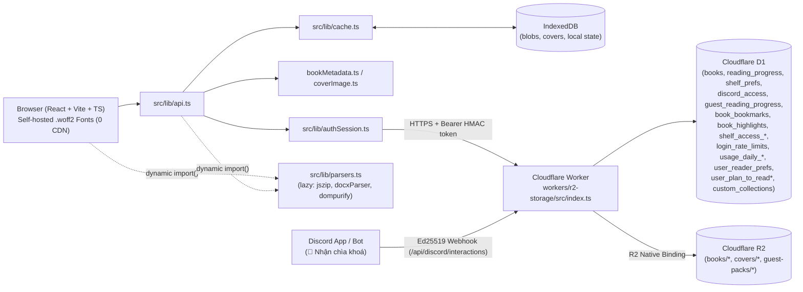

# Kiến trúc hệ thống — Arcane Library (`ofu.lol`)

## 1. Sơ đồ tổng thể

## 2. Bảng module

| File | Trách nhiệm | Export chính | Phụ thuộc vào |
|---|---|---|---|
| `src/types.ts` | Định nghĩa kiểu dữ liệu dùng chung (Book, Chapter, ParsedBook, Progress, Storage, CustomCollection, AniListNovelSuggestion, ReaderSettings, ViewMode, LibraryTab, AuthRole, AuthSessionInfo) | `Book`, `BookFileType`, `Chapter`, `ParsedBook`, `ReadingProgress`, `StorageStats`, `ShelfGroup`, `CustomCollection`, `AniListNovelSuggestion`, `ReaderSettings`, `ViewMode`, `LibraryTab`, `AuthRole`, `AuthSessionInfo` | — |
| `src/lib/authSession.ts` | Quản lý token & vòng đời phiên 2 tầng (`owner` 30 ngày / `guest` 24 giờ từ Discord key, `D-026`), bảo vệ D-005, HTTP client gắn Bearer token (`apiFetch`), kiểm tra Worker (`checkHealth`), đăng nhập (`loginWithPasscode`) và định dạng thời gian phiên còn lại (`formatRemainingSessionTime`) | `DEFAULT_OWNER_SESSION`, `isMissingProductionApi`, `isLocalDevMode`, `isCloudMode`, `assertApiConfigured`, `parseTokenSession`, `getAuthToken`, `setAuthToken`, `inspectStoredSession`, `getActiveAuthSession`, `formatRemainingSessionTime`, `isAuthError`, `apiFetch`, `checkHealth`, `loginWithPasscode` | `src/types.ts`, `localStorage`, Fetch API |
| `src/lib/gateRoutes.ts` | Định tuyến nhẹ 0 thư viện ngoài (`'root' \| 'entrance' \| 'locked' \| 'usage'`, `D-027`/`D-035`): phân tích `window.location.pathname` tương thích `BASE_URL`, chuyển hướng `replaceGateRoute` / `navigateGateRoute`, đồng bộ `document.title` (ẩn hoàn toàn `'usage'` thành `"Ofu's Library Closed"` khi chưa xác thực Admin) | `GateRoute`, `parsePathnameToGateRoute`, `getCurrentGateRoute`, `buildGateHref`, `syncGateDocumentTitle`, `replaceGateRoute`, `navigateGateRoute`, `subscribeGateRoute` | History API |
| `src/lib/usageApi.ts` | Client tải báo cáo thống kê hệ thống Admin (`GET /api/admin/usage?days=7\|14\|30` & chi tiết tủ sách theo khách `GET /api/admin/usage/guests/:discordUserId`, `D-035`/`D-036`, kèm fallback cục bộ cho Local Dev, chỉ import trong chunk nạp lười `AdminUsageView`) | `AdminUsageWindowDays`, `AdminUsageDailyPoint`, `AdminUsageTopBook`, `AdminUsageTopShelf`, `AdminUsageGuestRow`, `AdminGuestBookHistoryItem`, `AdminGuestUsageDetail`, `AdminUsageReport`, `fetchAdminUsageReport`, `fetchAdminGuestUsageDetail` | `src/lib/{api,authSession,cache,readingStreak}.ts` |
| `src/lib/cache.ts` | Lớp truy cập IndexedDB (`arcane-library-cache-v1`) lưu cache file sách/bìa, dữ liệu chế độ local và thống kê/dọn dẹp dung lượng cache thiết bị (`D-036` Mục 18) | `CachedBookEntryInfo`, `IndexedDbCacheInspection`, `getCachedBookBlob`, `setCachedBookBlob`, `deleteCachedBookBlob`, `getCachedCoverBlob`, `setCachedCoverBlob`, `deleteCachedCoverBlob`, `inspectIndexedDbCache`, `clearCachedBookBlobs`, `clearCachedCoverBlobs`, `clearAllMediaCache`, `getLocalBooks`, `putLocalBook`, `deleteLocalBook`, `getAllLocalProgress`, `putLocalProgress`, `deleteLocalProgress` | `src/types.ts`, IndexedDB API |
| `src/lib/shelfPlacement.ts` | Quy tắc phân bổ kệ thông minh: chuẩn hoá dấu gạch/hai chấm Unicode (`cleanShelfLabel`), nhận diện nhãn tập & tiêu đề phụ của tập sau nhãn tập trơn (`isVolumeOrSubtitleSegment`, `TITLE_ENDS_WITH_BARE_VOL_RE`, `isLikelyVolumeSubtitle`), trích tên bộ truyện (`extractSeriesName`), phát hiện kệ gốc chung cho cả lô tải lên (`inferBatchCommonShelf`), tác phẩm lẻ đứng kệ riêng và tự động gom chung về kệ tác giả khi có từ 2 tác phẩm lẻ cùng tác giả | `VOLUME_SEGMENT_RE`, `VOLUME_WITH_SUBTITLE_RE`, `TITLE_ENDS_WITH_BARE_VOL_RE`, `isVolumeOrSubtitleSegment`, `isLikelyVolumeSubtitle`, `cleanShelfLabel`, `extractSeriesName`, `isKnownAuthor`, `inferBatchCommonShelf`, `inferSingleBookShelf`, `resolveUploadShelfPlan`, `resolvePreviewShelfName` | `src/types.ts` |
| `src/lib/shelfPrefs.ts` | Quản lý tuỳ chọn kệ sách đồng bộ đa thiết bị (`D-025`/`D-032`/`D-036`): lưu/nạp cache `localStorage` (`covers`, `favorites`, `tags`, `altTitles`), cập nhật ảnh bìa kệ đại diện (`setShelfCoverBook`), ghim kệ yêu thích (`setShelfFavorite`), vá tag & tên gọi khác (`patchShelfTags`, `patchShelfAltTitles`), hợp nhất khi đổi tên kệ (`renameShelfPrefs`), dọn `cover_book_id` khi xoá sách và sắp xếp kệ yêu thích lên đầu | `MAX_ALT_TITLES`, `MAX_ALT_TITLE_LENGTH`, `ShelfPrefsState`, `toShelfPrefKey`, `normalizeClientShelfTags`, `normalizeClientAltTitles`, `readLocalShelfPrefs`, `writeLocalShelfPrefs`, `patchShelfCover`, `patchShelfFavorite`, `patchShelfTags`, `patchShelfAltTitles`, `renameShelfPrefs`, `pruneDeletedBooksFromPrefs`, `sortShelvesFavoriteFirst`, `setShelfCoverBook`, `setShelfFavorite` | `src/types.ts`, `src/lib/api.ts`, `localStorage` |
| `src/lib/catalogApi.ts` | Client đồng bộ các mở rộng Kho sách Wave 3 (`D-036` Mục 9, 11, 12, 13, chỉ nạp lười khi thao tác): lưu Tên gọi khác (`PUT /api/shelves/alt-titles`), đánh dấu *Đọc sau* cấp Bộ truyện hoặc cấp Tập lẻ (`PUT /api/plan-to-read`, có fallback `localStorage` ở Local Dev), CRUD Bộ sưu tập (`GET/POST/PUT/PATCH/DELETE /api/collections`) và gọi proxy gợi ý AniList (`POST /api/admin/anilist/search`, tự fallback nạp lười `src/lib/anilistDirect.ts` nếu WAF chặn IP Worker) | `readLocalPlanToReadShelves`, `readLocalPlanToReadBooks`, `readLocalCustomCollections`, `setShelfAltTitles`, `setPlanToReadShelf`, `setPlanToReadBook`, `fetchCustomCollections`, `createCustomCollectionApi`, `updateCustomCollectionApi`, `deleteCustomCollectionApi`, `searchAniListLightNovelsApi` | `src/types.ts`, `src/lib/{authSession,shelfPrefs}.ts`, `src/lib/anilistDirect.ts` (dynamic) |
| `src/lib/anilistDirect.ts` | Fallback nạp lười (`2.23 kB` gzip) chỉ gọi khi Cloudflare WAF của AniList chặn IP Worker (`502`/`504`): gọi thẳng `https://graphql.anilist.co` từ trình duyệt Admin (`ACAO: *`, 0 ảnh ngoài, timeout `6s`) và map sẵn về 40 thể loại chuẩn | `searchAniListDirectBrowser` | `src/types.ts`, `src/lib/shelfTagPresets.ts` |
| `src/lib/spoilerText.ts` | Bộ parse cú pháp `\|\|nội dung spoiler\|\|` thuần React (`D-036` Mục 15, tuyệt đối **0 `dangerouslySetInnerHTML`**, 0 nguy cơ XSS) và hàm chèn nhanh `\|\|Spoiler\|\|` cho ô nhập bình luận | `SpoilerTextSegment`, `parseSpoilerSegments`, `insertSpoilerSyntax` | — |
| `src/lib/communityApi.ts` | Client đồng bộ Chấm điểm 1–5 sao & Bình luận v2 (`GET /api/community`, `PUT /api/community/rating`, `POST /api/community/comments` kèm `parentId`/`chapterNumber`, `PATCH /api/community/comments/:id`, `PUT /api/community/comments/:id/reaction` 5 emoji, `DELETE /api/community/comments/:id`, `D-036`/`D-039`, có fallback `localStorage` cho Local Dev) | `MAX_COMMUNITY_COMMENT_LENGTH`, `CommunityApiError`, `fetchCommunitySummary`, `saveCommunityRating`, `postCommunityComment`, `editCommunityCommentApi`, `toggleCommunityReactionApi`, `deleteCommunityCommentApi` | `src/types.ts`, `src/lib/{authSession,shelfPrefs}.ts` |
| `src/lib/coverAccentColor.ts` | Trích 1 màu chủ đạo từ ảnh bìa đã cache bằng Canvas `16×16` (`< 1 ms`, cache RAM theo `coverKey`, `0` thư viện ngoài, `0 B` entry) để nhuộm nhẹ viền/thanh tiến độ và nền mờ `Ambient Cover Blur` (`D-039` Mục 1) | `extractDominantCoverColor`, `useCoverAccentColor` | React, Canvas 2D API |
| `src/lib/confettiBurst.ts` | Hiệu ứng pháo giấy Canvas nạp lười (`0.98 kB` gzip, `0 B` entry, tự huỷ `RAF` & thẻ `<canvas>`, tôn trọng `prefers-reduced-motion`) khi hoàn thành `100%` tập sách hoặc chạm mốc Streak `7 / 14 / 30` ngày (`D-039` Mục 4) | `triggerCelebrationConfetti`, `celebrateStreakMilestoneIfNeeded` | Canvas 2D API, `localStorage` |
| `src/lib/readerSoundscapes.ts` | Bộ phát **Âm thanh Môi trường Đọc sách (`PA-A`)** (`0` phụ thuộc `three`, `0` CDN, `0 B` R2, `0 B` tải trước khi chưa bật, `D-039` Mục 6): 3 bản nhạc nền Piano/Lofi + tiếng môi trường thật nối vòng lặp mượt lưu tại `public/sounds/*.m4a` (*Mưa đêm*, *Thư phòng ấm*, *Gió rừng anh đào*), định tuyến `<audio loop>` qua Web Audio `GainNode` hỗ trợ chỉnh âm lượng & hẹn giờ tắt `15/30/60p` fade-out trên cả Safari iOS, âm lật giấy nhẹ, mặc định TẮT, tự tạm dừng/`suspend()` khi ẩn tab & giải phóng bộ đệm + `AudioContext.close()` khi đóng sách | `ReaderSoundscapeId`, `SleepTimerMinutes`, `SOUNDSCAPE_OPTIONS`, `ReaderSoundscapeEngine`, `createReaderSoundscapeEngine` | HTMLAudioElement, Web Audio API |
| `src/lib/commandPaletteSearch.ts` | Bộ chấm điểm & gom nhóm kết quả tìm kiếm không dấu cho `CommandPaletteModal` (`Ctrl+K`, `D-039` Mục 11): khớp cả `alt_titles` Romaji/Anh/Nhật trên 6 nhóm (**Bộ truyện**, **Tập sách**, **Tác giả**, **Tuyển tập**, **Trích dẫn đã lưu**, **Thao tác nhanh**) và ẩn lệnh Admin với `guest` | `PaletteGroupKind`, `PaletteActionSpec`, `PaletteResultItem`, `PALETTE_GROUP_LABELS`, `buildCommandPaletteResults` | `src/types.ts`, `src/lib/{bookMetadata,libraryFiltering}.ts` |
| `src/lib/wrappedPosterCanvas.ts` | Tổng hợp dữ liệu **Ofu's Library Wrapped** (Tháng này / 90 ngày / Năm nay) và kết xuất Poster PNG `1080×1350` bằng Canvas 2D thuần (`0` CDN, dùng font tự lưu trữ `Literata` & `Be Vietnam Pro`, tự đóng `ImageBitmap` & gọi `URL.revokeObjectURL`, `D-039` Mục 12) | `WrappedPeriod`, `WrappedTopShelfSummary`, `WrappedComputedSummary`, `computeWrappedSummary`, `exportWrappedPosterPng` | `src/types.ts`, `src/lib/{api,bookMetadata,readingStreak}.ts`, Canvas 2D API |
| `src/lib/uploadBatchHelpers.ts` | Hàm nghiệp vụ dùng chung cho `UploadDropzone`: tạo hàng đợi tải lên (`createUploadQueueItems`) và gọi thông báo tập mới lên kênh Discord sau khi tải xong lô (`triggerDiscordReleaseAnnouncement`, `D-037`) | `MAX_SINGLE_FILE_BYTES`, `ACCEPTED_UPLOAD_EXTENSIONS`, `createUploadQueueItems`, `buildLibraryDuplicateKeys`, `triggerDiscordReleaseAnnouncement` | `src/types.ts`, `src/lib/{apiAdminMutations,authSession,bookMetadata}.ts`, `src/components/UploadQueueList.tsx`, `src/hooks/useToast.ts` |
| `src/lib/shelfBatchHelpers.ts` | Hàm nghiệp vụ dùng chung cho `ShelfBatchNoteModal`: phân tích danh sách tác giả trong kệ (`analyzeShelfAuthors`), chạy cập nhật metadata tuần tự theo tập và lưu đồng bộ kết quả gợi ý 1 chạm từ AniList (tác giả + mô tả + tên khác + thể loại) | `AuthorAnalysis`, `analyzeShelfAuthors`, `runShelfMetadataUpdates`, `saveShelfBatchAndAniListExtras` | `src/types.ts`, `src/lib/{api,bookMetadata,catalogApi,shelfPrefs,shelfTagPresets}.ts` |
| `src/lib/pwaRegister.ts` & `public/sw.js` | Đăng ký Service Worker PWA siêu mỏng tuân thủ chặt `QĐ-D` (`D-036` Mục 19): chỉ đăng ký ở bản `PROD` HTTPS/localhost, `sw.js` chỉ cache tài sản tĩnh đã gắn hash (`/assets/*`, icons) theo `CacheFirst` và `index.html` gốc theo `NetworkFirst` (`1.5s` timeout), **bỏ qua tuyệt đối** (`return` không can thiệp) `/api/*`, `/usage`, `/locked`, `/entrance`, cross-origin Worker, `Range` và tệp sách/3D | `registerPwaServiceWorker` | Service Worker API, `vite.config.ts` (`swVersionStampPlugin`) |
| `src/lib/shelfTagPresets.ts` | Danh mục 40 thể loại chuẩn Light Novel + tag tuỳ chỉnh (`D-032`, chỉ import trong chunk nạp lười `AdvancedSearchPanel`/`ShelfTagsModal`): chuẩn hoá nhãn, thống kê số bộ theo từng thể loại (`buildTagCatalogWithCounts`) và lưu tag lên D1 (`setShelfTags` → `PUT /api/shelves/tags`) | `MAX_SHELF_TAGS`, `MAX_SHELF_TAG_LENGTH`, `PRESET_SHELF_TAGS`, `toTagLookupKey`, `canonicalizeTagLabel`, `TagCatalogItem`, `buildTagCatalogWithCounts`, `setShelfTags` | `src/types.ts`, `src/lib/{api,shelfPrefs}.ts` |
| `src/lib/libraryFiltering.ts` | Các hàm thuần lọc & sắp xếp thư viện dùng chung cho `useLibraryViewState` (`normalizeSearchText`, tìm kiếm khớp cả Tên gọi khác `alt_titles` Romaji/Anh/Nhật, lọc theo tác giả, lọc thể loại 3 trạng thái AND/OR, lọc trạng thái đọc gồm `plan_to_read` cấp bộ & cấp tập, sắp xếp kệ) | `LibraryStatusFilter`, `normalizeSearchText`, `normalizeTagFilterKey`, `matchesBookAuthor`, `matchesShelfTagFilters`, `matchesShelfSearchQuery`, `matchesBookSearchQuery`, `collectAvailableAuthors`, `selectContinueReadingBooks`, `matchesBookStatus`, `matchesShelfStatus`, `sortShelvesByMode`, `prioritizeGuestReadable` | `src/types.ts`, `src/lib/{bookMetadata,shelfPlacement,shelfPrefs}.ts` |
| `src/lib/epubChapters.ts` | Chuẩn hoá danh sách chương EPUB: gom toàn bộ ảnh minh hoạ đầu sách (trước Khúc dạo đầu / Mục lục / Mở đầu / Chương X...) thành 1 mục duy nhất `Minh họa`; tích hợp liền mạch ảnh minh hoạ giữa chương và các tệp nối tiếp vào ngay trong chương hiện tại (không tách nhỏ chương trước khi tới chương tiếp theo) | `buildEpubChapters`, `RawEpubSection` | `src/types.ts` |
| `src/lib/bookMetadata.ts` | Hàm thuần trích xuất & chuẩn hoá metadata sách từ tên file (hỗ trợ tập thập phân `Tập 6.5` và tiêu đề phụ đi sau `- Quyển 1 - Đằng Sau Hạnh Phúc...`), khôi phục tiêu đề tập đầy đủ & lọc sạch tên tác giả bị tách nhầm từ tiêu đề phụ (`extractMisplacedSubtitleFromAuthor`, `getDisplayAuthor`, `getBookSortTitle`), màu bìa vải cổ điển và tính `%` tiến độ đọc | `VOLUME_SEGMENT_RE`, `VOLUME_WITH_SUBTITLE_RE`, `TITLE_ENDS_WITH_BARE_VOL_RE`, `isVolumeOrSubtitleSegment`, `isLikelyVolumeSubtitle`, `extractMisplacedVolumeFromAuthor`, `extractMisplacedSubtitleFromAuthor`, `getDisplayAuthor`, `getBookSortTitle`, `pickCoverColor`, `pickClothCoverColor`, `inferShelfName`, `parseFileMetadata`, `bookDuplicateKey`, `computeBookProgressPercent` | `src/types.ts`, `src/lib/shelfPlacement.ts` |
| `src/lib/shelfSummary.ts` | Hàm thuần cho Tab Thư viện (chỉ nạp lười trong chunk `LibraryCatalogView`): trích số tập (`Tập 1`, `Vol.1`, `v01`, `SAO1`...), chọn sách đại diện làm bìa kệ (`pickShelfCoverBook` ưu tiên tập do người dùng chọn ở `D-025`, fallback Tập 1 theo `D-018`) và tổng hợp thống kê kệ (`summarizeShelf`: `customCoverBookId`, `isFavorite`, `isPlanToRead`, `altTitles`, tác giả, trạng thái đọc, `%`, dung lượng, tập đọc tiếp) | `extractVolumeNumber`, `pickShelfCoverBook`, `summarizeShelf`, `computeBookProgressPercent`, `ShelfReadingStatus`, `ShelfSummary` | `src/types.ts`, `src/lib/bookMetadata.ts`, `src/lib/shelfPlacement.ts` |
| `src/lib/coverImage.ts` | Nén ảnh bìa bằng Canvas giữ nguyên tỉ lệ gốc trong biên an toàn `[0.56, 0.85]` về chiều cao tối đa `720px` (~40 KB JPEG `-v2.jpg`, `D-031`), tự giải phóng `ImageBitmap`, hỗ trợ tuỳ chọn `rejectBlankOrTiny` lọc bỏ ảnh quá nhỏ hoặc ảnh đơn sắc/trắng trơn | `compressCoverBlob`, `CompressCoverOptions` | Canvas / `createImageBitmap` |
| `src/lib/legacyCoverSync.ts` | Module nạp lười chạy ngầm 1 lần duy nhất cho `owner` (`D-031`): tự phát hiện sách có `cover_key` cũ chưa mang hậu tố `-v2.jpg`, trích lại bìa gốc không cắt xén từ tệp nguồn (`concurrency = 2`, không ghi tràn IndexedDB, giữ nguyên gói `guest-packs`) và cập nhật trực tiếp lên kệ | `needsLegacyCoverSync`, `syncLegacyCoversInBackground` | `src/types.ts`, `src/lib/{api,authSession,cache,parsers}.ts` |
| `src/lib/mikuCursorAnimator.ts` | Bộ phát hoạt ảnh 12 khung (`84ms`/khung, đúng chuẩn `jifRate = 5/60s` của `.ani` gốc) cho 13 con trỏ pixel-art Hatsune Miku: nạp lười 1 sprite-sheet duy nhất `public/cursors/miku-sheet.png` (`20.08 KB`), cắt frame sang `blob:` URL ghim RAM có `URL.revokeObjectURL` khi `dispose()`, tự dừng `0 FPS` khi ẩn tab hoặc `prefers-reduced-motion` | `startMikuCursorAnimation` | Canvas / CSSOM / `matchMedia` |
| `src/lib/chunkReload.ts` | Phát hiện lỗi tải chunk động sau deploy (`404`) và tự tải lại trang tối đa 1 lần qua `sessionStorage` để chặn lặp vô hạn (không reload khi `navigator.onLine === false`) | `isChunkLoadError`, `reloadOnceForStaleChunk`, `recoverFromChunkError` | `sessionStorage`, `navigator.onLine` |
| `src/fonts.css` & `src/assets/fonts/` | Khai báo `@font-face` cục bộ 0 CDN (`D-034`) cho 39 tệp `.woff2` (`vietnamese`, `latin-ext`, `latin`) của **Literata** (`font-serif`), **Be Vietnam Pro** (`font-sans`) và **JetBrains Mono** (`font-mono`), tách khỏi CSS nhờ `vite.config.ts` `assetsInlineLimit` | CSS `@font-face` | `src/assets/fonts/*.woff2` |
| `src/styles/reader.css` & `src/styles/cursors.css` | Tách gọn khỏi `src/index.css` (nhập tại `src/main.tsx` để mọi tệp CSS `<= 500` dòng): kiểu chữ/highlight/chú thích/in ấn chống lộ `guest` của trình đọc (`reader.css`) và lớp con trỏ Miku pixel-art (`cursors.css`) | CSS stylesheets | — |
| `src/lib/sanitizeHtml.ts` | Làm sạch HTML sách EPUB/DOCX bằng `DOMPurify` v3 (bảo toàn `epub:type`/`role`, cấm `style`/`srcset`/thẻ media nguy hiểm) trước bước đổi ảnh sang `blob:` URL, kèm `sanitizeSvgBlob()` chống XSS từ tệp `.svg` nhúng | `sanitizeBookDocument`, `sanitizeSvgBlob` | `dompurify` |
| `src/lib/docxXml.ts` | Hàm thuần đọc siêu dữ liệu OOXML của tệp `.docx` (relationships, styles/heading, numbering `ul`/`ol`, trích `rId` ảnh bỏ qua nhánh trùng `mc:AlternateContent`, thu thập ứng viên bìa ưu tiên thứ tự xuất hiện trong `word/document.xml` → `word/media/*` → `docProps/thumbnail.*`, hợp nhất `colspan`/`gridSpan`, trích nội dung `w:txbxContent` & đọc `word/footnotes.xml`/`word/endnotes.xml`) | `DocxRel`, `StyleMeta`, `RASTER_IMAGE_EXT_RE`, `RENDERABLE_IMAGE_EXT_RE`, `escapeHtml`, `getAttr`, `findDirectChild`, `resolveDocxPath`, `guessImageMimeType`, `parseRelationships`, `parseStyles`, `parseNumberingKinds`, `resolveHeadingFromStyle`, `isToggleFlagEnabled`, `findImageRelIds`, `collectDocxCoverCandidates`, `parseDocxNoteMap` | `jszip` (type-only) |
| `src/lib/docxChapters.ts` | Nhận diện tiêu đề chương chính xác cho tệp `.docx` (chặt biên dấu câu/số chương tránh cắt nhầm giữa câu) và gom khối HTML thành `Chapter[]` chuẩn hoá | `isDocxChapterHeadingText`, `splitDocxBlocksIntoChapters` | `src/types.ts` |
| `src/lib/docxParser.ts` | Trích ảnh bìa DOCX (duyệt ứng viên theo thứ tự `word/document.xml` → `word/media/*` → `docProps/thumbnail.*`, tự bỏ qua ảnh trắng trơn/icon quá nhỏ) và parse `word/document.xml` (kèm footnotes/endnotes & hộp văn bản `txbxContent`) thành `ParsedBook` reflowable chuẩn hoá `.normalize('NFC')`, hỗ trợ `skipMediaBlobs` tránh cấp phát ảnh thừa khi đóng gói `guest-pack` (`M-12`), giữ định dạng chữ/danh sách/bảng/ảnh `blob:` URL có `dispose()` | `extractDocxCover`, `parseDocxZip` | `jszip` (type-only), `src/types.ts`, `src/lib/{coverImage,docxChapters,docxXml,sanitizeHtml}.ts` |
| `src/lib/parsers.ts` | Nạp lười `jszip`; tải trước `jszip` khi trình duyệt rảnh (`preloadCoreReaders`); trích ảnh bìa lúc upload và parse EPUB/DOCX (hỗ trợ thẻ tự đóng `<title/>` XHTML, ưu tiên `nav epub:type="toc"` trên `landmarks`, fallback đường dẫn dẫn `/` & không phân biệt hoa thường/`%20`, làm sạch SVG nhúng bằng `sanitizeSvgBlob`) thành `ParsedBook` chuẩn hoá NFC, hỗ trợ truyền thẳng `arrayBuffer` & `skipMediaBlobs` kèm `dispose()` | `preloadCoreReaders`, `extractCoverAtUpload`, `parseBookBlob` | `jszip` (dynamic), `src/types.ts`, `src/lib/{chunkReload,coverImage,docxParser,epubChapters,sanitizeHtml}.ts` |
| `src/lib/readerSettingsStorage.ts` | Đọc/ghi & chuẩn hoá `ReaderSettings` trong `localStorage` + ánh xạ `appThemeToReaderTheme` (tách nhẹ khỏi `readerConfig.ts` để `useBookReader.ts` ở entry không kéo bảng màu trình đọc vào bundle khởi đầu, `D-013`) | `DEFAULT_READER_SETTINGS`, `appThemeToReaderTheme`, `normalizeReaderSettings`, `loadReaderSettings`, `saveReaderSettings` | `src/types.ts`, `localStorage` |
| `src/lib/readerConfig.ts` | Cấu hình trình đọc: 4 bảng màu đọc mở rộng token tương phản nội bộ độc lập khỏi theme App (`D-034`/`D-038`: `surfaceSubtle`, `accentText`, `accentBg`, `accentFg`, `accentSoftBg`, `focusBorder`, `sliderAccent`, `badgeOwner`, `badgeGuest`, `dangerButton`), font/width/paragraph-spacing map, xử lý bấm liên kết an toàn (`handleReaderContentLinkClick` kèm callback `onAnchorElement` cho chế độ Lật trang), trích nguồn ảnh click gồm `<svg><image>` (`findClickedReaderImage`), tính bề rộng lật trang (`resolvePaginatedSpreadWidth`) + tái xuất từ `readerSettingsStorage.ts` | `READER_THEME_STYLES`, `READER_FONT_CLASS`, `READER_WIDTH_MAX`, `READER_PARAGRAPH_SPACING_EM`, `handleReaderContentLinkClick`, `findClickedReaderImage`, `resolvePaginatedSpreadWidth`, `ReaderThemePalette` + tái xuất | `src/types.ts`, `src/lib/readerSettingsStorage.ts` |
| `src/lib/readerSettingsSync.ts` | Đồng bộ nền `ReaderSettings` lên Cloudflare D1 (`GET / PUT /api/reader-settings`, debounce `1.2s`, cách ly theo `user_scope`, nạp lười `0 B` ở entry, `D-036` Mục 7) | `fetchRemoteReaderSettings`, `scheduleRemoteReaderSettingsSync` | `src/types.ts`, `src/lib/{authSession,readerConfig}.ts` |
| `src/lib/readingEstimate.ts` | Hàm thuần đếm từ tiếng Việt/CJK trong chương (`~220` từ/phút), ước tính `"Còn ~X phút hết chương"` và sinh biến CSS Typography cho trình đọc DOM (`D-036` Mục 4 & 6) | `VIETNAMESE_READING_WPM`, `countWordsInPlainText`, `countWordsInGuestBlocks`, `formatRemainingChapterEstimate`, `buildReaderTypographyStyle` | `src/types.ts`, `src/lib/readerConfig.ts` |
| `src/lib/readerSearchJump.ts` | Định vị chính xác phần tử DOM (`ReaderView`) hoặc dòng `CanvasLayoutItem` (`GuestCanvasReader`, 0 DOM text) khớp lần xuất hiện thứ `N` của từ khoá và kích hoạt hiệu ứng nhấp nháy sáng `~2.2s` (`D-036` Mục 3) | `ReaderSearchJumpTarget`, `stripSearchDiacritics`, `findDomBlockForSearchQuery`, `flashDomSearchElement`, `findCanvasItemIndexForQuery` | `src/lib/guestCanvasLayout.ts` (type-only) |
| `src/lib/readingStreak.ts` | Định dạng thời lượng đọc dùng chung (`formatReadingDuration`), tính mức cường độ nhiệt `0..4`, lưu dự phòng theo ngày cho Local Dev và tải thống kê Streak & Lịch nhiệt 90 ngày (`GET /api/reading-stats/activity`, `D-036` Mục 17) | `ReadingActivityDay`, `ReaderActivityReport`, `toVnDayKey`, `formatReadingDuration`, `getHeatmapIntensityLevel`, `recordLocalDailyReadingSeconds`, `computeStreakFromDays`, `buildLocalReaderActivityFallback`, `fetchReaderActivityStats` | `src/types.ts`, `src/lib/authSession.ts` |
| `src/lib/apiAdminMutations.ts` | Nhóm hàm ghi kho sách dành riêng cho Admin (`uploadBook`, `updateBookMetadata`, `updateBookCover`, `renameShelfAll`, `bulkUpdateBooksShelf`, `deleteBooks`) tách sang chunk nạp lười để giữ nhẹ entry `index-*.js` (`D-013`) | `uploadBook`, `updateBookMetadata`, `updateBookCover`, `renameShelfAll`, `bulkUpdateBooksShelf`, `deleteBooks` | `src/types.ts`, `src/lib/{authSession,bookMetadata,cache,chunkReload,shelfPrefs}.ts` |
| `src/lib/api.ts` | Tầng nghiệp vụ đọc thư viện: tái xuất helper auth & admin mutations, giới hạn 9.0 GiB, cache-first blob/cover qua IndexedDB, đồng bộ `fetchLibraryState` và lưu tiến độ đọc kèm `readingDeltaSec` + `keepalive` (`D-026`/`D-036`) | `HARD_LIMIT_BYTES`, `MAX_SHELF_NAME_LENGTH`, `computeLocalStorageStats`, `fetchLibraryState`, `fetchBookBlobCached`, `fetchCoverBlobCached`, `saveReadingProgress`, `clearReadingProgress` + tái xuất | `src/types.ts`, `src/lib/{apiAdminMutations,authSession,bookMetadata,cache,shelfPrefs}.ts` |
| `src/hooks/useTheme.ts` | Quản lý 4 chế độ màu cho App 2D & Reader (`UiTheme`: `light` Ban ngày trắng `#fcfbf8` → `noon` Giữa trưa giấy kem ấm `#f6f1e7` → `dim` Chiều tối `#0d1117` → `midnight` Đêm khuya `#060608`, `D-034`) đồng thời giữ nguyên kiểu 3 chế độ `AppTheme` cho 3D qua cầu nối `toScene3DTheme()` & `getNext3DTheme()`, hỗ trợ View Transitions API & `meta[name="theme-color"]` | `useTheme`, `AppTheme`, `UiTheme`, `THEME_ORDER`, `THEME_LABELS`, `isDarkTheme`, `toScene3DTheme`, `getNextTheme`, `getNext3DTheme` | React, `localStorage` |
| `src/hooks/useReaderCanvasFontVersion.ts` | Đồng bộ nạp font tự lưu trữ (`Literata`, `Be Vietnam Pro`, `JetBrains Mono`) vào Canvas 2D cho `GuestCanvasReader` & `GuestCanvasPaginatedView`: gọi `document.fonts.load(...)` với mẫu dấu tiếng Việt và lắng nghe `loadingdone` để tính lại bố cục ngay khi font sẵn sàng (`D-034`) | `useReaderCanvasFontVersion` | React, `document.fonts`, `src/types.ts` |
| `src/hooks/useCanUse3D.ts` | Ranh giới thiết bị D-008: kiểm tra tuần tự `min-width: 1024px`, `(hover: hover) and (pointer: fine)`, lazy probe WebGL `{ failIfMajorPerformanceCaveat: true }` (cache cấp module, giải phóng ngay context test), `prefers-reduced-motion: reduce`, lưu/đồng bộ đa tab `localStorage` (`ofu-library-view-mode`), debounce resize `200ms`, cờ chịu lỗi phiên (`session3DFailed`, `retryKey`) | `VIEW_MODE_STORAGE_KEY`, `CanUse3DState`, `useCanUse3D` | React, `src/types.ts`, `localStorage`, `matchMedia`, WebGL API |
| `src/hooks/useLibraryViewState.ts` | Quản lý state giao diện thư viện dùng chung cho cả 2D và 3D (`searchQuery`, `activeShelfKey`, `selectionMode`, `selectedIds`, `allShelves`, `continueReadingBooks` tự loại sách đã `completed`, `filteredBooks`, `visibleShelves`, `selectedBooks`), đồng thời quản lý tab 2D `Trang chủ` / `Thư viện` / `Ủng hộ` (lưu `localStorage`), drill-down kệ đang mở (`openedLibraryShelf`), lọc nâng cao theo tác giả/thể loại 3 trạng thái và đồng bộ đổi tên kệ (`syncRenamedShelf`) | `LIBRARY_TAB_STORAGE_KEY`, `normalizeSearchText`, `selectContinueReadingBooks`, `computeBookProgressPercent`, `LibraryViewState`, `useLibraryViewState` | React, `src/types.ts`, `src/lib/api.ts`, `src/lib/bookMetadata.ts` |
| `src/hooks/useBookReader.ts` | Quản lý luồng mở/đóng sách (`fetchBookBlobCached` + dynamic `parseBookBlob`), huỷ mở sách an toàn bằng `AbortController` (`cancelOpeningBook`), chống rò rỉ `ObjectURL` (request ID + `dispose()` khi đóng/đổi/unmount), chỉ đồng bộ nền trình đọc khi người dùng chủ động đổi nền ngoài (`prevAppThemeRef`, vá `B1`) | `useBookReader` | React, `src/types.ts`, `src/lib/api.ts`, `src/lib/chunkReload.ts`, `src/lib/parsers.ts` (dynamic), `src/lib/readerConfig.ts` |
| `src/hooks/useCoverUrl.ts` | Tải ảnh bìa từ IndexedDB/R2 qua `fetchCoverBlobCached`, tạo & thu hồi `URL.revokeObjectURL` đúng vòng đời | `useCoverUrl` | React, `src/lib/api.ts` |
| `src/hooks/useCardReveal.ts` | Dùng chung 2 `IntersectionObserver` cấp module (`WeakMap`) cho toàn bộ thẻ sách/kệ (`isNearViewport`, `isRevealed`) và bộ xử lý nghiêng bìa 3D trái/phải/trên/dưới + ánh sáng phản chiếu theo con trỏ chuột (`handleCoverTiltMove`, `handleCoverTiltLeave` huỷ sạch RAF tránh kẹt nghiêng, `0` React re-render) | `useCardReveal`, `handleCoverTiltMove`, `handleCoverTiltLeave` | React, `IntersectionObserver` |
| `src/hooks/useToast.ts` | Hook quản lý hàng đợi thông báo Toast tự tắt kèm dọn sạch timer khi unmount | `useToast`, `ToastItem`, `ToastType` | React |
| `src/hooks/useBodyScrollLock.ts` | Hook khoá cuộn nền `document.body` có đếm reference (hỗ trợ nhiều modal mở lồng nhau an toàn không nhả khoá sớm) | `useBodyScrollLock` | React |
| `src/components/ThemeToggle.tsx` | Nút xoay vòng 4 chế độ (`Sun` Ban ngày → `Sunrise` Giữa trưa → `Moon` Chiều tối → `MoonStar` Đêm khuya) dùng chung cho `AuthGate` và `LibraryHeader` | `ThemeToggle` | `lucide-react`, `src/hooks/useTheme.ts` |
| `src/components/ViewModeToggle.tsx` | Công tắc chuyển đổi `2D` / `3D` trên `LibraryHeader`, chỉ render khi `canUse3D === true` (D-008) | `ViewModeToggle` | `lucide-react`, `src/types.ts` |
| `src/components/ErrorBoundary.tsx` | React Error Boundary chống trắng trang, nhận prop tuỳ chọn `fallback?: ReactNode \| ((errorMessage: string) => ReactNode)` (boundary gốc ở `main.tsx` giữ fallback mặc định), tự gọi `recoverFromChunkError(error)` trong `componentDidCatch` | `ErrorBoundary` | `lucide-react`, `src/lib/chunkReload.ts` |
| `src/components/ToastContainer.tsx` | Hiển thị stack thông báo không chặn UI góc dưới-phải qua `createPortal(..., document.body)` ở tầng `z-[90]` (luôn nổi trên mọi modal portal), đồng bộ màu Sáng/Tối | `ToastContainer` | `lucide-react`, `react-dom`, `src/hooks/useToast.ts` |
| `src/components/GateBackdropArt.tsx` | Họa tiết bản vẽ nét mảnh nguyên bản của Ofu's Library cho cổng ngoài (`0 CDN`): lưới kiến trúc mờ + cổng vòm Gothic-Classical & la bàn ổ khoá ánh sao (thay đổi trạng thái giữa `/entrance` mở khoá và `/locked` niêm phong) | `GateBackdropArt` | — |
| `src/components/AuthGate.tsx` | Cổng không gian mở mang bản sắc riêng của Ofu's Library (`D-026`/`D-027`, không đóng khung hộp SaaS, không sao chép chữ Hán/con dấu/font của TMW): tách **`/entrance`** (*`Ofu's Library Entrance`* — 1 ô nhập mã truy cập kèm nút ẩn/hiện dùng chung cho key Discord 12 ký tự và `ACCESS_PASSCODE` Admin) và **`/locked`** (*`Ofu's Library Closed`* — không có ô nhập mã, có nút chuyển sang `/entrance`), đồng bộ 3 chế độ Sáng/Chiều/Đêm | `AuthGate` | `lucide-react`, `src/types.ts`, `src/lib/{api,authSession,gateRoutes}.ts`, `src/components/{GateBackdropArt,ThemeToggle}.tsx` |
| `src/components/BookCard.tsx` | Thẻ sách 2D (dọc/ngang): bìa tỉ lệ chuẩn `7/10` (`D-031`, ảnh lazy qua `IntersectionObserver` + `useCoverUrl` hoặc bìa vải cổ điển fallback), nút đánh dấu *Đọc sau* cấp Tập lẻ (`BookmarkPlus`/`BookmarkCheck`, `D-036` Mục 11), thanh tiến độ %, badge định dạng, chế độ chọn nhiều | `BookCard` | `lucide-react`, `src/types.ts`, `src/hooks/useCoverUrl.ts` |
| `src/components/LibraryHeader.tsx` | Header thương hiệu **Ofu's Library**: thanh 3 tab 2D (`Trang chủ` \| `Thư viện` \| `Ủng hộ`), phân nhánh theo vai trò (`owner`: `Tải sách`, `Bảo mật`, `Bộ nhớ đệm`, `Chọn`, `ViewModeToggle`; `guest`: ẩn toàn bộ nút quản trị/cache/3D và hiện huy hiệu đếm ngược thời gian phiên 24 giờ `D-026`), chuyển Sáng/Tối, thống kê, làm mới, đăng xuất | `LibraryHeader` | `lucide-react`, `src/types.ts`, `src/lib/{api,authSession}.ts`, `src/components/ThemeToggle.tsx`, `src/components/ViewModeToggle.tsx` |
| `src/components/SupportView.tsx` | Nội dung Tab **Ủng hộ** nạp lười (`React.lazy`, `0 B` tăng thêm ở entry): lời tâm huyết của **Ofu's Library**, thẻ mã VietQR (`public/support-qr.png`) kèm hiệu ứng nghiêng 3D, nút sao chép STK 1 chạm & nút tải ảnh QR về máy | `SupportView`, `SupportViewProps` | `lucide-react`, `src/hooks/{useCardReveal,useToast}.ts` |
| `src/components/ShelfCoverCard.tsx` & `src/components/ShelfFanStack.tsx` | Thẻ Kệ / Bộ truyện trong Tab Thư viện (`D-018`/`D-025`/`D-031`/`D-036`/`D-039`): bìa chính `7/10` + **chồng bìa Tập 2 & Tập 3 thật xòe quạt (`PA-A`)** khi hover qua `IntersectionObserver` + `useCoverUrl`, nếp gáy sách, nút `Yêu thích` (`Star`), nút *`Đọc sau`*, nút quản trị kệ, huy hiệu điểm sao `★`, badge `N tập`, thanh tiến độ & trạng thái đọc | `ShelfCoverCard`, `ShelfFanStack` | `lucide-react`, `src/lib/{bookMetadata,shelfSummary}.ts`, `src/hooks/{useCardReveal,useCoverUrl}.ts` |
| `src/components/ShelfCoverPickerModal.tsx` | Modal chọn ảnh bìa đại diện cho kệ từ 1 tập bất kỳ có ảnh bìa trong kệ (hoặc đặt lại mặc định Tập 1) đồng bộ Cloudflare D1 qua `setShelfCoverBook` (`D-025`) | `ShelfCoverPickerModal`, `ShelfCoverPickerModalProps` | `lucide-react`, `src/types.ts`, `src/lib/{bookMetadata,shelfPrefs,shelfSummary}.ts`, `src/hooks/{useCoverUrl,useToast}.ts` |
| `src/components/ShelfDetailHero.tsx` | Phần Hero màn hình chi tiết bộ truyện (`D-018`/`D-032`/`D-036`): bìa kệ, hiển thị các **Tên gọi khác** (`altTitles`), mô tả mở rộng, **tên tác giả bấm được**, **chip thể loại bấm được**, nút `Đọc tiếp`, `Yêu thích`, *`Đọc sau`*, `Thể loại` (Admin), `Đổi tên kệ`, `Đổi ảnh bìa kệ`, `Ghi chú & Tác giả` và `Phân quyền` | `ShelfDetailHero`, `ShelfDetailHeroProps` | `lucide-react`, `src/types.ts`, `src/lib/{api,bookMetadata,shelfSummary}.ts`, `src/hooks/useCoverUrl.ts` |
| `src/components/AniListSuggestPanel.tsx` | Khung tìm kiếm & gợi ý metadata Light Novel 1 chạm từ AniList dành cho Admin (`D-036` Mục 12, **0 thẻ `` ngoài / 0 CDN**): chọn bản ghi điền nhanh Tác giả, Tên gọi khác (Romaji/Anh/Nhật), Mô tả sạch HTML và các Thể loại khớp `PRESET_SHELF_TAGS` | `AniListSuggestPanel`, `AniListSuggestPanelProps` | `lucide-react`, `src/types.ts`, `src/lib/catalogApi.ts` |
| `src/components/ShelfTagsModal.tsx` | Modal Admin gắn/gỡ thể loại cho bộ truyện (`D-032`/`D-036`, nạp lười trong chunk `LibraryCatalogView`): lưới 40 thể loại chuẩn (2–4 cột), nút **Gợi ý từ AniList** 1 chạm, lọc nhanh, thêm tag tuỳ chỉnh và lưu đồng bộ D1 qua `setShelfTags` | `ShelfTagsModal`, `ShelfTagsModalProps` | `lucide-react`, `react-dom`, `src/types.ts`, `src/components/AniListSuggestPanel.tsx`, `src/lib/shelfTagPresets.ts`, `src/hooks/{useLibraryViewState,useToast}.ts` |
| `src/components/ShelfDetailView.tsx` | Màn hình chi tiết 1 kệ khi drill-down trong Tab Thư viện: thanh quay lại, `ShelfDetailHero`, lọc nhanh tập + chip lọc nhanh `Đọc sau (N)` cho các tập đã đánh dấu trong kệ, chế độ chọn nhiều, lưới `BookCard` và khối nạp lười `CommunityReviewsSection` cấp Bộ truyện (tự khoá `🔒` nếu `isGuestLocked`, `D-030`) | `ShelfDetailView` | `lucide-react`, `src/types.ts`, `src/lib/shelfSummary.ts`, `src/components/{BookCard,ShelfDetailHero}.tsx`, `src/components/CommunityReviewsSection.tsx` (lazy), `src/hooks/useLibraryViewState.ts` |
| `src/components/CommunityCommentItem.tsx` | Thẻ bình luận đơn lẻ gắn danh tính `Owner` / tên Discord, nút xoá đúng quyền có xác nhận 2 bước tại chỗ và bộ render thuần React cho các đoạn `\|\|Spoiler\|\|` bấm để ẩn/hiện độc lập (`0` `dangerouslySetInnerHTML`) | `CommunityCommentItem`, `CommunityCommentItemProps` | `lucide-react`, `src/types.ts`, `src/lib/spoilerText.ts` |
| `src/components/CommunityReviewsSection.tsx` | Khối Chấm điểm 1–5 sao & Bình luận nạp lười (`React.lazy`, `6.40 kB` gzip, `0 B` entry, `D-036` Mục 15): chấm sao 1 chạm, ô bình luận giới hạn `1500` ký tự kèm nút chèn nhanh `\|\|Spoiler\|\|`, tương thích 2 chế độ giao diện (`library` và `reader` 4 nền đọc) | `CommunityReviewsSection`, `CommunityReviewsSectionProps` | `lucide-react`, `src/types.ts`, `src/components/CommunityCommentItem.tsx`, `src/lib/{authSession,communityApi,readerConfig,spoilerText}.ts`, `src/hooks/useToast.ts` |
| `src/components/ReaderBookCommunityBlock.tsx` | Vỏ nạp lười `CommunityReviewsSection` cấp Tập lẻ gắn cuối tập trong `ReaderView` & `GuestCanvasScrollStage` (chế độ cuộn dọc, nằm ngoài khung `<canvas>` bảo toàn `D-028`) và nút/modal `Bình luận` cạnh nút hoàn thành ở chế độ `Lật trang (2 cột)` (`ReaderPaginatedView`, `GuestCanvasPaginatedView`) | `ReaderBookCommunityBlock`, `ReaderBookCommunityModalButton` | `lucide-react`, `react-dom`, `src/lib/readerConfig.ts`, `src/components/CommunityReviewsSection.tsx` (lazy) |
| `src/lib/epubSummaryExtractor.ts` | Hàm nạp lười cho Admin tự trích xuất nội dung giới thiệu (`<dc:description>` / trang *Giới thiệu tác phẩm*) và tên tác giả (`<dc:creator>`) từ tệp `.epub` | `extractBookAutoDescription`, `extractBookAutoAuthor` | `jszip` (dynamic), `src/types.ts`, `src/lib/api.ts`, `DOMParser` |
| `src/components/ShelfBatchNoteFields.tsx` | Các bảng nhập liệu con cho cửa sổ cập nhật hàng loạt theo kệ: `Ghi chú chung cả bộ`, `Điền riêng từng tập`, `Tên tác giả` và tab `Tên khác` (`alt_titles` tối đa 15 tên Romaji/Anh/Nhật/viết tắt) | `ShelfBatchMode`, `ShelfBatchNoteFields`, `ShelfBatchNoteFieldsProps` | `src/types.ts`, `src/lib/{bookMetadata,shelfPrefs}.ts` |
| `src/components/ShelfBatchNoteModal.tsx` | Modal Admin thêm/cập nhật ghi chú, tên tác giả & tên gọi khác hàng loạt cho 1 kệ (kèm nút **Tự trích từ EPUB** và **Gợi ý từ AniList** 1 chạm, nạp lười trong chunk `LibraryCatalogView`) | `ShelfBatchNoteModal`, `ShelfBatchNoteModalProps` | `lucide-react`, `react-dom`, `src/types.ts`, `src/components/{AniListSuggestPanel,ShelfBatchNoteFields}.tsx`, `src/lib/{api,bookMetadata,epubSummaryExtractor,shelfBatchHelpers}.ts`, `src/hooks/useToast.ts` |
| `src/lib/shelfAccessApi.ts` | Client gọi API quản trị phân quyền đọc theo bộ (`GET / PUT /api/admin/shelves/access`, `D-030`) | `fetchAdminShelfAccessRules`, `saveAdminShelfAccessRule` | `src/types.ts`, `src/lib/authSession.ts` |
| `src/components/ShelfAccessMemberList.tsx` | Bảng danh sách tick chọn thành viên Discord, sao chép nhanh từ bộ khác & ô cấp quyền trước bằng `Discord User ID` cho `ShelfAccessModal` (`D-030`) | `SelectedMemberMeta`, `ShelfAccessMemberList`, `ShelfAccessMemberListProps` | `lucide-react`, `src/types.ts`, `src/lib/guestCrypto.ts` |
| `src/components/ShelfAccessModal.tsx` | Modal Admin phân quyền thành viên Discord theo bộ truyện (`D-030`, nạp lười trong chunk `LibraryCatalogView`, `0 B` tăng thêm ở entry): chuyển `public` ↔ `restricted` và lưu đồng bộ D1 | `ShelfAccessModal`, `ShelfAccessModalProps` | `lucide-react`, `react-dom`, `src/types.ts`, `src/components/ShelfAccessMemberList.tsx`, `src/lib/{api,guestCrypto,shelfAccessApi}.ts`, `src/hooks/{useLibraryViewState,useToast}.ts` |
| `src/components/CollectionFilterStrip.tsx` | Dải lọc ngang **Tuyển tập / Bộ sưu tập tuỳ chỉnh** trên Tab Thư viện (`D-036` Mục 13): hiển thị chip `Tất cả`, từng tuyển tập kèm số bộ `(N)`, mô tả tuyển tập đang chọn và nút `Quản lý` cho Admin | `CollectionFilterStrip`, `CollectionFilterStripProps` | `lucide-react`, `src/types.ts` |
| `src/components/CollectionManagerModal.tsx` | Modal nạp lười cho Admin tạo/sửa/xoá và gán bộ truyện vào **Tuyển tập tuỳ chỉnh** (`D-036` Mục 13, đồng bộ `custom_collections` & `collection_shelves` trên D1) | `CollectionManagerModal`, `CollectionManagerModalProps` | `lucide-react`, `react-dom`, `src/types.ts`, `src/lib/{catalogApi,libraryFiltering,shelfPrefs}.ts`, `src/hooks/useToast.ts` |
| `src/components/LibraryCatalogView.tsx` | Nội dung Tab Thư viện nạp lười (`React.lazy`, chunk riêng giữ nhẹ entry theo D-013): điều phối `CollectionFilterStrip` + lưới `ShelfCoverCard` ↔ chi tiết kệ `ShelfDetailView` + các modal kệ & `CollectionManagerModal` | `LibraryCatalogView`, `LibraryCatalogViewProps` | `lucide-react`, `src/types.ts`, `src/lib/shelfSummary.ts`, `src/components/{CollectionFilterStrip,ShelfAccessModal,ShelfBatchNoteModal,ShelfCoverCard,ShelfCoverPickerModal,ShelfDetailView}.tsx`, `src/components/CollectionManagerModal.tsx` (lazy) |
| `src/components/LibraryHomeShelvesSection.tsx` | Khối `03 · Toàn bộ kho truyện` trên Tab Trang chủ 2D (tách từ `Library2DView.tsx` giữ mọi file `<= 500` dòng): danh sách các kệ, nút yêu thích/đổi tên kệ & lưới `BookCard` | `LibraryHomeShelvesSection`, `LibraryHomeShelvesSectionProps` | `lucide-react`, `src/types.ts`, `src/components/BookCard.tsx` |
| `src/components/Library2DView.tsx` | Giao diện thư viện 2D dùng state chung `LibraryViewState` từ `App.tsx`: điều phối Tab `Trang chủ` (`LibraryFilterBar`, `Tiếp tục đọc`, `EditorialBookStrip`, `LibraryHomeShelvesSection`) ↔ Tab `Thư viện` (nạp lười `LibraryCatalogView`) ↔ Tab `Ủng hộ` | `Library2DView` | `lucide-react`, `src/types.ts`, `src/hooks/useLibraryViewState.ts`, `src/components/{BookCard,EditorialBookStrip,LibraryFilterBar,LibraryHeader,LibraryHomeShelvesSection}.tsx`, `src/components/{LibraryCatalogView,SupportView}.tsx` (lazy) |
| `src/components/Library3DHost.tsx` | Vỏ nạp lười `React.lazy` cho `FantasyLibrary3D` (chỉ mount sau khi đăng nhập & `effectiveMode === '3d'`), bọc `<ErrorBoundary key={retryKey}>` + `<Suspense>` tự động fallback mượt về `Library2DView` + toast khi lỗi chunk/runtime | `Library3DHost` | `lucide-react`, `src/components/ErrorBoundary.tsx`, `src/components/Library2DView.tsx`, `src/components/LibraryHeader.tsx`, `src/components/library3d/FantasyLibrary3D.tsx` (lazy) |
| `src/components/library3d/bookPacking3d.ts` | Lõi xếp sách vào tủ kệ dùng chung (tính kích thước sách, chọn sách tiêu điểm quay bìa, chia hàng theo khoang, tính ma trận xoay Euler `'XYZ'` chuẩn xác ở mọi góc `facingYaw`, `CoverPlaneTransform` & vector rút sách `pullDirection`) | `LIBRARY_3D_CONSTANTS`, `DEFAULT_FEATURED_COVER_SLOTS`, `MAX_FEATURED_COVER_SLOTS`, `BookFacing`, `CoverPlaneTransform`, `BookSlot3D`, `PreparedBook`, `PackedShelfRows`, `BuildCabinetBookSlotsOptions`, `rotationMatrixToEulerXYZ`, `transformCabinetLocalPoint`, `computeTierPlankYs`, `computeCabinetWidth`, `packShelfGroupIntoRows`, `buildCabinetBookSlots` | `src/types.ts`, `src/lib/bookMetadata.ts` |
| `src/components/library3d/layout3d.ts` | Kiểu dữ liệu bố cục 3D và windowing `getNearestShelfIndex` / `getVisibleShelfWindow` / `selectFeaturedCoverSlots` theo cả trục X lẫn 2D `(x, z)` + `activeFloorIndex` (`D-013`/`D-014`/`D-017`), tái xuất hằng/type từ `bookPacking3d.ts` | `LIBRARY_3D_CONSTANTS`, `DEFAULT_FEATURED_COVER_SLOTS`, `MAX_FEATURED_COVER_SLOTS`, `BookFacing`, `CoverPlaneTransform`, `BookSlot3D`, `ShelfLayout3D`, `LibraryLayout3D`, `VisibleShelfWindow`, `VisibleShelfWindowOptions`, `FeaturedCoverSelectionOptions`, `getNearestShelfIndex`, `getVisibleShelfWindow`, `selectFeaturedCoverSlots` | `src/components/library3d/bookPacking3d.ts` |
| `src/components/library3d/worldTypes.ts` | Tập hợp kiểu dữ liệu chuẩn cho Thế giới Aincrad Reading Tower (`BiomeId`, collider OBB/trụ, bề mặt dốc/cầu vồng, trạm tương tác, NPC, đạo cụ biome, tủ kệ xoay `WorldBookcase3D`, `FloorWorldLayout3D`, `TowerWorldLayout3D`, `JumpTarget3D`) | `BiomeId`, `ColliderTag`, `WorldBounds3D`, `BoxCollider3D`, `CylinderCollider3D`, `WorldCollider3D`, `SurfaceZone3D`, `WorldStationKind`, `WorldStation3D`, `NpcRole`, `NpcWaypoint3D`, `WorldNpcSpec3D`, `BiomePropKind`, `BiomePropPlacement3D`, `BookcaseAnchor3D`, `BiomeMeta`, `BiomeBlueprint3D`, `WorldBookcase3D`, `FloorWorldLayout3D`, `TowerWorldLayout3D`, `BuildTowerOptions`, `ActiveFloorCoverOptions`, `JumpTarget3D` | `src/components/library3d/bookPacking3d.ts` |
| `src/components/library3d/biomeBlueprints.ts` | Bản thiết kế không gian 4 World Biome Aincrad (`town_of_beginnings`, `sakura_shrine`, `starfield_atrium`, `starlight_ruins`): ranh giới đảo/sảnh, 6 neo tủ kệ/tầng, dốc/cầu gỗ vồng/bậc đá núi, collider nước/vách đá/cột, trạm tương tác, tuyến tuần tra NPC, đạo cụ & `bossAnchor` | `BIOME_SEQUENCE`, `BIOME_CATALOG`, `BIOME_BLUEPRINTS`, `getBiomeForFloorIndex` | `src/components/library3d/worldTypes.ts` |
| `src/components/library3d/floorWorldLayout3d.ts` | Bộ sinh Thế giới Aincrad theo tầng (`D-017`): phân bổ kệ & tự tách kệ rất lớn thành nhiều cụm tủ 2 khoang, gắn tủ xoay theo neo biome kèm collider OBB động, tạo bản đồ dịch chuyển O(1) theo kệ/sách, adapter `getFloorActiveLibraryLayout` và windowing bìa 2D trên tầng chủ động | `WORLD_LAYOUT_CONSTANTS`, `BIOME_CATALOG`, `BIOME_SEQUENCE`, `getBiomeForFloorIndex`, `buildTowerWorldLayout3D`, `getFloorActiveLibraryLayout`, `getVisibleFloorBookcases`, `selectActiveFloorFeaturedCovers`, `findJumpTargetForShelf`, `findJumpTargetForBook`, toàn bộ type từ `worldTypes.ts` | `src/types.ts`, `src/components/library3d/{bookPacking3d,layout3d,biomeBlueprints,worldTypes}.ts` |
| `src/components/library3d/worldPhysics3d.ts` | Bộ vật lý di chuyển & camera thuần cho thế giới 3D: tính độ cao bề mặt qua nền/dốc/cầu vồng (`resolveSurfaceY`), di chuyển chia nhỏ chống xuyên tường + trượt OBB/trụ + chắn rơi mép vực/hồ (`resolveWorldPlayerStep`), raycast chống camera xuyên tường/kệ (`resolveCameraOrbitPosition`) và tìm trạm tương tác gần nhất | `PLAYER_PHYSICS_CONSTANTS`, `SurfaceSample3D`, `PlayerStepInput`, `PlayerStepResult`, `CameraOrbitResult`, `evaluateSurfaceZoneY`, `resolveSurfaceY`, `resolveWorldPlayerStep`, `resolveCameraOrbitPosition`, `findNearestInteractableStation` | `src/components/library3d/floorWorldLayout3d.ts` (type-only) |
| `src/components/library3d/coverTextureCache.ts` | Quản lý VRAM texture bìa 3D theo `D-013`: tái sử dụng `fetchCoverBlobCached`, LRU tối đa `36` texture (`MAX_COVER_TEXTURES`), tối đa `4` lượt tải song song (`MAX_CONCURRENT_COVER_LOADS`), ưu tiên & huỷ request khi kệ rời tầm nhìn (`pruneOutsideShelves`), decode `createImageBitmap(blob, { imageOrientation: 'flipY', resizeWidth: 256, resizeHeight: 384, resizeQuality: 'medium' })` với `flipY = false` + `SRGBColorSpace` (fallback `ObjectURL` luôn `URL.revokeObjectURL` ngay trong `onload`/`onerror`), giải phóng bắt buộc `texture.dispose()` + `bitmap.close()` khi evict và `disposeAll()` | `MAX_COVER_TEXTURES`, `MAX_CONCURRENT_COVER_LOADS`, `COVER_DECODE_WIDTH`, `COVER_DECODE_HEIGHT`, `CoverTextureListener`, `CoverTextureRequestOptions`, `CoverTextureCacheStats`, `CoverTextureCache`, `createCoverTextureCache` | `three`, `src/lib/api.ts` |
| `src/components/library3d/proceduralMaterials.ts` | Tạo 100% vật liệu & texture Canvas2D procedural (0 CDN, `<= 4` texture VRAM: vân gỗ ấm tileable, wood bump, mặt giấy, atlas biển tên kệ dùng font hệ thống) kèm nạp vân gỗ thật `pbr-wood-albedo.webp` và bảng màu/ánh sáng đồng bộ 3 chế độ `light` (Ban ngày nắng ấm), `dim` (Chiều tối đèn thư phòng), `midnight` (Đêm khuya ánh trăng), đổi theme tại chỗ (`applyTheme`) kèm `dispose()` thu hồi sạch texture/material | `LIBRARY_3D_THEME_PALETTES`, `Library3DLightingRig`, `Library3DThemePalette`, `LibraryMaterialBundle`, `ShelfNameplateItem`, `NameplateUVRect`, `ShelfNameplateAtlas`, `getLibrary3DThemePalette`, `createShelfNameplateAtlas`, `createLibraryMaterialBundle` | `three`, `src/hooks/useTheme.ts`, `src/components/library3d/furnitureGlbHelpers.ts` |
| `src/components/library3d/geometryUtils.ts` | Bộ gộp `BufferGeometry` nhẹ nội bộ (`mergeSimpleGeometries`) cho các batch (tự chuẩn hoá nếu pha trộn indexed & non-indexed, `position`/`normal`/`uv`) thay cho `BufferGeometryUtils` nặng, tự động `dispose()` toàn bộ geometry đầu vào | `mergeSimpleGeometries` | `three` |
| `src/components/library3d/gltfLoader.ts` | Bộ nạp `.glb` nội bộ **0 CDN** (`D-010`) dùng `GLTFLoader` + `MeshoptDecoder` cục bộ từ `three/examples/jsm/libs/meshopt_decoder.module.js`, cache template Promise, nhân bản qua `SkeletonUtils.clone`, `disposeObject3D` / `clearLocalGlbCache` và hook `useLocalGlb(url)` | `LoadedGlbTemplate`, `loadLocalGlb`, `cloneGlbTemplate`, `disposeObject3D`, `clearLocalGlbCache`, `useLocalGlb` | React, `three` (`GLTFLoader`, `MeshoptDecoder`, `SkeletonUtils`) |
| `src/components/library3d/worldPalettes.ts` | Bảng màu bầu trời, sương mù, ánh sáng, thảm thực vật, mặt nước, đèn đường & hạt không khí cho đủ 12 tổ hợp `4 Biome × 3 Theme` (`light`/`dim`/`midnight`) kèm biến thể tầng cao (`variant`) | `WorldBiomeVisualPalette`, `getWorldBiomePalette` | `src/hooks/useTheme.ts`, `src/components/library3d/worldTypes.ts` |
| `src/components/library3d/skyPanoramaPainter.ts` | Vẽ bầu trời equirectangular 2K (`2048×1024`, 0 CDN, `D-022`): Dải Ngân Hà, cực quang, 900+ sao & sao lấp lánh 4 cánh, Mặt Trăng chi tiết có hố & quầng sáng (Đêm), Mặt Trời + mây khối anime nhiều lớp (Ngày/Hoàng hôn) & sương chân trời liền mạch | `paintSkyPanorama` | `src/hooks/useTheme.ts`, `src/components/library3d/{worldPalettes,worldTypes}.ts` |
| `src/components/library3d/worldMaterials.ts` | Sinh bộ texture Canvas2D liền mạch cho Thế giới Biome (`cobble`, `grass`, `marble`, `water`, `SkyDome` 2K qua `skyPanoramaPainter.ts`, 0 CDN) kết hợp nạp PBR WebP nội bộ (`pbr-cobble`, `pbr-tile`, `pbr-stone`) và đổi theme tại chỗ (`applyBiomeTheme`) kèm `dispose()` | `WorldMaterialBundle`, `WorldBiomeVisualPalette`, `getWorldBiomePalette`, `createWorldMaterialBundle` | `three`, `src/hooks/useTheme.ts`, `src/components/library3d/{worldTypes,worldPalettes,skyPanoramaPainter}.ts` |
| `src/components/library3d/WorldHorizonVista.tsx` | Khung cảnh không gian bên ngoài 360° Aincrad (`55–220 m`, `<= 5` draw call, 0 CDN, `D-022`): biển mây 2 tầng trôi chậm dưới chân đảo, vành đai núi 360° (Tầng 2 có đỉnh Phú Sĩ + tháp chùa xa), quần đảo bay + tàn tích pha lê & vành đế tầng trên khổng lồ của Aincrad | `WorldHorizonVista`, `WorldHorizonVistaProps` | `@react-three/fiber`, `three`, `src/hooks/useTheme.ts`, `src/components/library3d/{geometryUtils,worldGeometryBuilder,worldPalettes,worldTypes}.ts` |
| `src/components/library3d/grandLibraryBuilder.ts` | Bộ dựng vỏ kiến trúc kín 4 vách, ban công tầng lửng, vòm gân đồng cong, cửa sổ kính màu + hoa hồng, 4 đèn chùm, thảm hoàng gia và bảng toạ độ lắp ghép `.glb` thật cho Đại Thư Viện Tầng 3 (`D-023`) | `GlbPlacement3D`, `GrandLibraryGeometries`, `createRoyalCarpetTexture`, `buildGrandLibraryGeometries` | `three`, `src/components/library3d/{geometryUtils,worldGeometryBuilder}.ts` |
| `src/components/library3d/furnitureGlbHelpers.ts` | Tiện ích dùng chung chuẩn hoá, lọc sub-mesh, đổi tông vật liệu an toàn (`disposeClonedMaterials`), nạp vân gỗ liền mạch thật (`attachLocalWoodAlbedo`) và danh mục 12 URL `PROP_GLB_URLS` nội bộ (0 CDN, `D-023`) | `PROP_GLB_URLS`, `PreparedGlbProp`, `PrepareGlbOptions`, `prepareGlbProp`, `disposeClonedMaterials`, `computeFitTransform`, `attachLocalWoodAlbedo` | `three`, `src/components/library3d/gltfLoader.ts` |
| `src/components/library3d/DragonBossDoorGlb.tsx` | Component `FittedGlb` (căn tâm/chạm sàn `.glb` dùng chung) và `DragonBossDoorGlb` render **Cửa Đá Rồng chạm khắc (`prop-dragon-door.glb`)** kèm đôi đài đuốc đá & ấn phong ấn động (đỏ khoá / lam-ngọc mở, `D-023`) | `FittedGlb`, `FittedGlbProps`, `DragonBossDoorGlb`, `DragonBossDoorGlbProps` | `@react-three/fiber`, `three`, `src/hooks/useTheme.ts`, `src/components/library3d/{gltfLoader,furnitureGlbHelpers}.ts` |
| `src/components/library3d/GrandLibraryHallMesh.tsx` | Component R3F render Đại Thư Viện Hoàng Gia Tầng 3 (`starfield_atrium`, `D-023`): vỏ tường kín 4 góc + 2 tầng tủ sách Victorian PBR thật (`prop-bookcase-victorian.glb`), cầu thang thật (`prop-library-stairs.glb`), đôi cầu thang xoắn (`prop-spiral-stairs.glb`), 4 góc đọc sách đa dạng (2 góc lounge ghế bành nhung đỏ đô/ngọc lục bảo + 2 góc bàn cổ/artisan), thảm đỏ & 4 `pointLight` đèn chùm | `GrandLibraryHallMesh`, `GrandLibraryHallMeshProps` | `@react-three/fiber`, `three`, `src/hooks/useTheme.ts`, `src/components/library3d/{gltfLoader,furnitureGlbHelpers,grandLibraryBuilder,proceduralMaterials,worldMaterials}.ts` |
| `src/components/library3d/WorldFurnitureGlbs.tsx` | Phân bố nội thất PBR `.glb` đa dạng theo từng tầng/vị trí (`D-023`): Tầng 1 bàn sồi + ghế bành kem & quầy `artisan-table` + tủ Victorian; Tầng 2 bàn trà Nhật trầm thấp + quầy gỗ đỏ + giếng đá cổ; Tầng 3 bàn dài cổ điển + lounge ghế bành nhung + quầy Thủ thư Victorian; Tầng 4 Bàn Đá Ánh Sao chạm khắc từ `stone-platform`; mọi Cửa Boss dùng `prop-dragon-door.glb` kèm đôi đài đuốc & ấn phong ấn | `WorldFurnitureGlbs`, `WorldFurnitureGlbsProps` | `@react-three/fiber`, `three`, `src/hooks/useTheme.ts`, `src/components/library3d/{gltfLoader,furnitureGlbHelpers,worldTypes}.ts` |
| `src/components/library3d/worldGeometryBuilder.ts` | Dựng và gộp hình học kiến trúc theo từng Biome: mặt đất/quảng trường (tầng 2–4; tầng 1 dùng `TownWorldGlb`), hồ nước, cầu gỗ vồng parabol khớp vật lý, bậc thang đá/kính, mái vòm Starfield, toàn bộ tủ kệ xoay `WorldBookcase3D` (kèm mái hiên gỗ, cặp đèn tường đồng cổ & dải đèn ấm `bookcaseLampGlow`) và batch biển tên kệ xoay | `WorldArchitectureGeometries`, `createScaledBox`, `buildWorldArchitectureGeometries`, `buildRotatedNameplateGeometry` | `three`, `src/components/library3d/{geometryUtils,bookPacking3d,proceduralMaterials,worldTypes}.ts` |
| `src/components/library3d/skyEnvironment.ts` | Sinh bản đồ môi trường phản chiếu IBL nội bộ **0 CDN** (`THREE.PMREMGenerator` từ Canvas2D equirectangular đồng bộ bầu trời & hướng nắng/trăng) giúp đường lát đá ẩm, cửa kính châu Âu, kim loại và nhân vật có phản chiếu tự nhiên kèm `dispose()` | `ProceduralSkyEnvironment`, `createProceduralSkyEnvironment` | `three`, `src/hooks/useTheme.ts`, `src/components/library3d/worldPalettes.ts` |
| `src/components/library3d/TownWorldGlb.tsx` | Nạp & tinh chỉnh cảnh phố châu Âu thật cho Tầng 1 (`public/models/town-world.glb`, 13.09 MiB Meshopt + WebP 1024, 0 CDN, `D-019`): căn tâm đại lộ `(-7.8, 0, -40.0)`, lọc texture `anisotropy` 8x, chuyển tán lá/cỏ sang `alphaTest` sắc nét, bật sáng 22 đèn đường & 4 `pointLight` ấm vào Chiều/Đêm | `TownWorldGlb`, `TownWorldGlbProps` | `@react-three/fiber`, `three`, `src/hooks/useTheme.ts`, `src/components/library3d/gltfLoader.ts` |
| `src/components/library3d/WorldBiomeMesh.tsx` | Component R3F render tầng chủ động (`activeFloorIndex`, `D-017`/`D-019`): `SkyDome` bán kính 460 m, IBL `scene.environment` nội bộ (`skyEnvironment.ts`), hệ đèn + đổ bóng mềm `2048×2048`, gắn `TownWorldGlb` cho Tầng 1 hoặc địa hình/hồ/cầu/mái kính cho Tầng 2–4, tủ kệ xoay + atlas biển tên kệ và hiệu ứng gợn nước nhẹ | `WorldBiomeMesh`, `WorldBiomeMeshProps` | `@react-three/fiber`, `three`, `src/hooks/useTheme.ts`, `src/components/library3d/{worldTypes,proceduralMaterials,worldMaterials,worldGeometryBuilder,skyEnvironment,TownWorldGlb}.ts` |
| `src/components/library3d/bossRoomLayout3d.ts` | Tính mốc đọc tích luỹ toàn thư viện mở khoá Phòng Boss (`computeLibraryReadingTotals`, `evaluateFloorBossUnlock` — đạt `N(N+1)/2` tập hoặc `× 150` trang bất kỳ), tính chỉ số RPG nền (`computeReaderRpgStats`: LV/XP/HP/Mana từ tiến độ đọc hiện có), phân nhánh đấu trường (`isSkyBattlefieldBossRoom`) và sinh bố cục Phòng Boss kép: Colosseum kín 360° (Tầng 1–3) & Đấu trường Đảo Bay Trời Mở (`starlight_ruins` — Tầng 4 Stormterror, `D-024`) | `LibraryReadingTotals`, `ReaderRpgStats`, `getFloorBossName`, `isSkyBattlefieldBossRoom`, `computeLibraryReadingTotals`, `computeReaderRpgStats`, `evaluateFloorBossUnlock`, `buildBossRoomFloorLayout` | `src/types.ts`, `src/lib/bookMetadata.ts`, `src/components/library3d/worldTypes.ts` |
| `src/components/library3d/BossArenaMesh.tsx` | Render 2 đấu trường Phòng Boss theo tầng/Boss (`D-021`/`D-024`, 0 CDN): Colosseum đá kín 360° (`public/models/boss-arena.glb` 2.89 MiB ghép 4 mặt, Tầng 1–3) và Đấu trường Đảo Bay Trời Mở (`public/models/boss-battlefield.glb` 2.83 MB WebP+Meshopt kèm SkyDome 2K + `WorldHorizonVista`, Tầng 4 Stormterror), cổng thoát lam và `FloorBossSentinelGlb` | `BossArenaMesh`, `BossArenaMeshProps` | `@react-three/fiber`, `three`, `src/hooks/useTheme.ts`, `src/components/library3d/{gltfLoader,bossRoomLayout3d,worldTypes,worldMaterials,WorldHorizonVista,WorldGlbActors}.ts` |
| `src/components/library3d/StormterrorBossGlb.tsx` | Hoạt ảnh GPU vertex shader + bay lượn cho Boss Tầng 4 (**Phong Long Stormterror** — model gốc tĩnh 0 xương): vỗ 6 cánh mềm dẻo lệch pha, quẫy đuôi uốn lượn, đảo cổ/đầu, lượn hình số 8 trên không kèm nghiêng cánh, quay ánh nhìn theo Kirito, nhấp nháy pha lê Phong & vòng gió dưới cánh (0 FPS khi paused/reduced-motion, `dispose()` sạch material nhân bản) | `StormterrorBossGlb`, `StormterrorBossGlbProps` | `@react-three/fiber`, `three`, `src/components/library3d/{gltfLoader,worldTypes}.ts` |
| `src/components/library3d/WorldGlbActors.tsx` | Render đạo cụ & Boss `.glb` nén cục bộ (WebP 1024 + Meshopt, 0 CDN, `D-021`/`D-023`): `ToriiGateGlb` (`prop-torii-gate.glb`), `DragonMascotGlb`, `MossyStairsGlb` (`prop-mossy-stairs.glb`) và `FloorBossSentinelGlb` (chỉ render bên trong `BossArenaMesh`: `stone-golem`, `boss-monster` clip `MOTION`, uỷ quyền Tầng 4 sang `StormterrorBossGlb`) | `ToriiGateGlb`, `DragonMascotGlb`, `MossyStairsGlb`, `FloorBossSentinelGlb` | `@react-three/fiber`, `three`, `src/components/library3d/{gltfLoader,StormterrorBossGlb,worldTypes}.ts` |
| `src/components/library3d/BiomePropsMesh.tsx` | Render đạo cụ 4 Biome (cây, anh đào, đèn lồng, ghế đá, cột cổ/tinh thể, bàn đọc, bục thủ thư, cổng tầng & **Cửa Phòng Boss 2 cánh** có ấn phong ấn đỏ-hổ phách khi khoá / lam-ngọc khi mở), Cổng Torii/bậc đá GLB và hiệu ứng hạt (không còn Boss lộ thiên & không còn dây leo treo) | `BiomePropsMesh`, `BiomePropsMeshProps` | `@react-three/fiber`, `three`, `src/hooks/useTheme.ts`, `src/components/library3d/{geometryUtils,proceduralMaterials,worldMaterials,worldGeometryBuilder,WorldGlbActors,worldTypes}.ts` |
| `src/components/library3d/AnimatedPlayerGlb.tsx` | Nạp và điều khiển hoạt ảnh `THREE.AnimationMixer` cho Kirito `.glb` gắn xương Mixamo (`public/models/player.glb`, 269 KB, 25 xương, 4 clip `Idle`/`Walk`/`Run`/`Sprint` pha mượt `crossFadeTo(0.18s)`, `anisotropy` 8x, `castShadow`, `frustumCulled=false`, dọn sạch mixer khi unmount) | `AnimatedPlayerGlb`, `AnimatedPlayerGlbProps` | `@react-three/fiber`, `three`, `src/components/library3d/{gltfLoader,KiritoAvatar}.ts` |
| `src/components/library3d/KiritoAvatar.tsx` | Nhân vật 3D **Kirito** (`D-015`/`D-019`): mặc định nạp `AnimatedPlayerGlb` (`public/models/player.glb`) kèm bóng tiếp xúc chân và giữ sẵn rig Black Swordsman procedural làm fallback tức thì khi đang tải/lỗi; ẩn khi `firstPerson` | `PlayerMotionState`, `KiritoAvatar`, `KiritoAvatarProps` | `@react-three/fiber`, `three`, `src/components/library3d/{AnimatedPlayerGlb,worldMaterials}.ts` |
| `src/components/library3d/AmbientNpcs.tsx` | Nạp dàn 5 NPC anime `.glb` 0 T-pose/A-pose & bước đi thật (`D-021`/`D-022`): `asuna` (Mixamo 52j `Idle` + `Walk` đi dạo pha mượt `crossFadeTo(0.24s)`, dừng chào Kirito khi lại gần), `mint` (clip 24s), `zhongli` (186j) & `schoolgirl` (121j) hạ tay + thở/đảo đầu theo xương thật, `maid` đứng tự nhiên (ẩn sàn Showcase `Object_4`) | `AmbientNpcs`, `AmbientNpcsProps` | `@react-three/fiber`, `three`, `src/components/library3d/{worldTypes,KiritoAvatar,gltfLoader,worldMaterials}.ts` |
| `src/components/library3d/PlayerRig.tsx` | Điều khiển nhân vật & camera thế giới 3D: `WASD`/mũi tên theo hướng camera + `Shift` chạy, kéo chuột xoay 360° (ngưỡng 5px tách drag/click), cuộn zoom, `V` đổi Thứ 3 ↔ Thứ 1, `E` tương tác Trạm/Cổng/NPC gần nhất, bám vật lý `worldPhysics3d.ts`, đồng bộ `cameraYaw` cho Minimap, kích hoạt nhịp bước chân `onFootstepTick` và báo vùng sách 2D quanh Kirito | `TeleportCommand`, `ActiveWorldPrompt`, `PlayerRig`, `PlayerRigProps` | `@react-three/fiber`, `src/components/library3d/{worldPhysics3d,floorWorldLayout3d,worldTypes,KiritoAvatar}.ts` |
| `src/components/library3d/InteractiveStations.tsx` | Vòng sáng ma thuật rune 3D dịu dưới chân toàn bộ trạm tương tác (`Bàn đọc`, `Bục Thủ thư`, `Trụ Thời tiết`, `Cổng tầng`, `Cửa Phòng Boss`, `Cửa rời Phòng Boss`): tự nổi sáng, xoay nhanh hơn và dâng màn sáng nhẹ khi Kirito tiến vào tầm `[E]`, hỗ trợ click trực tiếp và `dispose()` sạch texture/geometry/material | `InteractiveStations`, `InteractiveStationsProps` | `@react-three/fiber`, `three`, `src/hooks/useTheme.ts`, `src/components/library3d/worldTypes.ts` |
| `src/components/library3d/ambientAudio.ts` | Bộ tổng hợp âm thanh môi trường Web Audio API thuần nội bộ (0 file ngoài, 0 CDN): âm nền dịu theo `4 Biome × 3 Theme` + `Phòng Boss` (gió phố, đền anh đào, đại thư viện, đêm sao, đấu trường Boss) & tiếng bước chân nhẹ; mặc định TẮT cho tới thao tác bật, tự suspend khi đọc sách/mở modal/ẩn tab và gọi `AudioContext.close()` khi unmount | `AmbientAccentStyle`, `BiomeSoundscapeProfile`, `AmbientAudioEngine`, `getBiomeSoundscapeProfile`, `createAmbientAudioEngine` | Web Audio API, `src/hooks/useTheme.ts`, `src/components/library3d/worldTypes.ts` |
| `src/components/library3d/InstancedBooksMesh.tsx` | Vẽ toàn bộ sách trên tầng chủ động bằng **3 `InstancedMesh` cố định** (gáy/bìa, ruột giấy, gân nhũ gáy, tới `2.000` cuốn theo D-014) + tối đa **`<= 20–24` `CoverPlane` tiêu điểm** (D-013), hỗ trợ `activeFloorIndex` + `cameraZ` và rút sách đúng vector `slot.pullDirection` cho tủ kệ xoay mọi góc | `InstancedBooksMesh`, `MAX_BOOK_INSTANCES` | `@react-three/fiber`, `three`, `src/types.ts`, `src/hooks/useTheme.ts`, `src/components/library3d/{geometryUtils,layout3d,coverTextureCache,proceduralMaterials}.ts` |
| `src/components/library3d/LibraryCanvas.tsx` | Khung `<Canvas>` thế giới Aincrad với `frameloop` thông minh (`'always'` khi đang dạo thế giới, `'demand'` khi `prefers-reduced-motion`, **`'never'` = 0 FPS** khi `paused`/đọc sách/mở modal/ẩn tab/context lost), `far: 560`, nối `InteractiveStations` + `telemetryRefs` dùng chung và `dispose()` sạch | `LibraryCanvas`, `LibraryCanvasProps` | `@react-three/fiber`, `three`, `src/types.ts`, `src/hooks/useTheme.ts`, `src/components/library3d/{floorWorldLayout3d,coverTextureCache,proceduralMaterials,worldMaterials,WorldBiomeMesh,BiomePropsMesh,InteractiveStations,InstancedBooksMesh,KiritoAvatar,AmbientNpcs,PlayerRig}` |
| `src/components/library3d/MinimapWidget.tsx` | Minimap radar tròn Canvas2D HiDPI góc trên-trái tự co giãn theo mọi `floor.bounds` (hỗ trợ cả chế độ Phòng Boss 360° và tự bám Kirito với bản đồ rất lớn `> 76 m`), vẽ Kirito + vùng nhìn 360°, tủ sách xoay, trạm tương tác, Cửa Boss, Cổng tầng và vị trí live của NPC; dừng RAF hoàn toàn khi paused/ẩn tab/reduced-motion | `MinimapWidget`, `MinimapWidgetProps` | `lucide-react`, `src/hooks/useTheme.ts`, `src/components/library3d/worldTypes.ts` |
| `src/components/library3d/CozyGameHud.tsx` | Cụm HUD Cozy RPG góc trên-trái (`<= z-20`, vùng trống `pointer-events-none`): ghép `MinimapWidget` + thẻ trạng thái `LV / HP / MP / XP` tính từ tiến độ đọc hiện có, nút xoay nhanh Ban ngày/Chiều tối/Đêm và mục tiêu mở khoá Phòng Boss thu gọn được | `CozyGameHud`, `CozyGameHudProps` | `lucide-react`, `src/types.ts`, `src/hooks/useTheme.ts`, `src/components/library3d/{bossRoomLayout3d,MinimapWidget,worldTypes}.ts` |
| `src/components/library3d/WorldQuickBar.tsx` | Thanh điều khiển góc trên-phải gọn thoáng: bộ chọn Tầng dạng dropdown/popover chịu được 10–100+ tầng (tự bật lọc khi `> 6` tầng), tìm sách xuyên tầng không dấu, nút bật/tắt âm thanh môi trường, nút đổi góc nhìn `Thứ 3 / Thứ 1 (V)` và `WorldInteractToast` (`[E]` + thoại NPC + phong ấn Boss) | `WorldQuickBar`, `WorldQuickBarProps`, `WorldInteractToast`, `WorldInteractToastProps` | `lucide-react`, `src/types.ts`, `src/hooks/useLibraryViewState.ts`, `src/components/library3d/{worldTypes,PlayerRig}.ts` |
| `src/components/library3d/BookInspectCard.tsx` | Thẻ xem nhanh cuốn sách đang chọn/hover trong 3D: ảnh bìa gốc sắc nét qua `useCoverUrl`, tiêu đề, tác giả, tên kệ, badge định dạng, dung lượng, thanh tiến độ %, nút **"Đọc sách"**, **"Chọn / Đã chọn"** (trong `selectionMode`), **"Sửa"** (`BookEditModal`), nút đóng thẻ | `BookInspectCard` | `lucide-react`, `src/types.ts`, `src/lib/api.ts`, `src/lib/bookMetadata.ts`, `src/hooks/{useCoverUrl,useLibraryViewState}.ts` |
| `src/components/library3d/Library3DOverlay.tsx` | Lớp phủ HTML gọn nhẹ không chắn tầm nhìn (`Header z-30`, HUD `<= z-20`, vùng trống `pointer-events-none`): ghép `CozyGameHud` (trên-trái), `WorldQuickBar` (trên-phải), thanh chọn nhiều (khi bật `selectionMode`), ngăn "Tiếp tục đọc", `WorldInteractToast` (`[E]` + thoại NPC) và `BookInspectCard` | `Library3DOverlay`, `Library3DOverlayProps` | `lucide-react`, `src/types.ts`, `src/lib/bookMetadata.ts`, `src/components/LibraryHeader.tsx`, `src/hooks/{useCoverUrl,useLibraryViewState,useTheme}.ts`, `src/components/library3d/{BookInspectCard,CozyGameHud,WorldQuickBar,worldTypes,PlayerRig}` |
| `src/components/library3d/FantasyLibrary3D.tsx` | Không gian **Aincrad Reading Tower 3D** hoàn chỉnh (lazy chunk độc lập): dựng `buildTowerWorldLayout3D`, quản lý `telemetryRefs` dùng chung & vòng đời `ambientAudio` (mặc định TẮT, suspend khi ẩn tab/paused, `close()` khi unmount), chuyển tầng + Phòng Boss 360°, tìm kiếm dịch chuyển tới từng sách (`findJumpTargetForBook`), nối đủ 5 modal, và gọi `coverTextureCache.disposeAll()` + **`clearLocalGlbCache()`** khi rời 3D | `FantasyLibrary3D`, `FantasyLibrary3DProps` | `src/types.ts`, `src/hooks/useLibraryViewState.ts`, `src/hooks/useTheme.ts`, `src/components/library3d/{floorWorldLayout3d,bossRoomLayout3d,ambientAudio,coverTextureCache,gltfLoader,LibraryCanvas,Library3DOverlay,PlayerRig}` |
| `src/lib/uploadBatchHelpers.ts` | Điều phối tải lên tuần tự từng tệp (`executeSequentialUploadBatch`) và chia lô ID `<= 50` khi gọi `announceDiscordReleasesApi` (tách khỏi `UploadDropzone.tsx` giữ `<= 500` dòng) | `SequentialUploadParams`, `SequentialUploadOutcome`, `announceDiscordInChunks`, `executeSequentialUploadBatch` | `src/types.ts`, `src/lib/{api,apiAdminMutations,bookMetadata,guestPackBuilder,shelfPlacement}.ts` |
| `src/components/UploadDropzone.tsx` | Modal kéo-thả/chọn nhiều file EPUB/DOCX (`D-033`/`D-037`), phát hiện trùng lặp qua `bookDuplicateKey()`, tự gợi ý gom kệ chung cho cả lô (`inferBatchCommonShelf` siết `>= 80%` & không gộp chéo bộ khác), tạm hoãn tự báo Discord khi dừng/lỗi kèm nút *"Báo Discord"* thủ công, kẹp bộ đếm tiến độ & khoá nút khi vượt hạn mức 9.0 GB | `UploadDropzone` | `lucide-react`, `src/types.ts`, `src/lib/{api,bookMetadata,shelfPlacement,uploadBatchHelpers}.ts`, `src/components/{UploadBatchShelfBar,UploadQueueList}.tsx`, `src/hooks/{useBodyScrollLock,useToast}.ts` |
| `src/components/UploadBatchShelfBar.tsx` | Pill checkbox `Thêm vào kệ <Tên>` ở góc trái footer `UploadDropzone`: tự tick khi phát hiện kệ chung, hỗ trợ sửa nhanh tên kệ ngay trên pill kèm `<datalist>` gợi ý kệ | `UploadBatchShelfBar` | `lucide-react`, React |
| `src/components/UploadQueueList.tsx` | Danh sách hàng đợi tệp trong `UploadDropzone`: trạng thái từng tệp, cảnh báo trùng, preview kệ thông minh (`batchShelfOverride` hoặc `resolvePreviewShelfName`), nút bỏ qua/xoá | `UploadQueueList`, `UploadQueueItem`, `QueueItemStatus` | `lucide-react`, `src/types.ts`, `src/lib/api.ts`, `src/lib/shelfPlacement.ts` |
| `src/components/BookEditModal.tsx` | Modal sửa metadata sách (`title`, `author`, `shelf` gợi ý kệ có sẵn, `description`) qua `updateBookMetadata()`, đổi ảnh bìa qua `updateBookCover()` kèm thu hồi `URL.revokeObjectURL`, nút xoá 1 sách | `BookEditModal` | `lucide-react`, `src/types.ts`, `src/lib/api.ts`, `src/hooks/useCoverUrl.ts`, `src/hooks/useToast.ts` |
| `src/components/ShelfRenameModal.tsx` | Modal đổi tên (hoặc gộp) kệ hàng loạt qua `renameShelfAll()` | `ShelfRenameModal` | `lucide-react`, `src/lib/api.ts`, `src/hooks/useToast.ts` |
| `src/components/BulkShelfModal.tsx` | Modal chuyển kệ hàng loạt cho các sách đã chọn qua `bulkUpdateBooksShelf()`: tự gợi ý kệ chung (`inferBatchCommonShelf` đối chiếu `existingShelves`), danh sách chips kệ hiện có chọn 1 chạm, khoá `saving` | `BulkShelfModal` | `lucide-react`, `src/types.ts`, `src/lib/api.ts`, `src/lib/shelfPlacement.ts`, `src/hooks/useToast.ts` |
| `src/components/DeleteConfirmModal.tsx` | Modal xác nhận xoá 1 sách hoặc xoá hàng loạt qua `deleteBooks()`, hiển thị danh sách tên sách & tổng dung lượng giải phóng (`formatBytes`) | `DeleteConfirmModal` | `lucide-react`, `src/types.ts`, `src/lib/api.ts`, `src/hooks/useToast.ts` |
| `src/components/ReaderSettingsPopover.tsx` | Bảng tùy chỉnh trình đọc đồng bộ D1 (`D-036` Mục 6 & 7): 4 chế độ màu, thanh trượt **Dịu mắt ban đêm (`0–50%`)**, 3 bộ font tiếng Việt cục bộ, cỡ chữ, giãn dòng, **Căn đều/Căn trái**, **Giãn đoạn (`Khít`/`Vừa`/`Thoáng`)**, **Thụt đầu dòng**, kiểu trang (`Cuộn dọc` ↔ `Lật trang`), độ rộng cột & chạm lề | `ReaderSettingsPopover` | `lucide-react`, `src/types.ts`, `src/lib/readerConfig.ts` |
| `src/components/ReaderFooterStatusBar.tsx` | Thanh trạng thái chân trình đọc (`Chương A/B · % cuốn · Còn ~Xp chương · ~Yg Zp cuốn`) kèm thanh tiến độ và lớp phủ dịu mắt ban đêm `ReaderNightDimOverlay` dùng chung cho `ReaderView` & `GuestCanvasReader` (`D-036` Mục 4 & 6) | `ReaderNightDimOverlay`, `ReaderFooterStatusBar` | `lucide-react`, `src/lib/readerConfig.ts` |
| `src/lib/epubFootnotes.ts` | Nhận diện & trích xuất **Chú thích dịch giả** (`D-036` Mục 1): dò `<a href="#...">` cùng chương hoặc xuyên chương cuối EPUB/DOCX cho `Owner` (`resolveOwnerFootnoteClick`), tự dò `[1]`/`(*)` cuối chương cho 263 `guest-packs` sẵn có + hit-test toạ độ `<canvas>` (`buildGuestChapterFootnoteMap`, `findCanvasFootnoteAtPoint`) và nhúng chú thích cho gói mới | `ResolvedFootnoteItem`, `INLINE_FOOTNOTE_TOKEN_RE`, `normalizeFootnoteKey`, `resolveOwnerFootnoteClick`, `buildGuestChapterFootnoteMap`, `extractChapterFootnotesForGuestPack`, `findCanvasFootnoteAtPoint` | `src/types.ts`, `src/lib/guestCanvasLayout.ts`, `DOMParser` |
| `src/components/ReaderFootnotePopover.tsx` | Hộp nổi hiển thị nội dung Chú thích dịch giả ngay trên trang (card bám toạ độ trên PC; trên Mobile `< 640px` tự lật lên đỉnh `safe-area-inset-top` khi neo ở nửa dưới tránh đè chữ, tự bật `select-none`/chống copy ở `guest`, dùng token tương phản `ReaderThemePalette`, `D-036`/`D-038`) | `ReaderFootnotePopover`, `ReaderFootnotePopoverProps` | `lucide-react`, `src/lib/{epubFootnotes,readerConfig}.ts` |
| `src/lib/domHighlights.ts` | Bắt vùng bôi đen (`Selection`) trong `.reading-content` và khôi phục thẻ `<mark class="reader-hl">` đa màu an toàn qua nhiều node văn bản (ưu tiên vị trí gần `startOffset`, xử lý khoảng trắng ảo giữa block/` `/`td`/`th`/`div`) cho `Owner` (`D-036` Mục 5) | `SelectionHighlightDraft`, `captureOwnerSelectionDraft`, `clearChapterDomHighlights`, `applyChapterDomHighlights` | `src/types.ts`, Selection API / `TreeWalker` |
| `src/lib/highlightsApi.ts` | Client CRUD bôi màu & **Kho trích dẫn** (`GET/POST/PATCH/DELETE /api/highlights`, fallback `localStorage` giới hạn `100`/cuốn ở Local Dev) và hàm lọc các đoạn văn đang hiển thị trên khung nhìn `guest` (`collectVisibleGuestParagraphOptions`, `QĐ-B`) | `HIGHLIGHT_COLOR_OPTIONS`, `VisibleGuestParagraphOption`, `fetchBookHighlights`, `fetchAllLibraryHighlights`, `createBookHighlight`, `updateBookHighlight`, `deleteBookHighlight`, `extractGuestBlockText`, `collectVisibleGuestParagraphOptions` | `src/types.ts`, `src/lib/{authSession,guestCanvasLayout}.ts` |
| `src/components/ReaderHighlightPopover.tsx` | Bảng nổi chọn 4 màu (`Vàng`/`Ngọc`/`Lam`/`Hồng`) + ghi chú cho `Owner` (`ReaderHighlightPopover`: trên iOS/Mobile tự lật lên đỉnh khi bôi chữ ở nửa dưới màn hình, vỏ `select-none` tránh kéo nhầm selection handle & tương phản `ReaderThemePalette`) và hộp chọn **"Lưu đoạn đang đọc"** bảo toàn `D-028` cho `Guest` (`GuestParagraphHighlightModal`, `QĐ-B`/`D-038`) | `ReaderHighlightPopover`, `GuestParagraphHighlightModal` | `lucide-react`, `src/types.ts`, `src/lib/{domHighlights,highlightsApi,readerConfig}.ts` |
| `src/components/ReaderHighlightsPanel.tsx` | Danh sách trích dẫn bôi màu của cuốn đang đọc trong ngăn kéo trình đọc (lọc theo màu, nhảy tới vị trí, nút mở `QuoteVaultModal`) | `ReaderHighlightsPanel`, `ReaderHighlightsPanelProps` | `lucide-react`, `src/types.ts`, `src/lib/{highlightsApi,readerConfig}.ts` |
| `src/components/QuoteVaultModal.tsx` | Hộp thoại nạp lười **Kho trích dẫn cá nhân** gom theo từng Bộ truyện (`shelf`), tìm kiếm không dấu, lọc 4 màu, đồng bộ khi xoá trích dẫn và mở đọc nhảy thẳng tới `(chapterIndex, scrollRatio)` (chặn copy ở phiên `guest`, `D-036` Mục 5) | `QuoteVaultModal`, `QuoteVaultModalProps` | `lucide-react`, `react-dom`, `src/types.ts`, `src/hooks/useBodyScrollLock.ts`, `src/lib/{highlightsApi,libraryFiltering}.ts` |
| `src/components/ReaderIllustrationGallery.tsx` | Tab **Minh họa** nạp lười trong trình đọc (`D-036`/`D-038`): quét ảnh toàn tập, công tắc **"Che chưa đọc"** mặc định BẬT (ẩn cả tên chương & khoá nút `Tới` khi đang che), nút `Tới ↗` tương phản theo `ReaderThemePalette`, giới hạn tải song song `3` thumbnail `<canvas>` cho `guest` (nhân bản `ImageBitmap` an toàn cho Lightbox, `0` thẻ `` DOM) | `ReaderIllustrationGallery`, `ReaderIllustrationGalleryProps` | `lucide-react`, `src/types.ts`, `src/lib/{guestCanvasPaint,guestCrypto,readerConfig}.ts` |
| `src/hooks/useReaderBookFeatures.ts` | Hook quản lý chung dữ liệu mở rộng cấp cuốn cho cả 2 trình đọc: danh sách `highlights`, màu đoạn trên Canvas (`blockHighlightColors`), tiến độ chương cao nhất chống spoiler (`highestChapterReached`) & state popup chú thích/trích dẫn | `useReaderBookFeatures`, `UseReaderBookFeaturesOptions` | React, `src/types.ts`, `src/lib/{domHighlights,epubFootnotes,highlightsApi}.ts` |
| `src/components/ReaderOverlaysHost.tsx` | Cụm điều phối tập trung các lớp phủ trình đọc (`ReaderTocDrawer`, `ReaderHighlightPopover` / `GuestParagraphHighlightModal`, `ReaderFootnotePopover`, `LazyQuoteVaultModal`, `LazyReaderImageLightbox`) dùng chung cho `ReaderView` & `GuestCanvasReader` | `ReaderOverlaysHost`, `ReaderOverlaysHostProps` | `src/types.ts`, `src/components/*` |
| `src/components/ReaderPaginatedFooter.tsx` | Thanh chân trang Lật trang 1 hàng `flex-nowrap` dùng chung cho `ReaderPaginatedView` & `GuestCanvasPaginatedView`: nhãn gọn trên Mobile (`< Trước | 18/143 · Ch.9/13 | Sau >` không xuống dòng) và đầy đủ trên Desktop (`D-038`) | `ReaderPaginatedFooter`, `ReaderPaginatedFooterProps` | `lucide-react`, `src/types.ts`, `src/components/ReaderBookCommunityBlock.tsx`, `src/lib/readerConfig.ts` |
| `src/components/ReaderPaginatedView.tsx` | Khung đọc lật trang ngang 1–2 cột CSS Multi-column chuẩn `D-011` cho `ReaderView`: chia 1–2 cột, khôi phục `<mark>` highlight, bắt click chú thích/liên kết `#anchor` nhảy đúng trang không lệch ngang, chờ `imagesSettled` trước khi đánh dấu hoàn thành 1 trang, chặn vuốt khi đang pinch/bôi chữ & dùng `ReaderPaginatedFooter` | `ReaderPaginatedView`, `PaginatedStageHandle` | `lucide-react`, `src/types.ts`, `src/components/ReaderPaginatedFooter.tsx`, `src/lib/{bookMetadata,domHighlights,readerConfig,readerSearchJump,readingEstimate}.ts` |
| `src/lib/guestCanvasPages.ts` | Phân trang `CanvasLayoutItem[]` thành từng cột vừa chiều cao & vẽ trực tiếp 1–2 cột vector sắc nét lên `<canvas>` chính (tô màu trích dẫn đoạn, gạch chân chấm chú thích `[1]`, tô sáng Tìm chữ, hạt giấy `2π` + thuỷ vân Discord) | `CanvasColumnPage`, `CanvasImageHitRect`, `CanvasFootnoteHitRect`, `paginateCanvasLayoutItems`, `paintGuestPaginatedCanvas` | `src/types.ts`, `src/lib/{epubFootnotes,guestCanvasLayout,guestCanvasPaint}.ts` |
| `src/components/GuestCanvasPaginatedView.tsx` | Khung đọc lật trang ngang 1–2 cột `<canvas>` cho `GuestCanvasReader` (`D-011` + `D-028`): 0 chữ/ảnh DOM, hỗ trợ bấm chú thích `[1]`/ảnh trên Canvas, nhảy đúng trang Tìm chữ & hiện giờ đọc còn lại chương/cuốn | `GuestCanvasPaginatedView` | `lucide-react`, `src/types.ts`, `src/components/ReaderPaginatedView.tsx`, `src/lib/{bookMetadata,epubFootnotes,guestCanvasLayout,guestCanvasPages,readerConfig,readerSearchJump}.ts` |
| `src/components/GuestCanvasScrollStage.tsx` | Sân khấu cuộn dọc ảo hoá `<canvas>` dành riêng cho `GuestCanvasReader` (`D-028`): bắt sự kiện chạm chú thích `[1]`, phóng to ảnh minh hoạ bảo mật và chạm lề chuyển chương | `GuestCanvasScrollStage`, `GuestCanvasScrollStageProps` | `src/types.ts`, `src/components/ReaderChapterEndNav.tsx`, `src/lib/{epubFootnotes,guestCanvasLayout,readerConfig}.ts` |
| `src/components/ReaderTopBar.tsx` | Thanh công cụ đầu trình đọc dùng chung cho `ReaderView` & `GuestCanvasReader`: trượt ẩn tự động khi cuộn, nút mở nhanh Mục lục (`M`), Minh họa, Ghi dấu (`B`), Lưu đoạn đang đọc (`Guest`), ẩn thanh (`F`) & Cài đặt chữ | `ReaderTopBar`, `ReaderTopBarProps` | `lucide-react`, `src/types.ts`, `src/lib/readerConfig.ts`, `src/components/{ReaderSettingsPopover,ReaderTocDrawer}.tsx` |
| `src/hooks/useActiveReadingTimer.ts` | Bộ đếm thời gian đọc thực tế phía Client (`D-036` PA-1): chỉ đếm giây khi `visibilityState === 'visible'` & có thao tác trong `90s` gần nhất, checkpoint mỗi `60s` đọc liên tục và flush `keepalive: true` ngay khi `pagehide` hoặc ẩn tab | `useActiveReadingTimer`, `UseActiveReadingTimerOptions` | React |
| `src/hooks/useReaderController.ts` | Hook điều phối lưu tiến độ + ghép `readingDeltaSec` từ `useActiveReadingTimer` (debounce `600ms`, flush `keepalive` khi đóng), tự ẩn thanh công cụ theo chiều cuộn, quản lý Lightbox ảnh và phím tắt `M`/`B`/`F`/`←`/`→` | `useReaderController` | React, `src/types.ts`, `src/hooks/useActiveReadingTimer.ts`, `src/components/{ReaderImageLightbox,ReaderTocDrawer}.tsx` |
| `src/hooks/useReaderChapterProgress.ts` | Hook điều hướng chương, tính `%` tiến độ cuốn, ước tính phút đọc còn lại của cả chương và cả cuốn, quản lý mục tiêu nhảy Tìm chữ (`searchTarget`) và gói `useReaderController` dùng chung | `useReaderChapterProgress`, `ReaderChapterItemMeta` | React, `src/types.ts`, `src/hooks/useReaderController.ts`, `src/lib/{readerSearchJump,readingEstimate}.ts` |
| `src/components/ReaderTocDrawer.tsx` | Ngăn kéo 4 tab trong trình đọc (**Mục lục** · **Minh họa** · **Tìm chữ** · **Ghi dấu** gồm Dấu trang & Trích dẫn, `D-029`/`D-036`) | `ReaderTocDrawer`, `ReaderDrawerTab` | `lucide-react`, `src/types.ts`, `src/lib/readerConfig.ts`, `src/components/{ReaderHighlightsPanel,ReaderIllustrationGallery,ReaderSearchAndBookmarks}.tsx` |
| `src/components/ReaderSearchAndBookmarks.tsx` | Hai bảng tính năng mở rộng trong ngăn kéo trình đọc (`D-029`): tìm từ khoá xuyên chương (`owner` quét RAM kèm đoạn trích; `guest` gọi API tìm chương khớp bảo toàn `D-028`) và lưu/xoá/nhảy tới dấu trang kèm ghi chú ngắn | `ReaderSearchPanel`, `ReaderBookmarksPanel` | `lucide-react`, `src/types.ts`, `src/lib/{bookmarksApi,readerConfig}.ts` |
| `src/components/ReaderImageLightbox.tsx` | Khung xem phóng to / kéo ảnh minh hoạ nạp lười (`React.lazy`, `D-029`): `owner` zoom ảnh DOM `0.75x–3.5x`; `guest` vẽ `ImageBitmap` lên `<canvas>` khoá `toDataURL`/`toBlob` kèm lưới thuỷ vân định danh Discord (`0` thẻ `` DOM) | `ReaderImageLightbox`, `ReaderLightboxTarget` | `lucide-react`, `src/lib/guestCanvasPaint.ts` |
| `src/components/ReaderChapterEndNav.tsx` | Thanh điều hướng cuối chương dùng chung cho `ReaderView` & `GuestCanvasReader` (`D-029`): nút Trước/Sau, nút Hoàn thành và nút **Đọc tiếp Tập kế →** tự chuyển tập trong cùng kệ | `ReaderChapterEndNav` | `lucide-react`, `src/types.ts`, `src/lib/{bookMetadata,readerConfig}.ts` |
| `src/components/EditorialBookStrip.tsx` | Dải thẻ sách biên tập ngang kiểu tạp chí sách nạp lười (`D-029`, 100% nguyên bản Ofu's Library theo `D-027`, 0 chữ Hán / con dấu): dùng chung cho **`01 Thịnh hành` *`tuần này`*** và **`02 Mới cập nhật` *`gần đây`*** kèm nút đánh dấu *Đọc sau* cấp Tập | `EditorialBookStrip` | `lucide-react`, `src/types.ts`, `src/lib/bookMetadata.ts`, `src/hooks/useCoverUrl.ts` |
| `src/components/BulkSelectionBar.tsx` | Thanh thao tác chọn hàng loạt dùng chung (chọn tất cả, chuyển kệ, xoá đã chọn) cho giao diện 2D | `BulkSelectionBar` | `lucide-react`, `src/types.ts` |
| `src/components/AdvancedSearchPanel.tsx` | Bảng **Tìm kiếm nâng cao** nạp lười (`React.lazy`, `0 B` entry, `D-032`/`D-036`): dải chip bộ lọc đang bật (`Tác giả`, `✓ Phải có`, `− Loại trừ`), ô nhập Tác giả có gợi ý `<datalist>`, chọn Trạng thái đọc (gồm `Đọc sau`), Sắp xếp và lưới **40 thể loại chuẩn + tag tuỳ chỉnh 3 trạng thái** | `AdvancedSearchPanel`, `AdvancedSearchPanelProps` | `lucide-react`, `src/types.ts`, `src/lib/shelfTagPresets.ts`, `src/hooks/useLibraryViewState.ts` |
| `src/components/LibraryFilterBar.tsx` | Thanh tìm kiếm (hỗ trợ phím tắt `/` & `Ctrl+K`), lọc theo trạng thái đọc (`all`/`reading`/`unread`/`plan_to_read`/`completed`), nút mở `AdvancedSearchPanel` nạp lười, kèm ô **Dung lượng** ở Trang chủ (`owner`) hoặc chọn kiểu sắp xếp ở tab Thư viện (`D-029`/`D-032`/`D-036`) | `LibraryFilterBar`, `LibraryAdvancedFilterProps` | `lucide-react`, `src/types.ts`, `src/lib/api.ts`, `src/components/AdvancedSearchPanel.tsx` (lazy) |
| `src/components/BookInfoModal.tsx` | Modal xem nhanh giới thiệu sách (`book.description`), thông tin kệ/dung lượng/ngày tải lên, nút **Đọc sau / Đã để dành**, **Đánh dấu đã đọc xong** và **Đặt lại tiến độ** (`D-029`/`D-036`) | `BookInfoModal` | `lucide-react`, `src/types.ts`, `src/lib/{api,bookMetadata}.ts`, `src/hooks/useCoverUrl.ts` |
| `src/components/ReadingHeatmapSection.tsx` | Khối hiển thị **Tổng thời gian đọc**, **Chuỗi đọc liên tiếp (Streak hiện tại / kỷ lục)** và **Lịch nhiệt đọc sách 90 ngày SVG thuần (0 CDN)** đồng bộ 4 chế độ nền (`D-036` Mục 17) | `ReadingHeatmapSection`, `ReadingHeatmapSectionProps` | `lucide-react`, `src/lib/readingStreak.ts` |
| `src/components/ReadingStatsModal.tsx` | Bảng thống kê & hồ sơ đọc 2D (`D-029`/`D-036`): cấp độ độc giả `LV/XP`, `ReadingHeatmapSection`, số tập hoàn thành, bộ theo dõi, trang quy đổi, nhật ký 8 cuốn đọc gần nhất & nút mở nhanh `CacheManagerModal` (chỉ hiện cho `Owner`) | `ReadingStatsModal` | `lucide-react`, `src/types.ts`, `src/components/ReadingHeatmapSection.tsx`, `src/lib/{bookMetadata,readingStats,readingStreak}.ts` |
| `src/components/CacheManagerModal.tsx` | Hộp thoại nạp lười **Quản lý bộ nhớ đệm IndexedDB** chỉ mở cho `Owner` (`D-036` Mục 18): thống kê dung lượng từng file sách đã lưu offline + tổng cache ảnh bìa, lọc nhanh, xoá lẻ từng cuốn hoặc dọn sạch 1 chạm (không đụng D1/R2 hay tiến độ đọc) | `CacheManagerModal`, `CacheManagerModalProps` | `lucide-react`, `react-dom`, `src/types.ts`, `src/lib/{api,bookMetadata,cache}.ts`, `src/hooks/useToast.ts` |
| `src/components/Library2DDialogsHost.tsx` | Cụm điều phối nạp lười `BookInfoModal`, `ReadingStatsModal` (kèm `DailyGoalCard` + `LazyReadingWrappedModal`) và `LazyCommandPaletteModal` (`Ctrl+K`, `0 B` tăng thêm ở entry chính) | `Library2DDialogsHost` | `src/types.ts`, `src/components/{BookInfoModal,CommandPaletteModal,ReadingStatsModal}.tsx` |
| `src/components/CommandPaletteModal.tsx` | Hộp tìm kiếm & điều khiển toàn cục nạp lười (`Ctrl+K` / `⌘K`, thuần phím tắt không thêm nút rối trên Header, `D-039` Mục 11): gom 6 nhóm kết quả, tải nền `fetchAllLibraryHighlights`, giữ khoá `D-030` cho `guest`, điều hướng `↑/↓/Enter/Esc` & `useBodyScrollLock` | `CommandPaletteModal`, `CommandPaletteModalProps` | `lucide-react`, `react-dom`, `src/types.ts`, `src/hooks/useBodyScrollLock.ts`, `src/lib/{commandPaletteSearch,highlightsApi}.ts` |
| `src/components/DailyGoalCard.tsx` & `src/components/ReadingWrappedModal.tsx` | Thẻ vòng tròn SVG tiến độ **Mục tiêu đọc hôm nay** (`dailyGoalMinutes` đồng bộ `user_reader_prefs`, `QĐ-2 = 2A`) và modal nạp lười **Ofu's Library Wrapped** (Tháng / 90 ngày / Năm + biểu đồ 12 tháng + tải Poster PNG, `D-039` Mục 12) | `DailyGoalCard`, `ReadingWrappedModal` | `lucide-react`, `react-dom`, `src/hooks/useBodyScrollLock.ts`, `src/lib/{readingStreak,wrappedPosterCanvas}.ts` |
| `src/components/CommunityReactionBar.tsx` & `src/hooks/useCommunityReviews.ts` | Thanh 5 biểu cảm (`🔥 ❤️ 😂 😭 🤯`) có `.micro-pop` và hook quản lý state/API cho Bình luận v2 (`PATCH` sửa chính chủ, trả lời 1 cấp `parentId`, gắn `chapterNumber`, xoá dây chuyền reaction/phản hồi, `D-039` Mục 13) | `CommunityReactionBar`, `useCommunityReviews` | React, `src/types.ts`, `src/lib/{authSession,communityApi,readerConfig}.ts` |
| `src/components/ReaderSoundscapePopover.tsx` & `src/components/ReaderScrollEnhancements.tsx` | Popover điều khiển 3 bối cảnh nhạc nền đọc sách (`public/sounds/*.m4a`) + Sleep Timer trên `ReaderTopBar`, thanh điều khiển mini Tự cuộn (`1–10`), HUD `%` độ tối Mobile và chỉ báo kéo đáy chuyển chương (`D-039` Mục 6, 9, 10) | `ReaderSoundscapePopover`, `ReaderAutoScrollBar`, `MobileNightDimHud`, `PullNextChapterIndicator`, `ReaderImmersionChrome` | `lucide-react`, `src/hooks/{useReaderImmersionTools,useReaderScrollGestures}.ts`, `src/lib/{readerConfig,readerSoundscapes}.ts` |
| `src/hooks/useDomReadingRuler.ts`, `src/hooks/usePaginatedReadingRuler.ts`, `src/hooks/useReaderImmersionTools.ts`, `src/hooks/useReaderScrollGestures.ts` | Cụm hook trình đọc chuyên sâu (`D-039` Mục 6–10): Thanh dẫn mắt cho Cuộn dọc & **khoá độc lập từng đoạn theo cột trái → cột phải ở Lật trang 2 cột** (hỗ trợ rê chuột, vuốt dọc & phím `↑`/`↓` tự chuyển cột/trang trên cả DOM lẫn `<canvas>`), vòng đời Web Audio/Auto-Scroll, vuốt mép trái `24px` Mobile chỉnh `nightDimPercent` và kéo đáy sang chương | `useDomReadingRuler`, `useDomPaginatedReadingRuler`, `useCanvasPaginatedReadingRuler`, `useReaderImmersionTools`, `useMobileLeftEdgeDimGesture`, `usePullToNextChapter`, `useReaderSoundBarModel` | React, `src/lib/readerSoundscapes.ts`, `localStorage` |
| `src/hooks/useShelfDeepLink.ts` | Đọc tham số `?shelf=` từ thông báo Discord sau khi đăng nhập & tải kho xong để mở thẳng `ShelfDetailView` rồi xoá sạch query qua `history.replaceState` (chặn kệ không tồn tại hoặc `guest_locked`, `D-039` Mục 5) | `useShelfDeepLink` | React, `src/types.ts`, `src/lib/shelfPrefs.ts`, History API |
| `src/components/ActiveReaderHost.tsx` | Cụm điều phối trình đọc đang mở (`LazyReaderView` / `LazyGuestCanvasReader` + hộp chờ mở sách) và tự tìm tập kế tiếp trong cùng kệ qua `findNextBookInShelf` | `ActiveReaderHost` | `lucide-react`, `src/types.ts`, `src/lib/nextVolume.ts`, `src/components/{GuestCanvasReader,ReaderView}.tsx` (lazy) |
| `src/hooks/useGuestLocalFavorites.ts` | Lưu/nạp danh sách kệ yêu thích cục bộ `localStorage` dành riêng cho phiên `guest` (`D-029`, không sửa `shelf_prefs` của Admin) | `useGuestLocalFavorites` | React, `src/lib/shelfPrefs.ts`, `localStorage` |
| `src/hooks/useLibraryDataStore.ts` | Quản lý kho state & đồng bộ dữ liệu thư viện (`books`, `progress`, `weeklyPopularIds`, `shelfPrefs`, `planToReadKeys`, `planToReadBookIds`, `collections`, `storage`, thao tác *Đọc sau* cấp bộ/tập, đánh dấu hoàn thành & đặt lại tiến độ) tách gọn khỏi `App.tsx` | `useLibraryDataStore` | React, `src/types.ts`, `src/lib/{api,catalogApi,shelfPrefs}.ts`, `src/hooks/useGuestLocalFavorites.ts` |
| `src/lib/bookmarksApi.ts` | Client đồng bộ Dấu trang & Ghi chú ngắn (`GET/POST/DELETE /api/books/:id/bookmarks`, fallback `localStorage` ở Local Dev) và gọi API tìm chương cho `guest` (`D-029`) | `fetchBookBookmarks`, `addBookBookmark`, `removeBookBookmark`, `searchGuestBookChaptersApi` | `src/types.ts`, `src/lib/authSession.ts` |
| `src/lib/readingStats.ts` | Hàm thuần tính tổng tập/trang đọc (`computeLibraryReadingTotals`), chỉ số `LV/XP` (`computeReaderRpgStats`) và thống kê chi tiết 2D (`computeDetailedLibraryInsights`) dùng chung cho cả 2D và 3D (`0` phụ thuộc `three`) | `computeLibraryReadingTotals`, `computeReaderRpgStats`, `computeDetailedLibraryInsights` | `src/types.ts`, `src/lib/bookMetadata.ts` |
| `src/lib/nextVolume.ts` | Tìm tập kế tiếp hợp lệ trong cùng `shelf` để đọc nối tiếp ở cuối sách (`D-029`, tự lọc tập `guest_ready` ở chế độ `guest`) | `findNextBookInShelf` | `src/types.ts`, `src/lib/{authSession,bookMetadata}.ts` |
| `src/lib/zipDirectory.ts` | Đọc trực tiếp bảng Central Directory & Local File Header của tệp PKZIP (`.epub`/`.docx`) trên `ArrayBuffer` trong `< 1 ms` để trích toạ độ byte-range `[dataOffset, compressedSize, compression]` của từng ảnh minh hoạ (`0 B` nhân bản ảnh trên R2, `D-028`) | `ZipSliceInfo`, `parseZipEntryOffsets` | `DataView` / `TextDecoder` |
| `src/lib/guestPackBuilder.ts` | Chuyển đổi sách `EPUB`/`DOCX` thành các khối `GuestBlock[]` giữ nguyên chữ **đậm**/*nghiêng*/tiêu đề/trích dẫn + bảng chỉ mục byte-offset ảnh, tự chia đoạn mượt các chương gộp quá dài (`> 260` khối), bỏ qua giải nén ảnh thừa (`skipMediaBlobs`), nén luồng `Blob.stream().pipeThrough(CompressionStream('gzip'))` chống deadlock và đóng gói nhị phân `OFGP` đẩy lên `PUT /api/books/:id/guest-pack` (`D-028`) | `buildGuestPackEnvelope`, `buildAndUploadGuestPack` | `src/types.ts`, `src/lib/{authSession,docxXml,parsers,zipDirectory}.ts`, `DOMParser`, `CompressionStream` |
| `src/lib/guestCrypto.ts` | Client bảo mật chế độ `guest` & quản trị rò rỉ (`D-028`): giải mã `AES-256-GCM` chương và ảnh ngay trên RAM bằng khoá phiên động, decode ảnh thẳng sang `ImageBitmap` (`0` `ObjectURL`, tự xoá buffer trung gian), API danh sách khách Discord, khoá tài khoản & quét dấu vân tay 32-bit | `DiscordGuestRecord`, `ForensicSuspectItem`, `fetchGuestBookToc`, `fetchGuestChapterDecrypted`, `fetchGuestMediaBitmap`, `fetchAdminDiscordGuests`, `setAdminDiscordGuestBan`, `runAdminForensicWatermarkCheck` | `src/types.ts`, `src/lib/authSession.ts`, Web Crypto API (`AES-GCM`), `createImageBitmap` |
| `src/lib/guestCanvasMetrics.ts` | Nạp webfont cục bộ cho Canvas 2D (`ensureReaderCanvasFontsLoaded`), đo & cache độ rộng từ (`measureCanvasTextWidth`), tách từ dài và căn đều hai bên (`justifyLineFragments`) | `buildCanvasFontSpec`, `clearCanvasWidthCache`, `ensureReaderCanvasFontsLoaded`, `measureCanvasTextWidth`, `splitWordToFit`, `justifyLineFragments` | `src/types.ts`, `src/lib/guestCanvasLayout.ts` (type-only), Canvas 2D `measureText` |
| `src/lib/guestCanvasLayout.ts` | Bộ dàn trang, ngắt dòng tiếng Việt & dò toạ độ ảnh minh hoạ (`findCanvasLayoutImageAtPoint`) trên Canvas 2D cho `GuestCanvasReader` (`D-028`): hỗ trợ run chữ thường/**đậm**/*nghiêng*, tiêu đề, trích dẫn, danh sách, gắn `blockIndex` + màu highlight đoạn & ảnh minh hoạ | `CanvasSpanFragment`, `CanvasLayoutItem`, `ChapterCanvasLayout`, `CANVAS_WIDTH_PX`, `computeChapterCanvasLayout`, `findCanvasLayoutImageAtPoint` + tái xuất từ `guestCanvasMetrics.ts` | `src/types.ts`, `src/lib/guestCanvasMetrics.ts` |
| `src/lib/guestCanvasPaint.ts` | Vẽ khung nhìn `<canvas>` chống OCR & trích xuất ảnh (`D-028`): phủ vân sợi giấy + sóng độ sáng 2 chiều, tô màu trích dẫn đoạn + gạch chân chấm chú thích `[1]`, in chìm lưới thuỷ vân `discord_username · #xxxx`, vẽ thumbnail phòng tranh `paintProtectedThumbnailCanvas`, khoá `toDataURL`/`toBlob`/`getImageData` | `hardenProtectedCanvas`, `paintGuestViewportCanvas`, `paintProtectedThumbnailCanvas` | `src/types.ts`, `src/lib/{epubFootnotes,guestCanvasLayout}.ts`, Canvas 2D API |
| `src/hooks/useGuestChapterStream.ts` | Hook quản lý luồng đọc `guest` (`D-028`): cache LRU tối đa `12` chương vừa mở trong RAM phiên (`0ms` lật lại không tốn lượt Token Bucket), nạp & giải mã `ImageBitmap` ảnh minh hoạ có `AbortController` và đóng sạch `bitmap.close()` khi đóng sách | `useGuestChapterStream` | React, `src/types.ts`, `src/lib/{api,guestCrypto}.ts` |
| `src/components/GuestCanvasReader.tsx` | Trình đọc `<canvas>` 2D ảo hoá theo khung nhìn nạp lười (`React.lazy`, `D-028`) dành riêng cho phiên `guest`: **0 thẻ văn bản/ảnh trong DOM**, chống copy/in ấn (`@media print`)/làm mờ khi ẩn tab, đồng bộ `ReaderTocDrawer` + `ReaderSettingsPopover` và lưu `guest_reading_progress` | `GuestCanvasReader`, `GuestCanvasReaderProps` | `lucide-react`, `src/types.ts`, `src/hooks/useGuestChapterStream.ts`, `src/lib/{guestCanvasLayout,guestCanvasPaint,readerConfig}.ts`, `src/components/{ReaderSettingsPopover,ReaderTocDrawer}.tsx` |
| `src/components/AdminDiscordGuestsPanel.tsx` | Bảng hiển thị danh sách thành viên Discord đã từng lấy key & nút Khoá/Mở khoá trong `AdminProtectionModal` (`D-028`) | `AdminDiscordGuestsPanel`, `AdminDiscordGuestsPanelProps` | `lucide-react`, `src/lib/guestCrypto.ts` |
| `src/components/AdminProtectionModal.tsx` | Bảng quản trị bảo mật nội dung nạp lười cho `owner` (`D-028`): (1) Đồng bộ hàng loạt 1 chạm gói bảo mật `EPUB`/`DOCX` cho sách cũ trên R2; (2) Quét văn bản rò rỉ đối chiếu chữ ký thuỷ vân 32-bit; (3) Xem & Khoá/Mở khoá thành viên Discord | `AdminProtectionModal` | `lucide-react`, `src/types.ts`, `src/components/AdminDiscordGuestsPanel.tsx`, `src/lib/{api,guestCrypto,guestPackBuilder}.ts`, `src/hooks/useToast.ts` |
| `src/components/AdminStorageSecurityPanel.tsx` | Bảng phân bổ dung lượng R2 (sách/bìa/gói khách) và tóm tắt chỉ số an toàn/đăng nhập cho trang `/usage` (tách khỏi `AdminUsageCharts.tsx` giữ `<= 500` dòng, `D-035`) | `StorageAndSecurityPanel` | `lucide-react`, `src/lib/{api,usageApi}.ts` |
| `src/components/AdminUsageCharts.tsx` | Biểu đồ cột xếp chồng SVG thuần 0 CDN (`7/14/30` ngày UTC+7: **Thời gian đọc**, Lượt đọc, DAU, Cổng & `429`, rút gọn nhãn trục Y `k`/`M` chống tràn, tự reset `activeIndex` khi đổi dữ liệu/ngày, đồng bộ 4 chế độ nền, `D-035`/`D-036`) + tái xuất `StorageAndSecurityPanel` | `DailyActivityChart`, `StorageAndSecurityPanel` | `lucide-react`, `src/components/AdminStorageSecurityPanel.tsx`, `src/lib/{readingStreak,usageApi}.ts` |
| `src/components/AdminUsageGuestDetailPanel.tsx` | Khối chi tiết xổ xuống theo yêu cầu trong `/usage` hiển thị toàn bộ danh sách các tập 1 thành viên Discord đã mở/đọc (tên tập, bộ truyện, chương hiện tại, thanh `%`, trạng thái `Đã xong`, giờ đọc, lần đọc gần nhất) | `AdminUsageGuestDetailPanel`, `AdminUsageGuestDetailPanelProps` | `lucide-react`, `src/lib/{readingStreak,usageApi}.ts` |
| `src/components/AdminUsageGuestTable.tsx` | Bảng hoạt động thành viên Discord trong `/usage` (`D-035`/`D-036`): cột `Giờ đọc` (`Tổng` & `7N`), bấm vào dòng thành viên xổ xuống `AdminUsageGuestDetailPanel`, lọc nhanh theo tên/ID/sách & trạng thái | `AdminUsageGuestTable` | `lucide-react`, `src/components/AdminUsageGuestDetailPanel.tsx`, `src/lib/{readingStreak,usageApi}.ts`, `src/hooks/useLibraryViewState.ts` |
| `src/components/AdminUsageView.tsx` | Trang thống kê hệ thống chỉ dành cho Admin tại `/usage` nạp lười (`React.lazy`, `0 B` cho entry/`guest`, `D-035`/`D-036`): `<meta name="robots" content="noindex, nofollow">`, KPI Thời gian đọc, biểu đồ SVG, Top tập (ưu tiên hiện số độc giả/hoàn thành trước tên kệ) & `AdminUsageGuestTable` | `AdminUsageView`, `AdminUsageViewProps` | `lucide-react`, `src/lib/{api,readingStreak,usageApi}.ts`, `src/components/{AdminUsageCharts,AdminUsageGuestTable,ThemeToggle}.tsx`, `src/hooks/useTheme.ts` |
| `src/components/AdminModalsHost.tsx` | Cụm điều phối nạp lười toàn bộ 7 modal quản trị chỉ mount khi `session.role === 'owner'` (gồm `CacheManagerModal`) | `AdminModalsHost`, `LibraryModalState` | `src/types.ts`, `src/components/{AdminProtectionModal,BookEditModal,BulkShelfModal,CacheManagerModal,DeleteConfirmModal,ShelfRenameModal,UploadDropzone}.tsx` |
| `src/components/ReaderView.tsx` | Trình đọc DOM mượt cho `owner` (nạp lười `React.lazy`, ≤ 500 dòng, EPUB/DOCX): điều hướng chương/trang, lưu & khôi phục vị trí cuộn theo tỉ lệ, xử lý an toàn link nội bộ/ngoài, phím `←`/`→` an toàn | `ReaderView` | `lucide-react`, `src/types.ts`, `src/lib/readerConfig.ts`, `src/components/{ReaderChapterEndNav,ReaderImageLightbox,ReaderPaginatedView,ReaderTopBar,ReaderTocDrawer}.tsx` |
| `src/App.tsx` | Vỏ điều phối mỏng: quản lý theme 4 chế độ `UiTheme` (cầu nối `toScene3DTheme` + `cycle3DTheme` giữ nguyên 3 chế độ 3D), ranh giới 3D `useCanUse3D()`, state thư viện dùng chung `useLibraryViewState()`, nạp lười `Library3DHost` & `ActiveReaderHost`, phiên 2 tầng `owner`/`guest` (`D-026`/`D-028`), xử lý `401` tập trung & dọn store khi hết phiên | `default App` | `src/types.ts`, `src/lib/{api,authSession,gateRoutes,shelfPrefs}.ts`, `src/components/*`, `src/hooks/{useBookReader,useCanUse3D,useLibraryDataStore,useLibraryViewState,useTheme,useToast}.ts` |
| `src/main.tsx` | Điểm khởi chạy React, bọc `<ErrorBoundary>` quanh `<App />`, lắng nghe `vite:preloadError` xử lý chunk cũ sau deploy và đăng ký PWA Service Worker qua `registerPwaServiceWorker()` | — | `src/components/ErrorBoundary.tsx`, `src/lib/{chunkReload,pwaRegister}.ts`, `src/App.tsx` |
| `workers/r2-storage/src/auth.ts` | Xác thực & phân quyền fail-closed 2 tầng (`D-026`/`D-028`/`D-038`): chỉ chấp nhận header `Authorization: Bearer` (không fallback `?token=`), so sánh timing-safe `ACCESS_PASSCODE` cấp token `owner` (30 ngày); đổi key Discord 12 ký tự cấp token `guest` (24 giờ, đóng phiên cũ, luôn băm `ua_hash` chống đánh cắp token, chặn `is_banned = 1`, bảo toàn `rl_tokens`/`rl_strikes` hồi tuyến tính theo đồng hồ thực & chỉ reset strike khi yên ổn `>= 24h`); trả `503` khi lỗi D1 tạm thời | `HttpError`, `AuthRole`, `AuthEnv`, `AuthContext`, `requireOwner`, `resolveSigningSecret`, `sha256Hex`, `computeUserAgentHash`, `formatGuestWatermarkLabel`, `ensureDiscordAccessTable`, `authenticatePasscodeOrKey`, `verifyAuth` | Web Crypto API (`crypto.subtle`), Cloudflare `D1Database` |
| `workers/r2-storage/src/rateLimitDb.ts` | Bộ giới hạn tốc độ nguyên tử trên D1 (`D-028`/`D-038`): Token Bucket đọc chương (`1.0` token, `trackStrikes: true`), ảnh minh hoạ (`0.2` token, `trackStrikes: false`), tìm kiếm/chỉ mục minh hoạ (`trackStrikes: true`) bằng câu `UPDATE ... WHERE` SQLite (chống đua song song, trả `Retry-After`) và chống dò mật mã `/api/auth/login` nguyên tử theo IP băm `SHA-256` (`login_rate_limits`) | `BUCKET_CAPACITY`, `BUCKET_REFILL_PER_MS`, `consumeGuestRateToken`, `assertLoginNotRateLimited`, `recordLoginFailure`, `clearLoginFailures` | Cloudflare `D1Database`, `workers/r2-storage/src/auth.ts` |
| `workers/r2-storage/src/discord.ts` | Webhook Discord HTTP Interactions (`D-026`/`D-027`/`D-028`, 0 thư viện ngoài): xác thực chữ ký `Ed25519` kèm kiểm tra chống replay timestamp trong ±300s (`H-4`), kiểm tra `DISCORD_GUILD_ID` & `is_banned`, lệnh `/setup-bell`, `/key` & nút `🔔 Nhận chìa khoá` trả key ẩn 5 phút trỏ về `/entrance` | `verifyDiscordSignature`, `handleDiscordInteraction` | Web Crypto API (`Ed25519`), `workers/r2-storage/src/{auth,booksDb}.ts` |
| `workers/r2-storage/src/discordReleaseFormat.ts` & `workers/r2-storage/src/discordRelease.ts` | Định dạng tóm tắt tập/tác giả (khôi phục nhãn `SS/EX/SP Tập X` lỡ rơi sang `author`, gom dải liên tiếp đa nhóm `Tập 1 – Tập N · Tập 2 SS – Tập N SS`, gộp tiêu đề trùng) và gửi Embed thông báo tập mới lên Discord (`POST /api/admin/discord/announce-release`, gắn deep-link `/?shelf=` trên nút `🌐 Mở thư viện`, `D-037`/`D-039`) | `summarizeGroupAuthors`, `formatReleaseVolumeSummary`, `resolvePublicAppUrl`, `resolveKeyChannelUrl`, `resolveReleaseDeliveryTarget`, `buildDiscordReleaseMessagePayload`, `announceDiscordReleases` | Fetch API, `FormData`, `workers/r2-storage/src/{auth,booksDb,shelfAccessDb,shelfTagsDb}.ts` |
| `workers/r2-storage/src/communityRatingsDb.ts`, `workers/r2-storage/src/communityReactionsDb.ts` & `workers/r2-storage/src/communityDb.ts` | Hệ thống Đánh giá & Bình luận v2 (`0014` + `0016_community_v2.sql`, `D-036`/`D-039`): tổng hợp `shelfRatings` cho `GET /api/books` (`QĐ-3 = 3B`), chấm 1–5 sao, đăng bình luận gốc + trả lời 1 cấp (`parent_id`, chặn cấp 2 `400`) + gắn `chapter_number`, sửa bình luận chính chủ (`PATCH`), toggle 5 emoji reaction (`PUT`), xoá dây chuyền reaction/phản hồi khi xoá bình luận/sách/kệ mồ côi và giữ chặn cứng `403` `D-030` | `loadAllShelfRatingsMap`, `upsertCommunityRating`, `toggleCommunityCommentReaction`, `buildDeleteCommentTreeStatements`, `buildDeleteTargetCommentsStatements`, `ensureCommunityTables`, `getCommunitySummary`, `createCommunityComment`, `updateCommunityComment`, `deleteCommunityComment`, `mergeCommunityRelationsOnShelfRename`, `tryHandleCommunityRoutes` | Cloudflare `D1Database`, `workers/r2-storage/src/{auth,booksDb,shelfAccessDb}.ts` |
| `workers/r2-storage/src/forensicWatermark.ts` | Thuỷ vân ẩn 32-bit chống rò rỉ văn bản (`D-028`): phái sinh chữ ký `HMAC-SHA256(secret, discordUserId)` (import 1 khoá HMAC dùng lại suốt vòng quét), chuẩn hoá NFC trước khi nhúng/trích trên nguyên âm đôi âm tiết mở tiếng Việt + dấu câu và tách từng đoạn văn khi truy vết kể cả sau AI OCR (`H-3`) | `WatermarkInlineSpan`, `WatermarkBlock`, `deriveUserWatermarkBits`, `watermarkTextString`, `applyForensicWatermarkToBlocks`, `extractForensicObservations`, `matchForensicCandidates` | Web Crypto API (`HMAC-SHA256`) |
| `workers/r2-storage/src/guestPack.ts` | Lưu trữ & phân phối nội dung bảo mật cho `guest` (`D-028`/`D-038`): nhận gói nhị phân `OFGP` theo `pack_key` có phiên bản + kiểm tra `Content-Length` + rollback R2 khi lỗi D1, áp dụng Token Bucket nguyên tử cho chương (`1.0`, `trackStrikes: true`) & ảnh minh hoạ (`0.2`, `trackStrikes: false`), cắt byte-range từng chương & ảnh trực tiếp từ R2 mã hoá `AES-256-GCM` theo phiên (`< 1 ms` CPU), quản lý khoá Discord & kiểm tra dấu vân tay | `GUEST_PACK_MAGIC`, `uploadBookGuestPack`, `getGuestBookToc`, `getGuestEncryptedChapter`, `getGuestEncryptedMediaResponse`, `listDiscordGuests`, `setDiscordGuestBan`, `runAdminForensicCheck` | Web Crypto API (`AES-GCM`, `SHA-256`), `DecompressionStream`, `workers/r2-storage/src/{auth,booksDb,forensicWatermark,rateLimitDb}.ts` |
| `workers/r2-storage/src/bookUploadRoutes.ts` | Xử lý tải file `.epub`/`.docx` (chặn `.pdf` trả `400`, `D-033`), kiểm tra kích thước thực sau khi `R2.put`, chỉ rollback R2 nếu D1 chưa commit, cập nhật ảnh bìa nguyên tử kiểm tra `meta.changes === 1`, cập nhật metadata sách (`PATCH /api/books/:id`) chuẩn hoá NFC & gọi `cleanupOrphanShelves` khi kệ cũ về 0 sách | `handleBookFileUpload`, `handleBookCoverUpload`, `handleBookMetadataPatch` | Cloudflare Workers Runtime (`D1Database`, `R2Bucket`), `workers/r2-storage/src/{auth,booksDb,shelfAccessDb,shelfMutationsDb}.ts` |
| `workers/r2-storage/src/progressDb.ts` | Quản lý tiến độ đọc & cộng dồn `reading_seconds` cách ly vật lý giữa `reading_progress` (`owner`) và `guest_reading_progress` (`guest` theo `discord_user_id`, `D-026`/`D-036`): kẹp trần `readingDeltaSec` (`0..300s`) đối chiếu ngân sách đồng hồ thực (tính đúng qua mốc nửa đêm UTC+7), dùng `Date.now()` máy chủ | `ProgressRow`, `ensureGuestProgressTable`, `ensureProgressReadingTimeColumns`, `upsertReadingProgress`, `deleteReadingProgress` | Cloudflare `D1Database`, `workers/r2-storage/src/{auth,booksDb,shelfAccessDb,usageRecorder}.ts` |
| `workers/r2-storage/src/shelfMutationsDb.ts` | Các thao tác ghi, hợp nhất & dọn sạch cấp kệ trên D1 (`D-038`): chuyển kệ hàng loạt (`bulkUpdateBooksShelf`), đổi tên/gộp kệ 2 pha giữ chặn `403` + tự động hợp nhất `tags_json`, `alt_titles_json`, `user_plan_to_read`, `collection_shelves`, `library_ratings` & `library_comments` (`renameShelfCaseInsensitive`), chọn bìa kệ (`upsertShelfCover`), ghim kệ yêu thích (`upsertShelfFavorite`), kiểm tra kệ tồn tại (`shelfExistsInBooks`) và dọn sạch toàn bộ bản ghi mồ côi khi kệ về 0 sách (`cleanupOrphanShelves`) | `clearStaleShelfCoverForBook`, `cleanupOrphanShelves`, `bulkUpdateBooksShelf`, `renameShelfCaseInsensitive`, `upsertShelfCover`, `upsertShelfFavorite` | Cloudflare `D1Database`, `workers/r2-storage/src/{auth,booksDb,catalogEnhancementsDb,communityDb,shelfAccessDb,shelfTagsDb}.ts` |
| `workers/r2-storage/src/booksDb.ts` | Truy vấn D1/R2 & kiểm soát hạn mức 9.0 GiB (tính gộp `book_guest_packs.pack_size`, bỏ qua truy vấn `getStorageStats` cho `guest`), ẩn `file_key` với `guest`, trả kèm `shelfAltTitles`, `planToReadShelves`, `planToReadBooks` & `collections` (lọc `D-030` cho `guest`), xoá D1 trước rồi xoá R2 theo lô `<= 500` khoá (`M-4`) | `Env`, `BookRow`, `ShelfPrefRow`, `getLimitBytes`, `getStorageStats`, `assertQuota`, `isValidId`, `safeDecodeHeader`, `listBooksAndProgress`, `deleteSingleBook`, `bulkDeleteBooks` + tái xuất từ `shelfMutationsDb.ts` | Cloudflare Workers Runtime (`D1Database`, `R2Bucket`), `workers/r2-storage/src/{auth,catalogEnhancementsDb,collectionsDb,progressDb,shelfAccessDb,shelfMutationsDb,shelfTagsDb}.ts` |
| `workers/r2-storage/src/weeklyPopular.ts` | Xếp hạng trực tiếp Top 10 Tập sách (`Book`) thịnh hành nhất 7 ngày qua từ D1 (`reading_progress` + `guest_reading_progress`, tự bù bằng tập đọc 30 ngày / tập mới lên kệ, `D-029`) | `computeWeeklyPopularBookIds` | Cloudflare `D1Database` |
| `workers/r2-storage/src/bookmarksDb.ts` | Quản lý bảng `book_bookmarks` cách ly theo `user_scope` (`owner` vs `guest:<discord_user_id>`, tối đa `30` dấu trang/cuốn, cache schema `WeakSet` + chỉ mục `idx_bookmarks_book_id`, `D-029`) | `ensureBookmarksTable`, `listBookBookmarks`, `createBookBookmark`, `deleteBookBookmark` | Cloudflare `D1Database`, `workers/r2-storage/src/{auth,booksDb}.ts` |
| `workers/r2-storage/src/highlightsDb.ts` | Quản lý bảng `book_highlights` (`GET/POST/PATCH/DELETE /api/highlights`, tối đa `100` trích dẫn/cuốn, `D-036` Mục 5) cách ly theo `user_scope` và lọc bỏ kệ `restricted` không có quyền khi truy vấn Kho trích dẫn toàn thư viện | `HighlightColor`, `ensureHighlightsTable`, `listHighlights`, `createHighlight`, `updateHighlight`, `deleteHighlight` | Cloudflare `D1Database`, `workers/r2-storage/src/{auth,booksDb,shelfAccessDb}.ts` |
| `workers/r2-storage/src/guestIllustrations.ts` | Quét chỉ mục ảnh minh hoạ `{ mediaIndex, chapterIndex, chapterTitle, alt }` trực tiếp từ gói `guest-packs/*.pack` sẵn có (`GET /api/guest/books/:id/illustrations`, **0 cần re-pack 263 cuốn cũ**, `D-036` Mục 2) | `GuestBookIllustrationItem`, `getGuestBookIllustrations` | `DecompressionStream`, `workers/r2-storage/src/{auth,booksDb,guestPack,rateLimitDb,shelfAccessDb}.ts` |
| `workers/r2-storage/src/guestRoutes.ts` | Bộ định tuyến nhóm endpoint đọc sách bảo mật `/api/guest/books/*` (`toc`, `illustrations`, `chapters/:index`, `media/:mediaIndex`, `search`) kèm ghi nhận sự kiện sử dụng | `tryHandleGuestRoutes` | `workers/r2-storage/src/{auth,booksDb,guestIllustrations,guestPack,guestSearch,usageDb}.ts` |
| `workers/r2-storage/src/guestSearch.ts` | Tìm chương khớp từ khoá cho chế độ `guest` (`D-028`/`D-029`): kiểm tra gói tồn tại trước khi trừ Token Bucket (`H-2`), trả `Retry-After` khi vượt ngưỡng, so khớp `.normalize('NFC').toLowerCase()` kèm trần quét an toàn (250 chương / 3.5M ký tự + cờ `truncated`) và **chỉ trả danh sách chương + số lần khớp** (`0` văn bản thô) | `searchGuestBookChapters` | `DecompressionStream`, `workers/r2-storage/src/{auth,booksDb,guestPack,rateLimitDb,shelfAccessDb}.ts` |
| `workers/r2-storage/src/shelfTagsDb.ts` | Quản lý cột `tags_json` và câu dọn rỗng an toàn `DELETE_EMPTY_SHELF_PREFS_SQL` (giữ lại hàng có `alt_titles_json`) của bảng `shelf_prefs` trên D1 (`D-032`/`D-036`): tự nâng cấp schema (`ensureShelfTagsSchema`), chuẩn hoá/parse/gộp tag khi đổi tên kệ và `upsertShelfTags` (`PUT /api/shelves/tags`) | `MAX_SHELF_TAGS`, `MAX_SHELF_TAG_LENGTH`, `DELETE_EMPTY_SHELF_PREFS_SQL`, `ensureShelfTagsSchema`, `normalizeTagKey`, `normalizeShelfTags`, `parseShelfTagsJson`, `mergeShelfTagsJson`, `upsertShelfTags` | Cloudflare `D1Database`, `workers/r2-storage/src/auth.ts` |
| `workers/r2-storage/src/catalogEnhancementsDb.ts` | Mở rộng Kho sách Wave 3 trên D1 (`D-036` Mục 9, 11): tự nâng cấp schema `0013` (`ensureCatalogEnhancementsSchema`), lưu/hợp nhất `alt_titles_json` (`upsertShelfAltTitles`), danh sách *Đọc sau* cấp Bộ truyện (`user_plan_to_read`) & cấp Tập lẻ (`user_plan_to_read_books`, cách ly theo `user_scope` và chặn `403` `D-030`), kèm hợp nhất kệ khi rename (`mergeCatalogEnhancementsOnShelfRename`) + tái xuất `collectionsDb.ts` | `MAX_ALT_TITLES`, `MAX_ALT_TITLE_LENGTH`, `ensureCatalogEnhancementsSchema`, `normalizeAltTitles`, `parseAltTitlesJson`, `mergeAltTitlesJson`, `upsertShelfAltTitles`, `listUserPlanToReadShelves`, `listUserPlanToReadBooks`, `setUserPlanToRead`, `setUserPlanToReadBook`, `mergeCatalogEnhancementsOnShelfRename` | Cloudflare `D1Database`, `workers/r2-storage/src/{auth,shelfAccessDb,shelfTagsDb}.ts` |
| `workers/r2-storage/src/collectionsDb.ts` | Quản lý bảng `custom_collections` & `collection_shelves` trên D1 (`D-036` Mục 13): trả danh sách **Tuyển tập** (với `guest` tự lọc bỏ các bộ `restricted` không có quyền & ẩn tuyển tập rỗng theo `D-030`) và CRUD dành cho Admin (`createCustomCollection`, `updateCustomCollection`, `deleteCustomCollection`) | `CustomCollectionDto`, `listCustomCollectionsForUser`, `createCustomCollection`, `updateCustomCollection`, `deleteCustomCollection` | Cloudflare `D1Database`, `workers/r2-storage/src/{auth,catalogEnhancementsDb,shelfAccessDb}.ts` |
| `workers/r2-storage/src/anilistProxy.ts` | Proxy quản trị tìm kiếm Light Novel từ `https://graphql.anilist.co` (`POST /api/admin/anilist/search`, `requireOwner`, timeout `6s`, `type: MANGA, format: NOVEL`, `D-036` Mục 12): làm sạch HTML/spoiler mô tả, trích tác giả kịch bản, gom `altTitles` (Romaji/Anh/Nhật/synonyms) và ánh xạ `genres`/`tags` sang bộ 40 `PRESET_SHELF_TAGS` (**0 trả URL ảnh ngoài / 0 CDN**) | `AniListNovelSuggestion`, `searchAniListLightNovels` | Fetch API (`AbortController`), `workers/r2-storage/src/auth.ts` |
| `workers/r2-storage/src/shelfAccessDb.ts` | Phân quyền đọc cấp Bộ (`shelf_key`) cho thành viên Discord chỉ định (`D-030`): quản lý bảng `shelf_access_rules` & `shelf_guest_grants`, lưu nguyên tử 1 `db.batch` (lô 20 dòng), đổi tên kệ 2 pha giữ chặn `403` liên tục (`prepareShelfAccessForRename` / `cleanupOldShelfAccessAfterRename`, `H-5`), chặn cứng `403` qua 1 truy vấn `LEFT JOIN` trong `assertGuestBookAccess` | `ensureShelfAccessTables`, `toShelfAccessKey`, `loadShelfAccessSnapshot`, `assertGuestBookAccess`, `getAdminShelfAccessOverview`, `putAdminShelfAccessConfig`, `prepareShelfAccessForRename`, `cleanupOldShelfAccessAfterRename` | Cloudflare `D1Database`, `workers/r2-storage/src/auth.ts` |
| `workers/r2-storage/src/usageRecorder.ts` | Ghi cộng dồn nguyên tử thống kê & thời gian đọc theo ngày UTC+7 (`usage_daily_stats` & `usage_daily_readers`, `D-035`/`D-036`) kèm chốt chặn ngân sách đồng hồ thực `last_reading_sync_at` chống bơm giây đa tab/xoá tiến độ, chạy nền qua `scheduleUsageEvent` | `UsageMetricColumn`, `UsageEventInput`, `MAX_READING_DELTA_SEC`, `toVietnamDayKey`, `buildDayKeys`, `ensureUsageTables`, `recordUsageEvent`, `scheduleUsageEvent` | Cloudflare `D1Database`, `workers/r2-storage/src/auth.ts` |
| `workers/r2-storage/src/usageQueries.ts` | Các truy vấn tổng hợp SQL cho `/usage`: Top tập sách, Top bộ truyện, bảng hoạt động thành viên Discord (kèm giờ đọc 7N/30N/90N) và danh sách chi tiết toàn bộ tập đã mở của từng thành viên (`queryGuestBookHistoryRows`) | `DailyStatRow`, `DailyReaderAggRow`, `TopBookRow`, `TopShelfRow`, `GuestActivityRow`, `GuestBookHistoryRow`, `queryTopBooksAndShelves`, `queryGuestActivityRows`, `queryGuestBookHistoryRows` | Cloudflare `D1Database` |
| `workers/r2-storage/src/usageDb.ts` | Tổng hợp báo cáo thống kê hệ thống cho Admin (`getAdminUsageReport`, `getAdminGuestUsageDetail`, `D-035`/`D-036`): KPI + giờ đọc, chuỗi 7/14/30 ngày, phân bổ R2, Top tập/bộ, hoạt động khách Discord & lịch sử đọc theo thành viên (0 trường bí mật, tự dọn reader > 92 ngày) | `getAdminUsageReport`, `getAdminGuestUsageDetail`, tái xuất từ `usageRecorder.ts` | Cloudflare `D1Database`, `workers/r2-storage/src/{auth,booksDb,bookmarksDb,progressDb,shelfAccessDb,shelfTagsDb,usageQueries,usageRecorder}.ts` |
| `workers/r2-storage/src/readingActivityDb.ts` | Trả thống kê thời gian đọc cá nhân, Streak hiện tại/kỷ lục & chuỗi 90 ngày gần nhất (`GET /api/reading-stats/activity`, `D-036` Mục 17) cách ly tuyệt đối theo `reader_scope` (`owner` vs `guest:<discord_user_id>`) | `getReaderActivityStats` | Cloudflare `D1Database`, `workers/r2-storage/src/{auth,booksDb,progressDb,usageRecorder}.ts` |
| `workers/r2-storage/src/readerPrefsDb.ts` | Lưu & tải `ReaderSettings` đồng bộ D1 (`GET / PUT /api/reader-settings`, bảng `user_reader_prefs`, `D-036` Mục 7) cách ly theo `user_scope` và kiểm duyệt chặt từng trường | `StoredReaderSettings`, `ensureReaderPrefsTable`, `sanitizeReaderSettingsPayload`, `getUserReaderPrefs`, `putUserReaderPrefs` | Cloudflare `D1Database`, `workers/r2-storage/src/auth.ts` |
| `workers/r2-storage/src/adminRoutes.ts` | Bộ định tuyến nhóm endpoint quản trị `/api/admin/*` (`requireOwner`): danh sách & khoá khách Discord, quét thuỷ vân rò rỉ (`D-028`), đọc/ghi phân quyền kệ (`D-030`), thống kê `GET /api/admin/usage` & chi tiết sách khách (`D-035`/`D-036`) và proxy gợi ý Light Novel `POST /api/admin/anilist/search` (`D-036` Mục 12) | `tryHandleAdminRoutes` | `workers/r2-storage/src/{anilistProxy,auth,booksDb,guestPack,shelfAccessDb,usageDb}.ts` |
| `workers/r2-storage/src/r2Files.ts` | Stream file sách gốc (`requireOwner`, `403` cho khách) & ảnh bìa `covers/*` từ R2: dùng `head()` cho `HEAD` không kéo body, hỗ trợ HTTP `Range` (`206`/`416`) và `If-None-Match` (`304`) / `If-Match` (`412`) | `streamR2FileResponse` | Cloudflare `R2Bucket`, `workers/r2-storage/src/{auth,booksDb}.ts` |
| `workers/r2-storage/src/index.ts` | Cloudflare Worker HTTP Router: chuẩn hoá `normalizedPath`, CORS (cho phép `If-None-Match`/`If-Match`/`If-Modified-Since`, expose `X-Guest-Iv`, `X-Guest-Nonce`, `X-Guest-Mime`, `Retry-After`), chống brute-force login theo IP, webhook Discord, định tuyến REST API kho sách, xếp hạng thịnh hành, dấu trang, gói bảo mật khách & công cụ truy vết Admin | `default { fetch }` | Cloudflare Workers Runtime (`D1Database`, `R2Bucket`), `workers/r2-storage/src/*` |
| `workers/r2-storage/scripts/register-discord-commands.mjs` | Script CLI chạy 1 lần (0 phụ thuộc ngoài) đăng ký lệnh `/setup-bell` (Admin) và `/key` vào Discord Guild chỉ định | — | Node.js `fetch` |

## 3. API của Cloudflare Worker

> - **`Có (Owner + Guest)`**: yêu cầu Bearer token hợp lệ của `owner` (30 ngày) hoặc `guest` (24 giờ, khớp `active_session_id` hiện hành).
> - **`Chỉ Owner`**: bắt buộc `auth.role === 'owner'`; token `guest` gọi vào sẽ bị chặn **`403 Forbidden`** (`D-026`).
> - Mặc định **fail-closed**: thiếu `ACCESS_PASSCODE` trả `503` (chỉ tắt auth khi dev local và đặt tường minh `ALLOW_INSECURE_DEV_NO_AUTH="true"` kèm bỏ trống `ACCESS_PASSCODE`).

| Method | Path | Auth? | Mô tả |
|---|---|---|---|
| `OPTIONS` | `*` | Không | CORS preflight theo `APP_ORIGINS` (trả `204`) |
| `GET` | `/api/health` | Không | Kiểm tra sống, trả `{ ok, authRequired, discordReady, limitBytes }` |
| `POST` | `/api/discord/interactions` | Chữ ký `Ed25519` | Webhook Discord HTTP Interactions: xử lý `PING`, lệnh `/setup-bell` (Admin Discord), lệnh `/key` & nút `🔔 Nhận chìa khoá` cấp mã 12 ký tự ẩn hạn 5 phút (`D-026`) |
| `POST` | `/api/auth/login` | Không *(giới hạn tốc độ theo IP)* | Nhận `passcode` Admin (cấp `owner` 30 ngày) **hoặc** mã key Discord 12 ký tự hạn 5 phút dùng 1 lần (cấp `guest` 24 giờ & đóng phiên cũ của cùng Discord user), chống brute-force theo IP băm `SHA-256` (`429` + `Retry-After`), trả `{ token, role, expiresAt }` |
| `GET` | `/api/auth/session` | Có (Owner + Guest) | Kiểm tra phiên hiện hành, trả `{ ok, role, expiresAt }` |
| `GET` | `/api/storage` | Chỉ Owner | Trả thống kê dung lượng `{ usedBytes, limitBytes, remainingBytes, bookCount }` |
| `GET` | `/api/books` | Có (Owner + Guest) | Trả `books` (kèm `guest_ready` và `guest_locked` theo `D-030`; với `guest` xoá rỗng `file_key`), `progress` cách ly, `weeklyPopular` (`D-029`), `shelfRatings` (điểm sao trung bình + số lượt chấm cho mọi bộ kể cả `restricted` theo `QĐ-3 = 3B`, `D-039`), `shelfCovers`, `favoriteShelves`, `shelfTags` (`D-032`), `shelfAltTitles`, `planToReadShelves`, `planToReadBooks`, `collections` (lọc `D-030` với `guest`, `D-036`), `shelfAccess` (`owner`, `D-030`), `storage` (`owner`) và `session` |
| `PUT` | `/api/books/:id/file` | Chỉ Owner | Stream file sách `.epub`/`.docx` (tối đa 350 MB, từ chối `.pdf` bằng `400` theo `D-033`) lên R2, kiểm tra hạn mức 9.0 GiB trước & sau khi ghi, tạo bản ghi D1 |
| `PUT` | `/api/books/:id/cover` | Chỉ Owner | Stream ảnh bìa JPEG (< 5 MB) lên R2, cập nhật nguyên tử kiểm tra `meta.changes === 1`, xoá ảnh bìa cũ trên R2 |
| `PUT` | `/api/books/:id/guest-pack` | Chỉ Owner | Tải gói chương nén nhị phân `OFGP` theo khoá phiên bản (`guest-packs/:id-<ts>.pack`) + manifest byte-offset ảnh lên R2/D1 (`D-028`, kiểm tra `Content-Length` & hạn mức 9.0 GiB, tự rollback R2 nếu lỗi D1) |
| `GET` | `/api/guest/books/:id/toc` | Có (Owner + Guest) | Trả mục lục chương `{ bookId, watermarkLabel, chapters }` kèm `compressedBytes` từng chương từ D1 (`0` lượt đọc R2, `D-028`/`D-036`) |
| `GET` | `/api/guest/books/:id/illustrations` | Có (Owner + Guest) | Quét chỉ mục `{ mediaIndex, chapterIndex, chapterNumber, chapterTitle, alt }` trực tiếp từ gói `OFGP` sẵn có trên R2 (`0.25` token, `trackStrikes: true`, `0` re-pack, `D-036`/`D-038`) |
| `GET` | `/api/guest/books/:id/chapters/:index` | Có (Owner + Guest) | Kiểm tra Token Bucket nguyên tử (`burst = 10`, `1 chương / 6s`, không trần ngày, trả `429` + `Retry-After`), cắt byte-range chương từ R2, nhúng thuỷ vân 32-bit theo `discord_user_id` (gồm cả `footnotes`) và mã hoá `AES-256-GCM` theo phiên (`D-028`) |
| `GET` | `/api/guest/books/:id/media/:mediaIndex` | Có (Owner + Guest) | Kiểm tra Token Bucket nguyên tử (`0.2` token/ảnh, `trackStrikes: false`, trả `429` + `Retry-After` nếu cào song song), cắt byte-range ảnh trực tiếp từ file `.epub`/`.docx` gốc trên R2 (tự giải nén `deflate-raw` nếu cần), mã hoá `AES-256-GCM` trả `application/octet-stream` (`D-028`/`D-038`) |
| `GET` | `/api/guest/books/:id/search` | Có (Owner + Guest) | Kiểm tra gói `OFGP` tồn tại trước khi trừ Token Bucket, tìm từ khoá `?q=` chuẩn hoá NFC trên Worker (kèm giới hạn quét an toàn 250 chương / 3.5M ký tự), chỉ trả `{ chapterIndex, chapterNumber, chapterTitle, matchCount }` + `truncated` (`0` văn bản thô, `D-029`) |
| `GET` | `/api/books/:id/bookmarks` | Có (Owner + Guest) | Danh sách dấu trang của người dùng hiện tại (`owner` hoặc `guest:<discord_user_id>`) trong cuốn sách (`D-029`) |
| `POST` | `/api/books/:id/bookmarks` | Có (Owner + Guest) | Lưu dấu trang + ghi chú ngắn (`<= 30` dấu trang/cuốn, cách ly `user_scope`, `D-029`) |
| `DELETE` | `/api/books/:id/bookmarks/:bookmarkId` | Có (Owner + Guest) | Xoá 1 dấu trang thuộc `user_scope` của người gọi (`D-029`) |
| `GET` | `/api/highlights` | Có (Owner + Guest) | Tải trích dẫn bôi màu theo cuốn (`?bookId=...`) hoặc toàn bộ **Kho trích dẫn** cá nhân gom theo bộ (cách ly `user_scope`, tự lọc bỏ kệ `restricted` không được cấp quyền, `D-036` Mục 5) |
| `POST` | `/api/highlights` | Có (Owner + Guest) | Tạo trích dẫn bôi màu mới (`amber`\|`emerald`\|`sky`\|`rose`, tối đa `100` trích dẫn/cuốn, `D-036` Mục 5) |
| `PATCH` | `/api/highlights/:id` | Có (Owner + Guest) | Cập nhật màu hoặc ghi chú cho trích dẫn thuộc `user_scope` của người gọi (`D-036` Mục 5) |
| `DELETE` | `/api/highlights/:id` | Có (Owner + Guest) | Xoá trích dẫn thuộc `user_scope` của người gọi (`D-036` Mục 5) |
| `GET` | `/api/admin/discord-guests` | Chỉ Owner | Danh sách thành viên Discord đã từng lấy key kèm trạng thái phiên, cảnh báo tốc độ và cờ `isBanned` (`D-028`) |
| `POST` | `/api/admin/discord-guests/:userId/ban` | Chỉ Owner | Khoá hoặc mở khoá quyền nhận key & đóng tức thì phiên 24 giờ đang mở của 1 `discord_user_id` (`D-028`) |
| `POST` | `/api/admin/forensic-check` | Chỉ Owner | Quét đoạn văn bản bị rò rỉ, đối chiếu chữ ký 32-bit trên toàn bộ `discord_access` để truy vết thành viên làm lộ (`D-028`) |
| `GET` | `/api/admin/shelves/access` | Chỉ Owner | Danh sách chi tiết các bộ (`shelf_key`) đang bật chế độ `restricted` kèm danh sách thành viên Discord được cấp quyền (`D-030`) |
| `PUT` | `/api/admin/shelves/access` | Chỉ Owner | Lưu chế độ phân quyền (`public` \| `restricted`) và danh sách `discord_user_id` được phép đọc của 1 bộ sách (`D-030`) |
| `GET` | `/api/admin/usage` | Chỉ Owner | Trả báo cáo thống kê sử dụng hệ thống (`?days=7\|14\|30`, `D-035`/`D-036`) gồm KPI + thời gian đọc, chuỗi ngày UTC+7, phân bổ R2, Top tập/bộ và hoạt động khách Discord (header `Cache-Control: no-store, private`, `X-Robots-Tag: noindex, nofollow`, 0 trường nhạy cảm) |
| `GET` | `/api/admin/usage/guests/:discordUserId` | Chỉ Owner | Trả danh sách chi tiết toàn bộ tập sách mà thành viên Discord chỉ định đã mở/đọc kèm chương hiện tại, `%`, trạng thái hoàn thành & `readingSeconds` (`Cache-Control: no-store, private`, `X-Robots-Tag: noindex, nofollow`, 0 trường nhạy cảm) |
| `POST` | `/api/admin/anilist/search` | Chỉ Owner | Proxy tìm kiếm Light Novel từ `https://graphql.anilist.co` (`{ query }`, timeout `6s`, `type: MANGA, format: NOVEL`), làm sạch HTML mô tả và trả danh sách gợi ý `{ id, titleRomaji, titleEnglish, titleNative, altTitles, author, description, suggestedTags }` (`0` URL ảnh ngoài, `D-036` Mục 12) |
| `POST` | `/api/admin/discord/announce-release` | Chỉ Owner | Gom các `bookIds` vừa tải theo bộ truyện thành Embed vàng đồng `#C89B62` (mẫu thống nhất `public` + `restricted`, `0` ping, đính kèm bìa JPEG trực tiếp từ R2 qua `multipart/form-data`, 2 Link Buttons `Mở thư viện` & `Nhận chìa khoá`), trả `{ ok: false, configured: false }` rõ ràng nếu chưa cấu hình kênh mà không làm hỏng upload (`D-037`) |
| `GET` | `/api/community` | Có (Owner + Guest) | Tải điểm trung bình, số lượt chấm, điểm của người gọi và danh sách bình luận kèm `parentId`, `chapterNumber`, `isEdited`, `reactions` & `myReactions` (`?type=shelf\|book&key=...`); chặn cứng `403` `D-030` nếu khách không có quyền bộ `restricted` (`D-036`/`D-039`) |
| `PUT` | `/api/community/rating` | Có (Owner + Guest) | Chấm điểm `1..5` sao (hoặc `null`/`0` để gỡ) cho bộ truyện/tập sách; chặn cứng `403` `D-030` với bộ `restricted` (`D-036` Mục 15) |
| `POST` | `/api/community/comments` | Có (Owner + Guest) | Đăng bình luận gốc hoặc phản hồi 1 cấp (`parentId`, chặn cấp 2 `400`), gắn `chapterNumber` (cấp `book`), giới hạn `1..1500` ký tự, chống spam `1` bình luận/`10s` (`429` + `Retry-After`) và chặn cứng `403` `D-030` (`D-036`/`D-039`) |
| `PATCH` | `/api/community/comments/:id` | Có (Owner + Guest) | Chỉnh sửa nội dung bình luận của chính mình (`403` nếu không phải tác giả, bật `isEdited: true`, kiểm tra `D-030`, `D-039` Mục 13) |
| `PUT` | `/api/community/comments/:id/reaction` | Có (Owner + Guest) | Bật/tắt 1 trong 5 biểu cảm (`fire`, `cry`, `laugh`, `heart`, `mindblown`) trên bình luận và trả snapshot `reactions` + `myReactions` (`D-039` Mục 13) |
| `DELETE` | `/api/community/comments/:id` | Có (Owner + Guest) | Xoá nguyên tử bình luận + phản hồi con 1 cấp + toàn bộ reaction liên quan (`Owner` xoá mọi bình luận, `Guest` xoá của mình, kiểm tra `D-030` trước, `D-036`/`D-039`) |
| `GET` | `/api/reading-stats/activity` | Có (Owner + Guest) | Trả tổng giờ đọc, Streak hiện tại/kỷ lục, chuỗi 90 ngày và tổng hợp tháng/năm + `monthlyBreakdown` 12 tháng (UTC+7) phục vụ `Ofu's Library Wrapped` (`D-036`/`D-039`) |
| `GET` | `/api/reader-settings` | Có (Owner + Guest) | Tải `ReaderSettings` đã đồng bộ (gồm `dailyGoalMinutes` & `readingRuler`, `QĐ-2 = 2A`) của `user_scope` hiện tại từ `user_reader_prefs` (`D-036`/`D-039`) |
| `PUT` | `/api/reader-settings` | Có (Owner + Guest) | Kiểm duyệt & lưu `ReaderSettings` (gồm `dailyGoalMinutes` `0 \| 10..240` & `readingRuler`) đồng bộ D1 theo `user_scope` (`D-036`/`D-039`) |
| `PATCH` | `/api/books/:id` | Chỉ Owner | Cập nhật metadata sách (`title`, `author`, `shelf`, `description`, `cover_color`) và dọn `shelf_prefs.cover_book_id` cũ khi đổi kệ |
| `DELETE` | `/api/books/:id` | Chỉ Owner | Xoá 1 sách: xoá D1 (kèm xoá tường minh `book_highlights` & gọi `cleanupOrphanShelves` nếu kệ về 0 sách theo `D-038`) rồi xoá object file + cover + `guest-packs/*` trên R2 |
| `POST` | `/api/books/bulk-delete` | Chỉ Owner | Xoá hàng loạt sách theo `ids` trên D1 trước rồi R2 theo từng lô `<= 500` khoá (gồm `guest-packs/*`, chia lô `<= 50` ID trong `DB.batch`) |
| `POST` | `/api/books/bulk-shelf` | Chỉ Owner | Chuyển kệ hàng loạt theo `{ ids, shelf }` (`shelf <= 120` ký tự, chia lô `<= 50` ID mỗi câu `UPDATE` trong `DB.batch`, trả `{ updatedIds, shelf }`) |
| `POST` | `/api/shelves/rename` | Chỉ Owner | Đổi tên kệ hàng loạt không phân biệt hoa/thường tiếng Việt (`oldName` → `newName`), hợp nhất `shelf_prefs` (`cover`, `favorite`, `tags_json`, `alt_titles_json`), `user_plan_to_read`, `collection_shelves` và đổi quyền `shelf_access` 2 pha giữ chặn `403` liên tục |
| `PUT` | `/api/shelves/cover` | Chỉ Owner | Lưu hoặc đặt lại tập đại diện làm ảnh bìa kệ (`{ shelfName, bookId }`, `D-025`) |
| `PUT` | `/api/shelves/favorite` | Chỉ Owner | Ghim hoặc bỏ ghim kệ yêu thích lên đầu Trang chủ & Thư viện (`{ shelfName, favorite }`, `D-025`) |
| `PUT` | `/api/shelves/tags` | Chỉ Owner | Lưu danh sách thể loại (tag) cho 1 bộ truyện (`{ shelfName, tags }`, tối đa `20` tag, đồng bộ `shelf_prefs.tags_json`, `D-032`) |
| `PUT` | `/api/shelves/alt-titles` | Chỉ Owner | Lưu danh sách Tên gọi khác (Romaji/Anh/Nhật/viết tắt) cho 1 bộ truyện (`{ shelfName, altTitles }`, tối đa `15` tên, đồng bộ `shelf_prefs.alt_titles_json`, `D-036` Mục 9) |
| `PUT` | `/api/plan-to-read` | Có (Owner + Guest) | Đánh dấu hoặc gỡ *Đọc sau* cấp Bộ truyện (`{ shelfName, planToRead }`) hoặc cấp Tập lẻ (`{ bookId, planToRead }`), cách ly theo `user_scope` và chặn `403` nếu `guest` thêm bộ/tập `restricted` không được cấp quyền (`D-030`/`D-036` Mục 11) |
| `GET` | `/api/collections` | Có (Owner + Guest) | Danh sách **Tuyển tập tuỳ chỉnh** (với `guest` tự lọc bỏ kệ `restricted` không có quyền & ẩn tuyển tập rỗng, `D-036` Mục 13) |
| `POST` | `/api/collections` | Chỉ Owner | Tạo mới 1 Tuyển tập tuỳ chỉnh (`{ name, description, shelfKeys, sortOrder }`, tối đa `50` tuyển tập, `D-036` Mục 13) |
| `PUT` / `PATCH` | `/api/collections/:id` | Chỉ Owner | Cập nhật tên, mô tả, thứ tự hoặc danh sách bộ truyện thuộc Tuyển tập (`D-036` Mục 13) |
| `DELETE` | `/api/collections/:id` | Chỉ Owner | Xoá 1 Tuyển tập tuỳ chỉnh (`ON DELETE CASCADE` dọn `collection_shelves`, `D-036` Mục 13) |
| `PUT` | `/api/progress/:bookId` | Có (Owner + Guest) | Upsert tiến độ đọc + cộng dồn `readingDeltaSec` (kẹp trần `0..300s` đối chiếu đồng hồ thực) vào `reading_progress` / `guest_reading_progress` & thống kê ngày (`D-036` PA-1) |
| `DELETE` | `/api/progress/:bookId` | Có (Owner + Guest) | Xoá tiến độ đọc của 1 sách trong bảng tương ứng vai trò (cho phép `guest` xoá tiến độ của chính mình kể cả khi kệ đã khoá) |
| `GET` / `HEAD` | `/api/files/:key` | `books/*`: **Chỉ Owner** (`403` cho khách) · `covers/*`: Owner + Guest | Stream file sách gốc (chỉ Admin, `D-028`) hoặc ảnh bìa nhẹ từ R2; dùng `head()` cho `HEAD`, hỗ trợ `Range` (`206`/`416`), `If-None-Match` (`304`) / `If-Match` (`412`), `Cache-Control: private, max-age=31536000, immutable` |

## 4. Data Model (`workers/r2-storage/schema.sql`)

- **`books`**:
  - `id TEXT PRIMARY KEY`
  - `title TEXT NOT NULL`, `author TEXT NOT NULL DEFAULT 'Không rõ tác giả'`, `shelf TEXT NOT NULL DEFAULT 'Kho chưa phân loại'`, `description TEXT`
  - `cover_color TEXT NOT NULL DEFAULT '#4f46e5'`, `cover_key TEXT`, `file_key TEXT NOT NULL`
  - `file_type TEXT NOT NULL CHECK (file_type IN ('epub', 'docx'))` *(migration `migrations/0008_drop_pdf.sql` xoá dữ liệu PDF cũ không `DROP TABLE`, `D-033`)*
  - `file_size INTEGER NOT NULL DEFAULT 0`, `cover_size INTEGER NOT NULL DEFAULT 0`, `created_at TEXT NOT NULL`
- **`reading_progress`** *(dành riêng cho Admin/Owner)*:
  - `book_id TEXT PRIMARY KEY REFERENCES books(id) ON DELETE CASCADE`
  - `chapter_id TEXT NOT NULL`, `chapter_index INTEGER NOT NULL DEFAULT 0`, `chapter_title TEXT`, `total_chapters INTEGER`
  - `scroll_ratio REAL NOT NULL DEFAULT 0`, `scroll_top REAL NOT NULL DEFAULT 0`
  - `completed INTEGER NOT NULL DEFAULT 0`, `reading_seconds INTEGER NOT NULL DEFAULT 0`, `updated_at INTEGER NOT NULL`
- **`shelf_prefs`** (`migrations/0002_shelf_prefs.sql` + `0007_shelf_tags.sql` + `0013_catalog_enhancements.sql`, `D-025`/`D-032`/`D-036`):
  - `shelf_key TEXT PRIMARY KEY` (tên kệ chữ thường tiếng Việt đã `trim`)
  - `cover_book_id TEXT` (`NULL` = tự động lấy Tập 1)
  - `is_favorite INTEGER NOT NULL DEFAULT 0` (`1` = ghim lên đầu Trang chủ & Thư viện)
  - `tags_json TEXT` (`NULL` hoặc mảng JSON tối đa `20` thể loại chuẩn hoá của bộ truyện)
  - `alt_titles_json TEXT` (`NULL` hoặc mảng JSON tối đa `15` tên gọi khác Romaji/Anh/Nhật/viết tắt của bộ truyện)
  - `updated_at INTEGER NOT NULL`
- **`discord_access`** (`migrations/0003_discord_guest_access.sql` + `0004_guest_protection.sql`, `D-026`/`D-028` — tối đa 1 dòng/tài khoản Discord):
  - `discord_user_id TEXT PRIMARY KEY`, `discord_username TEXT NOT NULL`
  - `key_hash TEXT` (băm `SHA-256` của mã key 12 ký tự, `NULL` ngay sau khi đổi key), `key_issued_at INTEGER`, `key_expires_at INTEGER` (hạn 5 phút)
  - `active_session_id TEXT`, `session_expires_at INTEGER` (hạn 24 giờ; đổi key mới sẽ ghi đè đóng phiên cũ), `ua_hash TEXT` (ràng buộc `User-Agent` chống copy token sang script ngoài)
  - `rl_tokens REAL NOT NULL DEFAULT 10`, `rl_updated_at INTEGER NOT NULL DEFAULT 0`, `rl_strikes INTEGER NOT NULL DEFAULT 0` (Token Bucket nguyên tử chống bot, không trần ngày)
  - `is_banned INTEGER NOT NULL DEFAULT 0`, `ban_reason TEXT`, `updated_at INTEGER NOT NULL`
- **`login_rate_limits`** (`rateLimitDb.ts` — chống brute-force `/api/auth/login` theo IP băm `SHA-256`):
  - `ip_hash TEXT PRIMARY KEY`, `fail_count INTEGER NOT NULL DEFAULT 0`, `window_start INTEGER NOT NULL`, `locked_until INTEGER NOT NULL DEFAULT 0`
- **`usage_daily_stats` & `usage_daily_readers`** (`migrations/0010_usage_stats.sql` + `0011_reading_time_and_prefs.sql`, `D-035`/`D-036` — thống kê & thời gian đọc theo ngày UTC+7, không lưu IP thô):
  - `usage_daily_stats`: `day_key TEXT PRIMARY KEY`, `owner_logins`, `guest_logins`, `discord_keys_issued`, `login_failures`, `guest_chapter_reads`, `owner_progress_updates`, `guest_searches`, `rate_limit_hits`, `owner_reading_seconds`, `guest_reading_seconds`, `updated_at`
  - `usage_daily_readers`: `day_key TEXT NOT NULL`, `reader_scope TEXT NOT NULL` (`'owner'` \| `'guest:<discord_user_id>'`), `role TEXT NOT NULL`, `last_seen_at INTEGER NOT NULL`, `reading_seconds INTEGER NOT NULL DEFAULT 0`, `last_reading_sync_at INTEGER NOT NULL DEFAULT 0`, `PRIMARY KEY (day_key, reader_scope)` *(tự dọn quá 92 ngày khi Admin mở `/usage`)*
- **`user_reader_prefs`** (`migrations/0011_reading_time_and_prefs.sql`, `D-036` Mục 7 — đồng bộ `ReaderSettings` đa thiết bị):
  - `user_scope TEXT PRIMARY KEY` (`'owner'` hoặc `'guest:<discord_user_id>'`), `settings_json TEXT NOT NULL`, `updated_at INTEGER NOT NULL`
- **`guest_reading_progress`** (`migrations/0003_discord_guest_access.sql` + `0011_reading_time_and_prefs.sql`, `D-026`/`D-036` — cách ly vật lý khỏi `reading_progress` của Admin):
  - `discord_user_id TEXT NOT NULL`, `book_id TEXT NOT NULL REFERENCES books(id) ON DELETE CASCADE`, `PRIMARY KEY (discord_user_id, book_id)`
  - `chapter_id TEXT NOT NULL`, `chapter_index INTEGER NOT NULL DEFAULT 0`, `chapter_title TEXT`, `total_chapters INTEGER`, `scroll_ratio REAL NOT NULL DEFAULT 0`, `scroll_top REAL NOT NULL DEFAULT 0`, `completed INTEGER NOT NULL DEFAULT 0`, `reading_seconds INTEGER NOT NULL DEFAULT 0`, `updated_at INTEGER NOT NULL`
- **`book_guest_packs`** (`migrations/0004_guest_protection.sql`, `D-028` — chỉ mục gói chương nén & toạ độ byte-offset ảnh cho `EPUB`/`DOCX`):
  - `book_id TEXT PRIMARY KEY REFERENCES books(id) ON DELETE CASCADE`, `pack_key TEXT NOT NULL`, `pack_size INTEGER NOT NULL DEFAULT 0`, `chapter_count INTEGER NOT NULL DEFAULT 0`, `manifest_json TEXT NOT NULL`, `updated_at INTEGER NOT NULL`
- **`book_bookmarks`** (`migrations/0005_bookmarks.sql`, `D-029` — dấu trang & ghi chú ngắn cách ly theo vai trò):
  - `id TEXT PRIMARY KEY`, `user_scope TEXT NOT NULL` (`'owner'` hoặc `'guest:<discord_user_id>'`), `book_id TEXT NOT NULL REFERENCES books(id) ON DELETE CASCADE`
  - `chapter_id TEXT NOT NULL`, `chapter_index INTEGER NOT NULL DEFAULT 0`, `chapter_title TEXT`, `scroll_ratio REAL NOT NULL DEFAULT 0`, `label TEXT NOT NULL`, `note TEXT`, `created_at INTEGER NOT NULL`
- **`book_highlights`** (`migrations/0012_book_highlights.sql`, `D-036` Mục 5 — trích dẫn bôi màu & Kho trích dẫn cách ly theo `user_scope`):
  - `id TEXT PRIMARY KEY`, `user_scope TEXT NOT NULL` (`'owner'` hoặc `'guest:<discord_user_id>'`), `book_id TEXT NOT NULL REFERENCES books(id) ON DELETE CASCADE`
  - `chapter_id TEXT NOT NULL`, `chapter_index INTEGER NOT NULL DEFAULT 0`, `chapter_title TEXT`, `quote_text TEXT NOT NULL`, `note TEXT`, `color TEXT NOT NULL DEFAULT 'amber'`, `locator_json TEXT`, `created_at INTEGER NOT NULL`
- **`shelf_access_rules` & `shelf_guest_grants`** (`migrations/0006_shelf_access.sql`, `D-030` — phân quyền đọc theo bộ cho thành viên Discord chỉ định):
  - `shelf_access_rules`: `shelf_key TEXT PRIMARY KEY`, `access_mode TEXT NOT NULL DEFAULT 'public' CHECK (access_mode IN ('public', 'restricted'))`, `updated_at INTEGER NOT NULL`
  - `shelf_guest_grants`: `shelf_key TEXT NOT NULL`, `discord_user_id TEXT NOT NULL`, `granted_label TEXT`, `created_at INTEGER NOT NULL`, `PRIMARY KEY (shelf_key, discord_user_id)`
- **`user_plan_to_read` & `user_plan_to_read_books`** (`migrations/0013_catalog_enhancements.sql`, `D-036` Mục 11 — danh sách *Để dành đọc sau* cấp Bộ truyện và cấp Tập lẻ cách ly theo `user_scope`):
  - `user_plan_to_read`: `user_scope TEXT NOT NULL`, `shelf_key TEXT NOT NULL`, `created_at INTEGER NOT NULL`, `PRIMARY KEY (user_scope, shelf_key)`
  - `user_plan_to_read_books`: `user_scope TEXT NOT NULL`, `book_id TEXT NOT NULL REFERENCES books(id) ON DELETE CASCADE`, `created_at INTEGER NOT NULL`, `PRIMARY KEY (user_scope, book_id)`
- **`custom_collections` & `collection_shelves`** (`migrations/0013_catalog_enhancements.sql`, `D-036` Mục 13 — Tuyển tập / Bộ sưu tập do Admin tuyển chọn):
  - `custom_collections`: `id TEXT PRIMARY KEY`, `name TEXT NOT NULL`, `description TEXT`, `sort_order INTEGER NOT NULL DEFAULT 0`, `created_at INTEGER NOT NULL`, `updated_at INTEGER NOT NULL`
  - `collection_shelves`: `collection_id TEXT NOT NULL REFERENCES custom_collections(id) ON DELETE CASCADE`, `shelf_key TEXT NOT NULL`, `sort_order INTEGER NOT NULL DEFAULT 0`, `PRIMARY KEY (collection_id, shelf_key)`
- **`library_ratings`, `library_comments` & `library_comment_reactions`** (`migrations/0014_comments_and_ratings.sql` + `0016_community_v2.sql`, `D-036`/`D-039` — Chấm điểm 1–5 sao & Bình luận v2 cấp Bộ truyện & Tập lẻ, `0 B` R2):
  - `library_ratings`: `target_type TEXT NOT NULL CHECK (target_type IN ('shelf', 'book'))`, `target_key TEXT NOT NULL`, `user_scope TEXT NOT NULL`, `author_name TEXT NOT NULL`, `rating INTEGER NOT NULL CHECK (rating BETWEEN 1 AND 5)`, `updated_at INTEGER NOT NULL`, `PRIMARY KEY (target_type, target_key, user_scope)`
  - `library_comments`: `id TEXT PRIMARY KEY`, `target_type TEXT NOT NULL CHECK (target_type IN ('shelf', 'book'))`, `target_key TEXT NOT NULL`, `user_scope TEXT NOT NULL`, `author_name TEXT NOT NULL`, `author_role TEXT NOT NULL`, `content TEXT NOT NULL`, `parent_id TEXT`, `chapter_number INTEGER`, `created_at INTEGER NOT NULL`, `updated_at INTEGER NOT NULL`
  - `library_comment_reactions`: `comment_id TEXT NOT NULL REFERENCES library_comments(id) ON DELETE CASCADE`, `user_scope TEXT NOT NULL`, `emoji TEXT NOT NULL CHECK (emoji IN ('fire','cry','laugh','heart','mindblown'))`, `created_at INTEGER NOT NULL`, `PRIMARY KEY (comment_id, user_scope, emoji)`
- **Indexes** (`schema.sql` + `migrations/0009_perf_indexes.sql` .. `0016_community_v2.sql`): `idx_books_shelf`, `idx_books_created_at`, `idx_progress_updated_at`, `idx_discord_access_key_hash`, `idx_guest_progress_user_updated`, `idx_guest_progress_updated_at`, `idx_guest_progress_book_id`, `idx_bookmarks_user_book`, `idx_bookmarks_book_id`, `idx_shelf_grants_user`, `idx_usage_daily_readers_day`, `idx_usage_daily_readers_scope_day`, `idx_highlights_user_book`, `idx_highlights_user_created`, `idx_highlights_book_id`, `idx_plan_to_read_user`, `idx_plan_to_read_books_user`, `idx_plan_to_read_books_book_id`, `idx_collection_shelves_shelf`, `idx_library_comments_target`, `idx_library_comments_user_created`, `idx_library_comments_parent`, `idx_comment_reactions_comment`.

## 5. Biến môi trường & cấu hình

| Biến / Binding | Phía | Loại | Đặt ở đâu | Vai trò |
|---|---|---|---|---|
| `VITE_API_URL` | Frontend | Env var (public) | `.env.local` (dev), GitHub Actions Secret (deploy) | URL Cloudflare Worker. Khi trống: chỉ cho phép Local-First ở `DEV`; bản production báo lỗi cấu hình rõ ràng (D-005). |
| `VITE_BASE_PATH` | Frontend | Env var (public) | `.github/workflows/deploy.yml` (`/`) | Base path của Vite build cho domain `ofu.lol`. |
| `APP_ORIGINS` | Worker | Var | `workers/r2-storage/wrangler.toml` `[vars]` | Danh sách origin được phép CORS (`https://ofu.lol`, `http://localhost:5173`, `http://127.0.0.1:5173`). |
| `PUBLIC_APP_URL` | Worker | Var | `workers/r2-storage/wrangler.toml` `[vars]` | URL cổng thư viện (`https://ofu.lol`) hiển thị trong tin nhắn Bot Discord trả key. |
| `STORAGE_LIMIT_BYTES` | Worker | Var | `workers/r2-storage/wrangler.toml` `[vars]` | Chốt chặn cứng `9663676416` (9.0 GiB). |
| `BOOKS_BUCKET` | Worker | R2 Binding | `workers/r2-storage/wrangler.toml` | Bucket R2 `arcane-library-books`. |
| `DB` | Worker | D1 Binding | `workers/r2-storage/wrangler.toml` | D1 database `library-db` (`1718c115-0bad-4fd2-b1eb-43a2b63b4ce9`, region APAC). |
| `ACCESS_PASSCODE` | Worker | Secret | `wrangler secret put` (prod) / `.dev.vars` (local) | Mật mã quản trị viên cấp quyền `owner` 30 ngày + mở khoá 3D (thiếu sẽ trả `503` fail-closed). |
| `AUTH_SECRET` | Worker | Secret | `wrangler secret put` (prod) / `.dev.vars` (local) | Khoá ký HMAC-SHA256 cho session token (nếu thiếu chỉ fallback về `ACCESS_PASSCODE`, không dùng chuỗi cố định). |
| `DISCORD_PUBLIC_KEY` | Worker | Secret | `wrangler secret put` (prod) / `.dev.vars` (local) | Public Key `Ed25519` của Discord Application dùng xác thực mọi webhook tới `/api/discord/interactions` (`D-026`). |
| `DISCORD_GUILD_ID` | Worker | Secret | `wrangler secret put` (prod) / `.dev.vars` (local) | ID máy chủ Discord được phép bấm chuông nhận chìa khoá (`D-026`). |
| `DISCORD_BOT_TOKEN` | Worker | Secret | `wrangler secret put` (prod) | Bot Token dùng khi chạy `/setup-bell` đăng bảng chuông cố định vào kênh Discord, gửi thông báo tập mới vào `DISCORD_RELEASE_CHANNEL_ID` (`D-037`) và chạy 1 lần `npm run discord:register`. |
| `DISCORD_RELEASE_CHANNEL_ID` | Worker | Secret / Var | `wrangler secret put` (prod) | ID kênh Discord đăng Embed thông báo tập mới kèm bìa R2 & 2 Link Buttons (`D-037`). |
| `DISCORD_KEY_CHANNEL_ID` | Worker | Secret / Var | `wrangler secret put` (prod) | ID kênh Discord nhận chìa khoá dùng cho nút `🔔 Nhận chìa khoá` trên thông báo tập mới (fallback `${PUBLIC_APP_URL}/entrance`, `D-037`). |
| `DISCORD_RELEASE_WEBHOOK_URL` | Worker | Secret *(tuỳ chọn fallback)* | `wrangler secret put` (prod) | URL Incoming Webhook Discord dự phòng nếu chưa cấu hình cặp `DISCORD_BOT_TOKEN` + `DISCORD_RELEASE_CHANNEL_ID` (`D-037`). |
| `ALLOW_INSECURE_DEV_NO_AUTH` | Worker | Var (tuỳ chọn dev) | `.dev.vars` (chỉ local dev) | Đặt `"true"` (và không đặt `ACCESS_PASSCODE`) để tắt auth khi dev local; tuyệt đối không đặt trên production. |

## 6. Công cụ đã có — cấm viết lại

| Hàm / Hằng | File | Mô tả |
|---|---|---|
| `formatBytes(bytes)` | `src/lib/api.ts` | Định dạng dung lượng byte sang `B / KB / MB / GB / TB`. |
| `sortBooksByTitle(books)` | `src/lib/api.ts` | Sắp xếp danh sách sách theo bảng chữ cái tiếng Việt + số tự nhiên (`numeric: true`, chuẩn hoá dấu phân cách, tie-break `variant` và tự ghép nhãn tập thập phân lỡ rơi sang `author` qua `getBookSortTitle`). |
| `groupBooksIntoShelves(books)` | `src/lib/api.ts` | Gom sách thành các `ShelfGroup` theo tên kệ (không phân biệt hoa thường tiếng Việt). |
| `getAuthToken()` / `setAuthToken()` / `inspectStoredSession()` / `getActiveAuthSession()` / `formatRemainingSessionTime()` / `isAuthError()` | `src/lib/authSession.ts` | Quản lý token đăng nhập, kiểm tra hết hạn phiên 24 giờ/30 ngày, nhận diện lỗi `401` và định dạng thời lượng phiên còn lại. |
| `getCurrentGateRoute()` / `replaceGateRoute()` / `navigateGateRoute()` / `subscribeGateRoute()` | `src/lib/gateRoutes.ts` | Đọc và điều hướng không tải lại trang giữa `/`, `/entrance` và `/locked` (`D-027`). |
| `apiFetch()` / `checkHealth()` / `loginWithPasscode()` | `src/lib/authSession.ts` (tái xuất ở `src/lib/api.ts`) | HTTP client đính Bearer token, kiểm tra Worker & đăng nhập bằng cả mật mã Admin lẫn mã key Discord 12 ký tự. |
| `fetchLibraryState()` / `uploadBook()` / `updateBookMetadata()` / `updateBookCover()` / `renameShelfAll()` / `bulkUpdateBooksShelf()` / `deleteBooks()` | `src/lib/api.ts` | Toàn bộ thao tác thư viện (tự động xử lý cache IndexedDB, chuyển kệ hàng loạt & hạn mức 9.0 GiB). |
| `fetchBookBlobCached()` / `fetchCoverBlobCached()` | `src/lib/api.ts` | Tải sách/ảnh bìa ưu tiên IndexedDB (0ms), cache tự động khi tải từ R2. |
| `saveReadingProgress()` / `clearReadingProgress()` | `src/lib/api.ts` | Lưu/xoá tiến độ đọc đồng thời local và D1. |
| `pickCoverColor(seed)` / `pickClothCoverColor(seed)` | `src/lib/bookMetadata.ts` | Chọn màu bìa mặc định ổn định (Arcane / bìa vải cổ điển dùng chung cho `BookCard`, `ShelfCoverCard`, `ShelfDetailView`). |
| `extractVolumeNumber` / `pickShelfCoverBook` / `summarizeShelf` | `src/lib/shelfSummary.ts` | Trích số tập, chọn cuốn đại diện lấy bìa Tập 1 cho kệ (ưu tiên `volume === 1` có ảnh bìa) và tổng hợp tiến độ/tác giả/tập đọc tiếp của kệ. |
| `extractSeriesName` / `inferBatchCommonShelf` / `resolveUploadShelfPlan` / `resolvePreviewShelfName` | `src/lib/shelfPlacement.ts` | Nhận diện bộ truyện nhiều tập (kể cả số dính liền chữ `SAO1`, `SAOP1`, ngoặc `(01)`, `v01`), suy luận kệ chung cho lô `>= 2` tệp (`inferBatchCommonShelf`), và tự động gom các tác phẩm lẻ cùng tác giả về chung kệ tác giả. |
| `inferShelfName(title, author)` | `src/lib/bookMetadata.ts` | Suy luận tên kệ đơn lẻ (uỷ quyền `inferSingleBookShelf`): ưu tiên tên bộ/tác phẩm, chỉ fallback về tác giả khi thiếu tiêu đề. |
| `parseFileMetadata(fileName)` | `src/lib/bookMetadata.ts` | Tách `title`, `author`, `shelf`, `extension` từ tên file. |
| `bookDuplicateKey(title, author)` | `src/lib/bookMetadata.ts` | Tạo khoá chuẩn hoá để phát hiện sách trùng lặp. |
| `compressCoverBlob(source, options?)` | `src/lib/coverImage.ts` | Nén ảnh bìa giữ nguyên tỉ lệ gốc trong biên `[0.56, 0.85]` về chiều cao tối đa `720px` (~40 KB JPEG `-v2.jpg`, `D-031`), có tuỳ chọn `rejectBlankOrTiny` lọc bỏ ảnh quá nhỏ hoặc ảnh trắng trơn/đơn sắc. |
| `isChunkLoadError(err)` / `reloadOnceForStaleChunk()` / `recoverFromChunkError(err)` | `src/lib/chunkReload.ts` | Nhận diện lỗi tải chunk động sau deploy và tự tải lại trang đúng 1 lần qua `sessionStorage` (bỏ qua khi `navigator.onLine === false`). |
| `sanitizeBookDocument(doc)` / `sanitizeSvgBlob(blob)` | `src/lib/sanitizeHtml.ts` | Làm sạch HTML EPUB/DOCX (giữ `epub:type`/`role`, cấm `style`/`srcset`) và làm sạch SVG nhúng chống XSS bằng `DOMPurify` v3. |
| `preloadCoreReaders()` | `src/lib/parsers.ts` | Tải trước ngầm `jszip` khi trình duyệt rảnh sau khi vào thư viện 2D để sẵn sàng đọc EPUB/DOCX offline. |
| `extractCoverAtUpload(file, fileType)` | `src/lib/parsers.ts` | Trích xuất ảnh bìa nhẹ 1 lần duy nhất lúc upload cho EPUB/DOCX (`D-033`). |
| `parseBookBlob(blob, book, options?)` | `src/lib/parsers.ts` | Parse EPUB/DOCX chuẩn hoá NFC thành `ParsedBook` kèm `dispose()` thu hồi Object URL (hỗ trợ `skipMediaBlobs` và `arrayBuffer` sẵn tránh nhân đôi RAM đỉnh). |
| `getCachedBookBlob` / `setCachedBookBlob` / `deleteCachedBookBlob` | `src/lib/cache.ts` | Đọc/ghi/xoá blob sách trong IndexedDB. |
| `getCachedCoverBlob` / `setCachedCoverBlob` / `deleteCachedCoverBlob` / `inspectIndexedDbCache` / `clearCachedBookBlobs` / `clearCachedCoverBlobs` / `clearAllMediaCache` | `src/lib/cache.ts` | Đọc/ghi/xoá blob ảnh bìa và thống kê/dọn sạch dung lượng cache IndexedDB cục bộ (`D-036` Mục 18). |
| `setShelfAltTitles` / `setPlanToReadShelf` / `setPlanToReadBook` / `createCustomCollectionApi` / `updateCustomCollectionApi` / `deleteCustomCollectionApi` / `searchAniListLightNovelsApi` | `src/lib/catalogApi.ts` | Đồng bộ Tên gọi khác, *Đọc sau* cấp bộ/tập, CRUD Tuyển tập và gọi proxy gợi ý AniList (`D-036` Wave 3). |
| `parseSpoilerSegments` / `insertSpoilerSyntax` | `src/lib/spoilerText.ts` | Phân tích cú pháp `\|\|Spoiler\|\|` thuần React (`0` `dangerouslySetInnerHTML`, `0` XSS) và chèn nhanh thẻ spoiler trong khung bình luận (`D-036` Mục 15). |
| `fetchCommunitySummary` / `saveCommunityRating` / `postCommunityComment` / `editCommunityCommentApi` / `toggleCommunityReactionApi` / `deleteCommunityCommentApi` | `src/lib/communityApi.ts` | Tải/lưu điểm 1–5 sao & bình luận v2 (trả lời 1 cấp, gắn chương, sửa chính chủ, 5 biểu cảm) cho Bộ truyện hoặc Tập lẻ (`D-036`/`D-039`). |
| `useCoverAccentColor(coverKey, coverUrl)` / `useHorizontalEdgeFade()` | `src/lib/coverAccentColor.ts`, `src/hooks/useCardReveal.ts` | Trích màu nhấn `16×16` từ ảnh bìa có cache và tự cập nhật lớp mờ mềm 2 mép trái/phải cho dải cuộn ngang (`D-039` Mục 1 & 4). |
| `triggerCelebrationConfetti()` / `celebrateStreakMilestoneIfNeeded(days)` | `src/lib/confettiBurst.ts` | Bắn pháo giấy Canvas nạp lười khi hoàn thành tập sách hoặc đạt mốc Streak `7 / 14 / 30` ngày (`D-039` Mục 4). |
| `createReaderSoundscapeEngine()` | `src/lib/readerSoundscapes.ts` | Bộ phát 3 bối cảnh nhạc nền đọc sách (`public/sounds/*.m4a`, `0` `three`, `0` CDN, `0 B` R2) qua Web Audio `GainNode` kèm âm lật trang & fade-out Sleep Timer (`D-039` Mục 6). |
| `computeWrappedSummary()` / `exportWrappedPosterPng()` | `src/lib/wrappedPosterCanvas.ts` | Tổng hợp thống kê đọc theo kỳ (Tháng / 90 ngày / Năm) và xuất thẻ ảnh PNG `1080×1350` bằng Canvas 2D thuần (`D-039` Mục 12). |
| `announceDiscordReleasesApi` | `src/lib/apiAdminMutations.ts` | Gọi `POST /api/admin/discord/announce-release` đăng Embed tập mới lên kênh Discord sau khi hoàn tất tải lên (`D-037`). |
| `registerPwaServiceWorker()` | `src/lib/pwaRegister.ts` | Đăng ký Service Worker PWA siêu mỏng `public/sw.js` tuân thủ chặt `QĐ-D` (`D-036` Mục 19). |
| `useTheme()` / `toScene3DTheme()` / `isDarkTheme()` | `src/hooks/useTheme.ts` | Quản lý & xoay vòng 4 chế độ màu App 2D/Reader (**Ban ngày / Giữa trưa / Chiều tối / Đêm khuya**, `D-034`) lưu `localStorage`, kèm cầu nối `toScene3DTheme()` giữ nguyên 3 chế độ cho 3D. |
| `useReaderCanvasFontVersion()` | `src/hooks/useReaderCanvasFontVersion.ts` | Kích hoạt nạp font tự lưu trữ (`document.fonts.load`) và trả bộ đếm phiên bản để Canvas 2D tính lại dòng ngay khi webfont sẵn sàng (`D-034`). |
| `useCanUse3D()` | `src/hooks/useCanUse3D.ts` | Kiểm tra ranh giới thiết bị D-008 (`>= 1024px`, `hover: hover` + `pointer: fine`, lazy probe WebGL `failIfMajorPerformanceCaveat`), `prefers-reduced-motion`, công tắc `2D`/`3D` lưu `localStorage` (`ofu-library-view-mode`), debounce resize 200ms và cơ chế fallback lỗi phiên. |
| `useLibraryViewState()` / `normalizeSearchText()` / `selectContinueReadingBooks()` / `computeBookProgressPercent()` | `src/hooks/useLibraryViewState.ts` | State tìm kiếm không dấu, lọc kệ, lọc danh sách "Tiếp tục đọc" (loại sách đã hoàn thành), chọn nhiều sách và tính `%` tiến độ đọc dùng chung cho cả `Library2DView` và `FantasyLibrary3D`. |
| `useCoverUrl(coverKey, enabled?)` | `src/hooks/useCoverUrl.ts` | Tải blob ảnh bìa từ cache/R2 và tự động `URL.revokeObjectURL` khi đổi khoá hoặc unmount. |
| `useCardReveal()` / `handleCoverTiltMove()` / `handleCoverTiltLeave()` | `src/hooks/useCardReveal.ts` | Quan sát `IntersectionObserver` dùng chung cấp module cho tải trước ảnh bìa + lướt hiện tuần tự, và cập nhật biến CSS nghiêng bìa 3D theo vị trí chuột (`0` re-render). |
| `useBookReader(options)` | `src/hooks/useBookReader.ts` | Mở/đóng sách (`fetchBookBlobCached` + `parseBookBlob`), huỷ mở sách an toàn (`cancelOpeningBook`), thu hồi `ParsedBook.dispose()` theo request ID, lưu `ReaderSettings` không ghi đè sai màu nền (`B1`) và `saveReadingProgress`. |
| `loadReaderSettings()` / `saveReaderSettings()` / `appThemeToReaderTheme()` | `src/lib/readerSettingsStorage.ts` (tái xuất ở `src/lib/readerConfig.ts`) | Đọc/ghi & chuẩn hoá `ReaderSettings` trong `localStorage` và ánh xạ 4 nền đọc (tách nhẹ khỏi bảng màu trình đọc giữ nhẹ entry `D-013`). |
| `handleReaderContentLinkClick()` / `findClickedReaderImage()` / `resolvePaginatedSpreadWidth()` | `src/lib/readerConfig.ts` | Chặn/mở liên kết an toàn (kèm callback `onAnchorElement` nhảy `#anchor` trong Lật trang), trích nguồn ảnh click gồm `<svg><image>` và tính bề rộng khung lật trang 1–2 cột. |
| `useBodyScrollLock(locked)` | `src/hooks/useBodyScrollLock.ts` | Khoá cuộn nền `document.body` có đếm reference (hỗ trợ nhiều modal mở lồng nhau không nhả khoá sớm). |
| `executeSequentialUploadBatch()` / `announceDiscordInChunks()` | `src/lib/uploadBatchHelpers.ts` | Điều phối tải sách tuần tự trong `UploadDropzone` và chia lô `<= 50` IDs khi báo tập mới lên Discord. |
| `cleanupOrphanShelves(db, shelves)` | `workers/r2-storage/src/shelfMutationsDb.ts` | Dọn sạch bản ghi cấp kệ mồ côi trên D1 (`shelf_prefs`, `shelf_access_rules`, `shelf_guest_grants`, `user_plan_to_read`, `collection_shelves`, `library_ratings`, `library_comments`) khi kệ về 0 sách (`D-038`). |
| `packShelfGroupIntoRows()` / `buildCabinetBookSlots()` / `rotationMatrixToEulerXYZ()` | `src/components/library3d/bookPacking3d.ts` | Chia hàng sách vào khoang tủ và tính transform thế giới chuẩn Euler `'XYZ'` + `CoverPlane` + `pullDirection` cho tủ kệ xoay mọi góc `facingYaw`. |
| `getNearestShelfIndex()` / `getVisibleShelfWindow()` / `selectFeaturedCoverSlots()` | `src/components/library3d/layout3d.ts` | Windowing kệ 1D/2D theo `activeFloorIndex` và chọn tối đa `<= 20–24` slot gắn `CoverPlane` (D-013/D-014/D-017). |
| `buildTowerWorldLayout3D()` / `getFloorActiveLibraryLayout()` / `selectActiveFloorFeaturedCovers()` / `findJumpTargetForShelf()` / `findJumpTargetForBook()` | `src/components/library3d/floorWorldLayout3d.ts` | Sinh toàn bộ tầng Biome Aincrad (`town_of_beginnings`, `sakura_shrine`, `starfield_atrium`, `starlight_ruins`), tách kệ dài thành nhiều tủ, cấp adapter tầng chủ động và dịch chuyển nhanh theo kệ/sách. |
| `resolveSurfaceY()` / `resolveWorldPlayerStep()` / `resolveCameraOrbitPosition()` / `findNearestInteractableStation()` | `src/components/library3d/worldPhysics3d.ts` | Vật lý di chuyển trượt tường OBB/trụ, leo cầu gỗ vồng & bậc đá mượt, chắn nước/vực và raycast chống camera xuyên tường/kệ. |
| `createCoverTextureCache()` / `CoverTextureCache` | `src/components/library3d/coverTextureCache.ts` | Nạp & cache texture bìa 3D qua `fetchCoverBlobCached` + `createImageBitmap` `256×384`, LRU 36, concurrency 4, huỷ khi kệ rời tầm nhìn, giải phóng `texture.dispose()` + `bitmap.close()`. |
| `createLibraryMaterialBundle()` / `createShelfNameplateAtlas()` / `getLibrary3DThemePalette()` | `src/components/library3d/proceduralMaterials.ts` | Tạo bộ texture/vật liệu Canvas2D procedural 0 CDN (`<= 4` VRAM textures gồm atlas biển tên kệ) và ánh sáng/bảng màu đồng bộ 3 theme `light`/`dim`/`midnight` kèm `dispose()`. |
| `createWorldMaterialBundle()` / `getWorldBiomePalette()` | `src/components/library3d/worldMaterials.ts` | Sinh texture liền mạch `cobble`/`grass`/`marble`/`water`/`SkyDome` (0 CDN) và bảng màu ánh sáng/sương mù cho đủ `4 Biome × 3 Theme` kèm `dispose()`. |
| `loadLocalGlb()` / `cloneGlbTemplate()` / `useLocalGlb()` / `clearLocalGlbCache()` | `src/components/library3d/gltfLoader.ts` | Nạp và cache `.glb` trong `public/models/` dùng `GLTFLoader` + `MeshoptDecoder` cục bộ từ `three` (tuyệt đối không gọi CDN ngoài). |
| `createProceduralSkyEnvironment()` | `src/components/library3d/skyEnvironment.ts` | Sinh IBL cubemap `PMREMGenerator` nội bộ 0 CDN từ palette bầu trời/mặt trời cho `scene.environment` kèm `dispose()`. |
| `computeLibraryReadingTotals()` / `computeReaderRpgStats()` / `computeDetailedLibraryInsights()` | `src/lib/readingStats.ts` (tái xuất ở `bossRoomLayout3d.ts`) | Tính tổng tập/trang đọc tích luỹ, chỉ số Cozy RPG (`LV/XP`) và thống kê chi tiết 2D (`0` phụ thuộc `three`). |
| `findNextBookInShelf(currentBook, allBooks, sessionRole)` | `src/lib/nextVolume.ts` | Tìm tập kế tiếp hợp lệ trong cùng `shelf` để đọc nối tiếp ở cuối sách (`D-029`). |
| `isRecentBookUpload(createdAt)` / `getGuestLockLabel(book, sessionRole)` | `src/lib/bookMetadata.ts` | Kiểm tra sách mới tải lên trong 7 ngày và nhãn trạng thái gói đọc bảo mật cho phiên `guest`. |
| `fetchBookBookmarks` / `addBookBookmark` / `removeBookBookmark` / `searchGuestBookChaptersApi` | `src/lib/bookmarksApi.ts` | Đồng bộ Dấu trang & Ghi chú ngắn cách ly vai trò và gọi API tìm chương khớp cho `guest` (`D-029`). |
| `fetchAdminShelfAccessRules` / `saveAdminShelfAccessRule` | `src/lib/shelfAccessApi.ts` | Đọc và lưu phân quyền thành viên Discord theo từng bộ sách (`D-030`). |
| `fetchAdminUsageReport(days, signal?)` / `fetchAdminGuestUsageDetail(discordUserId, signal?)` | `src/lib/usageApi.ts` | Tải báo cáo thống kê sử dụng Admin `GET /api/admin/usage` và danh sách tập đã mở theo thành viên Discord `GET /api/admin/usage/guests/:id` (`D-035`/`D-036`, chỉ import trong chunk nạp lười `AdminUsageView`). |
| `formatReadingDuration(seconds, compact?)` / `fetchReaderActivityStats(progress, signal?)` | `src/lib/readingStreak.ts` | Định dạng thời lượng đọc dùng chung và tải thống kê Streak + Lịch nhiệt 90 ngày (`D-036` Mục 17). |
| `countWordsInPlainText` / `countWordsInGuestBlocks` / `formatCombinedReadingEstimate` / `estimateGuestLaterBookWords` / `buildReaderTypographyStyle` | `src/lib/readingEstimate.ts` | Đếm từ tiếng Việt/CJK, ước tính đồng thời giờ đọc còn lại của chương & cả cuốn (`Còn ~Xp chương · ~Yg Zp cuốn`) và sinh biến CSS Typography (`D-036` Mục 4 & 6). |
| `resolveOwnerFootnoteClick` / `buildGuestChapterFootnoteMap` / `findCanvasFootnoteAtPoint` | `src/lib/epubFootnotes.ts` | Nhận diện chú thích dịch giả nội bộ/xuyên chương trên DOM (`Owner`) và dò ký hiệu `[1]`/`(*)` trên `<canvas>` (`Guest`, `D-036` Mục 1). |
| `fetchBookHighlights` / `fetchAllLibraryHighlights` / `createBookHighlight` / `updateBookHighlight` / `deleteBookHighlight` | `src/lib/highlightsApi.ts` | Đồng bộ trích dẫn bôi màu 4 màu & Kho trích dẫn gom theo bộ truyện (`D-036` Mục 5). |
| `captureOwnerSelectionDraft` / `applyChapterDomHighlights` | `src/lib/domHighlights.ts` | Bắt vùng chọn chữ `Selection` và khôi phục thẻ `<mark>` bôi màu trong `.reading-content` (`Owner`, `D-036` Mục 5). |
| `findDomBlockForSearchQuery` / `flashDomSearchElement` / `findCanvasItemIndexForQuery` | `src/lib/readerSearchJump.ts` | Định vị đoạn/dòng khớp từ khoá Tìm chữ và nhấp nháy sáng `~2.2s` trên cả DOM lẫn `<canvas>` (`D-036` Mục 3). |
| `useActiveReadingTimer()` / `useReaderChapterProgress()` | `src/hooks/{useActiveReadingTimer,useReaderChapterProgress}.ts` | Đếm giây đọc chủ động (90s thao tác + `visibilityState` + `pagehide keepalive`) và điều phối chương/tiến độ dùng chung cho cả 2 trình đọc (`D-036`). |
| `PRESET_SHELF_TAGS` / `canonicalizeTagLabel` / `buildTagCatalogWithCounts` / `setShelfTags` | `src/lib/shelfTagPresets.ts` | Danh mục 40 thể loại chuẩn Light Novel, đếm số bộ theo thể loại và lưu tag bộ truyện lên D1 (`D-032`, chỉ import trong chunk nạp lười). |
| `collectAvailableAuthors` / `matchesBookAuthor` / `matchesShelfTagFilters` | `src/lib/libraryFiltering.ts` | Hàm thuần gom danh sách tác giả gợi ý, lọc theo tác giả và lọc thể loại 3 trạng thái AND/OR (`D-032`). |
| `useGuestLocalFavorites()` | `src/hooks/useGuestLocalFavorites.ts` | Lưu/đọc kệ yêu thích cục bộ `localStorage` cho phiên `guest` không sửa DB chung. |
| `useReaderController()` | `src/hooks/useReaderController.ts` | Điều phối lưu tiến độ, chế độ tự ẩn thanh công cụ `Immersive Mode`, Lightbox và phím tắt trình đọc dùng chung. |
| `evaluateFloorBossUnlock()` / `buildBossRoomFloorLayout()` | `src/components/library3d/bossRoomLayout3d.ts` | Đánh giá điều kiện mở khoá Phòng Boss và sinh bố cục Đấu trường Boss 360°. |
| `parseZipEntryOffsets(buffer)` | `src/lib/zipDirectory.ts` | Trích bảng toạ độ byte-range `[dataOffset, compressedSize, compression]` của mọi tệp con trong `.epub`/`.docx` trực tiếp trên `ArrayBuffer` (`< 1 ms`, `0 B` nhân bản ảnh). |
| `buildGuestPackEnvelope(blob, book)` / `buildAndUploadGuestPack(blob, book)` | `src/lib/guestPackBuilder.ts` | Đóng gói các chương `EPUB`/`DOCX` thành luồng nén `OFGP` và tải lên Worker (`D-028`). |
| `fetchGuestBookToc` / `fetchGuestChapterDecrypted` / `fetchGuestMediaBitmap` | `src/lib/guestCrypto.ts` | Giải mã `AES-256-GCM` chương và ảnh minh hoạ ngay trên RAM cho `GuestCanvasReader` (`0` `ObjectURL`). |
| `computeChapterCanvasLayout` / `paintGuestViewportCanvas` / `hardenProtectedCanvas` | `src/lib/{guestCanvasLayout,guestCanvasPaint}.ts` | Dàn dòng tiếng Việt & vẽ trang `<canvas>` phủ vân giấy sóng độ sáng chống OCR + thuỷ vân định danh Discord (`D-028`). |
| `createAmbientAudioEngine()` / `getBiomeSoundscapeProfile()` | `src/components/library3d/ambientAudio.ts` | Tổng hợp âm thanh môi trường Web Audio API thuần nội bộ (0 file ngoài/0 CDN) theo `Biome × Ngày/Đêm + Phòng Boss` + tiếng bước chân nhẹ, mặc định TẮT và tự `AudioContext.close()` khi unmount. |

## 7. Trạng thái hiện tại

- **Phase 3 (2D + Cloudflare Worker/D1/R2)**, **Code-Splitting (`refactor/code-splitting`)**, **Gom kệ hàng loạt (`feat/bulk-shelf-grouping`)** và **Đổi định dạng EPUB/PDF/DOCX (`feat/docx-drop-mobi-cbz`, D-009)** đều đã merge vào `main` và chạy ổn định trên `https://ofu.lol`.
- **PR 4A — Aincrad Reading Tower (`feat/library-3d`, `D-010` → `D-024`) đã merge vào `main` qua PR #5 & vá hậu kỳ tại `fix/post-4a-cleanup`:**
  - **Tab Thư viện 2D (`D-018`) hoàn tất:** cặp tab 2D `Trang chủ` \| `Thư viện` trên `LibraryHeader`, chunk nạp lười `LibraryCatalogView` (`6.06 kB gzip`), bìa Tập 1 (`shelfSummary.ts`) và drill-down tại chỗ `ShelfDetailView`.
  - **Thế giới 3D Aincrad (`D-019` → `D-024`) + bản vá `fix/post-4a-cleanup`:**
    - Thế giới 4 tầng mặc định (PA-3, sẵn sàng mở 10–100 tầng ở PR 4C) với **27 tài sản `.glb` thực dùng** cục bộ (WebP 1024 + Meshopt, **0 CDN**, đã dọn `mountain-stairs.glb` thừa), 12 nội thất PBR đa dạng theo tầng, 5 NPC anime 0 T-pose/A-pose (`Asuna` đi dạo thật `Idle`+`Walk`), Phòng Boss kép (`boss-arena.glb` Colosseum kín 360° cho Tầng 1–3 & Đấu trường Đảo Bay `boss-battlefield.glb` + Phong Long Stormterror bay vỗ 6 cánh GPU cho Tầng 4), bầu trời 2K + chân trời Aincrad 360°, IBL nội bộ 0 CDN.
    - `Library3DHost` giữ sống ở nền với `paused=true` (**0 FPS**, tạm ngưng âm thanh, ẩn HUD, khoá phím `PlayerRig`) khi mở bất kỳ modal nào hoặc khi mở đọc sách (đóng sách quay về đúng vị trí Kirito trong `0 ms` không giải mã lại GLB); tự kích hoạt `requestRender` ngay khi texture PBR tải xong ở chế độ `prefers-reduced-motion`.
- **Chia sẻ Thư viện qua Bot Discord & Cổng `/entrance` / `/locked` (`D-026`, `D-027`):**
  - Webhook Discord HTTP Interactions `POST /api/discord/interactions` chạy trực tiếp trên Cloudflare Worker (`$0`, online 24/7, xác thực chữ ký `Ed25519` bằng `crypto.subtle` 0 thư viện ngoài): lệnh `/setup-bell` đặt bảng nút `🔔 Nhận chìa khoá`, thành viên thuộc `DISCORD_GUILD_ID` bấm nút nhận tin nhắn ẩn (`flags: 64`) chứa key 12 ký tự hạn **5 phút** dùng **1 lần** kèm link tới `https://ofu.lol/entrance`.
  - Tách 2 đường dẫn cổng tĩnh `200 OK` trên GitHub Pages (`D-027`): chưa đăng nhập vào `/` (hoặc đăng xuất / hết 24 giờ / đóng phiên) tự chuyển sang **`/locked`** (*`Ofu's Library Closed.`* — không ô nhập, có nút sang `/entrance`); mở **`/entrance`** hiển thị *`Ofu's Library Entrance.`* với 1 ô nhập mã chung nhận cả key Discord (`guest` **24 giờ** Chỉ Đọc 2D, tiến độ riêng `guest_reading_progress`) lẫn `ACCESS_PASSCODE` (`owner` **30 ngày**, toàn quyền DB + **3D Aincrad**).
- **Bảo vệ Nội dung Chống Crawl / Đánh cắp cho Chế độ `guest` (`feat/guest-content-protection`, `D-028`) — đã merge vào `main` (PR #10):**
  - Khoá cứng `403 Forbidden` với `guest` tại `GET /api/files/books/*`, ẩn `file_key` và ngắt lưu sách vào IndexedDB khách; cắt byte-range từng chương & từng ảnh minh hoạ (`0 B` nhân bản ảnh trên R2) mã hoá `AES-256-GCM` động theo phiên; ràng buộc `ua_hash` + Token Bucket chống bot (`burst = 10`, hồi `1 chương / 6s`, không trần tổng chương/ngày).
  - Trình đọc `GuestCanvasReader` ảo hoá `<canvas>` (**0 chữ/ảnh trong DOM**, khoá `toDataURL`/`toBlob`, nhiễu vân giấy sóng độ sáng phá cắt nền Tesseract OCR + thuỷ vân nổi `discord_username · #xxxx`) kết hợp thuỷ vân ẩn 32-bit trên dấu thanh/dấu câu tiếng Việt & công cụ `AdminProtectionModal` (đồng bộ 1 chạm sách cũ + quét văn bản truy vết thủ phạm Discord + khoá tức thì).
- **Nâng cấp Toàn diện Giao diện & Trình đọc Web 2D (`feat/web-2d-enhancements`, `D-029`):**
  - Cặp 2 dải thẻ biên tập ngang `EditorialBookStrip` (**`01 Thịnh hành` *`tuần này`*** xếp trực tiếp theo từng Tập sách trên D1 `owner + guest` & **`02 Mới cập nhật` *`gần đây`***), thanh lọc/sắp xếp `LibraryFilterBar` (hỗ trợ `/` & `Ctrl+K`), nhãn `MỚI`, yêu thích kệ cục bộ `localStorage` cho `guest`, xem giới thiệu `BookInfoModal` (`book.description`, đánh dấu đọc xong, đặt lại tiến độ), mô tả bộ trên `ShelfDetailView` và bảng `ReadingStatsModal` 2D.
  - Trình đọc `ReaderView` & `GuestCanvasReader` đồng bộ qua `ReaderTopBar` + `useReaderController`: nút **Đọc tiếp Tập kế →** cuối sách (`ReaderChapterEndNav`), tự ẩn thanh công cụ khi cuộn (`Immersive Mode`), phím tắt `M`/`B`/`F`, ngăn kéo 3 tab (**Mục lục** · **Tìm chữ** · **Dấu trang** đồng bộ `book_bookmarks` trên D1) và `ReaderImageLightbox` phóng to ảnh minh hoạ (giữ nguyên `<canvas>` gắn thuỷ vân ở `guest`).
- **Phân quyền Đọc theo Bộ cho Thành viên Discord chỉ định (`feat/shelf-member-access`, `D-030`):**
  - Cho phép Admin chuyển từng bộ (`shelf_key`) sang chế độ `restricted` trong `ShelfAccessModal` (tick thành viên Discord, dán trước `Discord User ID`, sao chép nhóm người đọc từ bộ khác, tự gộp giữ quyền khi đổi tên kệ); thành viên không nằm trong danh sách vẫn nhìn thấy bìa gắn ổ khoá `🔒 Giới hạn` và bị chặn cứng `403 Forbidden` trên toàn bộ API đọc chương/ảnh/tìm kiếm/tiến độ/dấu trang của Worker.
- **Thể loại (Tag) Bộ truyện, Tìm kiếm Nâng cao 3 trạng thái & Lọc theo Tác giả (`feat/shelf-tags-and-author-filter`, `D-032`):**
  - Mở rộng `shelf_prefs.tags_json` trên D1 (`PUT /api/shelves/tags`, `0 B` R2), nạp lười `ShelfTagsModal` (40 thể loại chuẩn Light Novel + tag tuỳ chỉnh) và `AdvancedSearchPanel` (ô Tác giả có gợi ý, Trạng thái, Sắp xếp, lưới thể loại 3 trạng thái `☐`/`☑`/`☒` AND/OR, 2 cột mobile chống cắt chữ); bấm tên tác giả trong `ShelfDetailHero` / `BookInfoModal` hoặc chip thể loại để lọc ngay các bộ tương ứng.
- **Vá lỗi tồn đọng toàn diện, Gỡ bỏ PDF & Bộ font tiếng Việt cục bộ + 4 chế độ nền (`fix/audit-bugs-drop-pdf-and-fonts`, `D-033`, `D-034`):**
  - **Gỡ PDF & drei (`D-033`):** bỏ hoàn toàn `pdfjs-dist`, `public/pdfjs-wasm/*`, `@react-three/drei` và nhánh PDF trên FE/Worker (trả `400` cho `.pdf`); thêm migration `migrations/0008_drop_pdf.sql` (xoá dữ liệu PDF cũ không `DROP TABLE`) & `migrations/0009_perf_indexes.sql`.
  - **Củng cố Backend Worker:** Token Bucket nguyên tử `rateLimitDb.ts` (`H-1`), chống brute-force login theo IP (`M-8`), kiểm tra gói tồn tại trước khi trừ hạn mức tìm kiếm (`H-2`), sửa đối chiếu Forensic Watermark NFC + tách đoạn (`H-3`), chống replay Discord webhook ±300s (`H-4`), đổi tên kệ `restricted` 2 pha giữ chặn `403` liên tục (`H-5`), kẹp chuẩn tiến độ + `Date.now()` máy chủ (`M-1`), xoá D1 trước rồi R2 theo lô `<= 500` (`M-4`), `head()` cho `HEAD` + `412`/`416` (`M-6`), rollback R2 & dọn `shelf_prefs.cover_book_id` cũ.
  - **Font tiếng Việt tự lưu trữ 0 CDN & 4 chế độ nền (`D-034`):** 39 tệp `.woff2` (`Literata`, `Be Vietnam Pro`, `JetBrains Mono`) nạp cục bộ cho cả DOM lẫn Canvas (`useReaderCanvasFontVersion`, chuẩn hoá NFC, vá lệch tiêu đề Canvas `M-04`); 4 chế độ nền App 2D + Reader (`Ban ngày` trắng `#fcfbf8` · `Giữa trưa` kem ấm `#f6f1e7` · `Chiều tối` `#0d1117` · `Đêm khuya` `#060608`) giữ nguyên 100% 3D qua `toScene3DTheme()`, vá `B1`, auth lifecycle (`H-01`/`H-02`/`H-06`), Lightbox drag (`H-09`), LRU 24 `ImageBitmap` (`H-04`), Store rollback (`H-05`/`M-03`), Modal stability (`M-06`/`M-07`/`M-08`) và 3D GLB/StrictMode/Escape/cursor (`M-11`).
- **Trang Thống kê Hệ thống Admin `/usage` Chống rò rỉ Thông tin (`feat/admin-usage-dashboard`, `D-035`):**
  - Xuất route tĩnh `dist/usage/index.html`; cơ chế **Stealth 4 lớp**: người lạ / token hết hạn hoặc giả mạo (xác thực trực tiếp `/api/auth/session` trong `AuthGate.tsx`) đẩy ngay về `/locked`, khách `guest` đẩy âm thầm về `/` (`0` tải chunk `AdminUsageView`, `0` gọi `/api/admin/usage`, `0` lộ tiêu đề); Backend `GET /api/admin/usage?days=7|14|30` khoá cứng `requireOwner(auth)` + header `Cache-Control: no-store, private` & `X-Robots-Tag: noindex, nofollow`, lọc sạch `key_hash`/`active_session_id`/`ua_hash`/`ip_hash`/`file_key`.
  - Hai bảng đếm gộp theo ngày UTC+7 (`migrations/0010_usage_stats.sql`: `usage_daily_stats` & `usage_daily_readers`, tự dọn > 90 ngày, ghi không chặn qua `ctx.waitUntil`) kết hợp giao diện nạp lười `AdminUsageView` (`7.99 kB` gzip, `0 B` cho khách), biểu đồ SVG thuần 0 CDN đồng bộ 4 chế độ nền và nút mở nhanh `Activity` đồng bộ màu `accent` chỉ hiện cho Owner.
- **Lộ trình v2 · Wave 1 — Thời gian đọc thực tế, Streak 90 ngày, Nâng cấp `/usage` & Lõi Trình đọc (`feat/reading-time-streak-and-reader-ux`, PR #21, `D-036`):**
  - Migration `0011_reading_time_and_prefs.sql`: bổ sung `reading_seconds` theo ngày/tập/khách, chống gian lận theo ngân sách đồng hồ thực (`last_reading_sync_at`), `useActiveReadingTimer` (`keepalive` khi `pagehide`/ẩn tab), tab `Thời gian đọc` + vá nhãn trục Y `0, 1, 1` + ghi chú trống + xổ chi tiết tủ sách theo thành viên Discord (`GET /api/admin/usage/guests/:discordUserId`) trên `/usage`, Streak & Lịch nhiệt 90 ngày SVG thuần trong `ReadingStatsModal`, ước tính phút đọc còn lại, Typography nâng cao đồng bộ D1 (`user_reader_prefs`) cho cả DOM lẫn `<canvas>`, và nhảy + nhấp nháy sáng `~2.2s` khi bấm kết quả Tìm chữ (đã bỏ Mục 8 *Tategaki*).
- **Lộ trình v2 · Wave 2 — Chú thích dịch giả, Tab Minh họa chống Spoiler, Highlight & Kho trích dẫn (`feat/reader-footnotes-gallery-highlights`, `D-036`):**
  - Mở rộng bộ đếm thời gian còn lại ở chân trình đọc hiện đồng thời cả chương & cả cuốn (`Còn ~Xp chương · ~Yg Zp cuốn`, với `Guest` nội suy từ `compressedBytes` trong `manifest_json` D1 tốn `0` lượt đọc R2).
  - **Mục 1 — Popup Chú thích dịch giả (`epubFootnotes.ts`, `ReaderFootnotePopover.tsx`):** bắt `<a href="#...">` cùng chương hoặc xuyên chương cuối EPUB/DOCX cho `Owner`; tự dò `[1]`/`(*)` cuối chương + gạch chân chấm & hit-test trên `<canvas>` cho 263 `guest-packs` sẵn có (`select-none` bảo toàn `D-028`).
  - **Mục 2 — Tab Minh họa & Chống spoiler (`guestIllustrations.ts`, `ReaderIllustrationGallery.tsx`):** `GET /api/guest/books/:id/illustrations` quét trực tiếp từ gói `OFGP` sẵn có (`0` re-pack), công tắc `Che chưa đọc` mặc định BẬT, mở `ReaderImageLightbox` trên ngăn kéo, thumbnail `<canvas>` gắn thuỷ vân Discord ở `Guest` (`0` thẻ `` DOM).
  - **Mục 5 — Highlight bôi màu & Kho trích dẫn (`0012_book_highlights.sql`, `highlightsDb.ts`, `domHighlights.ts`, `QuoteVaultModal.tsx`):** `Owner` bôi đen chọn câu tô 4 màu `<mark>` + ghi chú; `Guest` dùng nút `"Lưu đoạn đang đọc"` (`QĐ-B`, không mở copy chữ, tô vạch màu trực tiếp trên `<canvas>`); hộp thoại **Kho trích dẫn cá nhân** gom theo bộ truyện (`shelf`) cách ly tuyệt đối theo `user_scope` & `D-030`.
- **Lộ trình v2 · Wave 3 — Quản lý Kho sách Nâng cao (`alt_titles`, *Đọc sau* cấp Bộ & Tập, Gợi ý AniList, Tuyển tập) & Tiện ích Thiết bị (Cache Manager, PWA `QĐ-D`) (`feat/catalog-alt-titles-ptr-anilist-collections`, `D-036`):**
  - **Migration `0013_catalog_enhancements.sql` & Backend Worker:** thêm `shelf_prefs.alt_titles_json`, `user_plan_to_read` (cấp bộ), `user_plan_to_read_books` (cấp tập lẻ), `custom_collections` & `collection_shelves`; tự động hợp nhất dữ liệu khi đổi tên/gộp kệ (`POST /api/shelves/rename`); proxy `POST /api/admin/anilist/search` (`requireOwner`, timeout `6s`, 0 URL ảnh ngoài / 0 CDN).
  - **Quản lý Kho sách Nâng cao (Mục 9, 11, 12, 13):** tìm kiếm khớp cả Tên gọi khác Romaji/Anh/Nhật/viết tắt (`libraryFiltering.ts`) & hiện trên `ShelfDetailHero`; nút `"Gợi ý từ AniList"` 1 chạm trong `ShelfBatchNoteModal` & `ShelfTagsModal`; đánh dấu *Đọc sau* trên **cả Bộ truyện** (`ShelfCoverCard`, `ShelfDetailHero`) **lẫn từng Tập lẻ** (`BookCard`, `EditorialBookStrip`, `ShelfDetailView`, `BookInfoModal`) kèm bộ lọc `Đọc sau`; dải lọc **Tuyển tập** `CollectionFilterStrip` + `CollectionManagerModal` (lọc sạch kệ `restricted` cho `Guest` theo `D-030`).
  - **Tiện ích Thiết bị (Mục 18 & Mục 19):** `CacheManagerModal` nạp lười chỉ dành cho `Owner` (xoá lẻ từng tập hoặc dọn sạch cache IndexedDB); hoàn thiện PWA (`manifest.webmanifest`, bộ icon `192`/`512`/`maskable`/`apple-touch-icon` và `public/sw.js` tuân thủ chặt `QĐ-D` — chỉ cache `/assets/*` & `index.html`, bỏ qua tuyệt đối `/api/*`, `/usage`, `/locked`, `/entrance`, cross-origin Worker và dữ liệu sách).
- **Lộ trình v2 · Wave 4 — Cộng đồng Discord: Bot thông báo Tập mới (`D-037`) & Bình luận / Chấm điểm 1–5 sao có `||Spoiler||` (`feat/discord-releases-and-comments`, `D-036` Mục 14 & 15):**
  - **Phase 4.1 (Mục 14 — Bot Discord thông báo tập mới, `D-037`):** tạo `discordRelease.ts` + `POST /api/admin/discord/announce-release` (`requireOwner`, trả `{ ok: false, configured: false }` an toàn nếu chưa cấu hình kênh); dùng lại `DISCORD_BOT_TOKEN` & `DISCORD_GUILD_ID` + `DISCORD_RELEASE_CHANNEL_ID` (fallback `DISCORD_RELEASE_WEBHOOK_URL`) & `DISCORD_KEY_CHANNEL_ID`; 1 mẫu thống nhất cho cả bộ `public` & `restricted`, `allowed_mentions: { parse: [] }` (0 ping), Embed vàng đồng `#C89B62` gom tập cùng bộ kèm ảnh bìa JPEG đọc trực tiếp từ R2 gửi `multipart/form-data` (`attachment://cover.jpg`, 0 public URL, 0 B R2) và 2 Link Buttons (`style: 5`: `🌐 Mở thư viện` & `🔔 Nhận chìa khoá`); thêm ô tick **"Thông báo tập mới lên kênh Discord"** trong `UploadDropzone.tsx`.
  - **Phase 4.2 (Mục 15 — Bình luận & Chấm điểm 1–5 sao có `||Spoiler||`):** migration `0014_comments_and_ratings.sql` (`library_ratings`, `library_comments` + 2 index), `communityDb.ts` + API `/api/community*` (chống spam `1` bình luận/`10s`, phân quyền xoá Owner/Guest, hợp nhất khi đổi tên kệ và chặn cứng `403` `D-030` cho bộ/tập `restricted`); parser thuần React `spoilerText.ts` (`0` XSS), `communityApi.ts`, component nạp lười `CommunityReviewsSection.tsx` (`6.40 kB` gzip) gắn dưới `ShelfDetailView` (cấp Bộ truyện) và cuối tập trong `ReaderView` / `GuestCanvasReader` (cả chế độ cuộn dọc lẫn nút/modal `Bình luận` ở chế độ lật trang 2 cột, bảo toàn 100% `<canvas>` `D-028`).
- **Kiểm toán & Vá lỗi hậu Wave 4 — PR 1 (`fix/post-wave4-core-and-mobile`, `D-038`, tách riêng 3D sang PR 2):**
  - **Backend Worker & Migration `0015_audit_indexes_and_cleanup.sql`:** thêm 2 chỉ mục `idx_highlights_book_id` & `idx_plan_to_read_books_book_id`; củng cố `D-028` (`QĐ-2 = 2A` — bảo toàn `rl_tokens`/`rl_strikes` khi đổi key Discord mới + reset strike sau 24h yên ổn, áp Token Bucket `0.2` token/ảnh `trackStrikes: false` trên `/media/:mediaIndex`, bật `trackStrikes: true` trên `/illustrations` & `/search`); củng cố `D-030` (`503` fail-closed cho `guest`, thống nhất NFC ở `toShelfAccessKey()`, `shelfExistsInBooks()`, `cleanupOrphanShelves()` + dọn tường minh `book_highlights`); vá race-condition nguyên tử ở `rateLimitDb`/`communityDb`, mốc nửa đêm UTC+7 ở `usageRecorder`, gộp tên kệ tiếng Việt Đ/đ ở `/usage`, thoát Markdown + retry `429` ở `discordRelease.ts`; giữ nguyên `weeklyPopular` tính cả bộ `restricted`.
  - **Trình đọc, Parser & 3 lỗi thực tế Mobile iOS (`QĐ-3 = 3A`):** khởi tạo `keepalive` progress đồng bộ trước `await` IDB, chống mất `readingSeconds` & đua sync theme `1200ms`, bảo toàn `epub:type`/`role` + `sanitizeSvgBlob()` + `<title/>` XHTML + DOCX footnotes/endnotes/`txbxContent`/`colspan` (`docxChapters.ts`); mở rộng `ReaderThemePalette` độc lập khỏi theme App sửa triệt để tương phản chéo 16 cặp theme (nút `Tới ↗` ở Tab Minh họa, bình luận, popover, slider); hộp `ReaderHighlightPopover` & `ReaderFootnotePopover` tự lật lên đỉnh trên Mobile `< 640px` khi chọn chữ nửa dưới + vỏ `select-none` + nâng `ReaderNightDimOverlay` lên `z-[63]`; chân trang `ReaderPaginatedFooter` gọn 1 hàng `flex-nowrap` trên iPhone; nhảy `#anchor` trong Lật trang, chờ `imagesSettled`, chống vuốt khi pinch/chọn chữ, giới hạn `3` thumbnail song song cho `guest` và `QuoteVaultModal` nhảy thẳng tới `(chapterIndex, scrollRatio)`.
  - **2D UI, Admin, Upload Wave 4, PWA & CSS:** `useBodyScrollLock`, `ToastContainer` portal `z-[90]`, tách `LazyQuoteVaultModal` khỏi backdrop `ReadingStatsModal`, `AdminProtectionModal` (`finally`), redirect `/locked`/`/entrance` khi đã đăng nhập + giữ token Admin khi `/usage` gặp lỗi mạng/5xx, khoá xoá sách gốc nhầm trên `CacheManagerModal` khi Local Dev, siết `inferBatchCommonShelf` (`>= 80%`) + `uploadBatchHelpers.ts` (chia lô Discord `<= 50` & nút gửi thủ công khi dừng/lỗi), vá `legacyCoverSync` không hồi sinh sách đã xoá, `sw.js` timeout `1.5s` & không ép `skipWaiting`, sửa 3 class Tailwind v4, ưu tiên cursor `text`, tách `src/styles/reader.css`, `src/styles/cursors.css`, `src/lib/readerSettingsStorage.ts` & `AdminStorageSecurityPanel.tsx`.
- **Đợt nâng cấp v3 (`feat/v3-ux-and-community-upgrades`, `D-039` — `QĐ-1 = 1B`, `QĐ-2 = 2A`, `QĐ-3 = 3B`) + Bản vá tên kệ dài & `SS Tập X`:**
  - **Nhóm 1 (Hình ảnh, Điểm sao, Hiệu ứng & Deep-link):** Ambient Cover Blur + trích màu nhấn Canvas `16×16` (`ShelfDetailHero`, `BookInfoModal`), chồng bìa Tập 2 & Tập 3 thật xòe quạt (`PA-A` — `ShelfFanStack.tsx`) + nếp gáy sách (`BookCard`, `ShelfCoverCard`), điểm sao `★` trên bìa kệ (`shelfRatings` trả cho mọi bộ kể cả `restricted` theo `QĐ-3 = 3B`) & sắp xếp `rating_desc`, Edge Fades + `.micro-pop` + pháo giấy `confettiBurst.ts` + View Transitions, deep-link Discord `/?shelf=` (`useShelfDeepLink.ts`) và vá dứt điểm lỗi cắt tên bộ `> 6` từ / `SS Tập X` trên `shelfPlacement.ts` + `discordReleaseFormat.ts`.
  - **Nhóm 2 (Trình đọc Chuyên sâu, Nhạc nền Đọc sách & Furigana):** 3 bản nhạc nền Piano/Lofi + tiếng môi trường thật nối vòng lặp mượt tại `public/sounds/*.m4a` (`readerSoundscapes.ts`, `PA-A`, `0` `three`, `0` CDN, `0 B` R2) + âm lật giấy + Sleep Timer `15/30/60p`, bóng gáy sách 2 cột + trượt trang `220ms`, **Thanh Dẫn Mắt** đồng bộ `user_reader_prefs` (`QĐ-2 = 2A`, ở chế độ Lật trang 2 cột khoá từng đoạn độc lập theo cột trái → cột phải bằng chuột/vuốt dọc/phím `↑`/`↓`), tự cuộn `1–10`, vuốt mép trái `24px` Mobile chỉnh `nightDimPercent`, kéo đáy chuyển chương, và bảo toàn/vẽ `<ruby><rt>` Furigana trên cả DOM & `<canvas>`.
  - **Nhóm 3 (Command Palette `Ctrl+K`, Mục tiêu & Wrapped, Bình luận v2):** `CommandPaletteModal` nạp lười mở thuần bằng phím tắt `Ctrl+K` / `⌘K` (6 nhóm kết quả không dấu + `alt_titles`), `DailyGoalCard` (vòng tiến độ SVG hôm nay) + `ReadingWrappedModal` xuất Poster PNG `1080×1350` bằng Canvas 2D thuần (`wrappedPosterCanvas.ts`), và Bình luận v2 (`0016_community_v2.sql`: sửa chính chủ, trả lời 1 cấp, 5 emoji reaction, tự làm mờ bình luận vượt chương đang đọc).
- **Kiểm định tổng thể XANH 100%**: `npm run typecheck`, `npm run lint` (0/0, mọi file `<= 500` dòng hiệu dụng), `npm run build` (`index-*.js = 85.39 kB gzip <= 86.04 kB`, **0 B `three` ở entry**, **0 CDN**), Worker `tsc --noEmit` XANH; đã chạy thử thực tế Migration `0016` + bộ test tích hợp Worker/D1 local + trình duyệt thật Desktop (`1280×800`) & Mobile (`390×844`).
