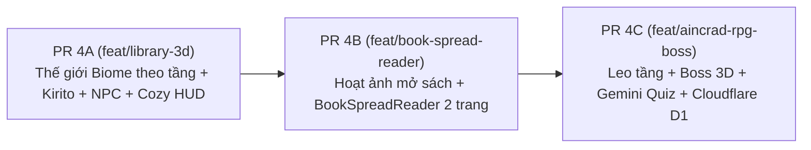

# Kế hoạch Phase 4 — Aincrad Reading Tower (`ofu.lol`)

> **Trạng thái:** **PR 4A (`feat/library-3d`)** đã merge vào `main` qua PR #5 và deploy lên `https://ofu.lol` (2026-11-21); đang thực hiện bản vá hậu kỳ `fix/post-4a-cleanup` trước khi bắt đầu **PR 4B (`feat/book-spread-reader`)**.
> **Quyết định nền tảng:** `D-008`, `D-009`, `D-010` (Hybrid nội bộ), `D-011`, `D-012`, `D-013` (ưu tiên độ đẹp máy cá nhân, giữ entry 2D/mobile `0 B three`), `D-014`, `D-015`, `D-016`, `D-017` (Mỗi tầng = 1 World Biome + Render tầng chủ động + NPC).
> **Bất biến:** Mọi file `<= 500` dòng hiệu dụng (`eslint` `max-lines`), **0 CDN bên thứ 3**, **0 byte `three`** trong entry `index-*.js` (`<= 86.04 kB gzip`), bản **2D trên `ofu.lol`** không bị phá vỡ, mọi `ObjectURL`/texture/geometry/audio đều `dispose()` sạch khi unmount.

---

## 1. Kiến trúc World & Lộ trình 3 PR

### Nguyên lý Build World (`D-017`)
- **Mỗi tầng không phải phòng sách đóng kín:** Mỗi tầng là một **khu vực thế giới mở/bán mở có chủ đề Biome riêng** kết nối với **Khu Thư viện (Quảng trường sách / Lầu đọc)**, **Khu nghỉ (Bàn đọc / Ghế công viên)** và **Đài Cổng Tầng** (nơi bước lên/chuyển sang tầng tiếp theo; ở PR 4C sẽ là nơi Boss trấn giữ).
- **Render tầng chủ động (`activeFloorIndex`):** Tại một thời điểm chỉ dựng & render thế giới của tầng đang đứng (chuyển tầng mượt qua Cổng Tầng / Cầu thang ánh sáng hoặc dịch chuyển nhanh từ Search/Chip). Nhờ đó mỗi tầng có bầu trời, ánh sáng, mặt nước, thực vật và khí hậu hoàn toàn riêng biệt mà vẫn nhẹ GPU.
- **4 Biome Preset chuẩn cho các tầng (tái sử dụng & biến tấu thông minh cho nhiều tầng):**
  1. **Tầng 1 — `town_of_beginnings` (Thị trấn Khởi Đầu):** Quảng trường lát đá cuội kiểu châu Âu/Aincrad, con đường dạo bộ hai hàng cây xanh, đèn đường cổ điển, đài phun nước trung tâm, dãy **lầu sách / tiệm sách mở** xếp dọc hai bên quảng trường, cổng vòm đá lớn cuối đường dẫn lên Tầng 2. *(Gần nhất với cảm giác dạo phố trong clip Threads).*
  2. **Tầng 2 — `sakura_shrine` (Rừng Anh Đào / Rừng Thu & Cầu Gỗ):** Đồi cỏ nhẹ, hồ nước phản chiếu mềm, cầu gỗ đỏ/sồi bắc qua hồ, cây anh đào/lá thu với cánh hoa rơi lơ lửng, đèn lồng đá & dãy giá sách dưới mái hiên gỗ kiểu đền thư viện.
  3. **Tầng 3 — `starfield_atrium` (Đại sảnh Kính Starfield):** Không gian thư viện trần kính vòm cao vút (lấy cảm hứng Starfield Library trong `library_sample/`), ánh nắng xuyên khung kính xuống tháp kệ cong nhiều tầng nhỏ + khu bàn đọc giữa sảnh + cầu thang kính.
  4. **Tầng 4+ — `starlight_ruins` (Hồ Đêm Sao & Phế tích Cổ Aincrad):** Sân đá cổ trên cao, cột đá vỡ có rêu/tinh thể phát sáng, bầu trời đêm đầy sao & tinh vân, đom đóm nhẹ quanh khu kệ sách và cổng dịch chuyển pha lê. *(Từ tầng 5 trở đi xoay vòng biến tấu bảng màu & bố cục từ 4 biome trên).*

### Lõi giữ nguyên 100% (cấm viết lại theo `docs/ARCHITECTURE.md` §6)
- Toàn bộ `src/lib/*`, `src/hooks/{useCanUse3D,useLibraryViewState,useTheme,useBookReader,useCoverUrl,useToast}.ts`, `src/components/Library3DHost.tsx`, 5 modal `z-40`, `ToastContainer z-50`.
- Tái sử dụng trực tiếp: `coverTextureCache.ts`, `geometryUtils.ts`, `BookInspectCard.tsx`, `InstancedBooksMesh.tsx` (mở rộng xoay theo hướng từng kệ trên tầng chủ động).
- Thay thế `CameraRig.tsx` và `LibraryRoomMesh.tsx` bằng hệ thống **World Biome theo tầng + Kirito + NPC + Cozy HUD**.

---

## 2. Chi tiết Chặng 1 — PR 4A (`feat/library-3d`)

### Sub-phase 4A-T1 — Mô hình Thế giới Tầng (`floorWorldLayout3d.ts` / `layout3d.ts`) & Vật lý Va chạm (`worldPhysics3d.ts`)
- **Mục tiêu:** Chia các kệ sách (`ShelfGroup`) vào từng tầng (`FloorWorldLayout3D`), bố trí toạ độ hợp lý trong mỗi Biome (quảng trường, đường dạo, hồ/cầu, khu kệ sách, bàn đọc, cổng tầng, đường tuần tra NPC) và xây hệ thống va chạm trượt tường/leo dốc cầu thang-bậc thềm mượt mà.
- **File tạo / sửa:**
  1. `src/components/library3d/floorWorldLayout3d.ts` *(file mới, `<= 450` dòng)* + giữ tương thích export trong `src/components/library3d/layout3d.ts` *(mỗi file `<= 500` dòng hiệu dụng)*:
     - Gán các `ShelfGroup` vào `FloorWorldLayout3D[]` (tối đa ~4–6 kệ/tầng; kệ rất dài tự chia cụm gọn quanh quảng trường/hành lang của tầng đó).
     - Gán `biomeId` (`town_of_beginnings`, `sakura_shrine`, `starfield_atrium`, `starlight_ruins`) cho mỗi tầng.
     - Sinh toạ độ kiến trúc & đạo cụ: `walkableZones` / `stairRamps` (bậc thềm lên đài cổng, cầu gỗ vồng qua hồ), `bookcaseSlots` (góc xoay bất kỳ `facingYaw`), `stations` (`Bàn đọc`, `Bục Thủ thư`, `Trạm tìm kiếm`, `Cổng chuyển tầng lên/xuống`), `npcWaypoints` (tuyến đi dạo & ghế ngồi đọc cho NPC).
     - Cập nhật `getVisibleShelfWindow` và `selectFeaturedCoverSlots` lọc theo **`activeFloorIndex`** + khoảng cách 2D `(x, z)` tới Kirito.
  2. `src/components/library3d/worldPhysics3d.ts` *(file mới, `<= 320` dòng)*:
     - Collider hộp/trụ cho tường bao rìa đảo/phố, kệ sách, cột, đài phun nước, lan can cầu/hồ (không rơi xuống nước), bục cổng tầng.
     - Hàm thuần `resolveWorldPlayerStep(...)`: trượt tường theo từng trục, kẹp biên map, tính `resolveSurfaceY(x, z)` mượt qua bậc thềm, cầu vồng và sàn đài cổng; kèm `resolveCameraOrbitPosition(...)` chống camera xuyên vào tường/kệ.
- **Rủi ro & giảm thiểu:**
  - *Bị kẹt ở miệng cầu gỗ hoặc bậc đá lên Đài Cổng:* viết test Node kiểm tra liên tục dọc tuyến đi bộ từ quảng trường → qua cầu/bậc → tới Cổng chuyển tầng không bị sụt `Y` hay kẹt collider.
- **Hoàn tác:** `git revert <commit-4A-T1>`.

### Sub-phase 4A-T2 — Dựng 4 World Biomes, Texture Hybrid & Không khí Sống động (`WorldBiomeMesh.tsx`, `proceduralMaterials.ts`, `InstancedBooksMesh.tsx`)
- **Mục tiêu:** Xây khung thế giới giàu chi tiết cho cả 4 biome (đường đá, thảm cỏ, mặt nước, cầu gỗ, cây cối, đèn đường/đèn lồng, mái vòm kính, cổng dịch chuyển phát sáng) đồng bộ với chu kỳ **Ngày / Chiều / Đêm** và thời tiết nhẹ.
- **File tạo / sửa:**
  1. `src/components/library3d/proceduralMaterials.ts` *(giữ `<= 500` dòng hiệu dụng, tách helper nếu vượt)*:
     - Bổ sung texture/vật liệu cho thế giới: lát đá cuội, cỏ/đất, gỗ sồi/gỗ trầm, nước gợn nhẹ, kính vòm, bầu trời/gradient vòm trời (`SkyDome`) đổi mượt theo 3 chế độ `light` (Ban ngày nắng ấm), `dim` (Hoàng hôn chiều tối), `midnight` (Đêm khuya đầy sao + đèn đường/đèn lồng tự bật sáng!).
  2. `src/components/library3d/WorldBiomeMesh.tsx` *(file mới thay `LibraryRoomMesh.tsx`, `<= 480` dòng)* + `src/components/library3d/BiomePropsMesh.tsx` *(file mới `<= 350` dòng cho cây, đèn đường, cầu, ghế đá, cổng tầng, hạt lá/hoa anh đào/đom đóm/mưa nhẹ)*:
     - Render đúng biome của `activeFloorIndex`, kèm cổng nạp asset `.glb` tối ưu đặt trong `public/models/` (nén từ `glb/` gốc bằng **WebP 1024 + Simplify + Quantize/Meshopt local** — nạp `meshopt_decoder.module.js` trực tiếp từ `three`, tuyệt đối không để `useGLTF`/Draco gọi CDN `gstatic.com`; kiểm tra lại mesh/UV trước khi đưa vào `public/models/`).
     - Gắn biển tên kệ Canvas2D lên từng tủ kệ.
  3. `src/components/library3d/InstancedBooksMesh.tsx` *(giữ `<= 500` dòng hiệu dụng)*:
     - Chỉ render các `BookSlot3D` thuộc `activeFloorIndex` hiện tại với đúng `facingYaw` và hướng rút sách.
- **Rủi ro & giảm thiểu:**
  - *Chuyển tầng bị khựng khung hình khi tạo lại geometry:* tách geometry dùng chung (kệ, sách) giữ nguyên giữa các tầng, chỉ tái dựng phần prop đặc trưng của biome khi `activeFloorIndex` thay đổi kèm hiệu ứng mờ chuyển cảnh 250ms.
- **Hoàn tác:** `git revert <commit-4A-T2>`.

### Sub-phase 4A-T3 — Nhân vật Kirito 3D (`KiritoAvatar.tsx`), NPC Thế giới (`AmbientNpcs.tsx`) & Điều khiển (`PlayerRig.tsx`)
- **Mục tiêu:** Đưa nhân vật **Black Swordsman (Kirito)** đúng ảnh mẫu cùng các **NPC Thủ thư / Người đọc** vào thế giới, giữ thao tác đi dạo + xoay camera mượt mà.
- **File tạo / sửa:**
  1. `src/components/library3d/KiritoAvatar.tsx` *(file mới, `<= 380` dòng)* + `CustomGlbAvatar.tsx` *(tùy chọn nạp `/models/player.glb` hoặc `.vrm` nếu có)*:
     - Dựng chi tiết theo ảnh mẫu bạn gửi: tóc đen mái nhọn phân lớp, khuôn mặt anime Canvas2D sắc nét, áo khoác dài cổ cao viền bạc + 2 tà áo sau vung theo tốc độ, dây đeo chéo ngực kèm khoá 3 chấu, huy hiệu vai trái, thắt lưng khoá kim loại, găng hở ngón, bốt cổ xám và **kiếm đen đeo chéo sau lưng**.
     - Animation: `idle`, `walk`, `run` (hơi chồm người về trước kiểu anime), `interact` (chạm/rút sách). Ẩn khi `firstPerson === true`.
  2. `src/components/library3d/AmbientNpcs.tsx` *(file mới, `<= 280` dòng)*:
     - Tạo 3–5 NPC stylized mỗi tầng (Thủ thư áo choàng đứng gần Bục Thủ thư / Cổng tầng, 2–3 người đọc đi dạo chậm dọc quảng trường hoặc ngồi đọc sách ở ghế công viên/bàn đọc).
     - Đứng gần NPC nhấn `[E]` hoặc click để hiện câu thoại ngắn ấm áp (gợi ý sách đang đọc dở hoặc giới thiệu tầng hiện tại).
  3. `src/components/library3d/PlayerRig.tsx` *(file mới thay `CameraRig.tsx`, `<= 350` dòng)*:
     - `WASD` / mũi tên, `Shift` chạy nhanh, kéo chuột xoay 360° (ngưỡng `5px` tách drag/click), lăn zoom, `V` chuyển Thứ 3 ↔ Thứ 1.
     - Tự kích hoạt nhịp animation nhẹ cho NPC/lá rơi/cổng sáng khi người dùng đang chơi (`active`), nhưng **ngay lập tức về `0 FPS`** khi mở sách, mở modal, chuyển sang 2D hoặc ẩn tab (`paused` / `hidden`)!
- **Rủi ro & giảm thiểu:**
  - *Xung đột giữa `frameloop="demand"` và NPC/hoa rơi chuyển động liên tục:* dùng chế độ thông minh — khi cửa sổ active và không mở modal/đọc sách thì giữ nhịp `requestAnimationFrame` mượt cho thế giới sống động (hoặc tuỳ chọn "Tiết kiệm pin: chỉ render khi di chuyển"); khi mở trình đọc/modal/ẩn tab/chuyển 2D thì đóng băng hoàn toàn `0 FPS`.
- **Hoàn tác:** `git revert <commit-4A-T3>`.

### Sub-phase 4A-T4 — Cozy Game HUD (`CozyGameHud.tsx`), Âm thanh (`ambientAudio.ts`) & Trạm tương tác (`InteractiveStations.tsx`)
- **Mục tiêu:** Giao diện phủ kiểu Cozy RPG giống demo Threads (minimap, HP/Mana/XP, đồng hồ/thời tiết, nhiệm vụ) nhưng gọn thoáng, bấm đọc sách tối đa `<= 2` click.
- **File tạo / sửa:**
  1. `src/components/library3d/MinimapWidget.tsx` *(file mới, `<= 180` dòng)*:
     - Minimap tròn góc trên-trái: vẽ bản đồ tầng hiện tại (đường phố/hồ/cầu, các kệ sách, cổng lên/xuống tầng, chấm vị trí Kirito + hướng nhìn, chấm NPC).
  2. `src/components/library3d/CozyGameHud.tsx` & `src/components/library3d/Library3DOverlay.tsx` *(mỗi file `<= 460` dòng)*:
     - Góc trên-trái: Minimap + Tên Tầng & Biome + đồng hồ ngày-đêm/thời tiết + thanh **HP / Mana / XP** (PR 4A tính XP nền từ tổng tiến độ đọc hiện có; PR 4C đồng bộ D1) + bảng **Nhiệm vụ đọc** thu gọn được.
     - Thanh công cụ trên: Tìm kiếm không dấu (nhảy thẳng tới đúng tầng & kệ của cuốn sách), danh sách **Tầng / Kệ**, công tắc Thứ 3/Thứ 1 (`V`), nút **Âm thanh** (bật/tắt), nút chuyển `2D / 3D` (`D-008`), chọn nhiều & ngăn "Tiếp tục đọc".
     - Góc dưới-phải: `BookInspectCard.tsx` mở sách ngay (`ReaderView` ở PR 4A).
  3. `src/components/library3d/ambientAudio.ts` *(file mới, `<= 180` dòng)*:
     - Web Audio API tạo âm thanh môi trường thư viện & thiên nhiên nhẹ (gió/mưa đêm/tiếng chim sáng + tiếng bước chân/lật trang), bật theo thao tác người dùng và `AudioContext.close()` khi unmount.
  4. `src/components/library3d/InteractiveStations.tsx` *(file mới, `<= 200` dòng)* + nối `LibraryCanvas.tsx` & `FantasyLibrary3D.tsx`:
     - Hỗ trợ `[E]` hoặc click cho: Bàn đọc ("Tiếp tục đọc"), Bục Thủ thư (Tải sách), Trụ Thời tiết/Đèn (đổi Ban ngày/Chiều tối/Đêm/Mưa), Cổng Tầng Lên/Xuống (chuyển `activeFloorIndex`), và NPC quanh tầng.
- **Rủi ro & giảm thiểu:**
  - *HUD chiếm chỗ trên màn hình laptop 13–14 inch:* gom nhóm gọn vào các góc `<= z-20`, cho phép thu gọn bảng nhiệm vụ và giữ toàn bộ vùng giữa `pointer-events-none`.
- **Hoàn tác:** `git revert <commit-4A-T4>`.

### Sub-phase 4A-T5 — Kiểm thử PR 4A, Kiểm định `max-lines` & Merge vào `main`
- Chạy `npm run typecheck`, `npm run lint` (mọi file `<= 500` dòng hiệu dụng), `npm run build` (xác nhận `index-*.js <= 86.04 kB gzip` và **0 byte `three`** trong entry).
- Chạy checklist kiểm thử trình duyệt (Mục 4 bên dưới).
- Cập nhật `docs/ARCHITECTURE.md` & `HANDOFF.md` → mở **PR 4A → `main`**, CI xanh mới merge.

---

## 3. Lộ trình tiếp nối (sẽ viết plan chi tiết trước khi code từng PR)

### Chặng 2 — PR 4B (`feat/book-spread-reader`, tách từ `main` sau PR 4A)
- Hoạt ảnh 3D rút & mở bìa sách từ kệ / bàn đọc.
- Trình đọc `BookSpreadReader` 2 cột CSS Multi-column (`D-011`, `D-012`) cho `EPUB` & `DOCX` nổi trên nền Thế giới 3D làm mờ + dừng render (`0 FPS`), kèm tiếng lật trang nhẹ. `PDF` giữ nguyên mở bằng `ReaderView` / `PdfReader`.

### Chặng 3 — PR 4C (`feat/aincrad-rpg-boss`, tách từ `main` sau PR 4B)
- **Cloudflare D1 (`workers/r2-storage/schema.sql`):** thêm các bảng gọn nhẹ `tower_floors`, `rpg_profile` (`level`, `xp`, `hp`, `mana`, `unlocked_floor`), `floor_quizzes`, `quests`.
- **Cloudflare Worker (`workers/r2-storage/src/`):**
  - API đồng bộ cấu hình tầng, tiến độ RPG, cộng XP khi đọc xong chương/sách.
  - Endpoint `POST /api/floors/:floorId/quiz/generate`: nhận đoạn trích ngắn từ các chương vừa đọc ở frontend, gọi **Gemini API** thông qua secret **`GEMINI_API_KEY`** (`wrangler secret put GEMINI_API_KEY`) để sinh bộ câu hỏi trắc nghiệm chuẩn JSON và **cache vào bảng `floor_quizzes` của D1** (hỗ trợ sửa/import JSON offline).
- **Boss 3D tại Đài Cổng Tầng & Quiz RPG Encounter:**
  - Tại Đài Cổng cuối mỗi tầng xuất hiện **Hộ vệ / Boss 3D**; đủ điều kiện đọc tầng → vào trận đấu câu hỏi (đúng trừ máu Boss, sai mất HP/Mana) → hạ Boss mở phong ấn lên tầng tiếp theo + nhận huy hiệu/vật phẩm trang trí tầng.
  - Luôn giữ lối đọc tự do qua Search / chế độ 2D (`<= 2` click).

---

## 4. Checklist Kiểm thử PR 4A (bắt buộc trước khi merge `main`)
- [x] 1. `npm run typecheck`, `npm run lint` (**0 lỗi, 0 cảnh báo `max-lines`**), `npm run build` (**0 B `three` trong `index-*.js`**, `84.77 kB gzip <= 86.04 kB`, **0 CDN**), Worker `npx tsc --noEmit` XANH, toàn bộ 28 `.glb` cục bộ giải mã sạch `0` lỗi UV/normal.
- [x] 2. Mobile / DevTools `< 1024px` (`390×844`): **0** chunk `FantasyLibrary3D`/`three` được tải, chế độ 2D (`Trang chủ` ↔ `Thư viện`) hoạt động nguyên vẹn, `0` lỗi console.
- [x] 3. Desktop `>= 1024px` (`1280×800`):
   - Tầng 1–4 Biome, Kirito Mixamo, 5 NPC anime (`Asuna` đi dạo), 12 nội thất PBR `.glb`, Phòng Boss kép (`boss-arena.glb` Tầng 1–3 & Đấu trường Đảo Bay `boss-battlefield.glb` + Stormterror bay vỗ 6 cánh Tầng 4).
   - Minimap tự co giãn, Cozy HUD (`LV/HP/MP/XP` + mục tiêu Boss thu gọn), Dropdown 10–100+ tầng nền đặc rõ nét, tìm sách xuyên tầng, bật/tắt âm thanh môi trường Web Audio nội bộ, đổi `Thứ 3 / Thứ 1 (V)`, vòng sáng rune trạm tương tác 3D.
   - Kiểm định vật lý đi bộ/cầu thang/cầu vồng/đảo bay/camera anti-clipping/500 cuốn & 100 tầng PASS 100%, `0` lỗi console.
- [x] 4. Khi mở đọc sách / mở modal / chuyển tab / chuyển về `2D`: cảnh 3D dừng `0 FPS`, `3D → 2D` unmount sạch (`0` canvas WebGL còn sót, giải phóng `CoverTextureCache`, `clearLocalGlbCache()`, `AudioContext.close()`).
